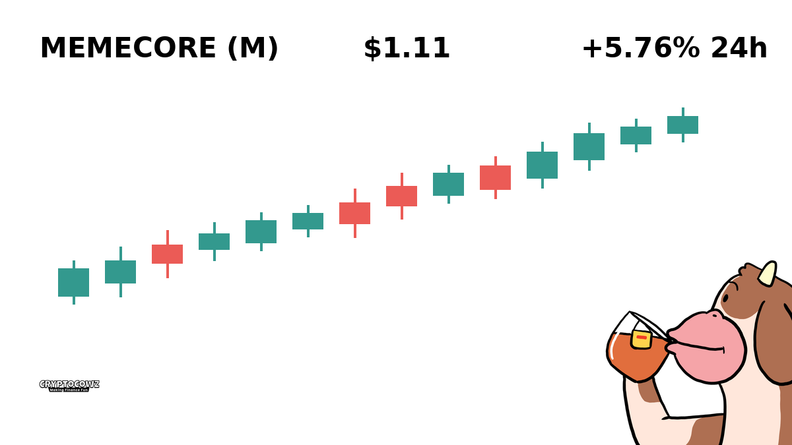
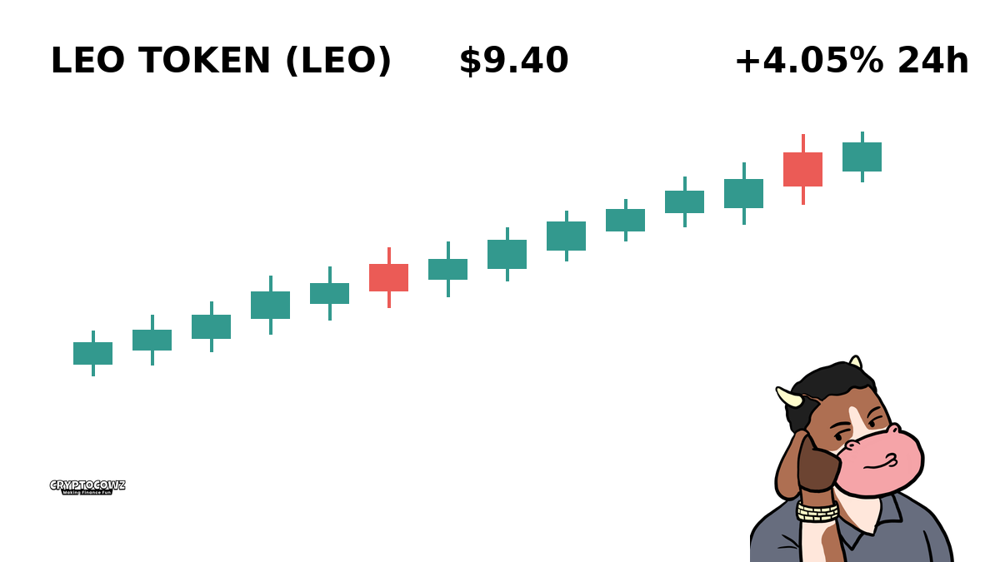
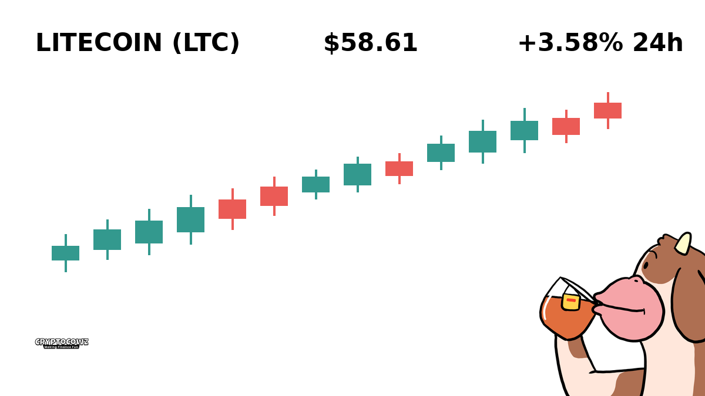
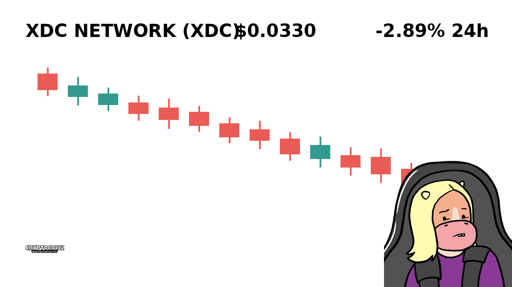
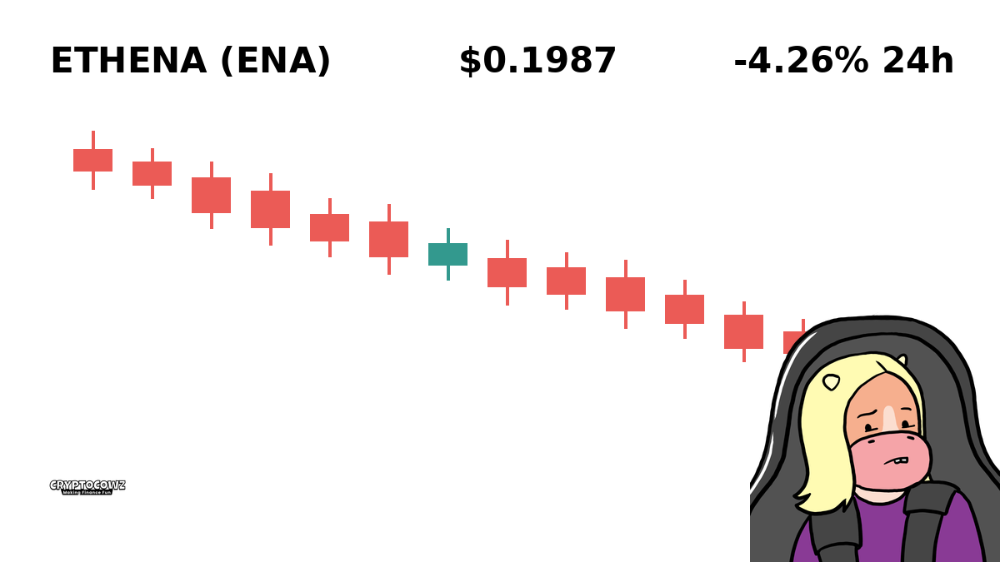
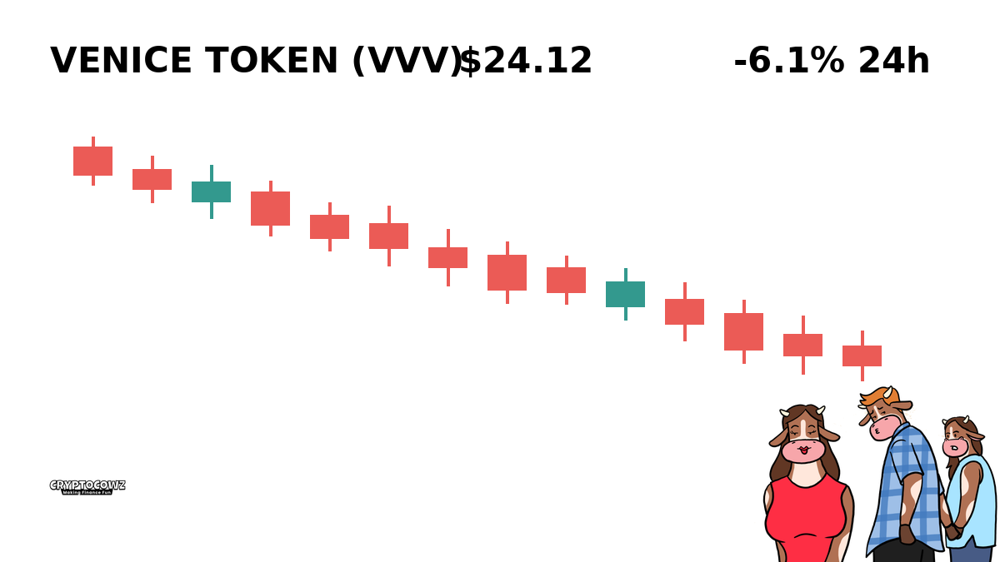

# Daily Top Movers: CMC Community Visuals & Posts

## 1. Bitway ($BTW) — +12.78% (PUMP)
**Cast Member:** Skip Zinfandel
**CMC Comment:** Bitway is pumping so hard I just remortgaged my barn to buy more before we hit the stratosphere! We are all gonna make it, moon cows!

---

## 2. Pepe ($PEPE) — +10.26% (PUMP)
**Cast Member:** Frank Rizzo
**CMC Comment:** A green frog making green money, listen to me, if you ain't buying PEPE right now you're an absolute clown.

---

## 3. MemeCore ($M) — +5.76% (PUMP)
**Cast Member:** Sunshine Innocent Nimbus
**CMC Comment:** The universe is aligning through MemeCore's divine green candle, sending love and generational wealth to all our pasture friends!

---

## 4. LEO Token ($LEO) — +4.05% (PUMP)
**Cast Member:** Professor Hartmut
**CMC Comment:** Statistically speaking, a 4 percent increase in LEO token signifies a temporary localized anomaly in market greed index parameters.

---

## 5. Litecoin ($LTC) — +3.58% (PUMP)
**Cast Member:** Skip Zinfandel
**CMC Comment:** Digital silver is back, baby! I've already picked out the color of my second yacht!

---

## 6. XDC Network ($XDC) — -2.89% (DUMP)
**Cast Member:** Frank Rizzo
**CMC Comment:** XDC is dropping faster than my patience with these weak-handed paper-cut bagholders. Unbelievable.

---

## 7. Injective ($INJ) — -3.02% (DUMP)
**Cast Member:** Professor Hartmut
**CMC Comment:** The current structural collapse of Injective perfectly illustrates the entropy inherent to speculative liquidity pools.

---

## 8. Lighter ($LIT) — -3.92% (DUMP)
**Cast Member:** Sunshine Innocent Nimbus
**CMC Comment:** Lighter token is burning down our portfolio dreams, but remember that out of the ashes comes spiritual growth and cheaper entry points.

---

## 9. Ethena ($ENA) — -4.26% (DUMP)
**Cast Member:** Frank Rizzo
**CMC Comment:** Down over 4 percent in a day? I'm callin' my cousin Tony to figure out who turned off the buy button on ENA.

---

## 10. Venice Token ($VVV) — -6.1% (DUMP)
**Cast Member:** Skip Zinfandel
**CMC Comment:** Venice Token is sinking faster than the actual city of Venice, and my wife's lawyer is already drafting the divorce papers!

---
