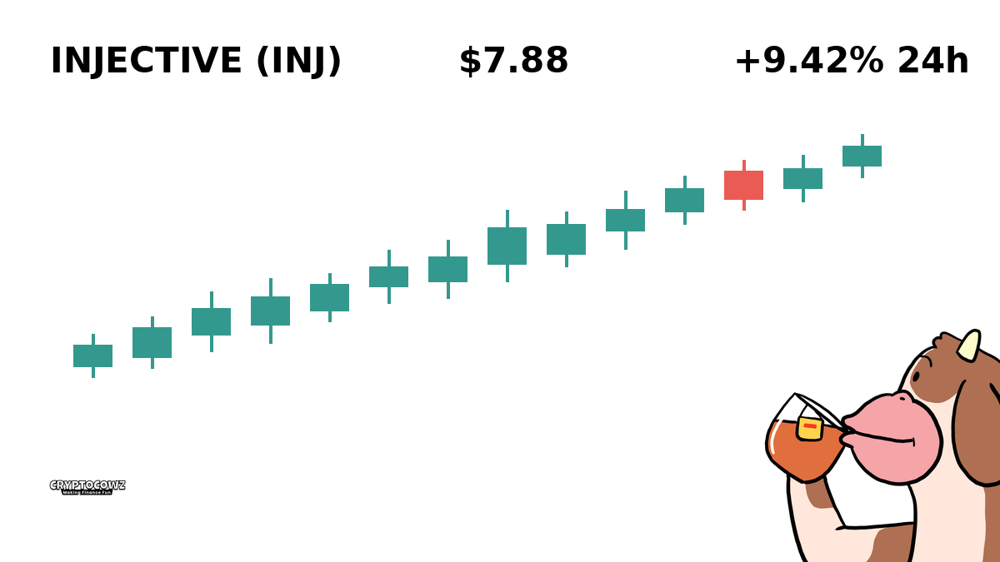
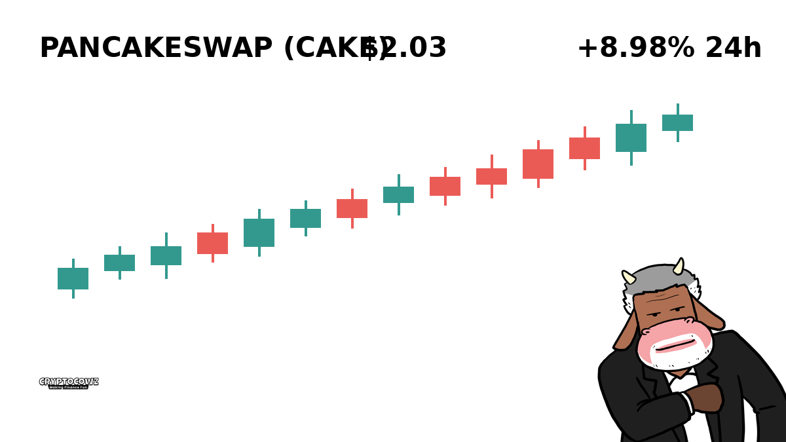
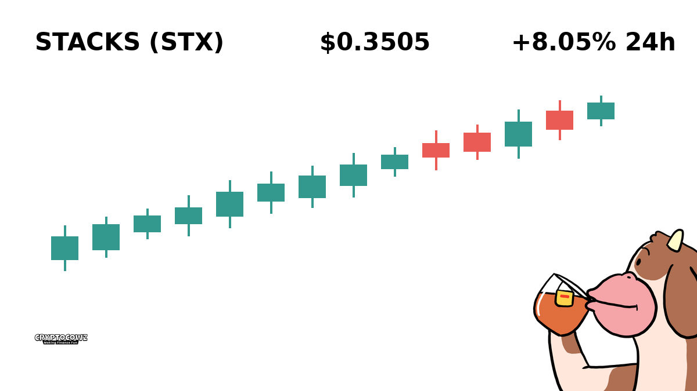
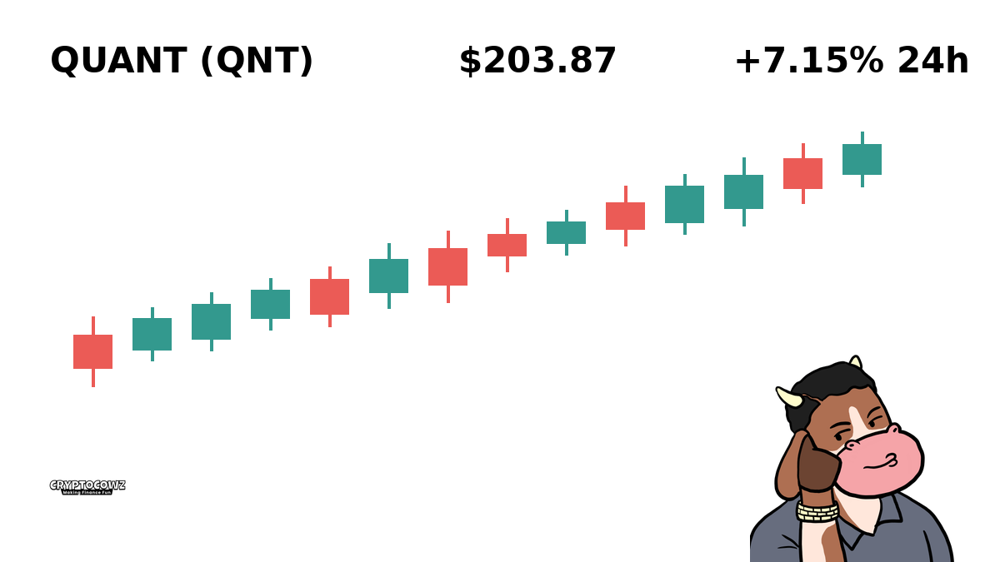
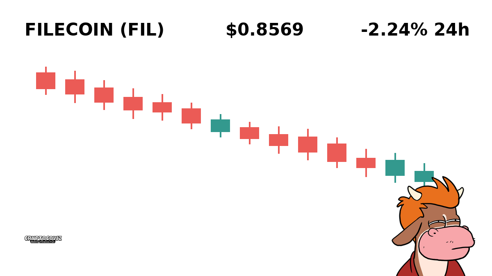
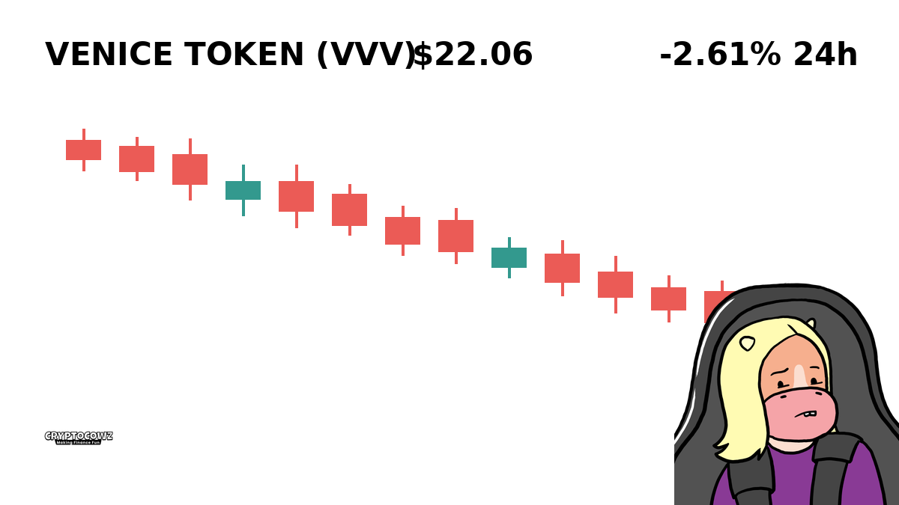
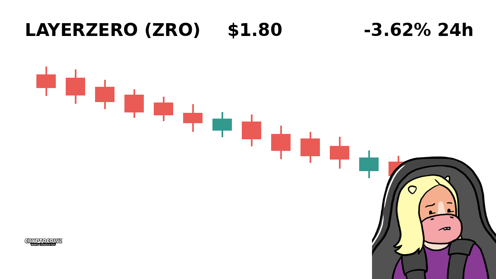
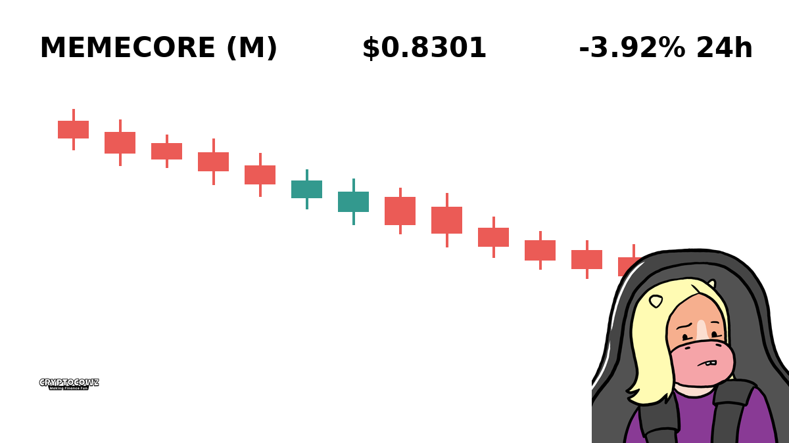
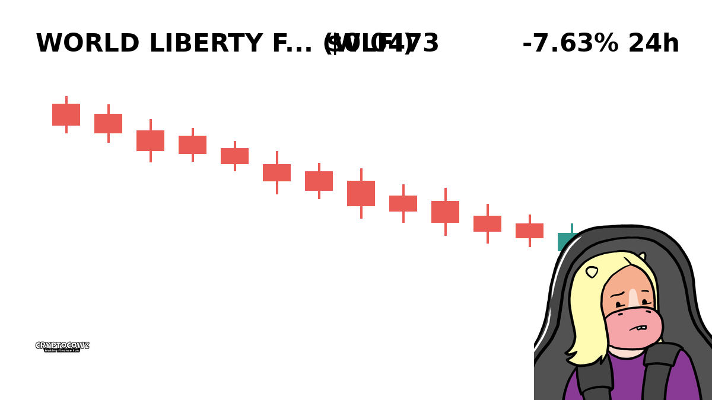

# Daily Top Movers: CMC Community Visuals & Posts

## 1. Injective ($INJ) — +9.42% (PUMP)
**Cast Member:** Skip Zinfandel
**CMC Comment:** Just refinanced my barn to market-buy INJ at the local peak because risk management is for poor people. See you on Mars, exit liquidity!

---

## 2. PancakeSwap ($CAKE) — +8.98% (PUMP)
**Cast Member:** Sunshine Innocent Nimbus
**CMC Comment:** I am flipping sweet syrup-covered yield until my wallet explodes with pure joy! Who needs real calories when digital pastries send you straight to the stratosphere?

---

## 3. Stacks ($STX) — +8.05% (PUMP)
**Cast Member:** Frank Rizzo
**CMC Comment:** Look here pal, STX is pumping and I already told my wife's divorce lawyer we're settled in green candles. Don't you dare touch my 50x leverage!

---

## 4. Bitway ($BTW) — +7.23% (PUMP)
**Cast Member:** Professor Hartmut
**CMC Comment:** Mathematically speaking, this parabolic trajectory of Bitway represents pure irrational euphoria. Yet my quantitative algorithms insist we hold until cosmic heat death.

---

## 5. Quant ($QNT) — +7.15% (PUMP)
**Cast Member:** Skip Zinfandel
**CMC Comment:** Interoperability is just a fancy word for buying another yacht. Up seven percent means champagne for breakfast and zero questions asked!

---

## 6. Filecoin ($FIL) — -2.24% (DUMP)
**Cast Member:** Frank Rizzo
**CMC Comment:** You're telling me decentralized storage can't even store the value of my original investment? What a complete dump job, get out of here!

---

## 7. Venice Token ($VVV) — -2.61% (DUMP)
**Cast Member:** Sunshine Innocent Nimbus
**CMC Comment:** The gondolas in Venice are sinking so softly today, but true love and dedicated bagholding endure forever under the red sky.

---

## 8. LayerZero ($ZRO) — -3.62% (DUMP)
**Cast Member:** Professor Hartmut
**CMC Comment:** LayerZero seems to be living up to its numerical suffix as portfolio capital vanishes seamlessly into a quantum void of negative returns.

---

## 9. MemeCore ($M) — -3.92% (DUMP)
**Cast Member:** Skip Zinfandel
**CMC Comment:** MemeCore is dumping faster than my third marriage, but real alpha male traders just average down until complete financial ruin.

---

## 10. World Liberty Financial ($WLFI) — -7.63% (DUMP)
**Cast Member:** Frank Rizzo
**CMC Comment:** World Liberty Financial? More like World Liberty Free-Fall! My cousin's neighborhood bookie runs tighter risk management than this chart.

---
