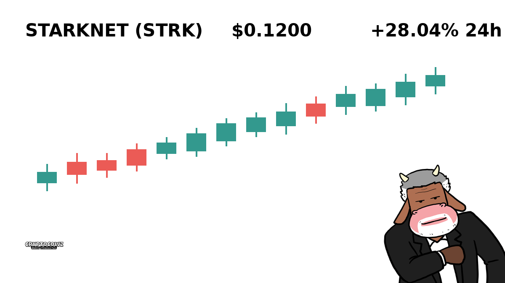
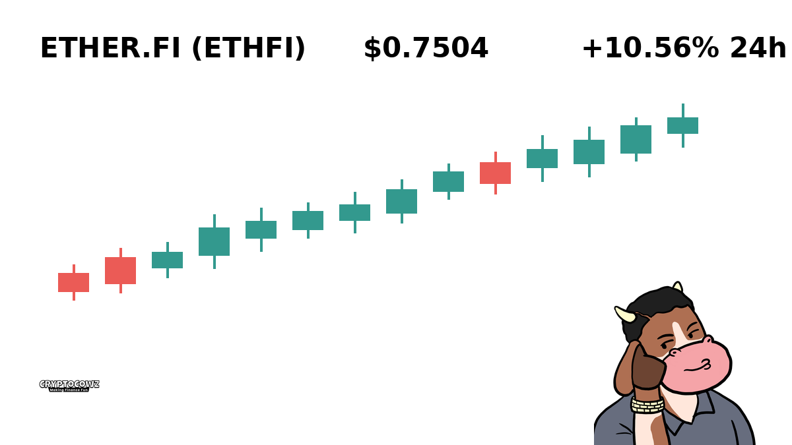
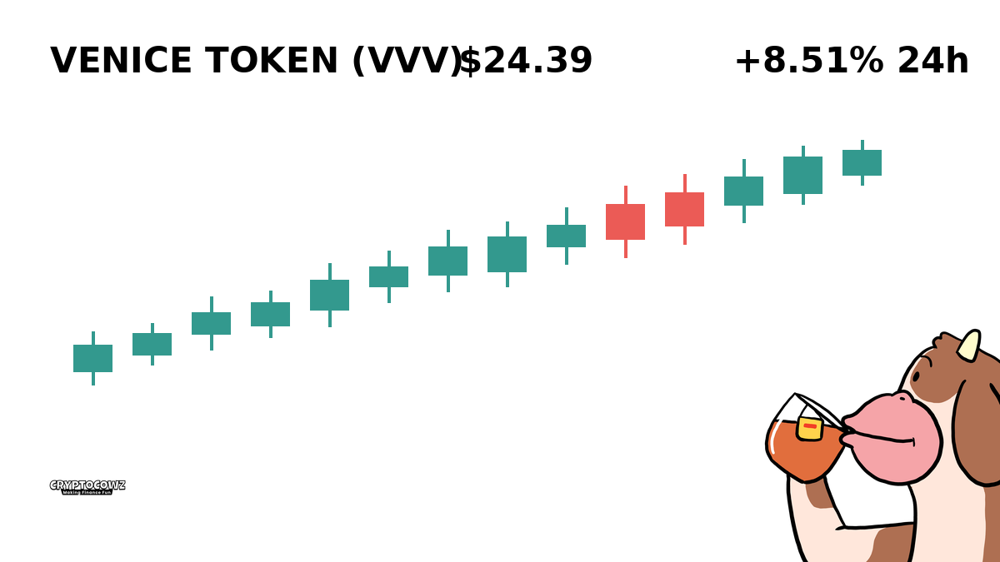
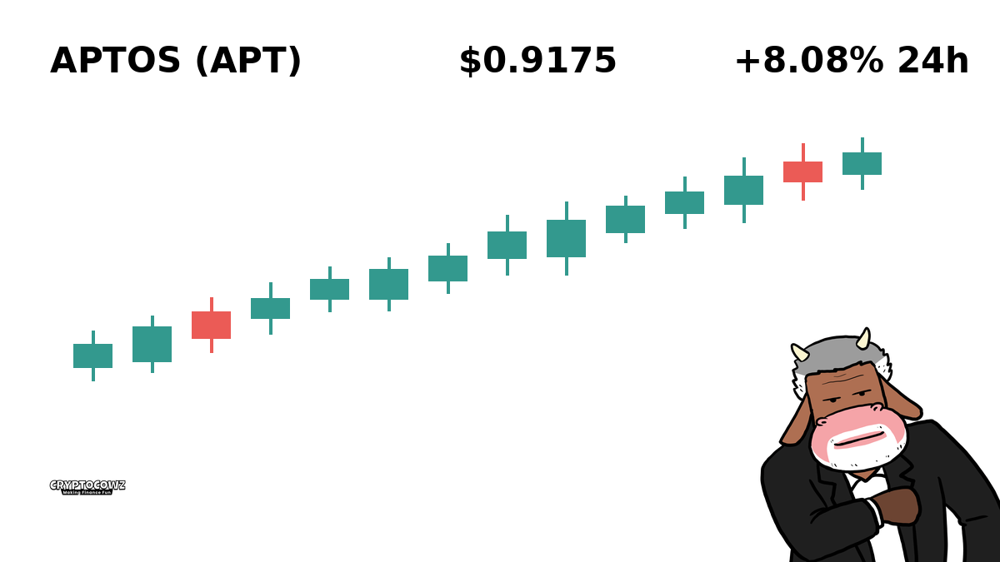
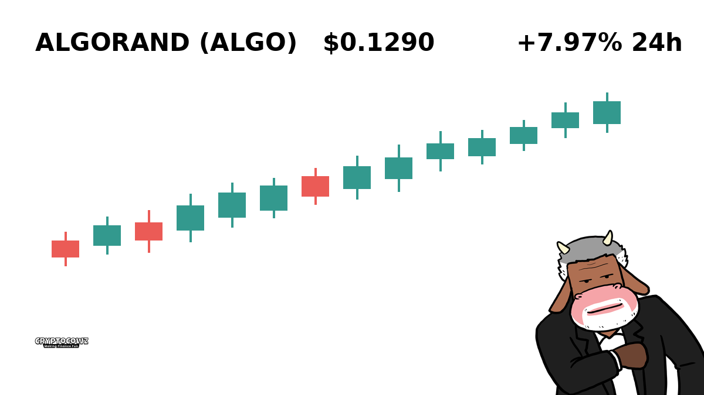
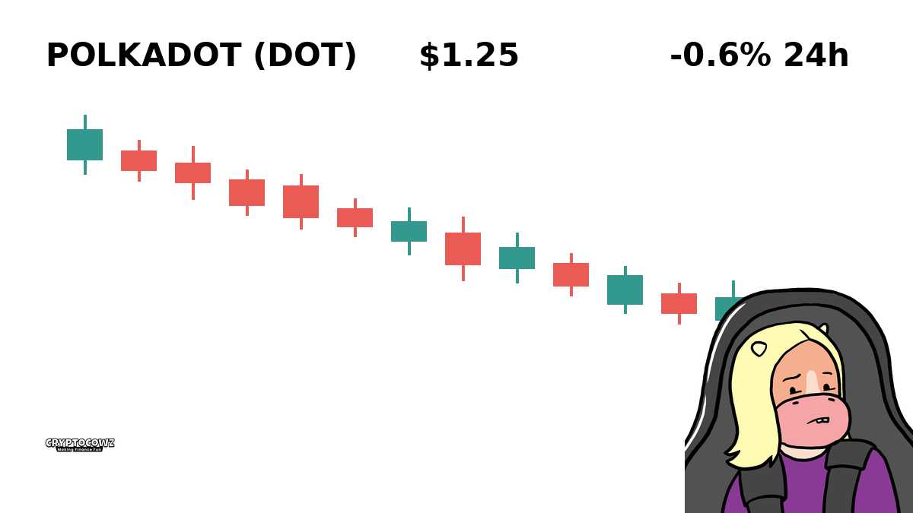
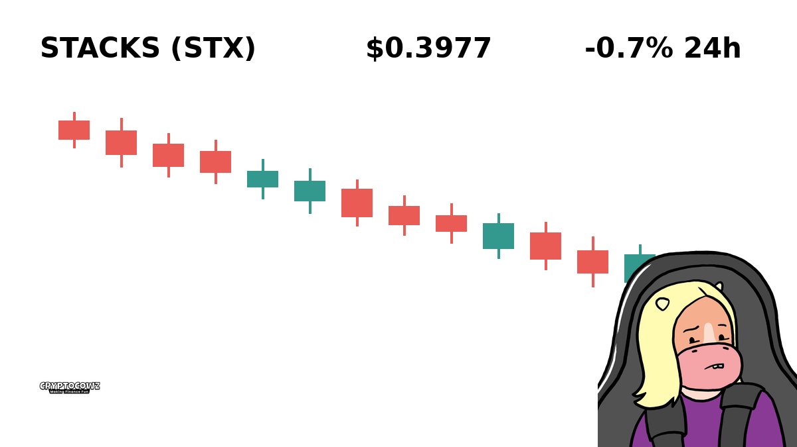
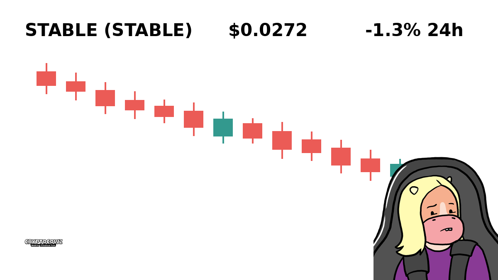
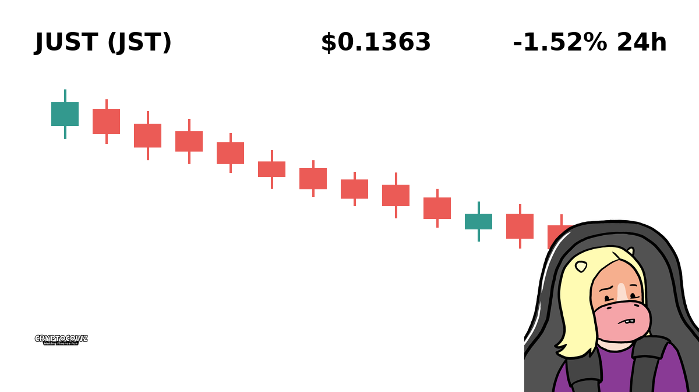

# Daily Top Movers: CMC Community Visuals & Posts

## 1. Starknet ($STRK) — +28.04% (PUMP)
**Cast Member:** Skip Zinfandel
**CMC Comment:** Up 28 percent today, which means I have already placed a deposit on a third cyber-yacht. Who needs basic financial literacy when Layer 2 pays for my lifestyle?

---

## 2. Ether.fi ($ETHFI) — +10.56% (PUMP)
**Cast Member:** Sunshine Innocent Nimbus
**CMC Comment:** The universe is aligning and restaking is healing my financial chakras! Up 10 percent today, we are all going to ascend straight to the moon together!

---

## 3. Venice Token ($VVV) — +8.51% (PUMP)
**Cast Member:** Frank Rizzo
**CMC Comment:** Venice is pumping, pal! I do not know what gondolas have to do with crypto, but my nephew says we are buying a canal by Tuesday!

---

## 4. Aptos ($APT) — +8.08% (PUMP)
**Cast Member:** Professor Hartmut
**CMC Comment:** Mathematically speaking, an eight percent green candle triggers an immediate neurochemical surge of unearned confidence in retail participants.

---

## 5. Algorand ($ALGO) — +7.97% (PUMP)
**Cast Member:** Skip Zinfandel
**CMC Comment:** Algorand is moving up! Time to update my social profile to Visionary Tech Architect before the chart remembers gravity exists.

---

## 6. Polkadot ($DOT) — -0.6% (DUMP)
**Cast Member:** Frank Rizzo
**CMC Comment:** Down less than one percent and people are screaming in the telegram like the sky is falling. Take a cold shower and hold the bag!

---

## 7. Stacks ($STX) — -0.7% (DUMP)
**Cast Member:** Professor Hartmut
**CMC Comment:** The slight contraction in valuation proves that stacking smart contracts on top of Bitcoin merely stacks the underlying existential dread.

---

## 8. ​​Stable ($STABLE) — -1.3% (DUMP)
**Cast Member:** Sunshine Innocent Nimbus
**CMC Comment:** Oh dear, even a token called Stable is losing its delicate balance! Sending pure light and calm energy to everyone whose portfolio is wobbling today.

---

## 9. JUST ($JST) — -1.52% (DUMP)
**Cast Member:** Skip Zinfandel
**CMC Comment:** It is JUST a tiny dip, folks, which is precisely what I told my landlord right before blocking his number!

---

## 10. MemeCore ($M) — -5.06% (DUMP)
**Cast Member:** Frank Rizzo
**CMC Comment:** Down five percent on a coin called MemeCore? What did you expect, a dividend payout? Forget about it!

---
