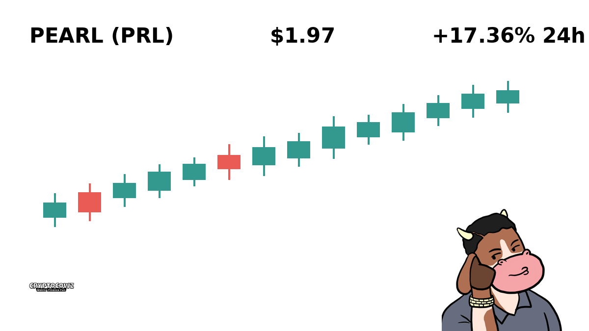
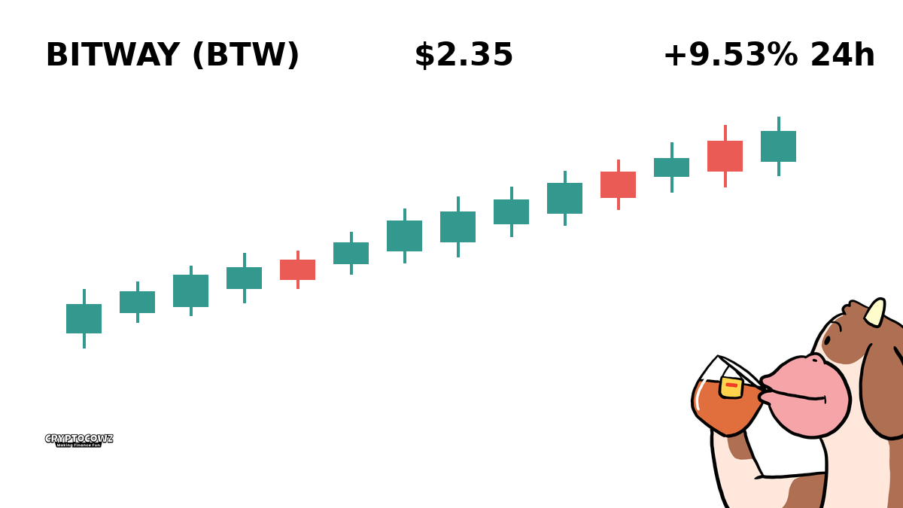
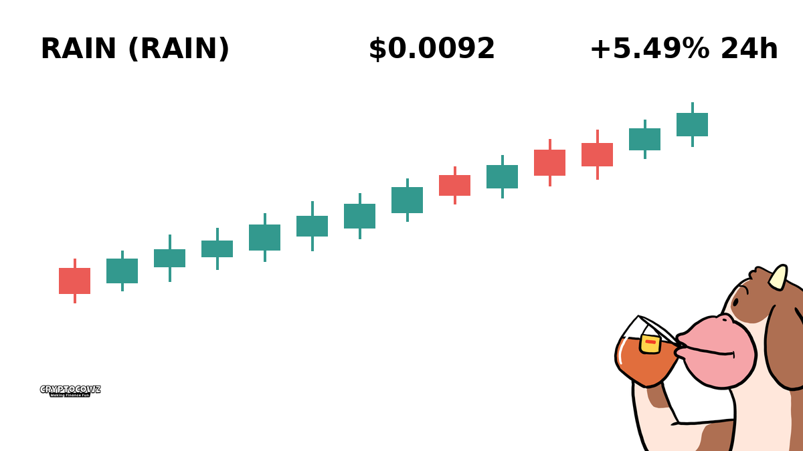
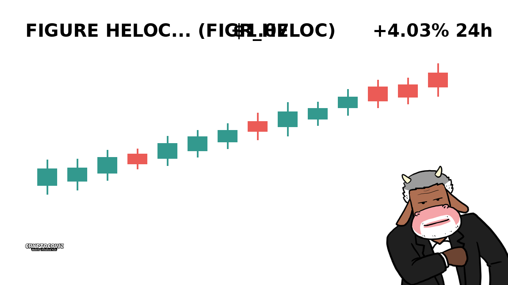
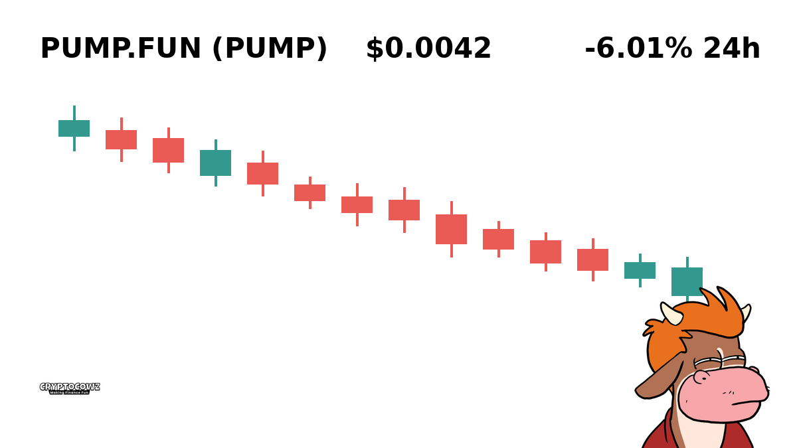
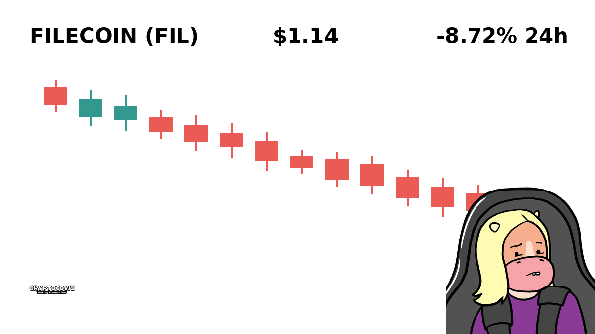
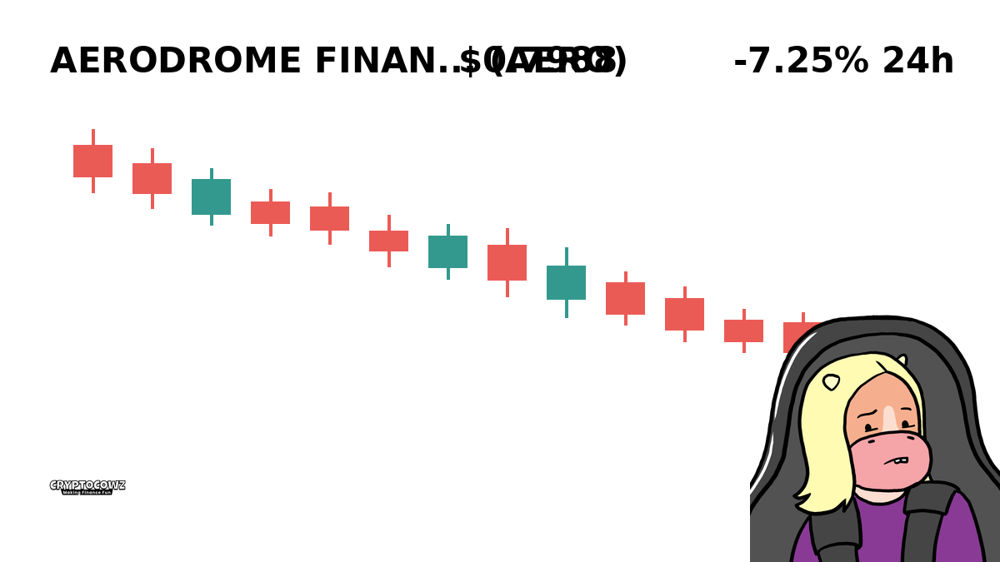

# Daily Top Movers: CMC Community Visuals & Posts

## 1. Pearl ($PRL) — +17.36% (PUMP)
**Cast Member:** Skip Zinfandel
**CMC Comment:** Pearl is up 17% today, proving once again that clutching shiny digital stones is a legitimate wealth management strategy. Time to order the gold-plated pasture gates!

---

## 2. Bitway ($BTW) — +9.53% (PUMP)
**Cast Member:** Frank Rizzo
**CMC Comment:** Bitway gaining nearly 10% because somebody accidentally hit buy instead of selling off their kids college fund. We take those wins on the block, baby.

---

## 3. Monero ($XMR) — +6.78% (PUMP)
**Cast Member:** Professor Hartmut
**CMC Comment:** Monero's upward trajectory correlates precisely with tax season anxiety starting early. My algorithmic models confirm untraceable gains feel mathematically superior.

---

## 4. Rain ($RAIN) — +5.49% (PUMP)
**Cast Member:** Sunshine Innocent Nimbus
**CMC Comment:** It is raining green candles everywhere, and my spiritual aura is glowing with pure financial dominance! Blessed be the pumpers making it storm cash!

---

## 5. Figure Heloc ($FIGR_HELOC) — +4.03% (PUMP)
**Cast Member:** Skip Zinfandel
**CMC Comment:** Leveraging a home equity line token to buy more crypto is peak galaxy-brain finance. See you all on the mega-yacht or sleeping under the bridge!

---

## 6. Lighter ($LIT) — -5.82% (DUMP)
**Cast Member:** Frank Rizzo
**CMC Comment:** Lighter is getting snuffed out today down almost 6%. My wallet is feeling distinctly unlit, but at least I still have my dignity and a cardboard box.

---

## 7. Pump.fun ($PUMP) — -6.01% (DUMP)
**Cast Member:** Professor Hartmut
**CMC Comment:** The irony of Pump.fun dumping over 6% is an exquisite lesson in nominative anti-determinism. Science proves fun is strictly inversely proportional to your portfolio value.

---

## 8. Filecoin ($FIL) — -6.43% (DUMP)
**Cast Member:** Skip Zinfandel
**CMC Comment:** Filecoin's decentralized storage protocol is currently storing nothing but tears and heavy bags. I would back up my regrets to the cloud, but I cannot afford the gas.

---

## 9. Aerodrome Finance ($AERO) — -7.25% (DUMP)
**Cast Member:** Sunshine Innocent Nimbus
**CMC Comment:** Aerodrome Finance is experiencing severe turbulent down-drafts today, but every crash is just the universe re-aligning our chakras for humility! Stay hopeful, sweet souls.

---

## 10. LayerZero ($ZRO) — -7.81% (DUMP)
**Cast Member:** Frank Rizzo
**CMC Comment:** LayerZero is really living up to its name today by bringing my net worth closer to absolute zero every minute. Who needed a retirement fund anyway?

---
