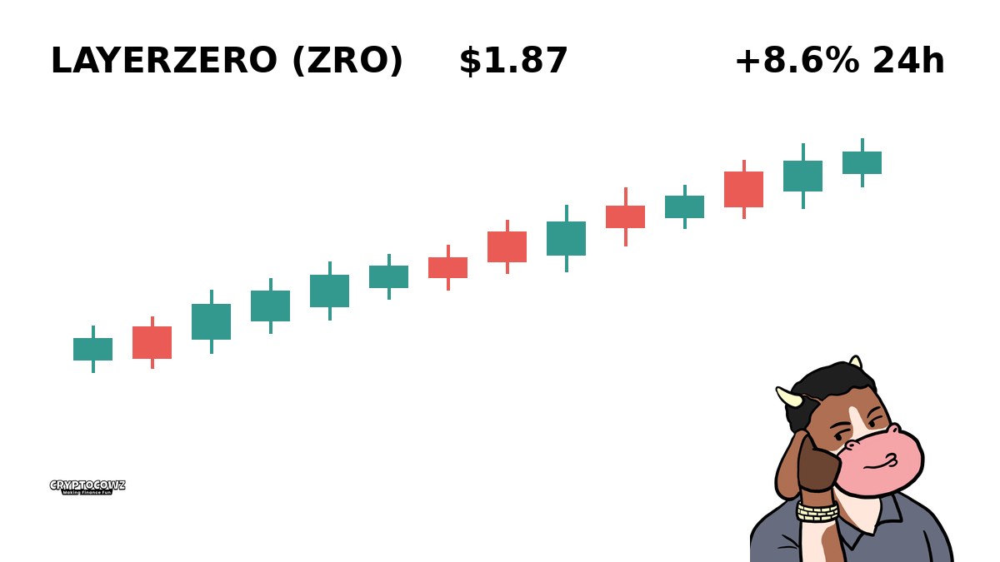
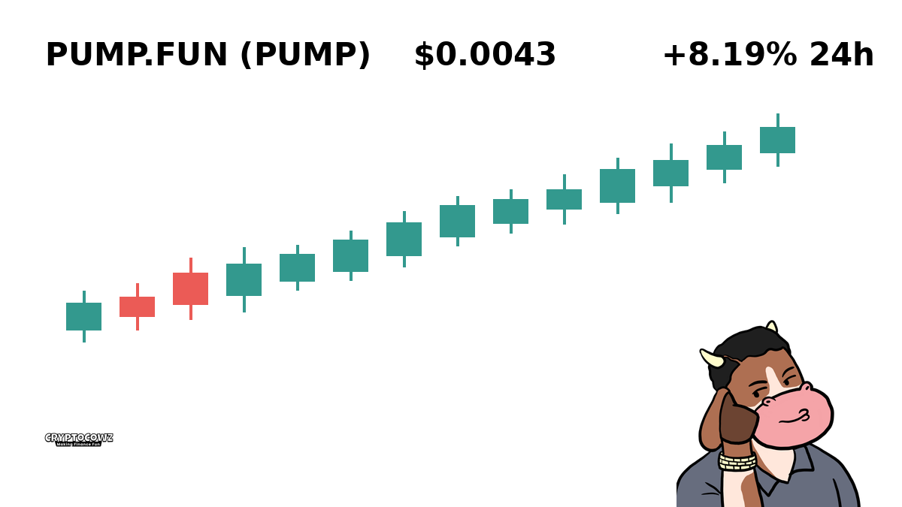
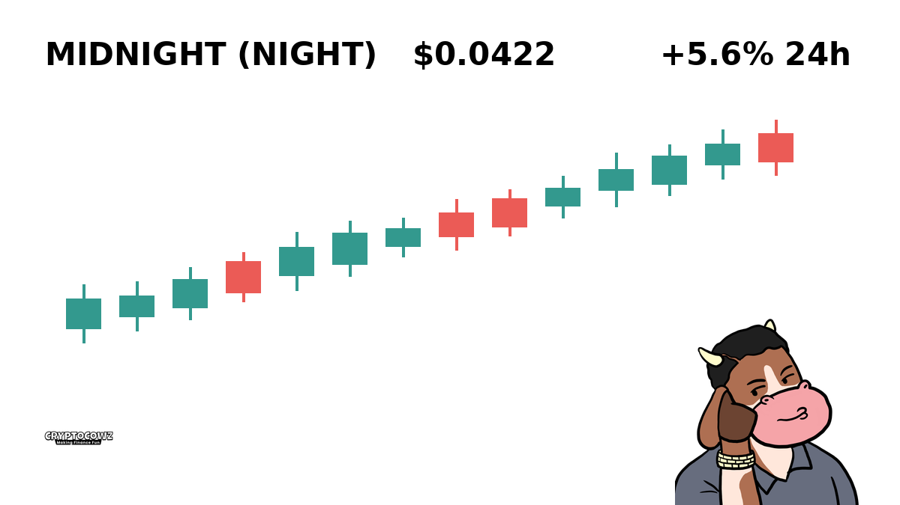
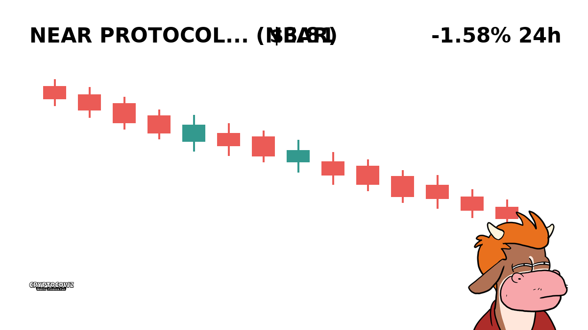
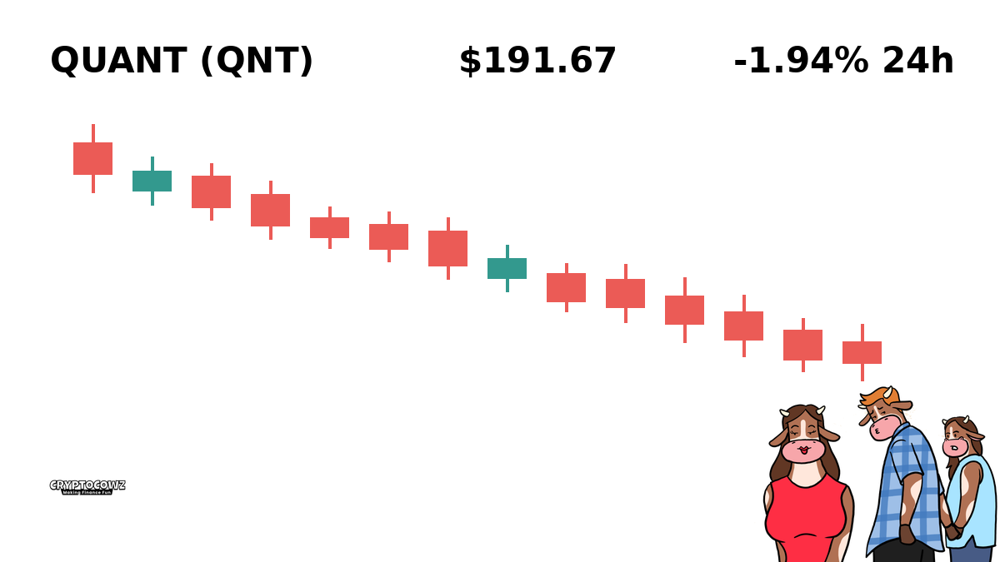
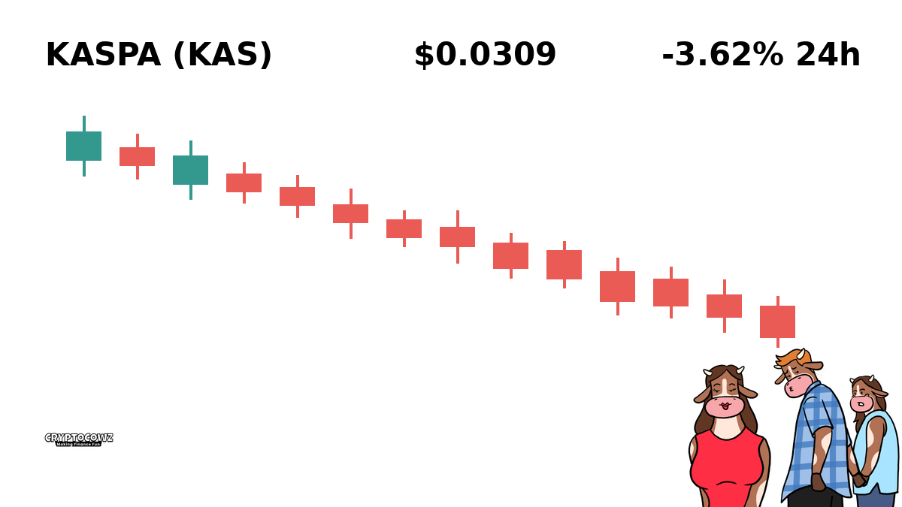

# Daily Top Movers: CMC Community Visuals & Posts

## 1. Lighter ($LIT) — +9.49% (PUMP)
**Cast Member:** Skip Zinfandel
**CMC Comment:** Just remortgaged the pasture to put it all into LIT! Who needs shelter when you are riding a rocket straight to financial freedom?

---

## 2. LayerZero ($ZRO) — +8.6% (PUMP)
**Cast Member:** Frank Rizzo
**CMC Comment:** LayerZero is up eight percent and suddenly every degenerate thinks they are a genius trader. Take your profits before the smart money pulls the plug, pal.

---

## 3. Pump.fun ($PUMP) — +8.19% (PUMP)
**Cast Member:** Sunshine Innocent Nimbus
**CMC Comment:** The cosmic vibrations on Pump.fun are soaring today! I manifested this green candle by aligning my third eye with the liquidity pool.

---

## 4. Midnight ($NIGHT) — +5.6% (PUMP)
**Cast Member:** Professor Hartmut
**CMC Comment:** The mathematical probability of this Midnight rally sustaining itself is mathematically negligible, yet retail greed remains utterly indifferent to physics.

---

## 5. Venice Token ($VVV) — +5.56% (PUMP)
**Cast Member:** Skip Zinfandel
**CMC Comment:** Venice Token is floating up faster than a speed boat on champagne! I am already customizing my second neon yacht.

---

## 6. NEAR Protocol ($NEAR) — -1.58% (DUMP)
**Cast Member:** Frank Rizzo
**CMC Comment:** NEAR is dropping like a sack of wet cement. Keep holding those heavy bags, buddy, while real men short you into the ground.

---

## 7. Stacks ($STX) — -1.68% (DUMP)
**Cast Member:** Professor Hartmut
**CMC Comment:** A fascinating psychological display: Stacks investors routinely confuse a slow portfolio hemorrhage with a calculated accumulation phase.

---

## 8. Quant ($QNT) — -1.94% (DUMP)
**Cast Member:** Sunshine Innocent Nimbus
**CMC Comment:** Quant is just taking a gentle sleep to cleanse its aura. I sprayed essential oils on my ledger to help the chart heal!

---

## 9. Kaspa ($KAS) — -3.62% (DUMP)
**Cast Member:** Frank Rizzo
**CMC Comment:** Kaspa drops three percent and the tears in the group chat are glorious. Panic sell your tokens so I can buy your trash for dirt cheap.

---

## 10. Bitway ($BTW) — -6.31% (DUMP)
**Cast Member:** Skip Zinfandel
**CMC Comment:** Bitway down six percent? That is not a loss, that is a golden ultra-discount before the guaranteed thousand-percent moonshot!

---
