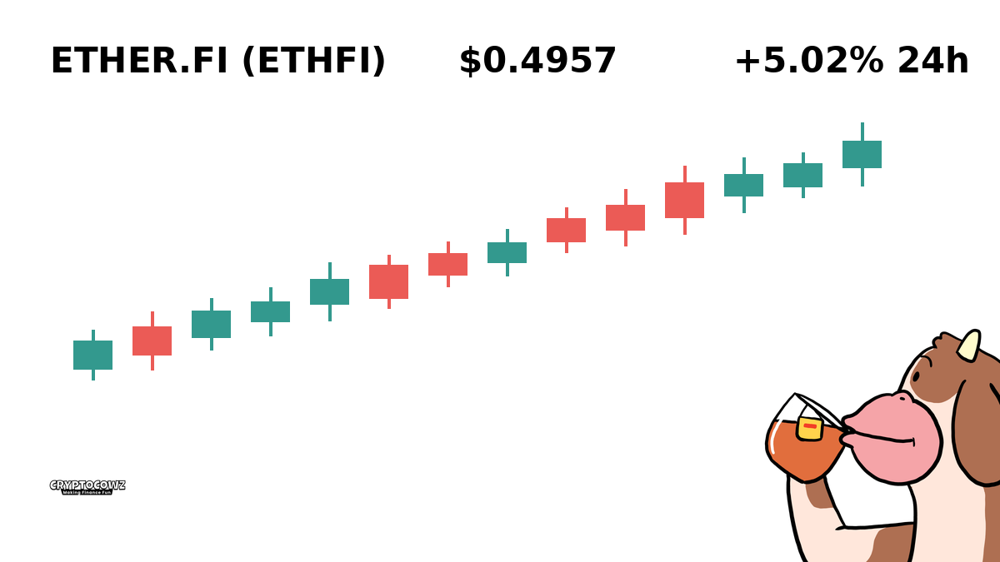
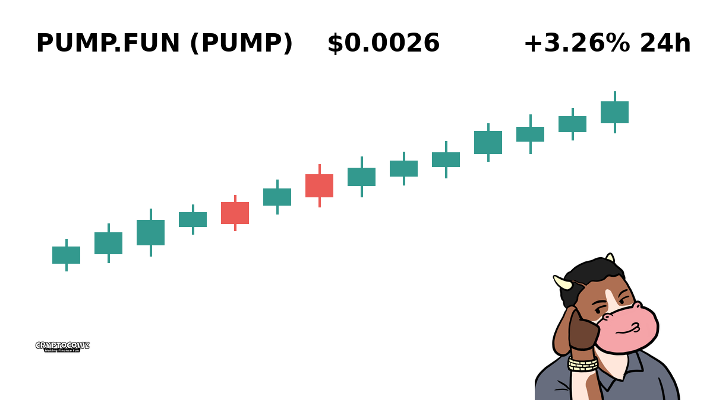
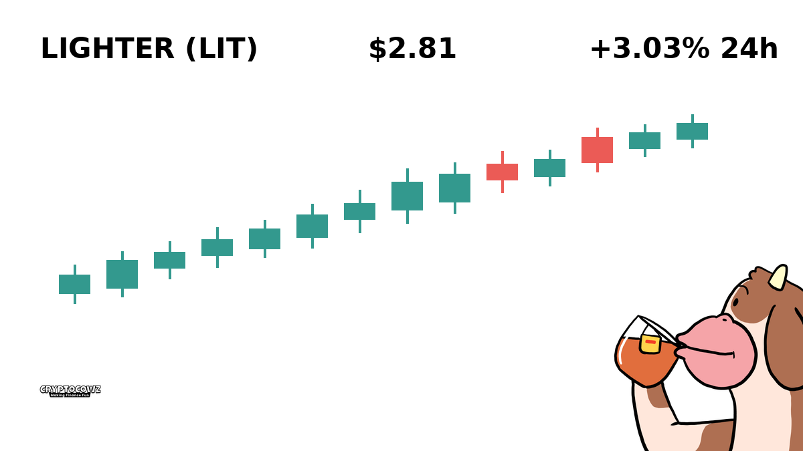
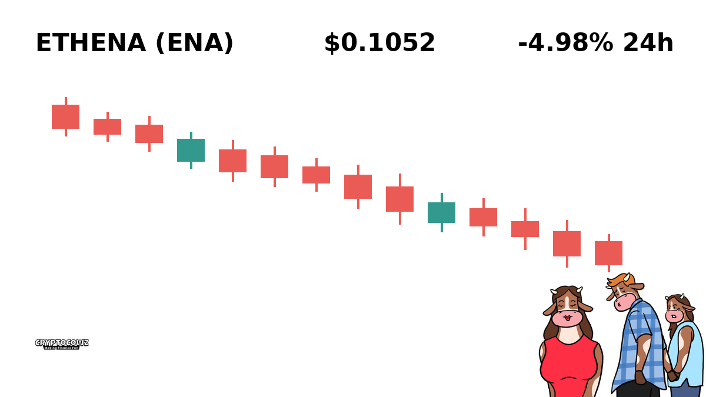
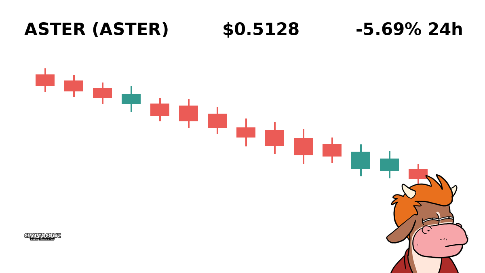
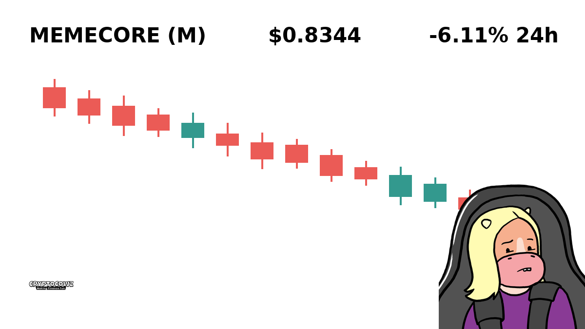
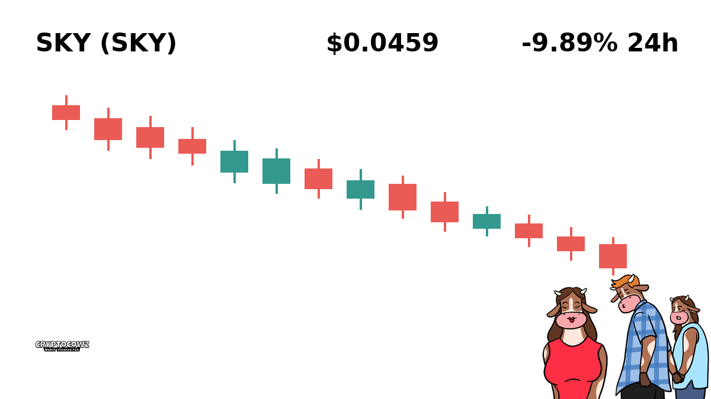
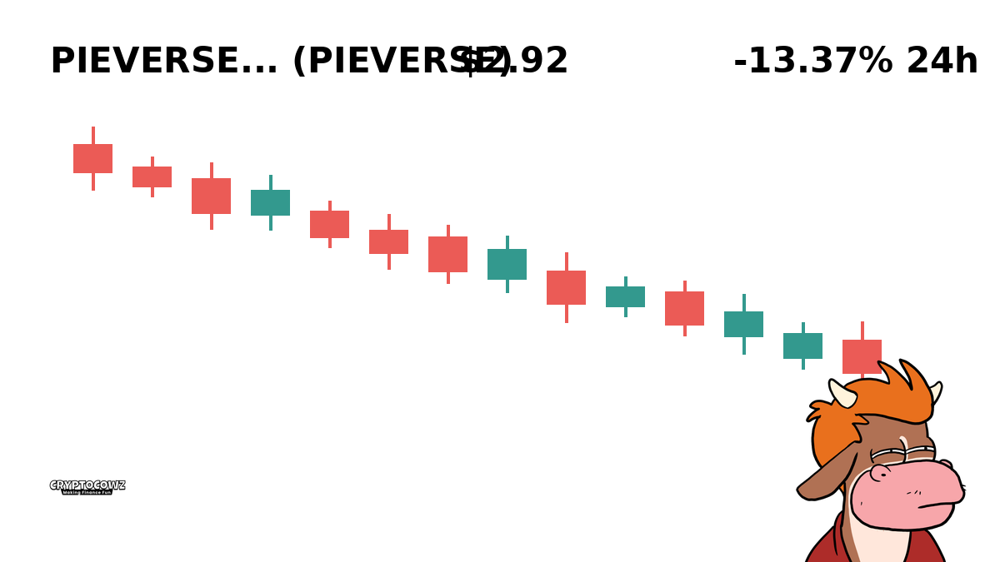

# Daily Top Movers: CMC Community Visuals & Posts

## 1. Bitway ($BTW) — +22.96% (PUMP)
**Cast Member:** Skip Zinfandel
**CMC Comment:** Bitway is up nearly 23% and I'm already shopping for a third jet! Remember folks, fundamentals are for people who hate winning.

---

## 2. Venice Token ($VVV) — +6.58% (PUMP)
**Cast Member:** Sunshine Innocent Nimbus
**CMC Comment:** Venice Token is floating so peacefully up the canal today! I put all my flower-power energy into this green candle and it worked!

---

## 3. Ether.fi ($ETHFI) — +5.02% (PUMP)
**Cast Member:** Frank Rizzo
**CMC Comment:** Up five percent? That barely covers my espresso budget, but at least these staking guys haven't run off with my coat yet.

---

## 4. Pump.fun ($PUMP) — +3.26% (PUMP)
**Cast Member:** Skip Zinfandel
**CMC Comment:** It's literally called PUMP and it's pumping, what more DD do you nerds need?! Smells like pure, unadulterated parabolic bliss!

---

## 5. Lighter ($LIT) — +3.03% (PUMP)
**Cast Member:** Professor Hartmut
**CMC Comment:** A three percent upward variance in Lighter merely demonstrates temporary retail irrationality. Mathematically speaking, you will still end up poor.

---

## 6. Ethena ($ENA) — -4.98% (DUMP)
**Cast Member:** Frank Rizzo
**CMC Comment:** Down five percent already? Unbelievable, every time I buy a synthetic dollar it turns into synthetic dust.

---

## 7. Aster ($ASTER) — -5.69% (DUMP)
**Cast Member:** Sunshine Innocent Nimbus
**CMC Comment:** Aster is just taking a little sleepy nap in the discount soil! Don't sell, just send the chart peaceful healing vibrations!

---

## 8. MemeCore ($M) — -6.11% (DUMP)
**Cast Member:** Professor Hartmut
**CMC Comment:** The empirical data for MemeCore confirms my thesis: assets with single-letter tickers correlate directly with single-digit IQ trading decisions.

---

## 9. Sky ($SKY) — -9.89% (DUMP)
**Cast Member:** Skip Zinfandel
**CMC Comment:** The Sky is falling down ten percent! Dump it all, run for the hills, and tune into my emergency market crash broadcast!

---

## 10. Pieverse ($PIEVERSE) — -13.37% (DUMP)
**Cast Member:** Frank Rizzo
**CMC Comment:** Thirteen percent in the gutter! They promised me a pie in the sky and all I got was a slap in the face.

---
