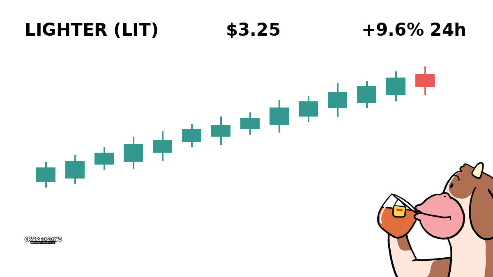
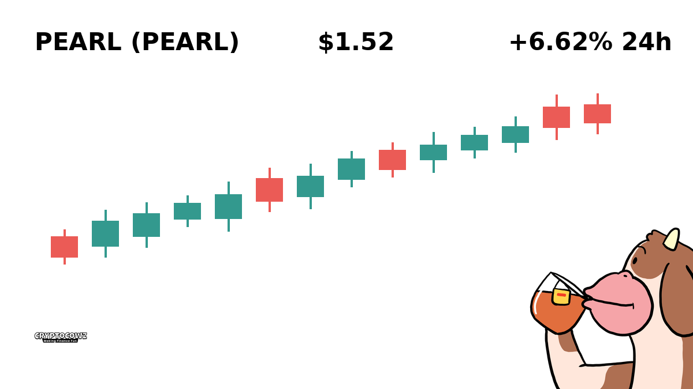
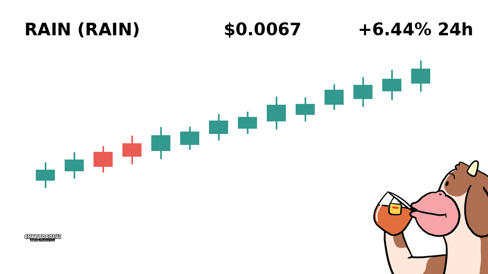
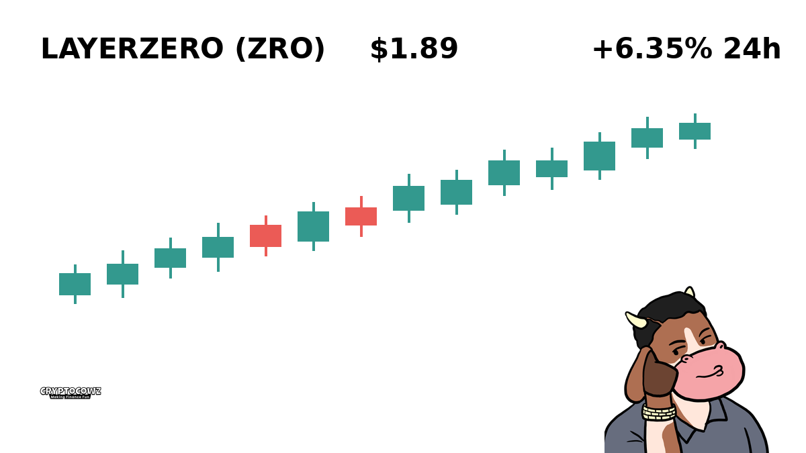
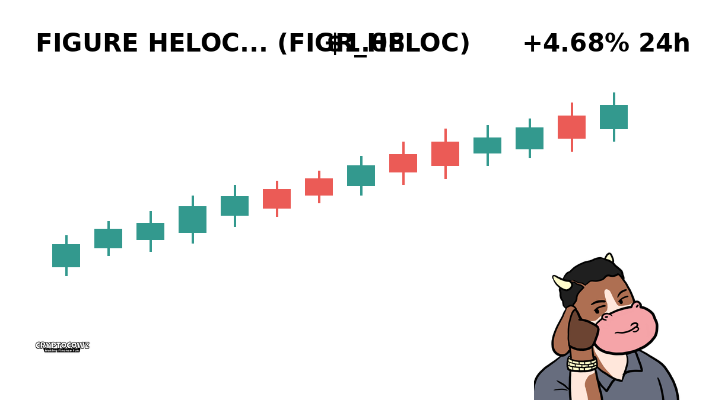
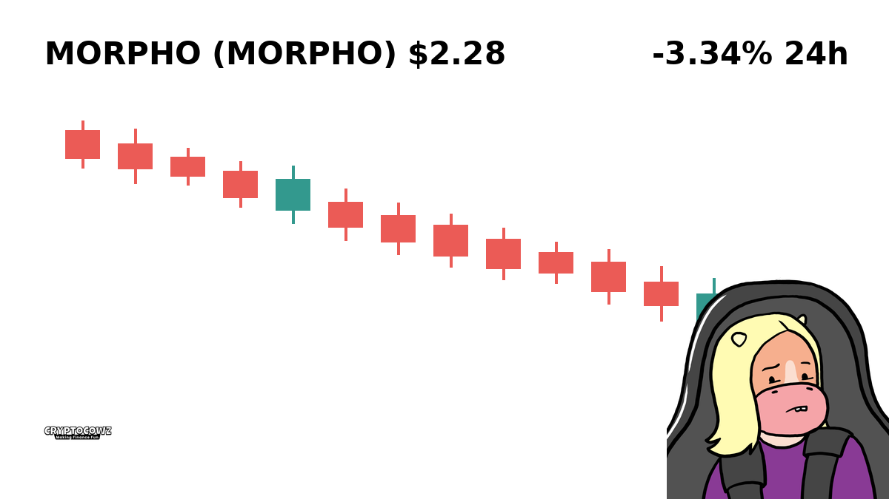
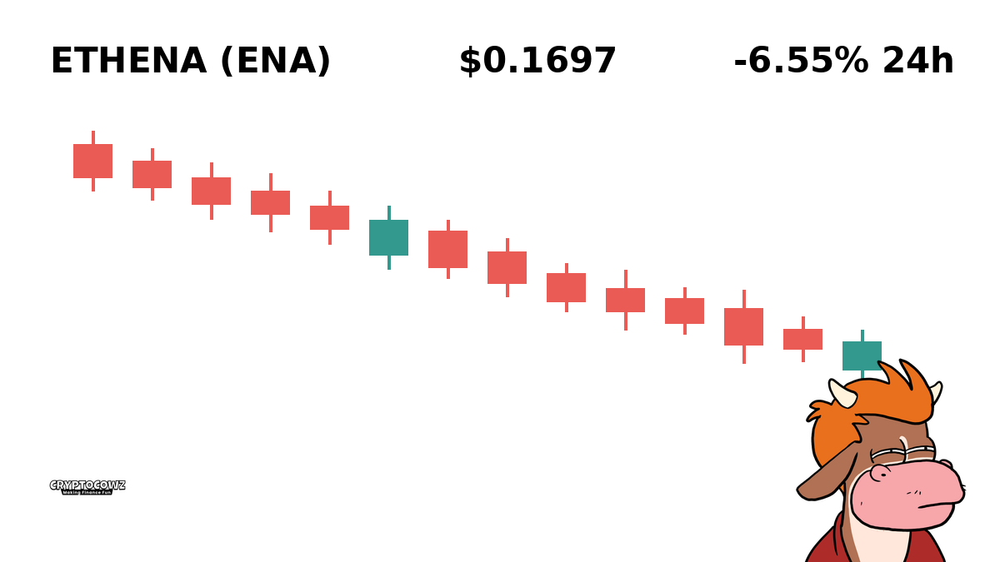
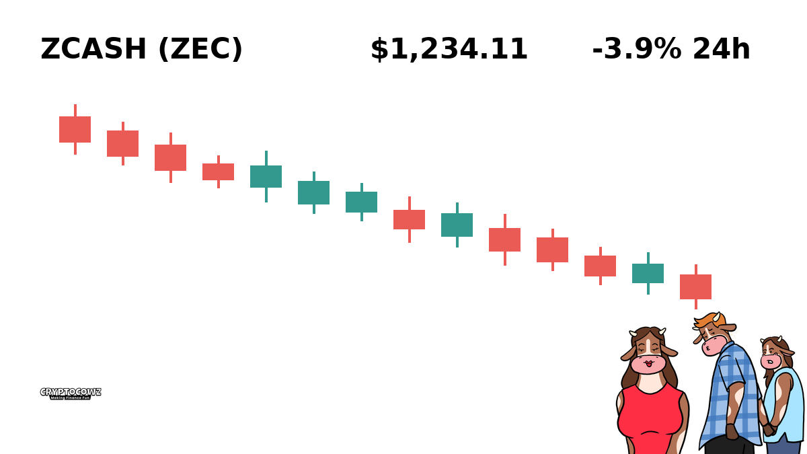
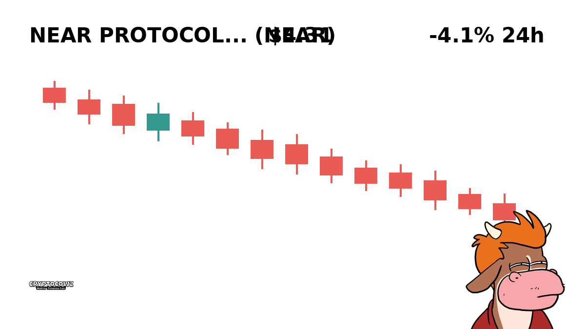
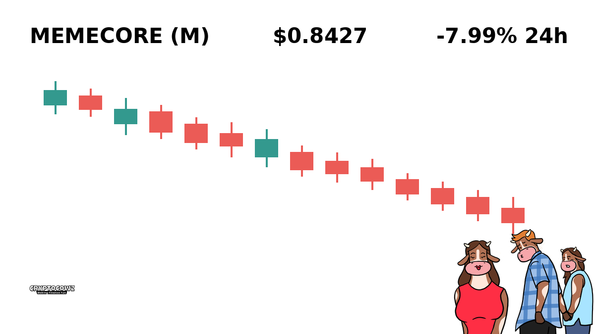

# Daily Top Movers: CMC Community Visuals & Posts

## 1. Lighter ($LIT) — +9.6% (PUMP)
**Cast Member:** Skip Zinfandel
**CMC Comment:** LIT is burning bright today, which means I have already leveraged my third house to buy the top. Keep sparking, boys, we are going to the moon or the homeless shelter!

---

## 2. Pearl ($PEARL) — +6.62% (PUMP)
**Cast Member:** Sunshine Innocent Nimbus
**CMC Comment:** Clams everywhere are opening up to bless us with pure liquidity! I knew holding onto shiny ocean rocks would make us all spiritually and financially whole!

---

## 3. Rain ($RAIN) — +6.44% (PUMP)
**Cast Member:** Frank Rizzo
**CMC Comment:** Make it rain, baby! I told my ex-wife's lawyer I was broke, but this green chart says I am buying a yacht by Tuesday!

---

## 4. LayerZero ($ZRO) — +6.35% (PUMP)
**Cast Member:** Professor Hartmut
**CMC Comment:** Mathematically speaking, cross-chain interoperability combined with rampant speculative euphoria generates a textbook temporary pump. Enjoy the yield before entropy reclaims your principal.

---

## 5. Figure Heloc ($FIGR_HELOC) — +4.68% (PUMP)
**Cast Member:** Skip Zinfandel
**CMC Comment:** Nothing says generational wealth quite like taking out a home equity line on a tokenized mortgage derivative. Bullish on borrowing against my own future!

---

## 6. Morpho ($MORPHO) — -3.34% (DUMP)
**Cast Member:** Professor Hartmut
**CMC Comment:** The algorithmic efficiency of this lending protocol appears to be undergoing a sharp structural liquidation. A fascinating empirical study in rapid wealth destruction.

---

## 7. Ethena ($ENA) — -3.88% (DUMP)
**Cast Member:** Frank Rizzo
**CMC Comment:** Delta-neutral my ass! I am down four figures and my broker is ignoring my calls. Who ordered this synthetic disaster?

---

## 8. Zcash ($ZEC) — -3.9% (DUMP)
**Cast Member:** Sunshine Innocent Nimbus
**CMC Comment:** The privacy shadows are hiding all our gains away, but true darkness is just the universe resting before the light returns!

---

## 9. NEAR Protocol ($NEAR) — -4.1% (DUMP)
**Cast Member:** Frank Rizzo
**CMC Comment:** NEAR? More like NEARly broke! I should have stuck to selling counterfeit Rolexes down at the boardwalk.

---

## 10. MemeCore ($M) — -7.99% (DUMP)
**Cast Member:** Skip Zinfandel
**CMC Comment:** Down eight percent? Perfect, that just means the meme core is charging up for an even bigger moonshot! Buy the dip, folks!

---
