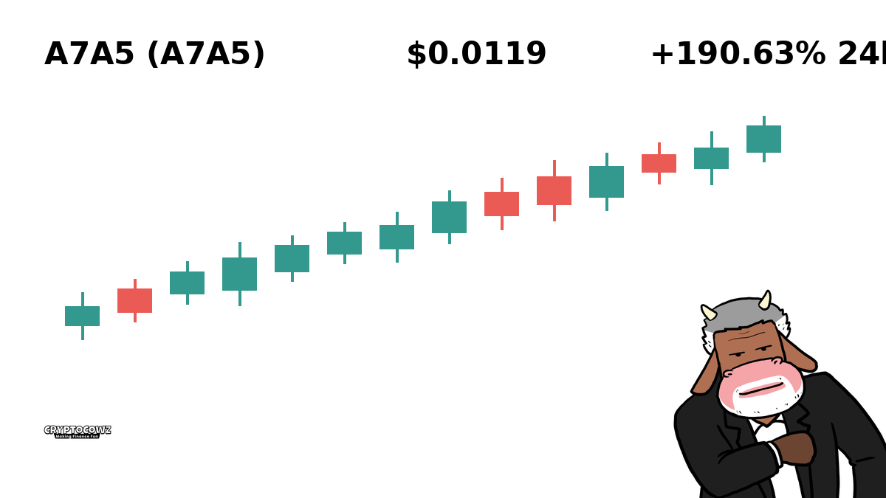
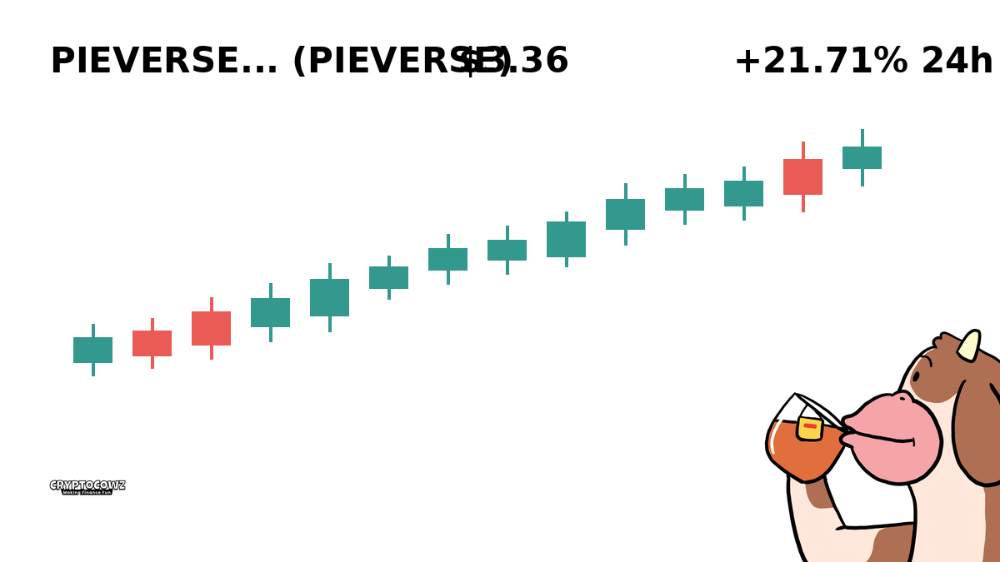
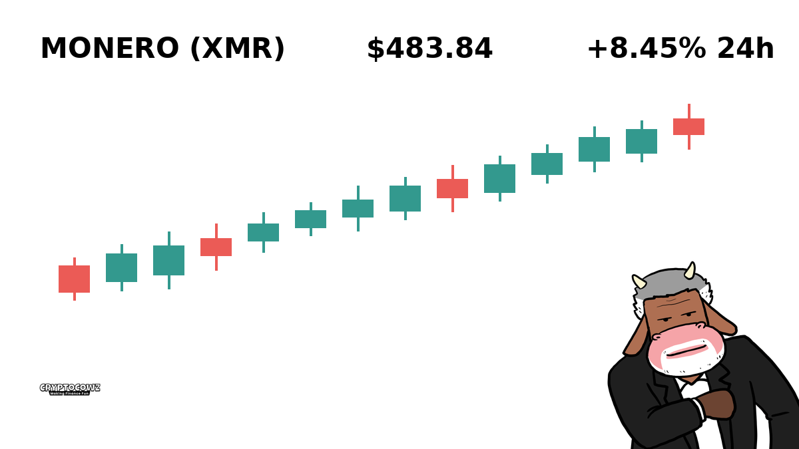
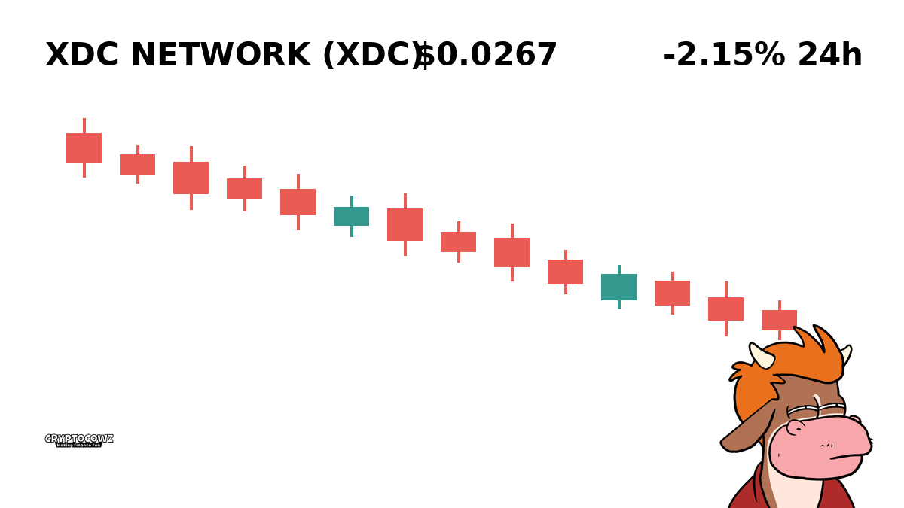
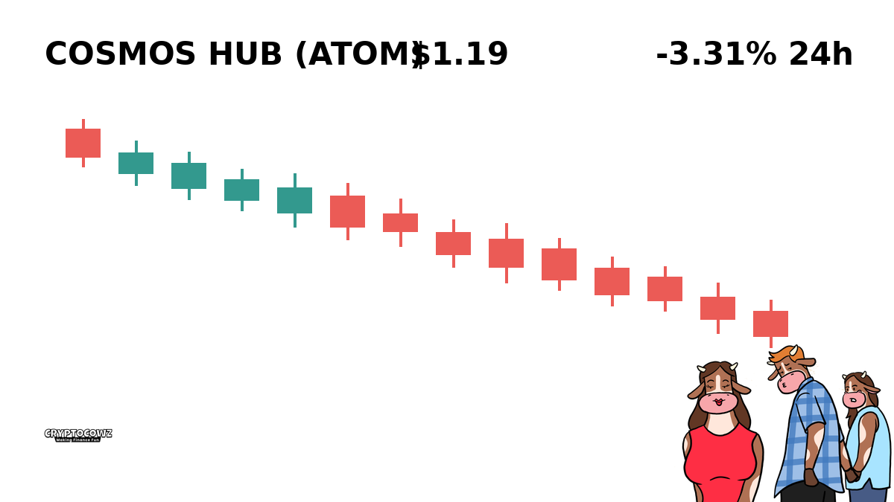
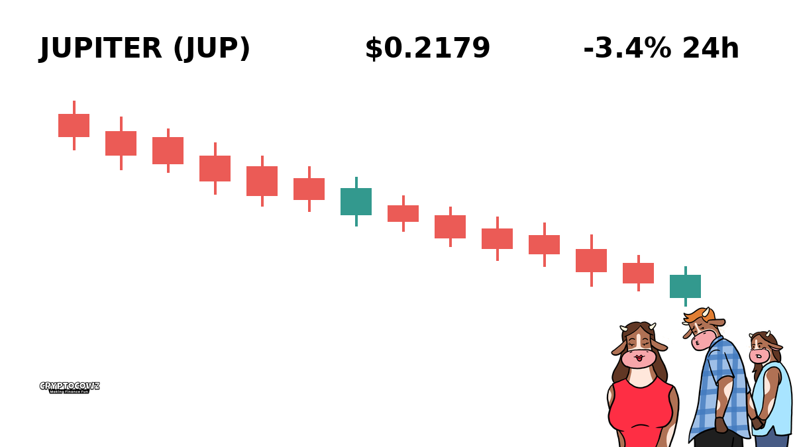
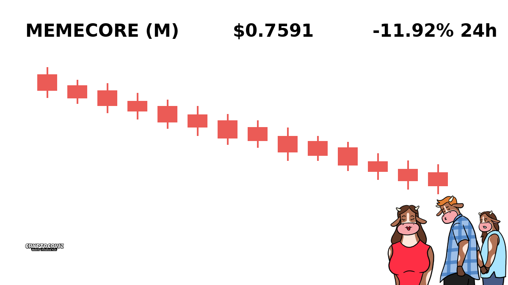

# Daily Top Movers: CMC Community Visuals & Posts

## 1. A7A5 ($A7A5) — +190.63% (PUMP)
**Cast Member:** Skip Zinfandel
**CMC Comment:** Up 190% today because fundamental analysis is just astrology for guys who sleep on futons. I am leveraging my wife's retirement fund as we speak!

---

## 2. Venice Token ($VVV) — +23.35% (PUMP)
**Cast Member:** Sunshine Innocent Nimbus
**CMC Comment:** The sacred gondolas of Venice are floating high on pure green candles! Blessed are the believers who traded their rent money for eternal digital glory.

---

## 3. Pieverse ($PIEVERSE) — +21.71% (PUMP)
**Cast Member:** Frank Rizzo
**CMC Comment:** I don't know what a Pieverse is, but it's up 21% so I just put a second mortgage on the deli. We are eatin' baked goods on the moon tonight!

---

## 4. Monero ($XMR) — +8.45% (PUMP)
**Cast Member:** Professor Hartmut
**CMC Comment:** Ah, privacy gains—mathematically proven to correlate with tax evasion vectors. An exquisite 8.45% increase in total financial anonymity.

---

## 5. Pi Network ($PI) — +7.39% (PUMP)
**Cast Member:** Skip Zinfandel
**CMC Comment:** Tapping a button on your phone once a day finally paid for half a caramel macchiato. Web3 disruption is truly here, baby!

---

## 6. XDC Network ($XDC) — -2.15% (DUMP)
**Cast Member:** Frank Rizzo
**CMC Comment:** Down 2%? Great, my nephew told me this was an institutional-grade enterprise chain, and now I am paying for his enterprise-grade mistakes.

---

## 7. Cosmos Hub ($ATOM) — -3.31% (DUMP)
**Cast Member:** Professor Hartmut
**CMC Comment:** The interchain hub suffers a minor gravitational collapse, proving once again that cosmic entropy always triumphs over staking yields.

---

## 8. Jupiter ($JUP) — -3.4% (DUMP)
**Cast Member:** Sunshine Innocent Nimbus
**CMC Comment:** Jupiter is taking us on a quiet retreat down into the lower realm to test our spiritual resilience before the grand ascension.

---

## 9. Internet Computer ($ICP) — -4.09% (DUMP)
**Cast Member:** Skip Zinfandel
**CMC Comment:** It turns out decentralizing the entire internet just means losing money decentralized-style. Bullish on cloud-based poverty!

---

## 10. MemeCore ($M) — -11.92% (DUMP)
**Cast Member:** Frank Rizzo
**CMC Comment:** Down almost 12% in a single day? I have seen mob hits cleaner than this chart, get me out of this core dump!

---
