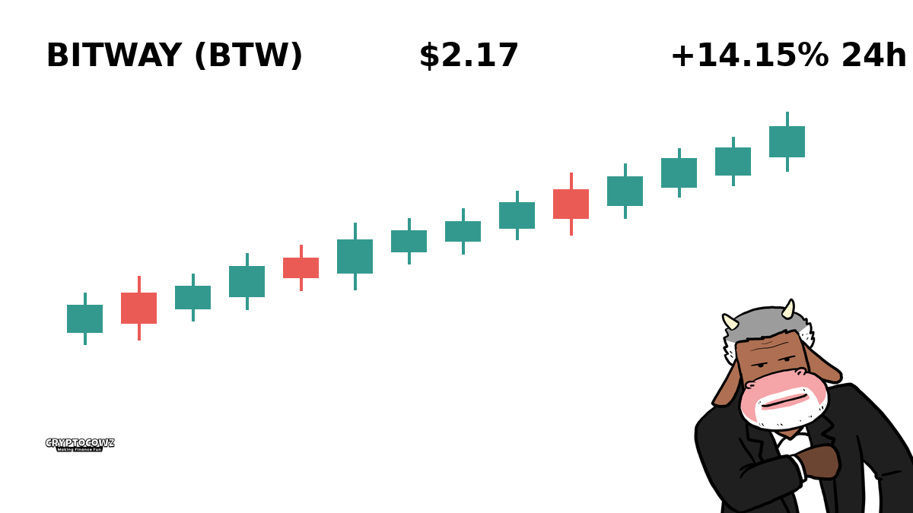
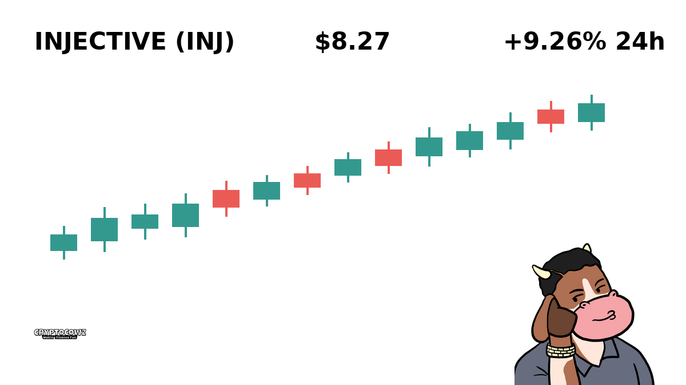
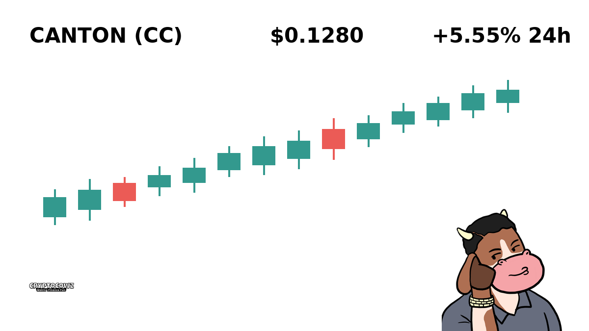
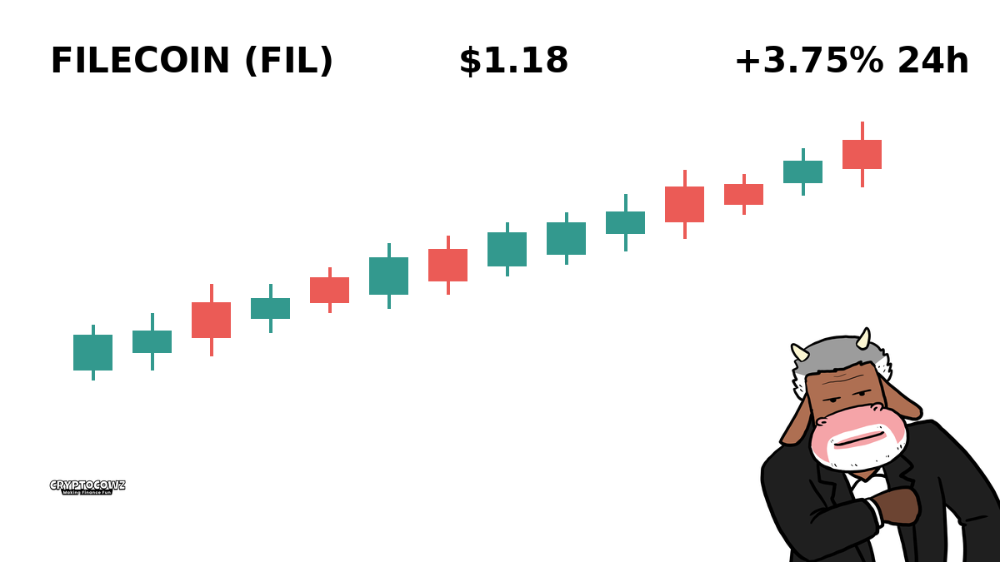
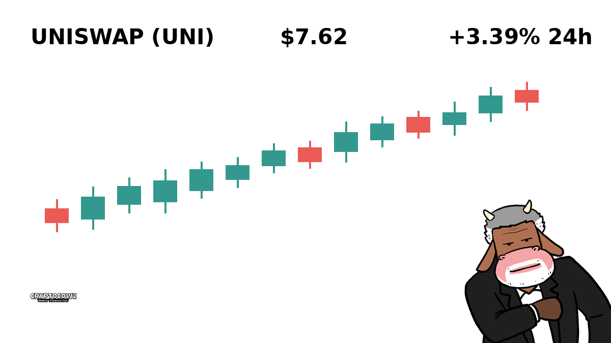
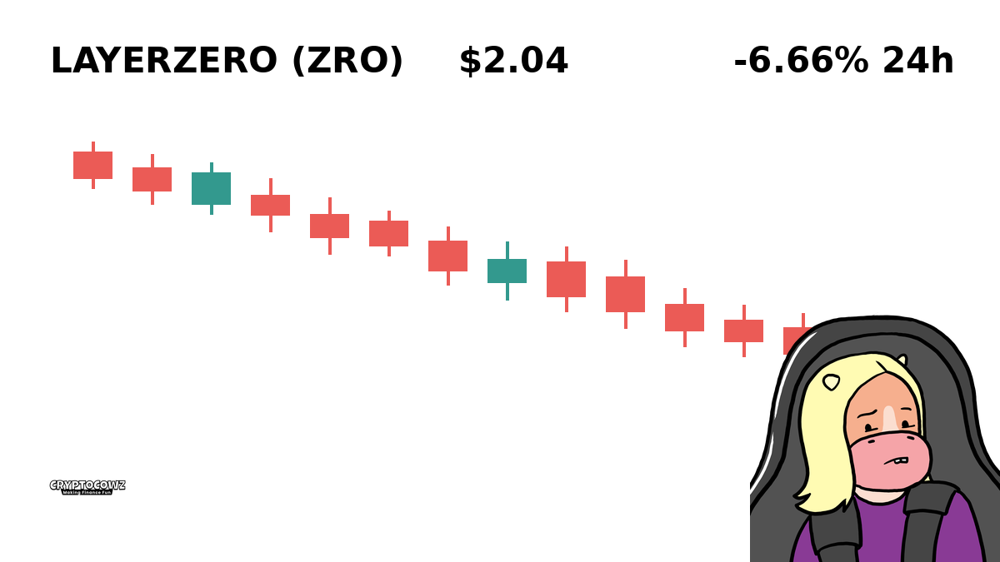
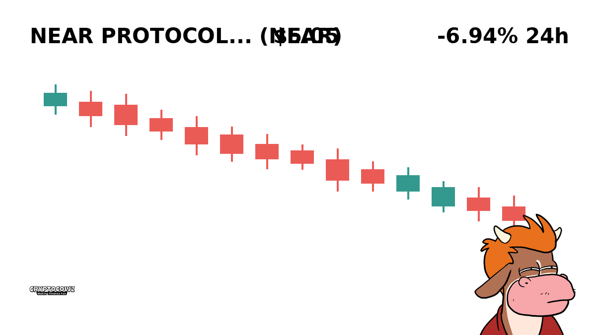
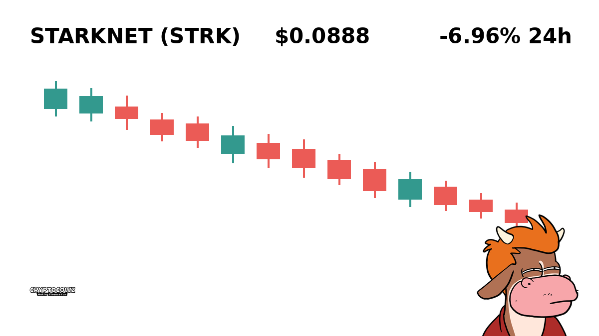
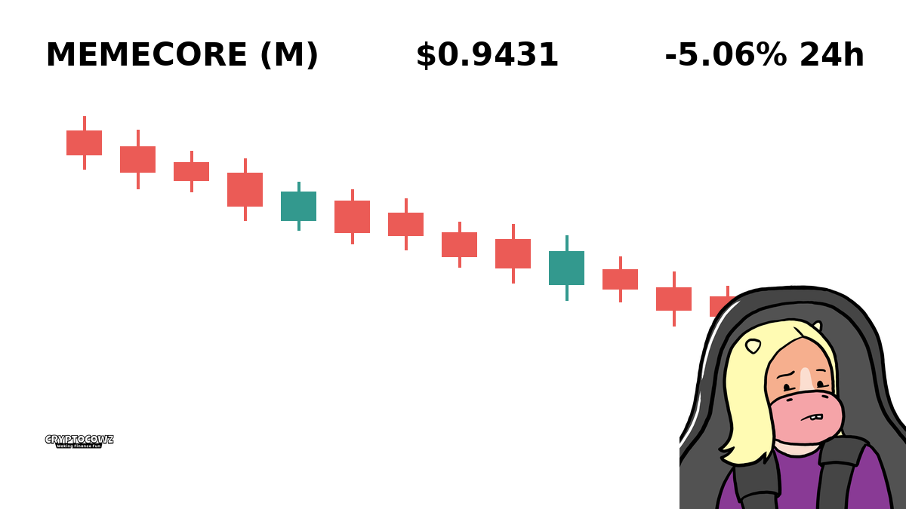

# Daily Top Movers: CMC Community Visuals & Posts

## 1. Bitway ($BTW) — +15.46% (PUMP)
**Cast Member:** Skip Zinfandel
**CMC Comment:** Bitway just put up 15% and suddenly my cousin is calling himself a sovereign wealth fund manager. I'm leveraging the family farm as we speak!

---

## 2. Injective ($INJ) — +9.26% (PUMP)
**Cast Member:** Frank Rizzo
**CMC Comment:** Up 9% and the chat is acting like we solved world hunger. Put your pants back on, you're buying pizza with it anyway.

---

## 3. Canton ($CC) — +5.55% (PUMP)
**Cast Member:** Sunshine Innocent Nimbus
**CMC Comment:** A green 5% candle is the universe's warm, gentle hug reminding us that line go up forever if you just believe hard enough!

---

## 4. Filecoin ($FIL) — +3.75% (PUMP)
**Cast Member:** Professor Hartmut
**CMC Comment:** Statistically, storing hard drives full of JPEG cows on-chain at a 3.75% premium is the exact peak of human civilizational progress.

---

## 5. Uniswap ($UNI) — +3.39% (PUMP)
**Cast Member:** Skip Zinfandel
**CMC Comment:** Three percent green on UNI means it's time to order the top-shelf champagne for the pasture tonight!

---

## 6. Lighter ($LIT) — -5.9% (DUMP)
**Cast Member:** Frank Rizzo
**CMC Comment:** Lighter went down 6% and took everyone's hopes and dreams with it. Don't look at me, I told you to keep your money under the mattress.

---

## 7. LayerZero ($ZRO) — -6.66% (DUMP)
**Cast Member:** Professor Hartmut
**CMC Comment:** The mathematical probability of bridging your assets down 6.66% to zero remains remarkably consistent with historical bovine folly.

---

## 8. NEAR Protocol ($NEAR) — -6.94% (DUMP)
**Cast Member:** Skip Zinfandel
**CMC Comment:** NEAR is down nearly 7%, which just means it's NEARer to the dirt where I usually sleep after a bad trade anyway.

---

## 9. Starknet ($STRK) — -6.96% (DUMP)
**Cast Member:** Sunshine Innocent Nimbus
**CMC Comment:** Oh no, Starknet dipped a tiny bit, but every red candle is just a seed waiting to grow into a glorious sunflower of liquidation!

---

## 10. MemeCore ($M) — -9.23% (DUMP)
**Cast Member:** Frank Rizzo
**CMC Comment:** Down 9% on a coin called MemeCore? You bought a ticker symbol with one letter and expected a pension plan?

---
