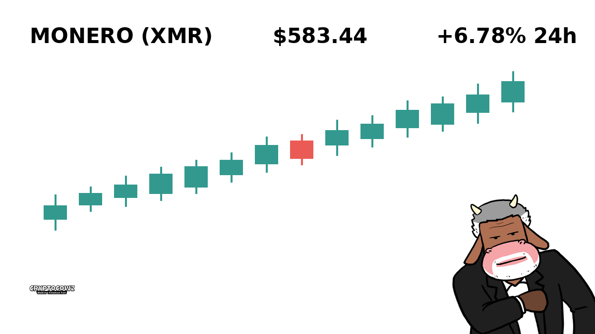
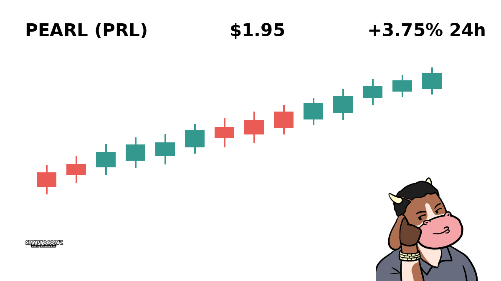
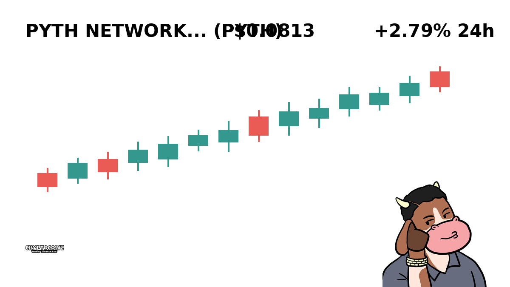
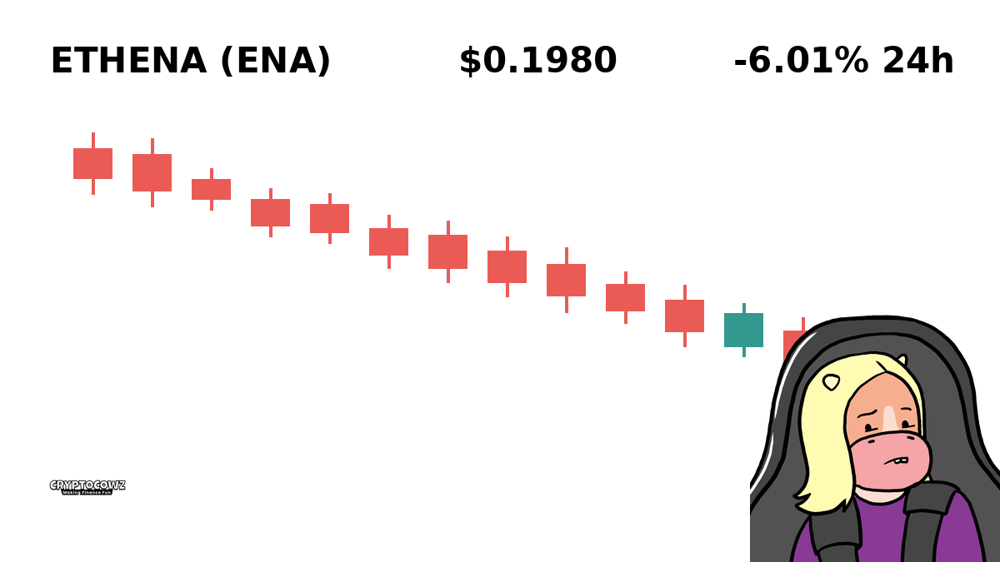
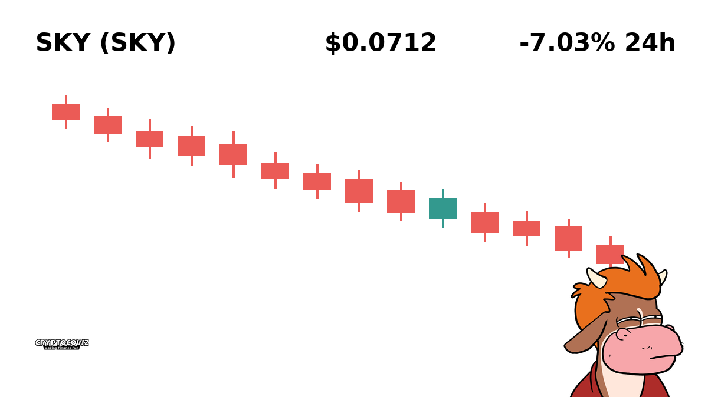
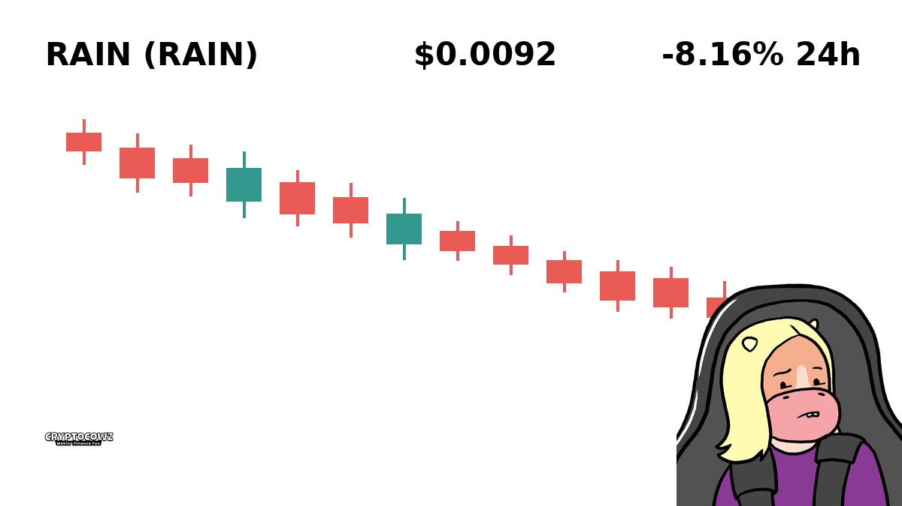
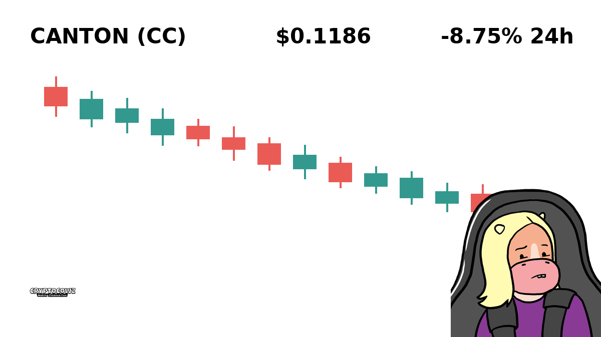

# Daily Top Movers: CMC Community Visuals & Posts

## 1. Bitway ($BTW) — +18.48% (PUMP)
**Cast Member:** Skip Zinfandel
**CMC Comment:** Up 18% today, which means I've already leveraged my second mortgage to buy more because diversification is for cowards!

---

## 2. Venice Token ($VVV) — +6.12% (PUMP)
**Cast Member:** Sunshine Innocent Nimbus
**CMC Comment:** The charts are singing sweet melodies of pure green light today! Venice is rising, just like my spiritual aura!

---

## 3. Monero ($XMR) — +4.15% (PUMP)
**Cast Member:** Frank Rizzo
**CMC Comment:** Up four percent and completely untraceable, just how I like my off-the-books construction deals.

---

## 4. Pearl ($PRL) — +3.75% (PUMP)
**Cast Member:** Professor Hartmut
**CMC Comment:** A modest 3.75% uptick suggests the retail herd has temporarily mistaken shiny clam secretions for sound monetary policy.

---

## 5. Pyth Network ($PYTH) — +2.79% (PUMP)
**Cast Member:** Skip Zinfandel
**CMC Comment:** It's pumping slightly, which clearly indicates a 100x moon mission is imminent and guaranteed!

---

## 6. Ethena ($ENA) — -6.01% (DUMP)
**Cast Member:** Frank Rizzo
**CMC Comment:** Down six percent already, looks like someone turned the synthetic yield machine into a trash compactor.

---

## 7. Sky ($SKY) — -7.03% (DUMP)
**Cast Member:** Professor Hartmut
**CMC Comment:** The sky is not falling, though this particular token certainly is, down 7% due to elementary economic friction.

---

## 8. KuCoin ($KCS) — -8.02% (DUMP)
**Cast Member:** Frank Rizzo
**CMC Comment:** Eight percent drop on an exchange token? Sounds like somebody's moving money out the back door in duffel bags.

---

## 9. Rain ($RAIN) — -8.16% (DUMP)
**Cast Member:** Sunshine Innocent Nimbus
**CMC Comment:** The heavy clouds of sell orders are washing away our gains, but rain is just nature's way of resetting our chakras.

---

## 10. Canton ($CC) — -8.75% (DUMP)
**Cast Member:** Skip Zinfandel
**CMC Comment:** Down nearly nine percent, but I'm holding all my bags straight into the abyss because real alpha never dies!

---
