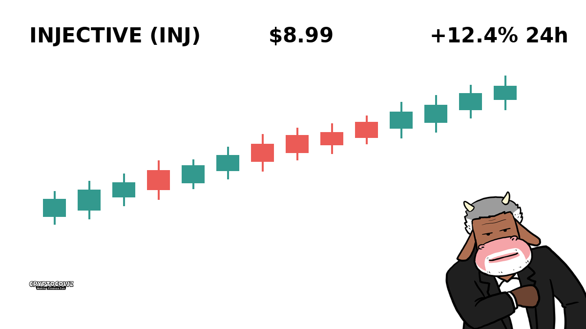
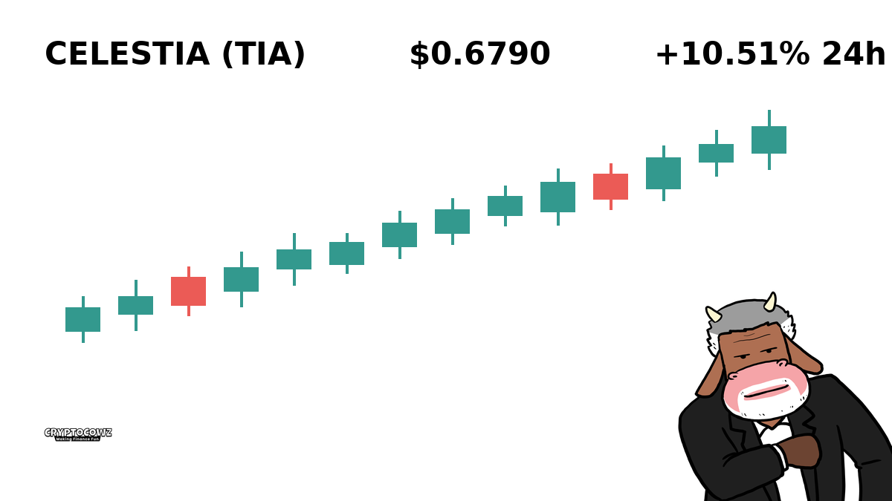
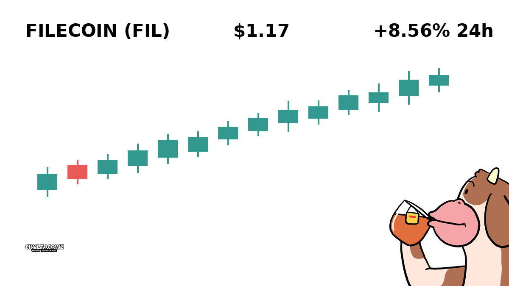
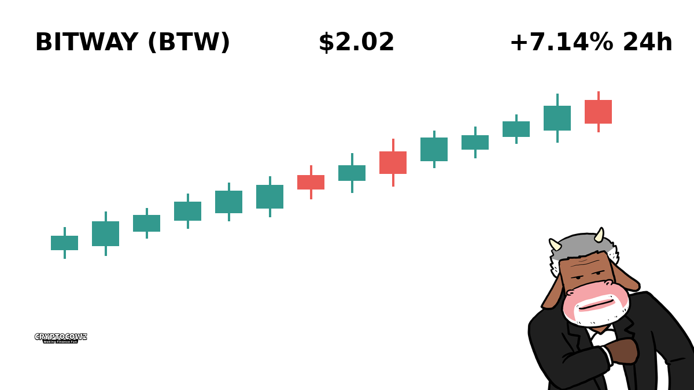
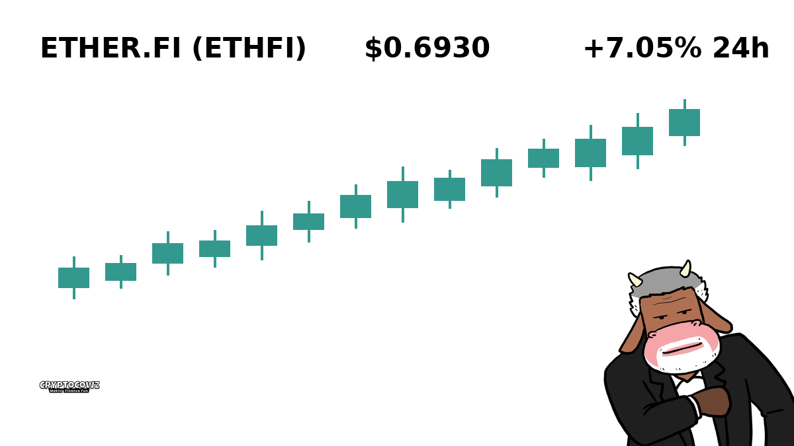
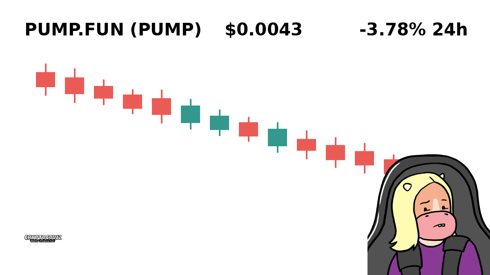
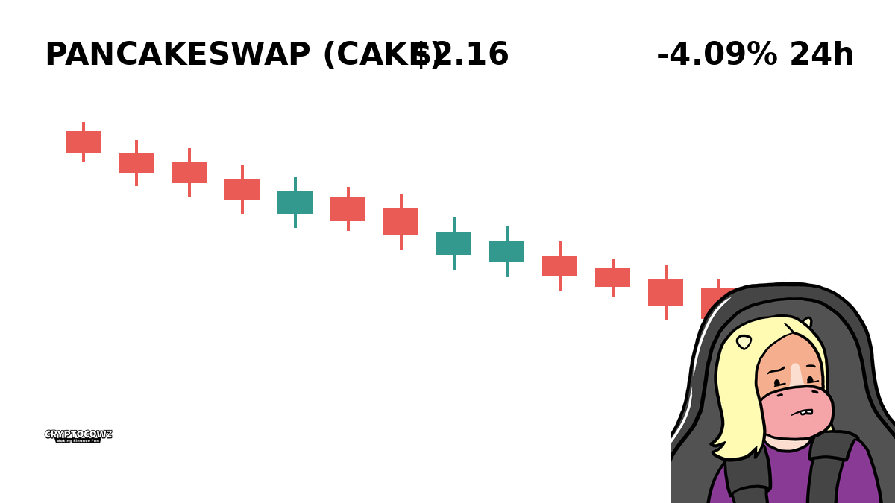
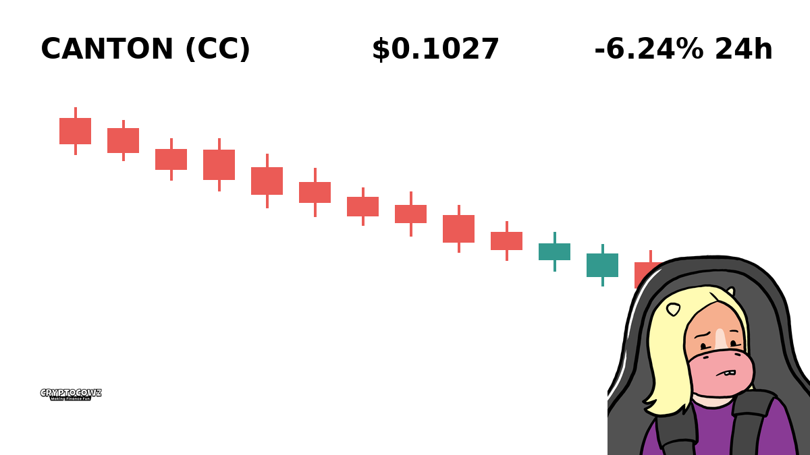
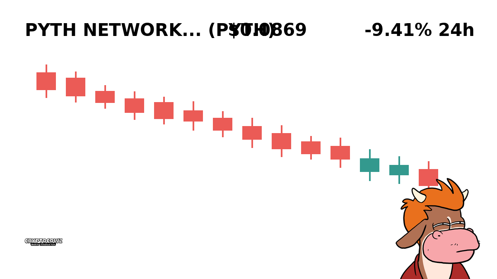

# Daily Top Movers: CMC Community Visuals & Posts

## 1. Injective ($INJ) — +12.4% (PUMP)
**Cast Member:** Skip Zinfandel
**CMC Comment:** Just refinanced my second barn to leverage long INJ at 50x because real financial freedom requires zero fear and zero basic math. To the stratosphere, fellas!

---

## 2. Celestia ($TIA) — +10.51% (PUMP)
**Cast Member:** Sunshine Innocent Nimbus
**CMC Comment:** The modular stars are aligning and TIA is showering us with pure cosmic wealth! I have already bought matching silk pajamas for my entire pasture.

---

## 3. Filecoin ($FIL) — +8.56% (PUMP)
**Cast Member:** Professor Hartmut
**CMC Comment:** Storing decentralised data is finally yielding exponential capital appreciation, proving that basic server rack physics can indeed trigger irrational retail euphoria.

---

## 4. Bitway ($BTW) — +7.14% (PUMP)
**Cast Member:** Frank Rizzo
**CMC Comment:** Look at BTW moving up, baby! I told my wife's lawyer we are holding all the profits in offshore hardware wallets.

---

## 5. Ether.fi ($ETHFI) — +7.05% (PUMP)
**Cast Member:** Skip Zinfandel
**CMC Comment:** Restaking yield on top of liquid staking yield on top of pure, unadulterated green candles is my favorite morning smoothie.

---

## 6. Pump.fun ($PUMP) — -3.78% (DUMP)
**Cast Member:** Frank Rizzo
**CMC Comment:** Pump.fun is currently dumping fun straight into my empty checking account. Who do I call to sue the dev who rugpulled my rent?

---

## 7. PancakeSwap ($CAKE) — -4.09% (DUMP)
**Cast Member:** Sunshine Innocent Nimbus
**CMC Comment:** Oh dear, the syrup is burning and everyone is running for the exit! I am holding my batter tight, but my soul feels deeply undercooked.

---

## 8. Venice Token ($VVV) — -4.63% (DUMP)
**Cast Member:** Professor Hartmut
**CMC Comment:** Venice Token appears to be sinking faster than its geographical namesake, confirming my thesis on aquatic liquidity decay.

---

## 9. Canton ($CC) — -6.24% (DUMP)
**Cast Member:** Skip Zinfandel
**CMC Comment:** Down six percent? That is just a tactical discount for visionary chads who enjoy buying falling knives in broad daylight!

---

## 10. Pyth Network ($PYTH) — -9.41% (DUMP)
**Cast Member:** Frank Rizzo
**CMC Comment:** The oracle predicted my complete financial ruin down to the fourth decimal place. Thanks for the precision forecast, fellas!

---
