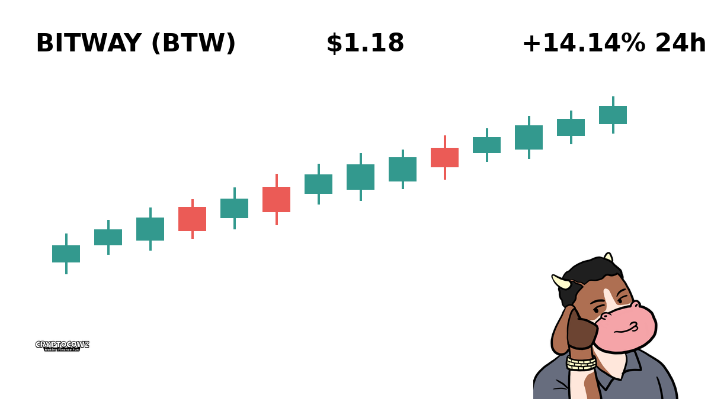
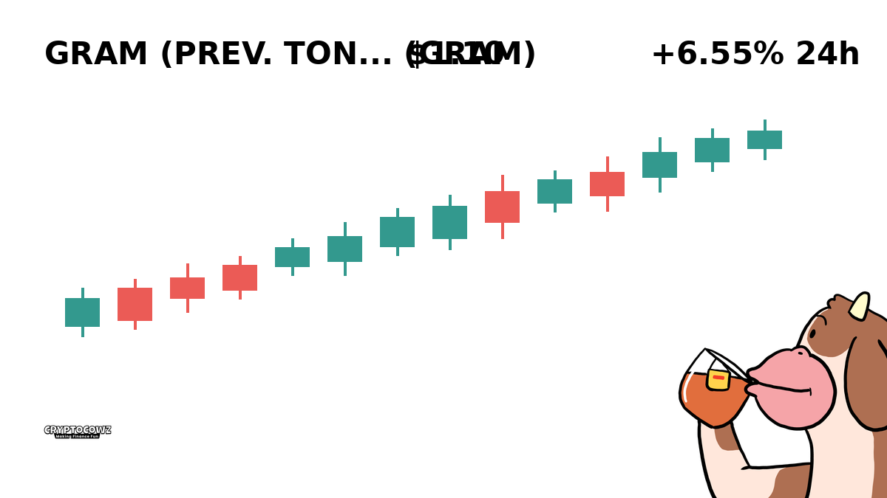
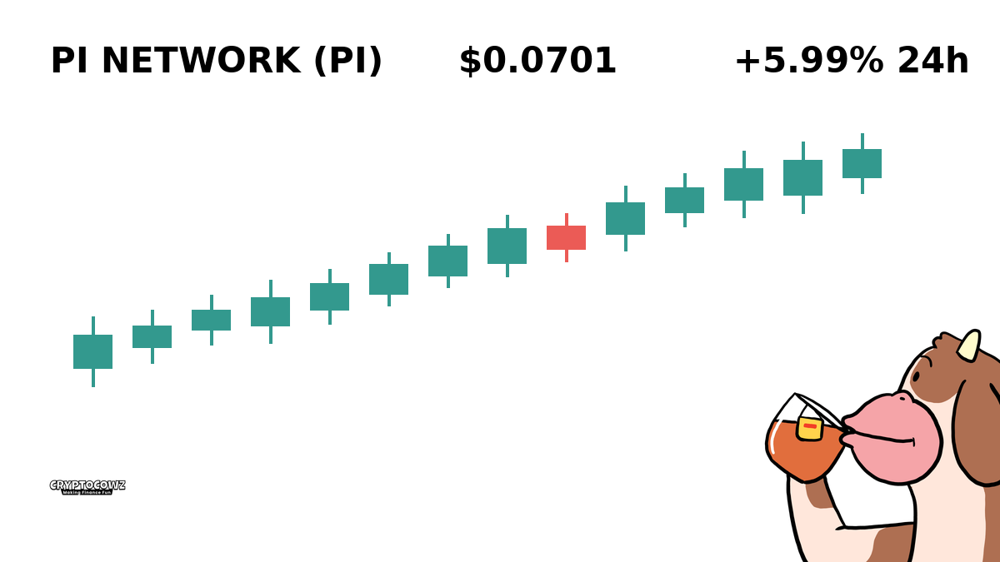
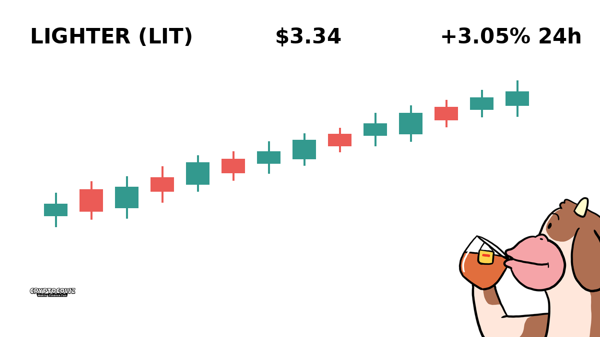
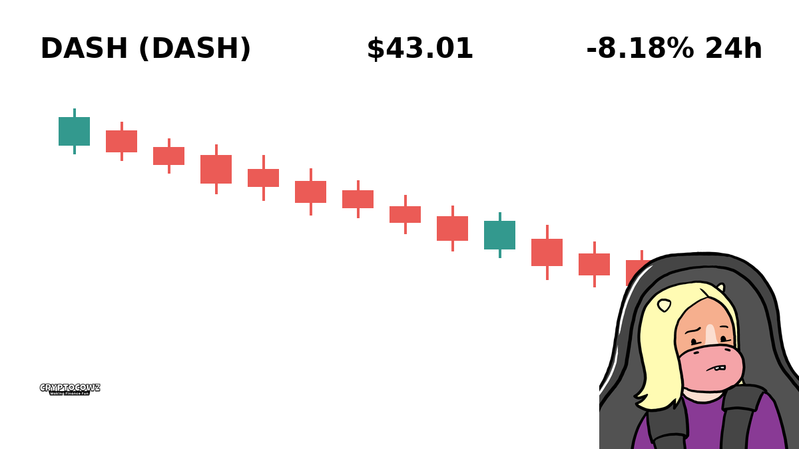
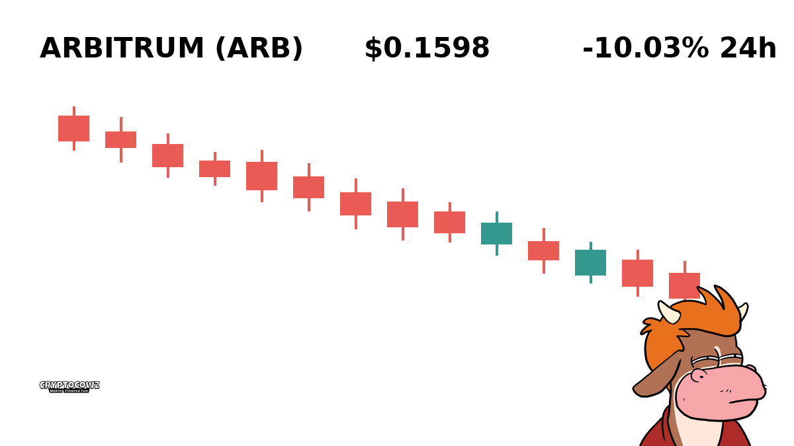
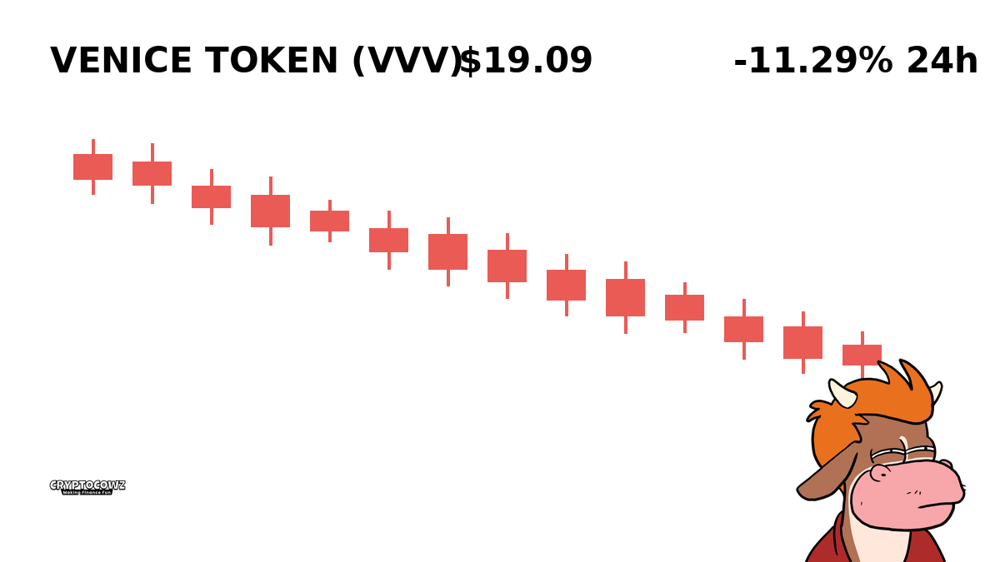
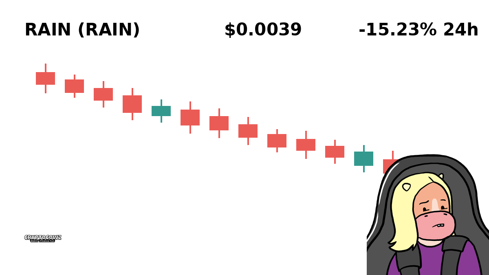

# Daily Top Movers: CMC Community Visuals & Posts

## 1. Bitway ($BTW) — +14.14% (PUMP)
**Cast Member:** Skip Zinfandel
**CMC Comment:** Bitway is flying straight to the moon and taking my second mortgage right along with it! We are all gonna buy yachts by Tuesday!

---

## 2. Gram (prev. Toncoin) ($GRAM) — +6.55% (PUMP)
**Cast Member:** Sunshine Innocent Nimbus
**CMC Comment:** The universe is aligning so beautifully for Gram today, sending warm golden energy to every validator node in existence.

---

## 3. Pi Network ($PI) — +5.99% (PUMP)
**Cast Member:** Frank Rizzo
**CMC Comment:** Listen to me, you tap your phone screen twice and suddenly you're a Wall Street titan? I love this stupid game.

---

## 4. Midnight ($NIGHT) — +4.97% (PUMP)
**Cast Member:** Professor Hartmut
**CMC Comment:** A modest green candle during Midnight hours merely confirms my empirical theorem on irrational nocturnal exuberance.

---

## 5. Lighter ($LIT) — +3.05% (PUMP)
**Cast Member:** Skip Zinfandel
**CMC Comment:** Lighter is sparking up a green candle that has my inner degenerate screaming for maximum leverage!

---

## 6. Dash ($DASH) — -8.18% (DUMP)
**Cast Member:** Frank Rizzo
**CMC Comment:** Dash? More like dash for the exit before your portfolio looks like a total crime scene.

---

## 7. Arbitrum ($ARB) — -10.03% (DUMP)
**Cast Member:** Professor Hartmut
**CMC Comment:** The statistical velocity of Arbitrum's current decline suggests bagholders are experiencing severe emotional entropy.

---

## 8. Venice Token ($VVV) — -11.29% (DUMP)
**Cast Member:** Sunshine Innocent Nimbus
**CMC Comment:** Venice Token is just washing away negative aura so we can rebuild our spirit from a place of pure, heavy bagholding.

---

## 9. Zcash ($ZEC) — -12.18% (DUMP)
**Cast Member:** Skip Zinfandel
**CMC Comment:** Privacy coins are great because nobody can see me crying in absolute pitch darkness right now.

---

## 10. Rain ($RAIN) — -15.23% (DUMP)
**Cast Member:** Frank Rizzo
**CMC Comment:** It is raining blood on this chart, capish? Grab an umbrella or get washed straight down the sewer.

---
