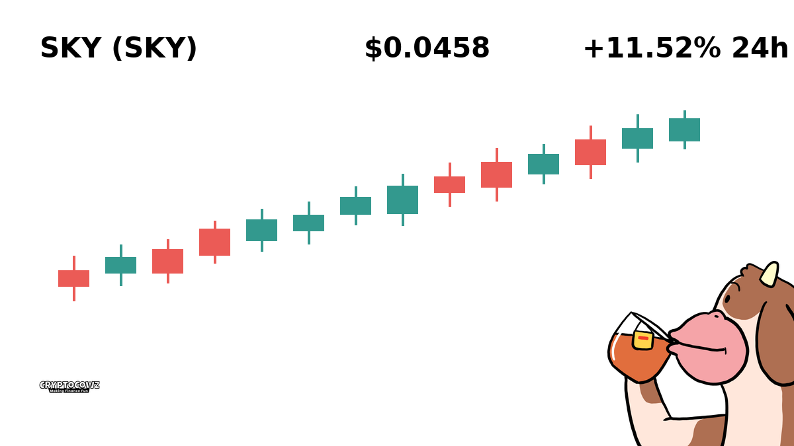
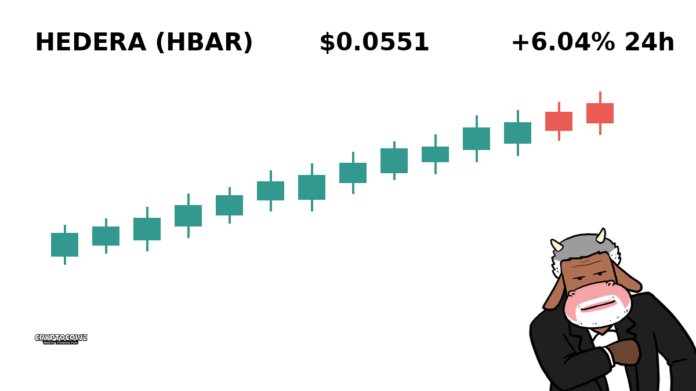
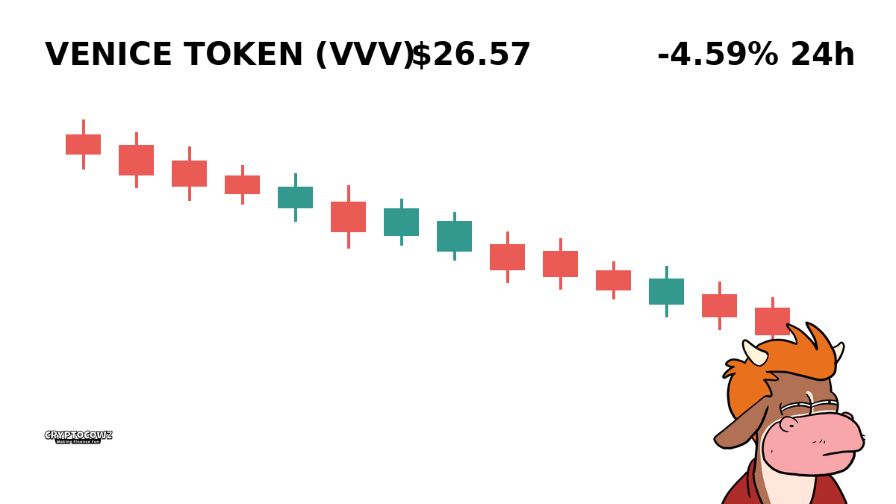
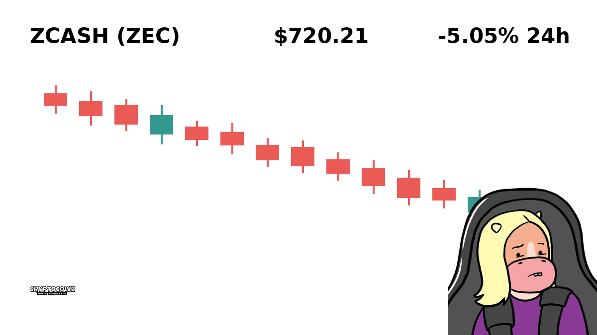
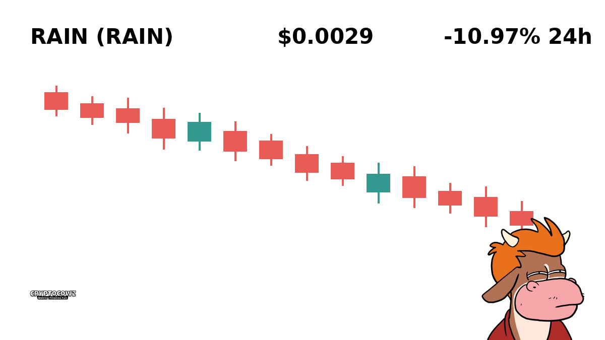
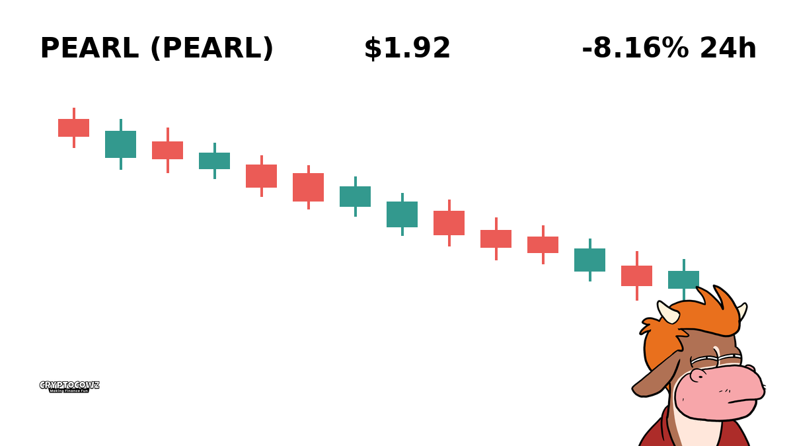
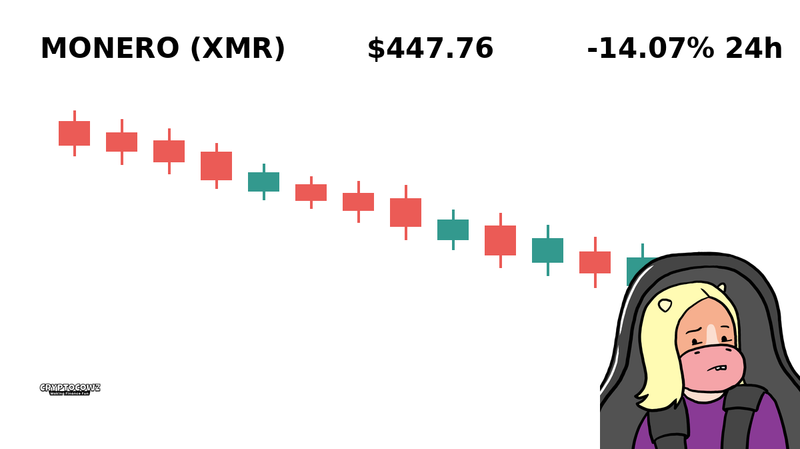

# Daily Top Movers: CMC Community Visuals & Posts

## 1. Sky ($SKY) — +11.52% (PUMP)
**Cast Member:** Skip Zinfandel
**CMC Comment:** Up 11% today, which means I have officially upgraded my afternoon snack from lukewarm paste to artisanal luxury hay. Sky is the limit!

---

## 2. Bitway ($BTW) — +10.36% (PUMP)
**Cast Member:** Frank Rizzo
**CMC Comment:** Bitway pumpin over 10 percent? Listen to me, I already put my wife's mink coat up for collateral to double down right now!

---

## 3. Pieverse ($PIEVERSE) — +7.69% (PUMP)
**Cast Member:** Sunshine Innocent Nimbus
**CMC Comment:** Oh wow, Pieverse is floating up like a freshly baked warm pie! My heart is so full and my digital pockets are feeling extra fluffy!

---

## 4. Hedera ($HBAR) — +6.04% (PUMP)
**Cast Member:** Professor Hartmut
**CMC Comment:** A 6.04% upward variance in hashgraph telemetry confirms my hypothesis: retail FOMO remains mathematically predictable yet wildly irrational.

---

## 5. WhiteBIT Coin ($WBT) — +5.11% (PUMP)
**Cast Member:** Skip Zinfandel
**CMC Comment:** WhiteBIT keeps greening out! Time to order the gold-plated pasture gates and ignore every fundamental risk metric known to man!

---

## 6. Venice Token ($VVV) — -4.59% (DUMP)
**Cast Member:** Frank Rizzo
**CMC Comment:** Venice Token is sinking faster than a cement gondola! Hey, who turned off the pumps? I am drowning in red ink over here!

---

## 7. Zcash ($ZEC) — -5.05% (DUMP)
**Cast Member:** Professor Hartmut
**CMC Comment:** Privacy protocols cannot obfuscate this downward trajectory. The zero-knowledge proofs remain robust, but my liquid balance sheet is utterly compromised.

---

## 8. Rain ($RAIN) — -7.42% (DUMP)
**Cast Member:** Sunshine Innocent Nimbus
**CMC Comment:** They said it was just going to be a gentle little shower, but now my entire portfolio is completely soaked in sad red tear-drops...

---

## 9. Pearl ($PEARL) — -8.16% (DUMP)
**Cast Member:** Skip Zinfandel
**CMC Comment:** Clutching my pearls while PEARL clutches the ocean floor. Down 8%? Just a tactical micro-dip before the legendary 10,000x recovery!

---

## 10. Monero ($XMR) — -14.07% (DUMP)
**Cast Member:** Frank Rizzo
**CMC Comment:** Monero down 14%? You can't even trace who stole all my money! It's the perfect crime and a terrible investment!

---
