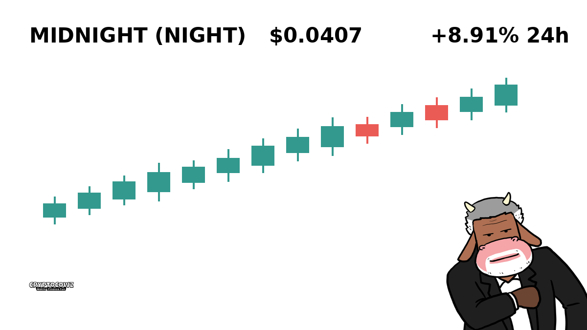
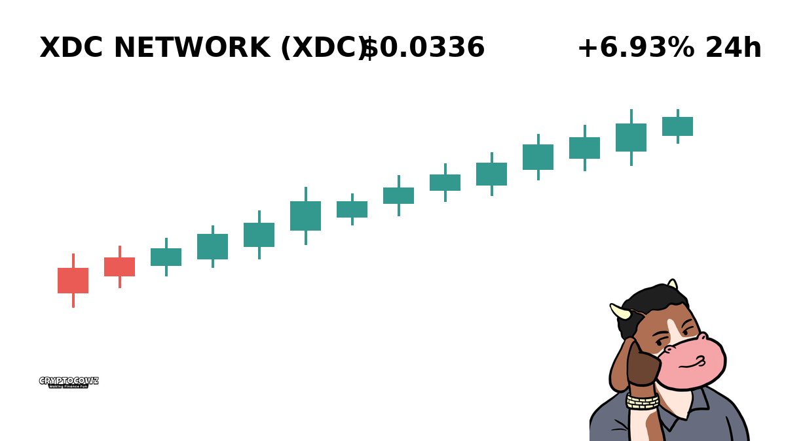
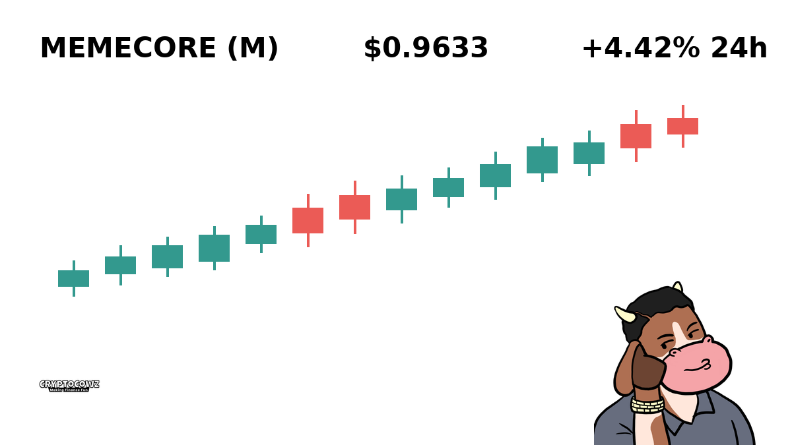
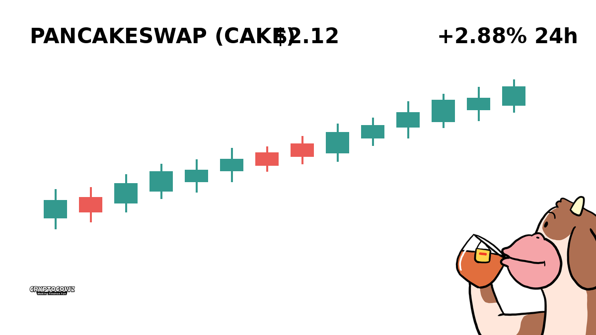
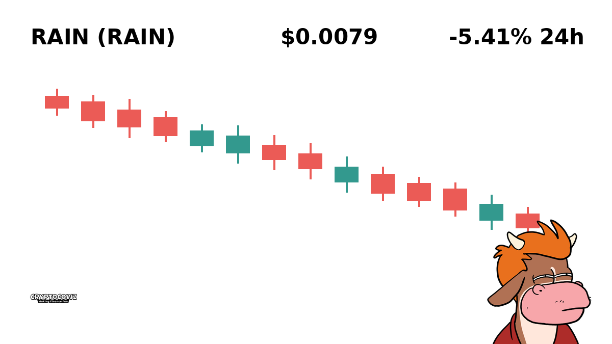
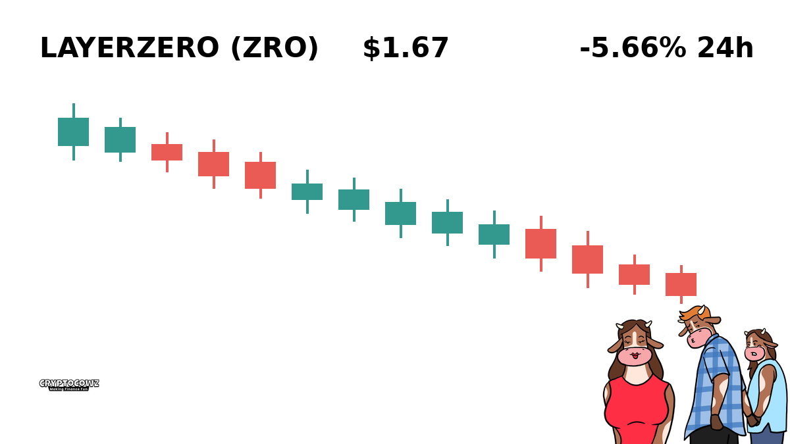
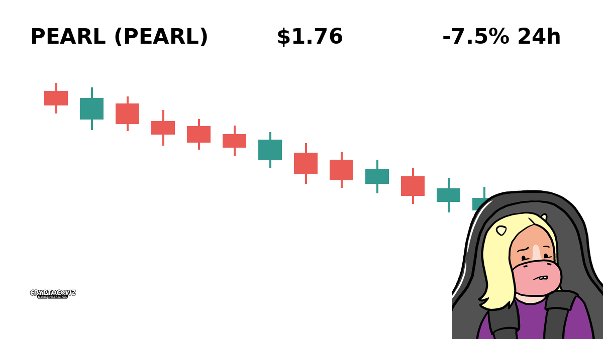

# Daily Top Movers: CMC Community Visuals & Posts

## 1. Midnight ($NIGHT) — +8.91% (PUMP)
**Cast Member:** Skip Zinfandel
**CMC Comment:** Up nearly nine percent past bedtime? Time to sleep when you are dead and trade when you are manic.

---

## 2. XDC Network ($XDC) — +6.93% (PUMP)
**Cast Member:** Professor Hartmut
**CMC Comment:** My quantitative models suggest that a 6.93% increase in XDC directly correlates with localized dopamine spikes in retail speculators.

---

## 3. Quant ($QNT) — +6.2% (PUMP)
**Cast Member:** Frank Rizzo
**CMC Comment:** Two hundred bucks a pop and still moving up; looks like someone finally figured out how to turn enterprise buzzwords into cold hard green.

---

## 4. MemeCore ($M) — +4.42% (PUMP)
**Cast Member:** Sunshine Innocent Nimbus
**CMC Comment:** The universe is aligning through MemeCore, bringing us financial abundance one little green candle at a time!

---

## 5. PancakeSwap ($CAKE) — +2.88% (PUMP)
**Cast Member:** Skip Zinfandel
**CMC Comment:** Pass the syrup, boys, because we are stacking sweet, sweet green pancakes all the way to retirement!

---

## 6. Lighter ($LIT) — -4.32% (DUMP)
**Cast Member:** Frank Rizzo
**CMC Comment:** Lighter took a dive, and now everyone is sitting in the dark holding a burned out plastic husk.

---

## 7. Rain ($RAIN) — -5.41% (DUMP)
**Cast Member:** Sunshine Innocent Nimbus
**CMC Comment:** It is just a gentle downpour of opportunity washing away our earthly material attachments.

---

## 8. LayerZero ($ZRO) — -5.66% (DUMP)
**Cast Member:** Professor Hartmut
**CMC Comment:** LayerZero appears to be approaching its namesake faster than my peer-reviewed risk models anticipated.

---

## 9. Pearl ($PEARL) — -7.5% (DUMP)
**Cast Member:** Skip Zinfandel
**CMC Comment:** Clutch those pearls tight, bagholders, because this underwater dive was not in the promotional pitch deck!

---

## 10. Bitway ($BTW) — -25.69% (DUMP)
**Cast Member:** Frank Rizzo
**CMC Comment:** Down twenty-five percent? By the way, your portfolio just got chopped while you were getting coffee.

---
