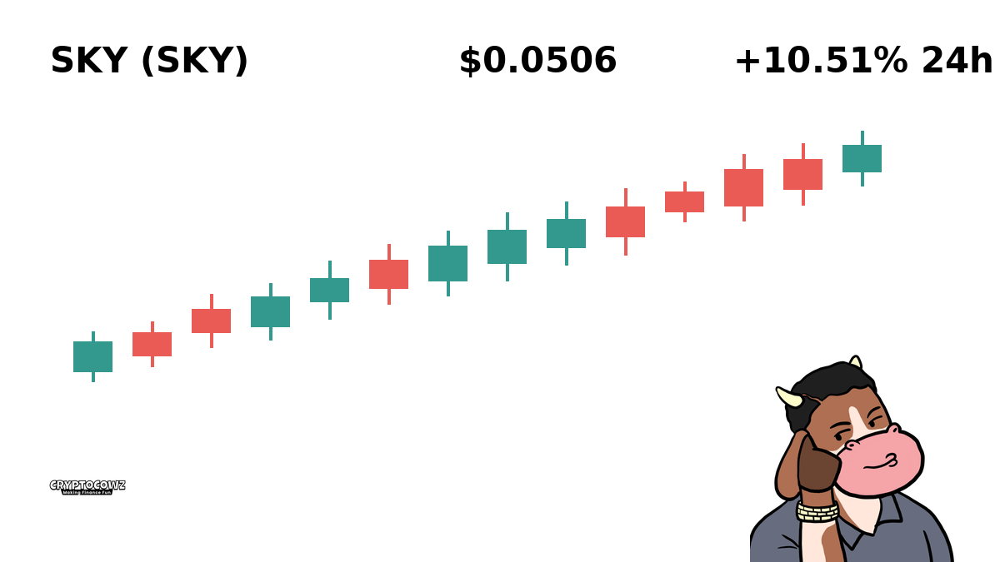
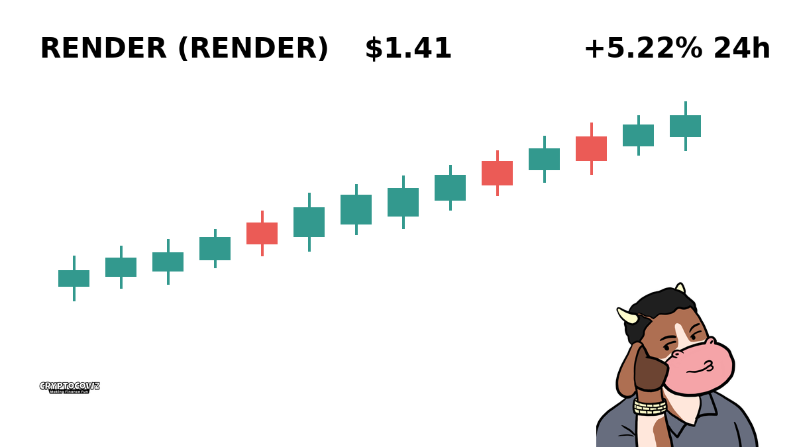
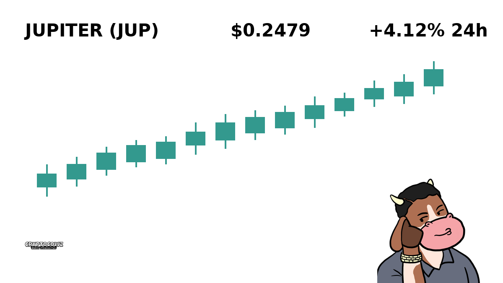
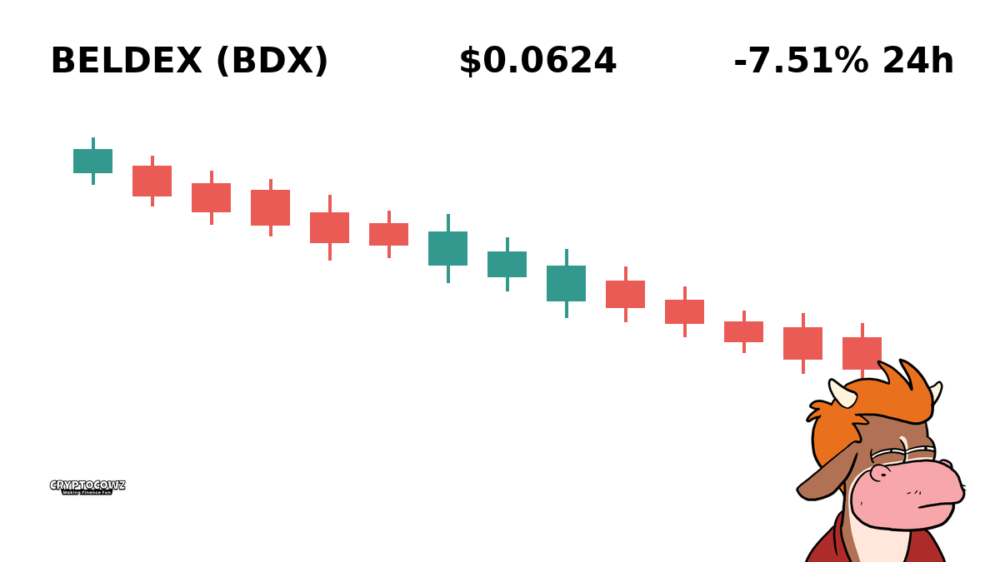
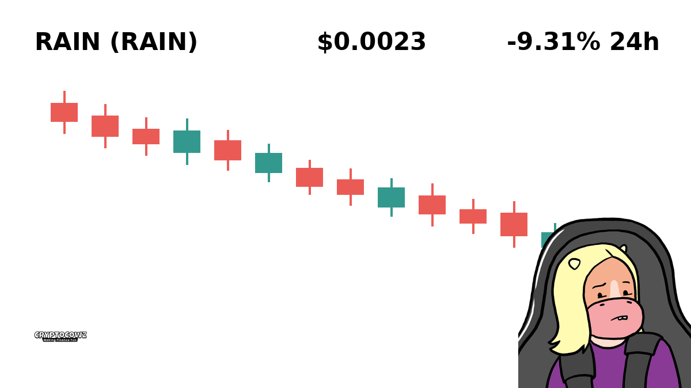
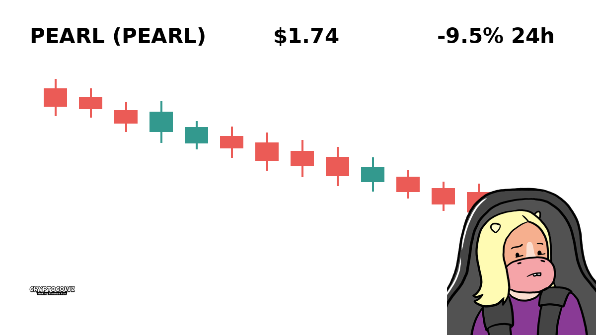
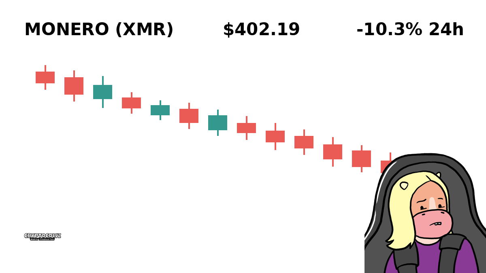
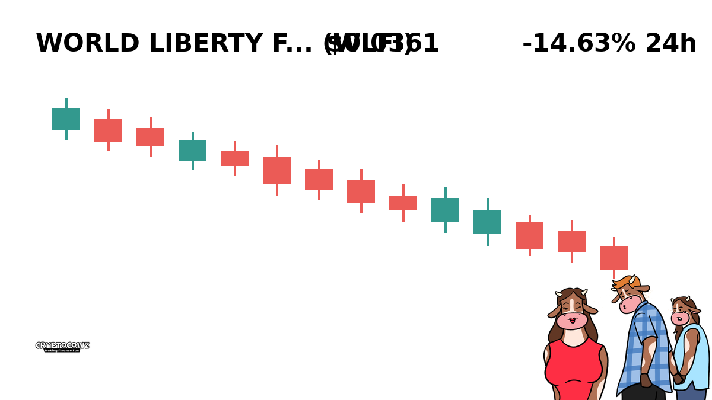

# Daily Top Movers: CMC Community Visuals & Posts

## 1. Bitway ($BTW) — +16.71% (PUMP)
**Cast Member:** Skip Zinfandel
**CMC Comment:** Up 16% on pure hopium and unearned confidence. I have already leveraged my second pasture to buy the top!

---

## 2. Sky ($SKY) — +10.51% (PUMP)
**Cast Member:** Sunshine Innocent Nimbus
**CMC Comment:** The sky is not even the limit anymore, we are floating straight into bovine enlightenment! Just remember to never look down at the order book.

---

## 3. Render ($RENDER) — +5.22% (PUMP)
**Cast Member:** Frank Rizzo
**CMC Comment:** Yeah yeah, rendering green candles all day. Keep buying, kid, my retirement fund needs another zero on it.

---

## 4. Jupiter ($JUP) — +4.12% (PUMP)
**Cast Member:** Professor Hartmut
**CMC Comment:** Mathematically speaking, a 4% trajectory toward Jupiter suggests high-gravity FOMO. Proceed with cautious euphoria.

---

## 5. Lighter ($LIT) — +4.0% (PUMP)
**Cast Member:** Skip Zinfandel
**CMC Comment:** It is lit, literally! I do not even know what this token does, but green numbers mean I can afford imported hay tonight.

---

## 6. Beldex ($BDX) — -7.51% (DUMP)
**Cast Member:** Frank Rizzo
**CMC Comment:** Privacy coin? The only thing private here is my tears while I hold this heavy bag in absolute silence.

---

## 7. Rain ($RAIN) — -9.31% (DUMP)
**Cast Member:** Sunshine Innocent Nimbus
**CMC Comment:** It is raining red candles, but remember, every storm washes away the paper hands to leave behind pure mud.

---

## 8. Pearl ($PEARL) — -9.5% (DUMP)
**Cast Member:** Skip Zinfandel
**CMC Comment:** Clutching my pearls while watching PEARL crash nearly 10%. Guess who forgot to set a stop-loss again?

---

## 9. Monero ($XMR) — -10.3% (DUMP)
**Cast Member:** Professor Hartmut
**CMC Comment:** Monero's stealth protocol is working perfectly; my portfolio gains have completely vanished without a trace.

---

## 10. World Liberty Financial ($WLFI) — -14.63% (DUMP)
**Cast Member:** Frank Rizzo
**CMC Comment:** Liberty is not free, and today it cost me 14 percent of my entire net worth. Absolute dumpster fire.

---
