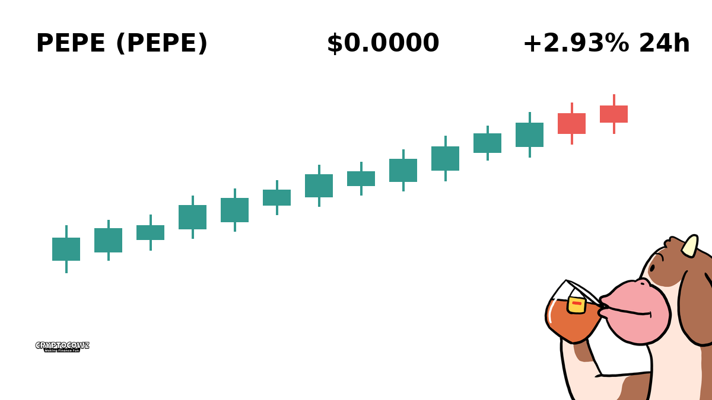
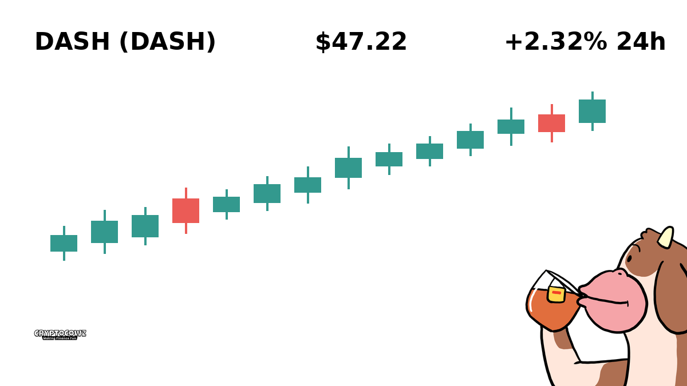
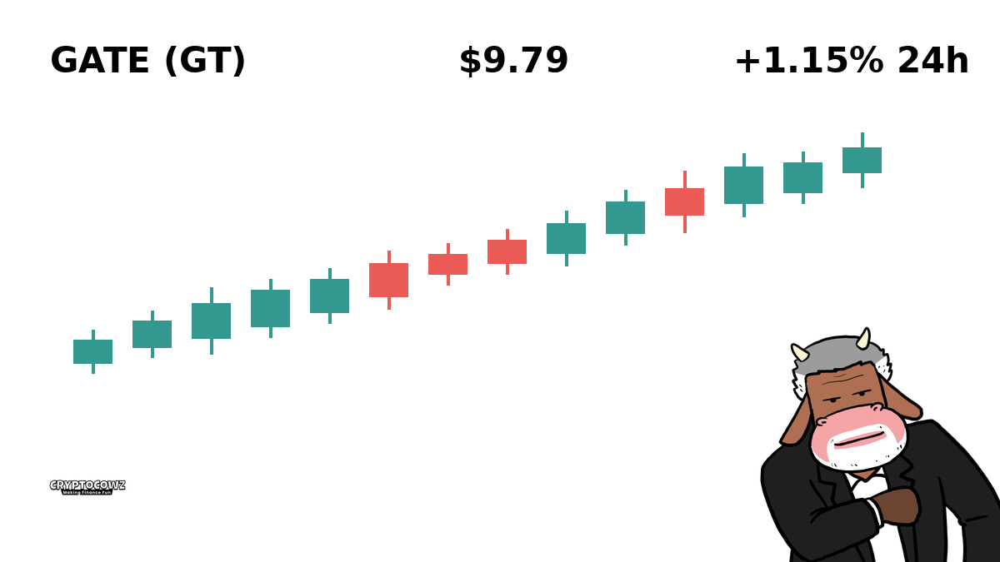
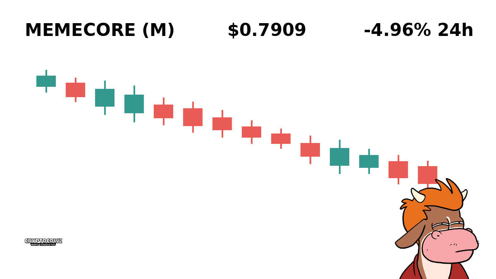
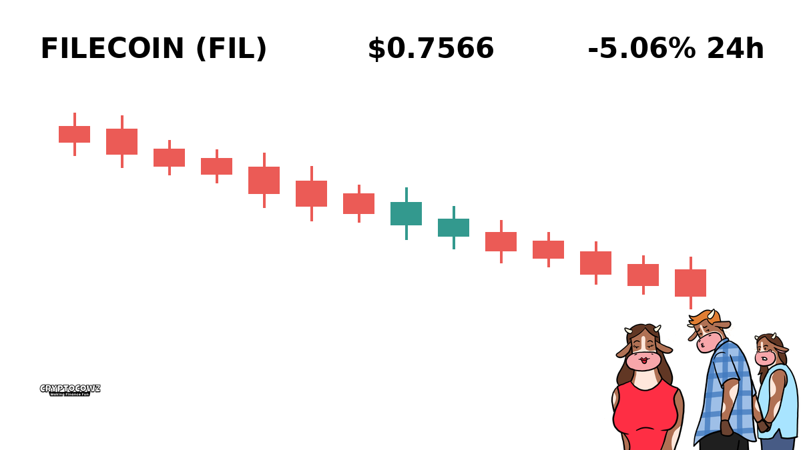
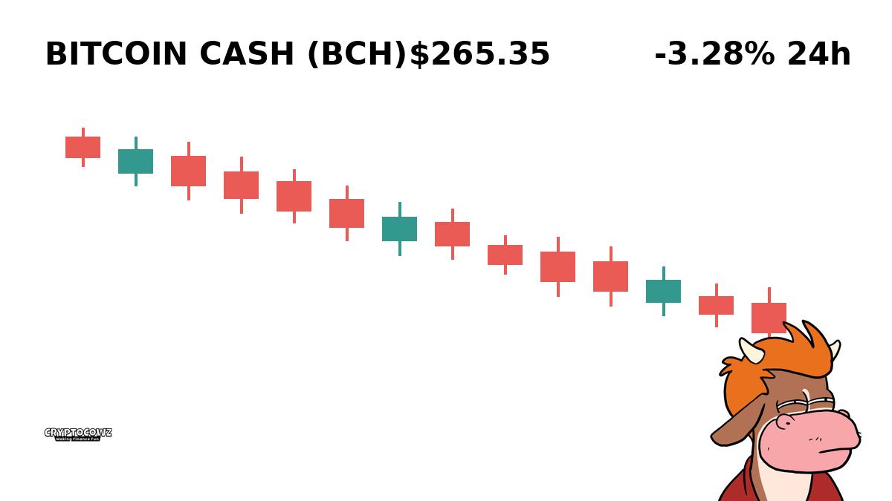
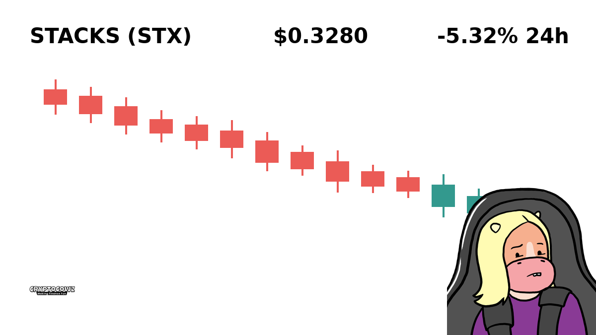

# Daily Top Movers: CMC Community Visuals & Posts

## 1. Pepe ($PEPE) — +2.93% (PUMP)
**Cast Member:** Skip Zinfandel
**CMC Comment:** Up under three percent and I've already put down a deposit on a gold-plated yacht for my frog.

---

## 2. Dash ($DASH) — +2.32% (PUMP)
**Cast Member:** Frank Rizzo
**CMC Comment:** Two percent gains? Put the coffee down kid, that ain't even enough to cover my blood pressure meds.

---

## 3. Figure Heloc ($FIGR_HELOC) — +1.59% (PUMP)
**Cast Member:** Professor Hartmut
**CMC Comment:** Fascinating how leverage on home equity can stimulate such trivial green candles in modern liquidity pools.

---

## 4. Quant ($QNT) — +1.53% (PUMP)
**Cast Member:** Skip Zinfandel
**CMC Comment:** Institutional tech is pumping so hard I might actually pay my tax debt this year, dynamic leverage baby!

---

## 5. Gate ($GT) — +1.15% (PUMP)
**Cast Member:** Sunshine Innocent Nimbus
**CMC Comment:** Oh look, the green line went up a tiny bit! Does this mean everyone in the pasture gets free smoothies now?

---

## 6. MemeCore ($M) — -4.96% (DUMP)
**Cast Member:** Skip Zinfandel
**CMC Comment:** Down five percent? Relax, it's just a healthy structural correction before we launch to Alpha Centauri.

---

## 7. Filecoin ($FIL) — -5.06% (DUMP)
**Cast Member:** Professor Hartmut
**CMC Comment:** The decentralized storage protocol appears to be leaking value far faster than it stores hard data.

---

## 8. Bitcoin Cash ($BCH) — -5.21% (DUMP)
**Cast Member:** Frank Rizzo
**CMC Comment:** Another red day for Satoshi's red-headed stepchild. Sell it off and buy real estate, you degenerates.

---

## 9. Stacks ($STX) — -5.32% (DUMP)
**Cast Member:** Sunshine Innocent Nimbus
**CMC Comment:** My little Bitcoin layer-two tokens are taking a sleepy nap today, but I'm sure they'll wake up happy!

---

## 10. Rain ($RAIN) — -5.95% (DUMP)
**Cast Member:** Frank Rizzo
**CMC Comment:** It's raining pain and my portfolio is soaked. Get me out of this liquid garbage before I lose my shoes.

---
