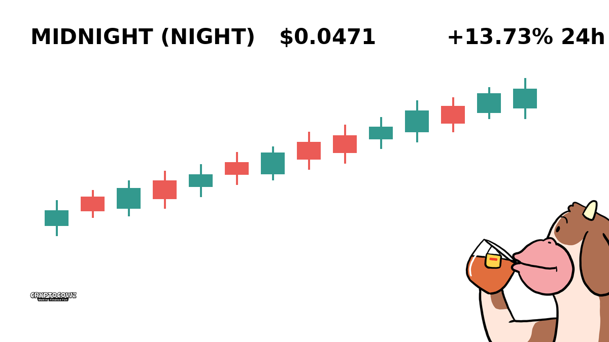
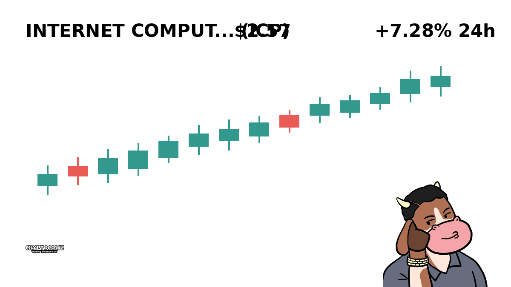
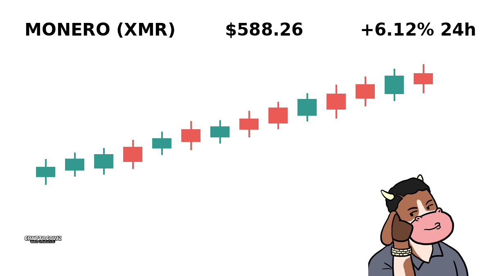
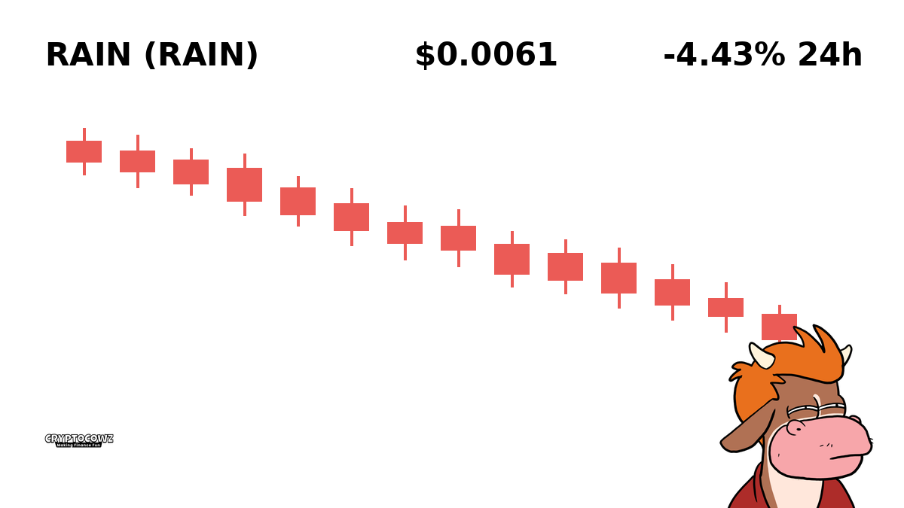
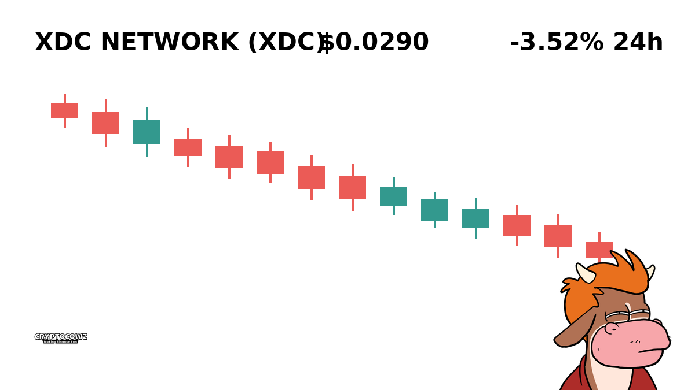
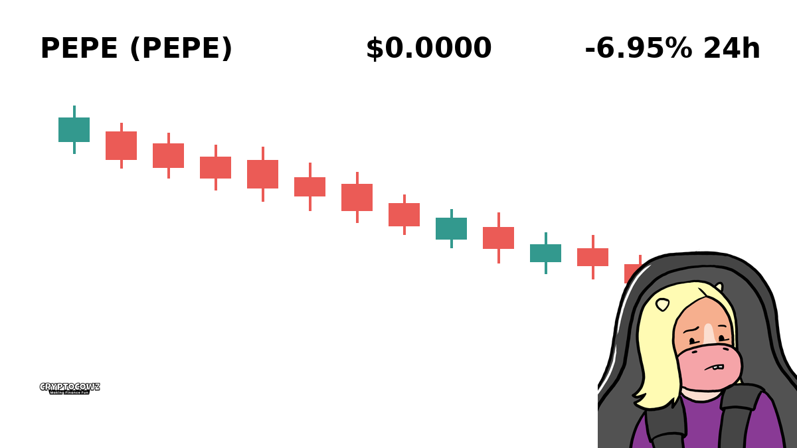

# Daily Top Movers: CMC Community Visuals & Posts

## 1. Midnight ($NIGHT) — +13.73% (PUMP)
**Cast Member:** Skip Zinfandel
**CMC Comment:** Up nearly 14% past midnight? Time to quit my day job and buy a second jet ski before dawn.

---

## 2. Gram (prev. Toncoin) ($GRAM) — +10.1% (PUMP)
**Cast Member:** Sunshine Innocent Nimbus
**CMC Comment:** A 10% gain means the universe is aligned and Gram's aura is practically beaming pure gold right now!

---

## 3. LayerZero ($ZRO) — +7.93% (PUMP)
**Cast Member:** Frank Rizzo
**CMC Comment:** LayerZero bridged straight into my wallet with nearly 8% gains, so don't ask where the money came from, capiche?

---

## 4. Internet Computer ($ICP) — +7.28% (PUMP)
**Cast Member:** Professor Hartmut
**CMC Comment:** Mathematically speaking, a 7% surge in Internet Computer suggests the decentralized web is finally outsmarting traditional digital entropy.

---

## 5. Monero ($XMR) — +6.12% (PUMP)
**Cast Member:** Frank Rizzo
**CMC Comment:** Monero is up over 6% today and there is zero paper trail on these gains, just the way I like it.

---

## 6. Rain ($RAIN) — -2.61% (DUMP)
**Cast Member:** Skip Zinfandel
**CMC Comment:** It's raining red candles and my portfolio is soaked, but real alpha degens don't use umbrellas.

---

## 7. XDC Network ($XDC) — -3.52% (DUMP)
**Cast Member:** Professor Hartmut
**CMC Comment:** A 3.5% retraction indicates systemic user hesitation within the enterprise network infrastructure paradigm.

---

## 8. Zcash ($ZEC) — -3.89% (DUMP)
**Cast Member:** Sunshine Innocent Nimbus
**CMC Comment:** Zcash is down almost 4%, but privacy is a peaceful state of mind that market dips can never erase!

---

## 9. Pepe ($PEPE) — -6.95% (DUMP)
**Cast Member:** Frank Rizzo
**CMC Comment:** The frog took a 7% dive straight into the gutter, but I am holding these heavy bags till the bitter end.

---

## 10. Bitway ($BTW) — -16.81% (DUMP)
**Cast Member:** Skip Zinfandel
**CMC Comment:** Down almost 17% today. By the way, my 50x leverage position just completely vaporized.

---
