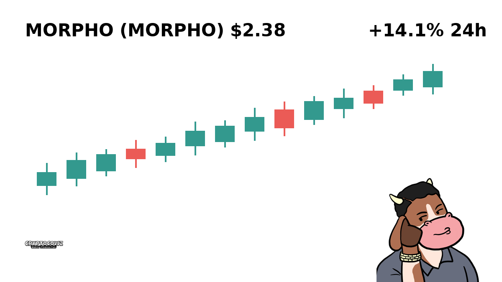
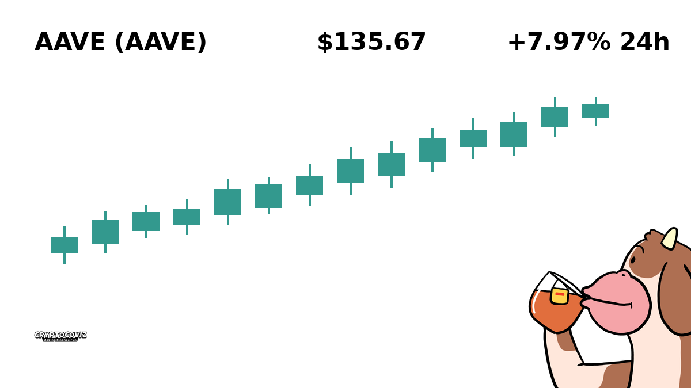
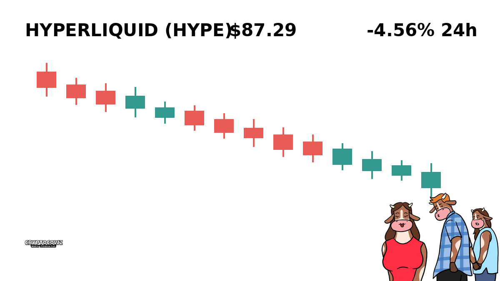
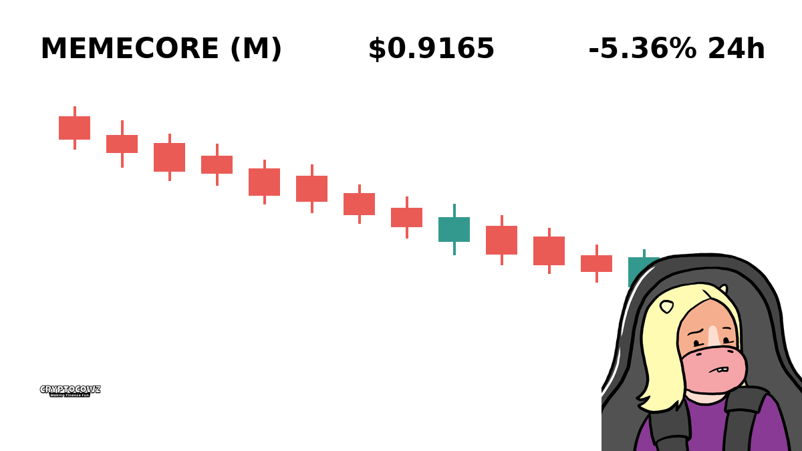
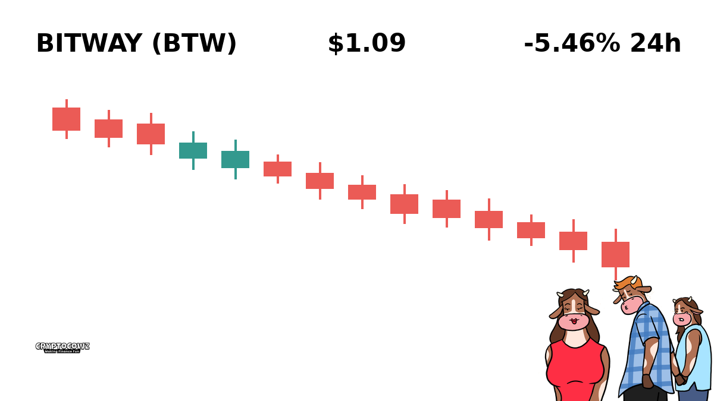
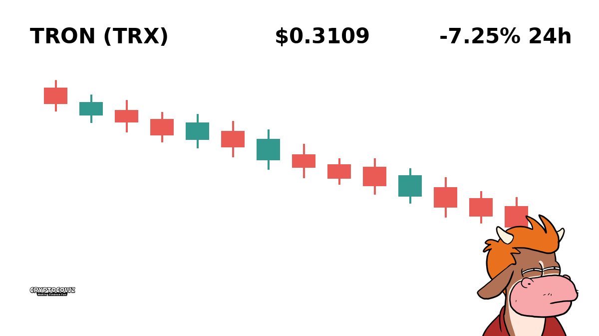

# Daily Top Movers: CMC Community Visuals & Posts

## 1. Stacks ($STX) — +15.62% (PUMP)
**Cast Member:** Skip Zinfandel
**CMC Comment:** Just quit my day job to stack smart contracts full time. Satoshi himself couldn't stop this glorious green candle from buying my next yacht.

---

## 2. Morpho ($MORPHO) — +14.1% (PUMP)
**Cast Member:** Frank Rizzo
**CMC Comment:** Yield optimizations are morphing straight into my offshore account, keep pumping it you beautiful idiots!

---

## 3. Ether.fi ($ETHFI) — +7.99% (PUMP)
**Cast Member:** Professor Hartmut
**CMC Comment:** Economically speaking, liquid restaking surges are driven by collective cognitive dissonance, yet my portfolio is up eight percent so logic is irrelevant.

---

## 4. Aave ($AAVE) — +7.97% (PUMP)
**Cast Member:** Skip Zinfandel
**CMC Comment:** Liquidation protocols? More like liquidity straight into my champagne bucket! We are never seeing double digits again, boys!

---

## 5. Lighter ($LIT) — +6.35% (PUMP)
**Cast Member:** Sunshine Innocent Nimbus
**CMC Comment:** The universe shines so brightly today as Lighter ignites our spiritual wealth! Spread the positive vibes and buy the top!

---

## 6. Rain ($RAIN) — -4.43% (DUMP)
**Cast Member:** Frank Rizzo
**CMC Comment:** Rain is falling alright, straight onto my burning trash fire of a portfolio. Who turned off the damn tap?

---

## 7. Hyperliquid ($HYPE) — -4.56% (DUMP)
**Cast Member:** Professor Hartmut
**CMC Comment:** Empirical data suggests that purchasing assets at peak hype results in standard retail capitulation, a phenomenon currently metastasizing in your accounts.

---

## 8. MemeCore ($M) — -5.36% (DUMP)
**Cast Member:** Frank Rizzo
**CMC Comment:** MemeCore? More like Core Disaster, I am holding a bag so heavy it is actively warping space-time.

---

## 9. Bitway ($BTW) — -5.46% (DUMP)
**Cast Member:** Sunshine Innocent Nimbus
**CMC Comment:** Oh no, Bitway is dipping, but maybe the red candles are just the cosmos teaching us to practice spiritual detachment from earthly gains?

---

## 10. TRON ($TRX) — -7.25% (DUMP)
**Cast Member:** Skip Zinfandel
**CMC Comment:** Justin Sun told me to stay calm, but my margin call doesn't read Telegram messages. Time to liquidate the family lawnmower.

---
