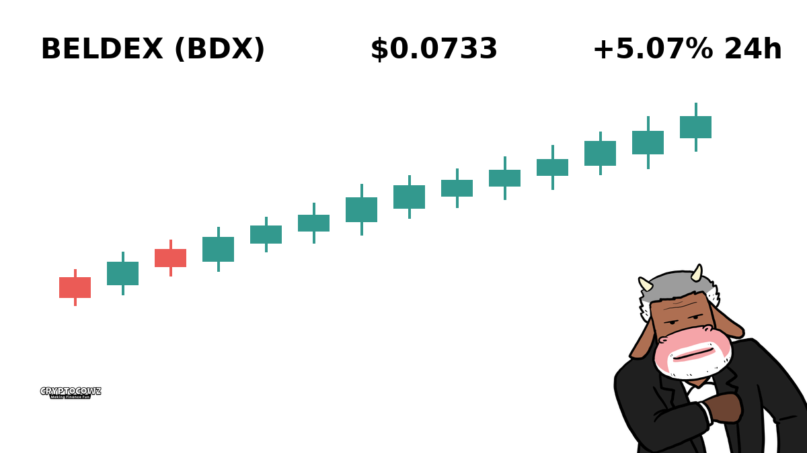
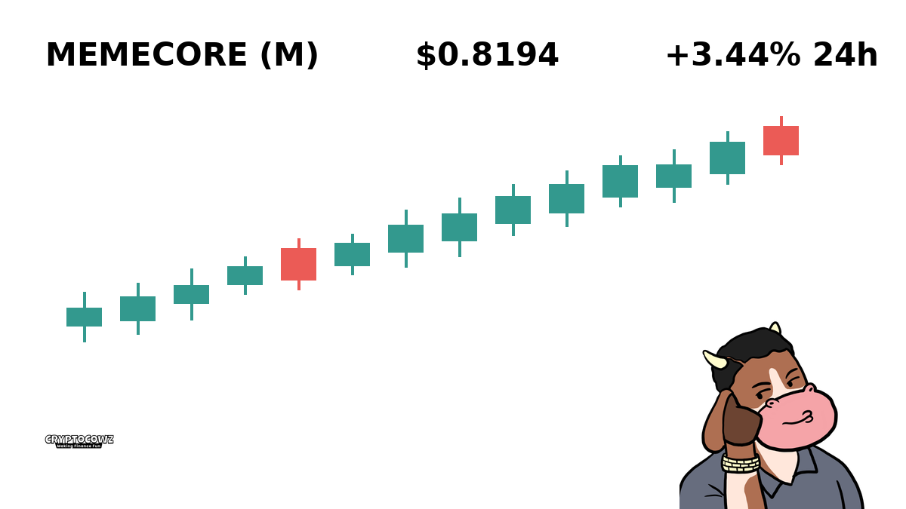
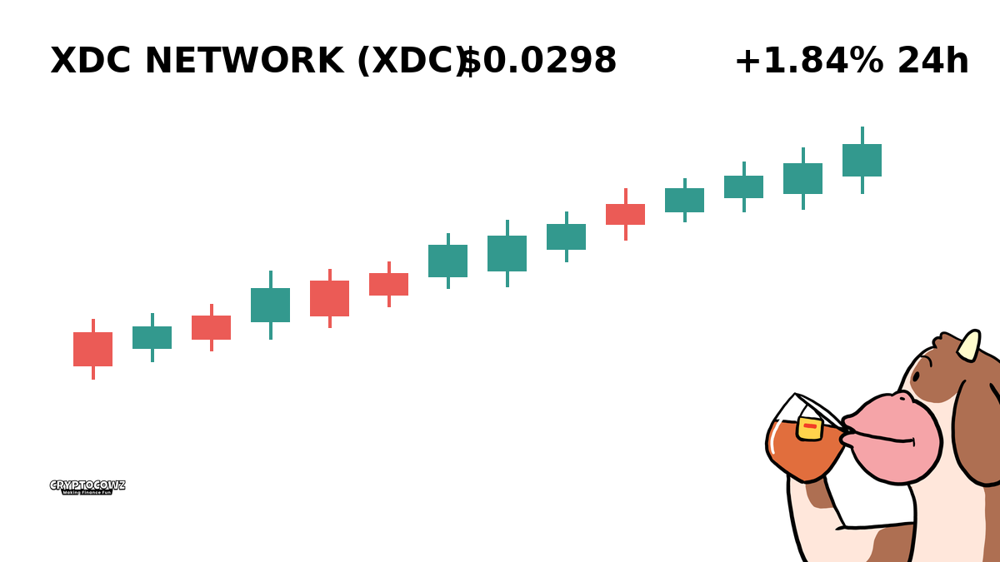
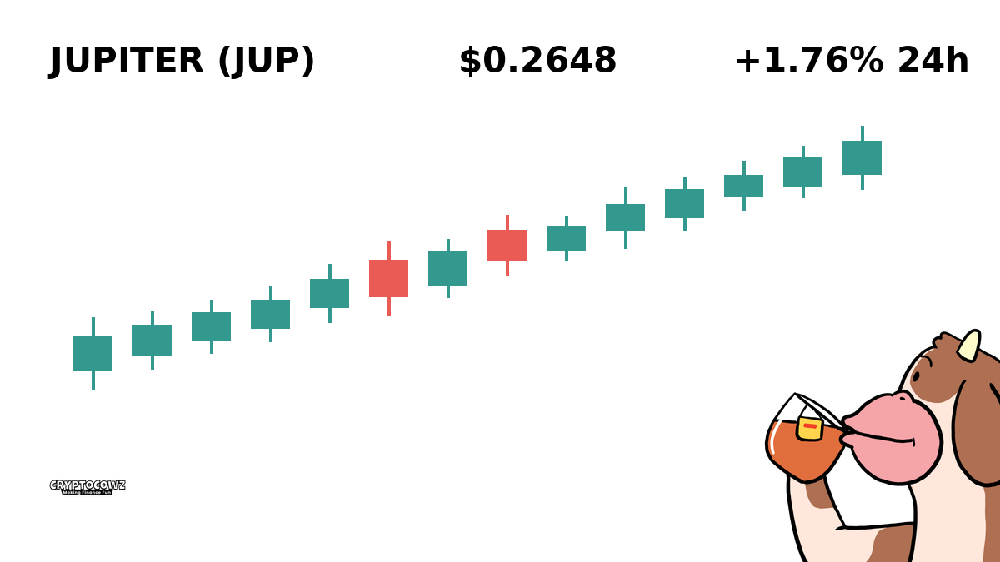
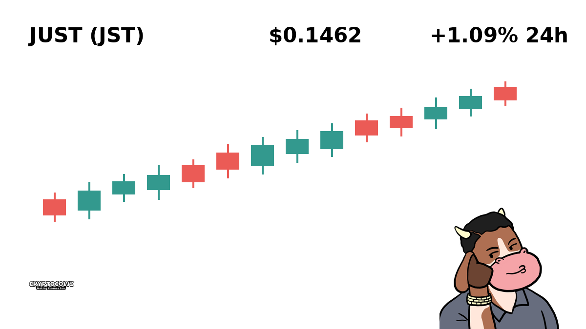
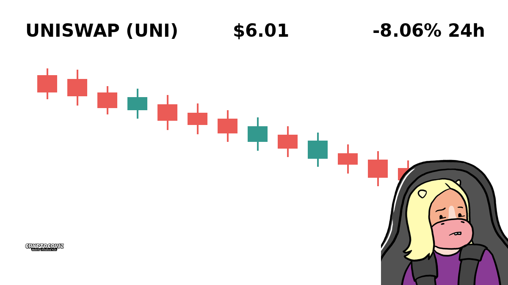
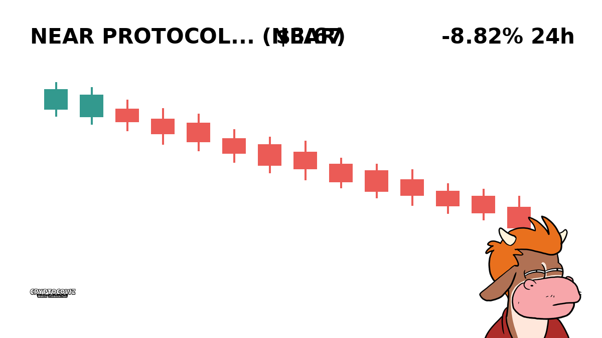
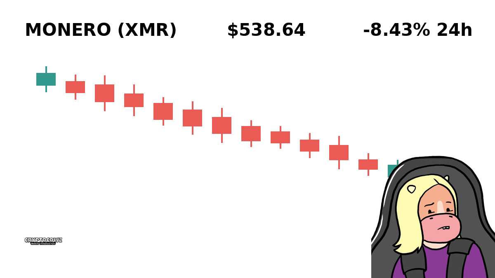
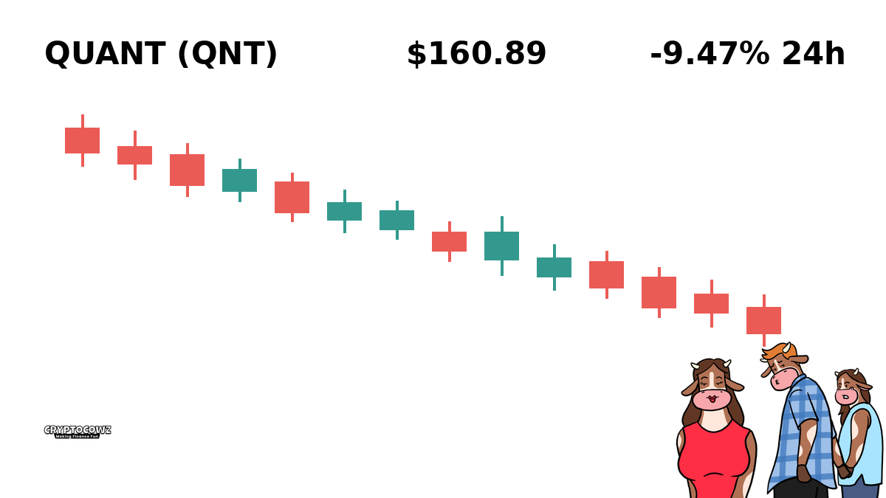
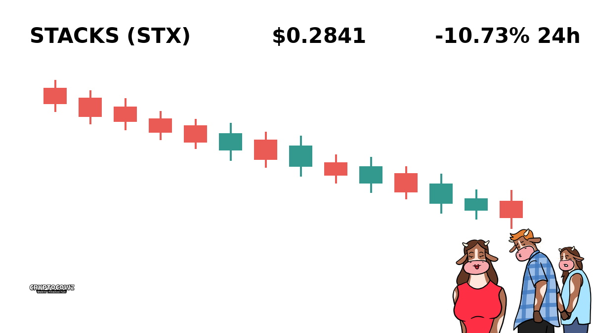

# Daily Top Movers: CMC Community Visuals & Posts

## 1. Beldex ($BDX) — +5.07% (PUMP)
**Cast Member:** Skip Zinfandel
**CMC Comment:** Privacy is cool, but privacy while printing green candles is absolute luxury. I just bought three invisible yachts.

---

## 2. MemeCore ($M) — +3.44% (PUMP)
**Cast Member:** Sunshine Innocent Nimbus
**CMC Comment:** The universe told me that holding single letter tokens aligns my chakras. We are all ascending together!

---

## 3. XDC Network ($XDC) — +1.84% (PUMP)
**Cast Member:** Frank Rizzo
**CMC Comment:** You call under two percent a pump? Back in my day, we did not open the chart for less than double digits, capiche?

---

## 4. Jupiter ($JUP) — +1.76% (PUMP)
**Cast Member:** Professor Hartmut
**CMC Comment:** Mathematically speaking, a tiny upward trajectory toward Jupiter still leaves your portfolio stuck in middle-class stratosphere.

---

## 5. JUST ($JST) — +1.09% (PUMP)
**Cast Member:** Skip Zinfandel
**CMC Comment:** JUST keep buying, baby! A one percent gain today means custom leather interior on my tractor by Tuesday.

---

## 6. Uniswap ($UNI) — -8.06% (DUMP)
**Cast Member:** Frank Rizzo
**CMC Comment:** Who drained the liquidity pool? I come back from my lunch break and my UNI bags are lighter than a paper towel!

---

## 7. NEAR Protocol ($NEAR) — -8.19% (DUMP)
**Cast Member:** Sunshine Innocent Nimbus
**CMC Comment:** Oh no, NEAR is getting further away from my financial freedom! Time to light a scented candle and manifest a recovery.

---

## 8. Monero ($XMR) — -8.43% (DUMP)
**Cast Member:** Professor Hartmut
**CMC Comment:** The untraceable nature of Monero is truly remarkable, especially how quickly my capital untraced itself from the balance sheet.

---

## 9. Quant ($QNT) — -9.47% (DUMP)
**Cast Member:** Skip Zinfandel
**CMC Comment:** Down nearly ten percent? Perfect time to take out a second mortgage and double down before my wife checks the mail.

---

## 10. Stacks ($STX) — -10.73% (DUMP)
**Cast Member:** Frank Rizzo
**CMC Comment:** Stacks? More like stacked liabilities! I am getting crushed under these red blocks, somebody call a tow truck!

---
