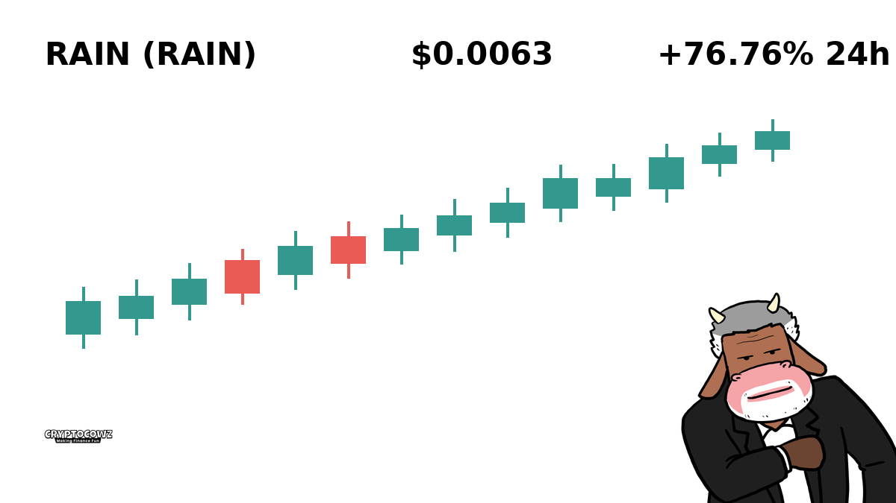
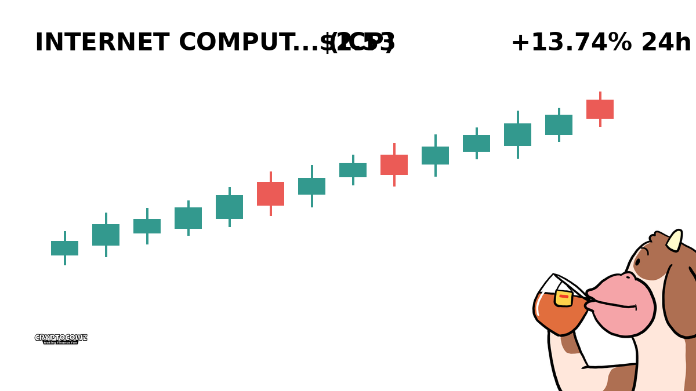
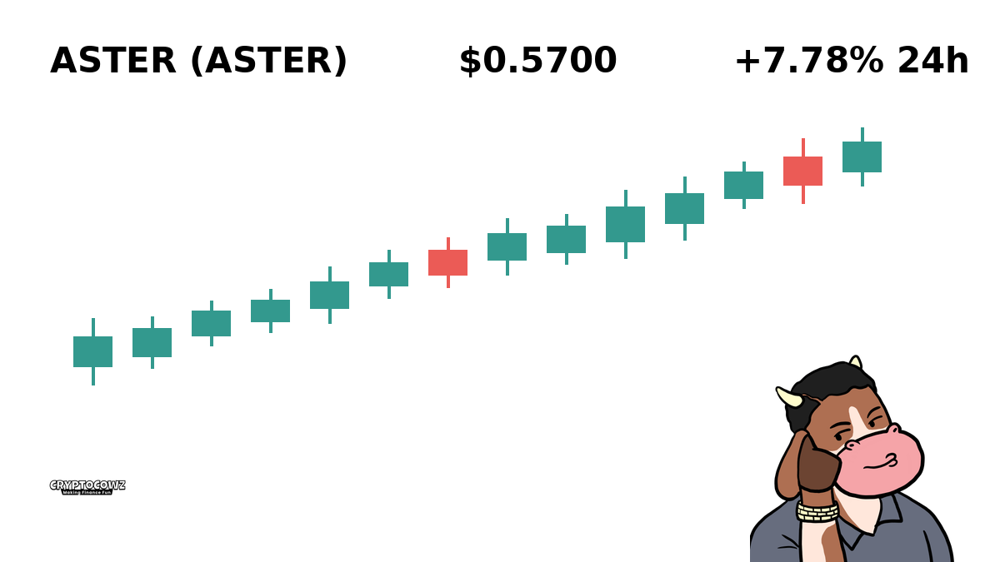
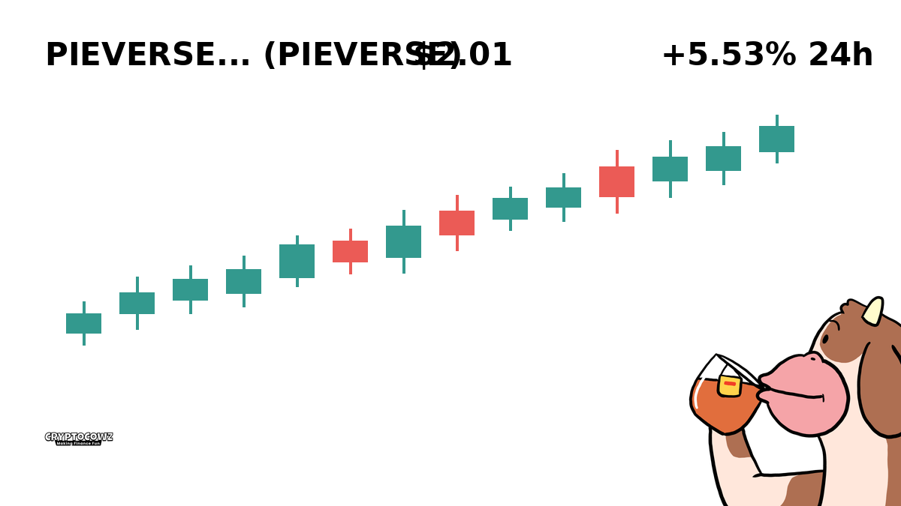
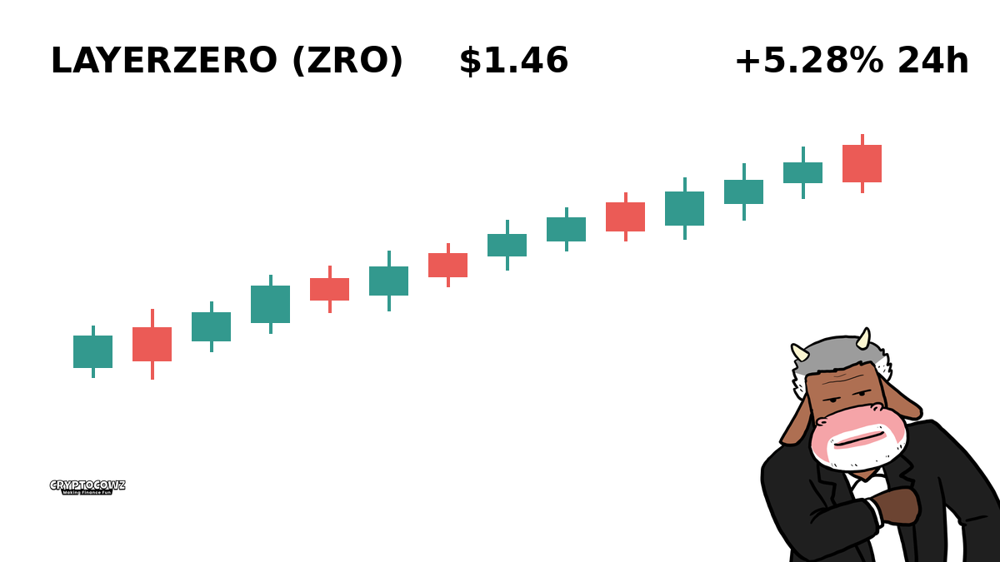
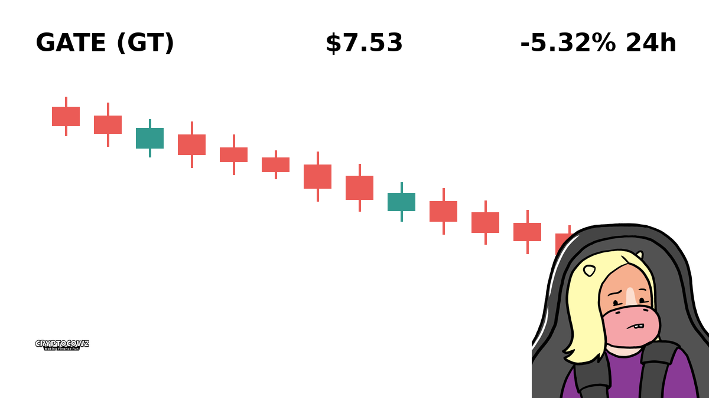
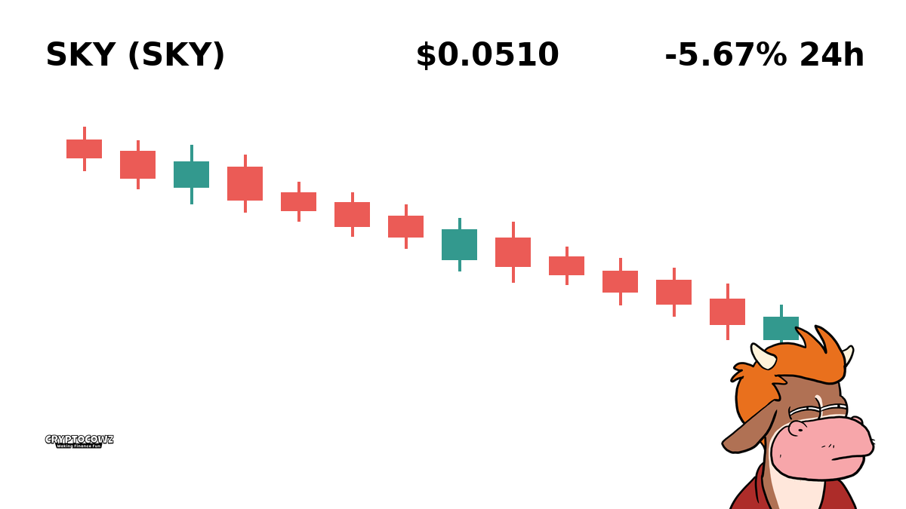
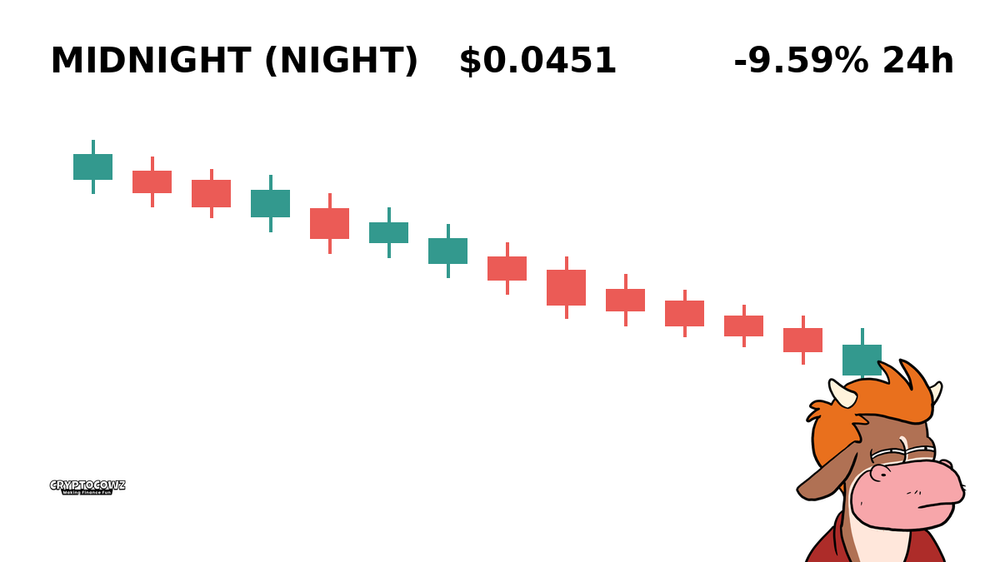

# Daily Top Movers: CMC Community Visuals & Posts

## 1. Rain ($RAIN) — +76.76% (PUMP)
**Cast Member:** Skip Zinfandel
**CMC Comment:** It is absolute flash-flooding gains in the pasture today, folks! I just leveraged my third mortgage to buy the top, and my wife's boyfriend couldn't be prouder.

---

## 2. Internet Computer ($ICP) — +13.74% (PUMP)
**Cast Member:** Professor Hartmut
**CMC Comment:** The mathematical probability of this cloud protocol pumping was statistically negligible, yet here we observe pure, unadulterated speculative mania.

---

## 3. Aster ($ASTER) — +7.78% (PUMP)
**Cast Member:** Sunshine Innocent Nimbus
**CMC Comment:** The stars aligned and told me to buy Aster right before this cosmic green candle manifested! Spread the love and keep holding, beautiful souls.

---

## 4. Pieverse ($PIEVERSE) — +5.53% (PUMP)
**Cast Member:** Skip Zinfandel
**CMC Comment:** Save me a slice of that green candle because Pieverse is baking up gains faster than my offshore accountant can hide them!

---

## 5. LayerZero ($ZRO) — +5.28% (PUMP)
**Cast Member:** Frank Rizzo
**CMC Comment:** Listen up, you retail chumps! LayerZero is pumping, so buy now before I dump my pre-mine allocation directly onto your faces.

---

## 6. Gate ($GT) — -5.32% (DUMP)
**Cast Member:** Frank Rizzo
**CMC Comment:** The gate just slammed shut right on my portfolio's fingers. Somebody get me a stiff drink and a fresh line of uncollateralized credit, quick!

---

## 7. Sky ($SKY) — -5.67% (DUMP)
**Cast Member:** Sunshine Innocent Nimbus
**CMC Comment:** The sky isn't falling, my friends! It's just descending gracefully to offer us a magical discount on cosmic energy alignment.

---

## 8. Jupiter ($JUP) — -8.19% (DUMP)
**Cast Member:** Skip Zinfandel
**CMC Comment:** Jupiter is taking a crash landing straight into the dirt today, but remember, true degens only sell at the absolute floor!

---

## 9. Midnight ($NIGHT) — -9.59% (DUMP)
**Cast Member:** Professor Hartmut
**CMC Comment:** Empirical data confirms Midnight has entered a severe liquidity eclipse, leaving retail bagholders with a textbook case study in buyer remorse.

---

## 10. Bitway ($BTW) — -30.04% (DUMP)
**Cast Member:** Frank Rizzo
**CMC Comment:** Down thirty percent in twenty-four hours? By the way, I just declared personal bankruptcy three times in five seconds!

---
