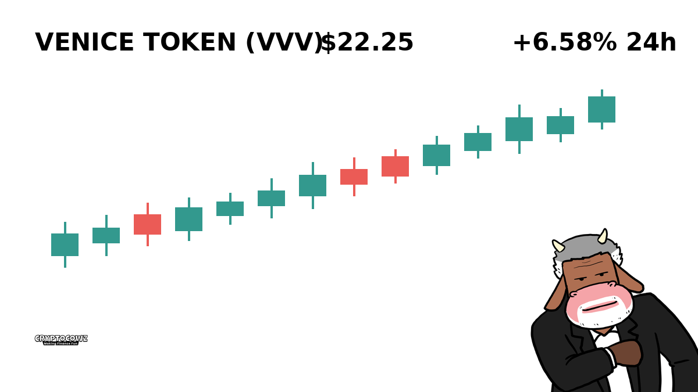
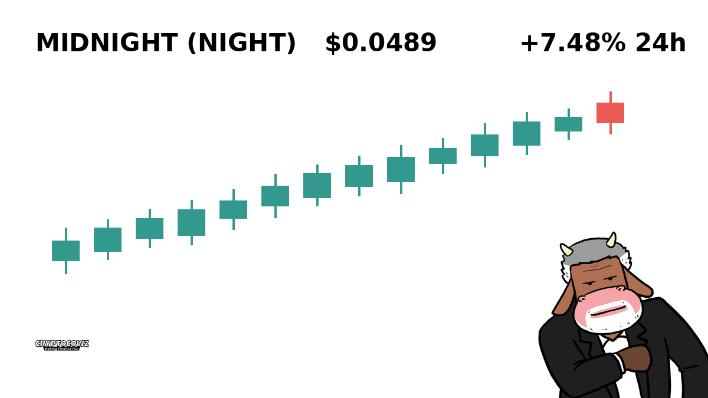
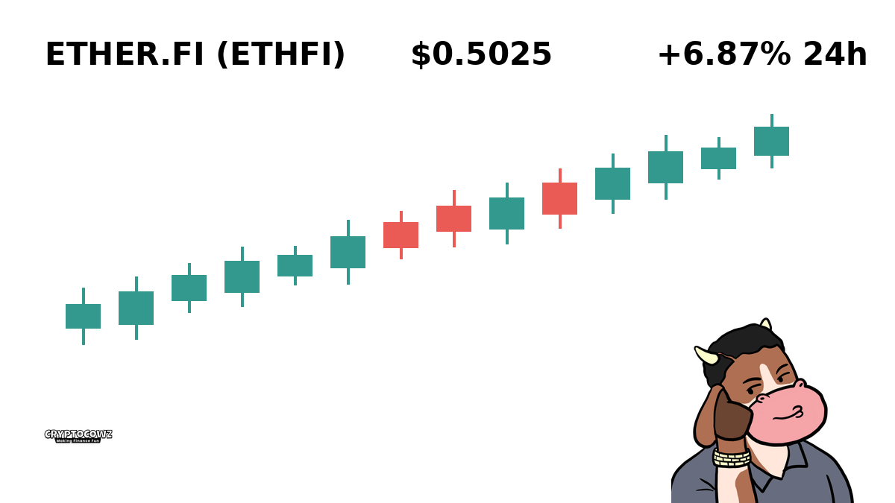
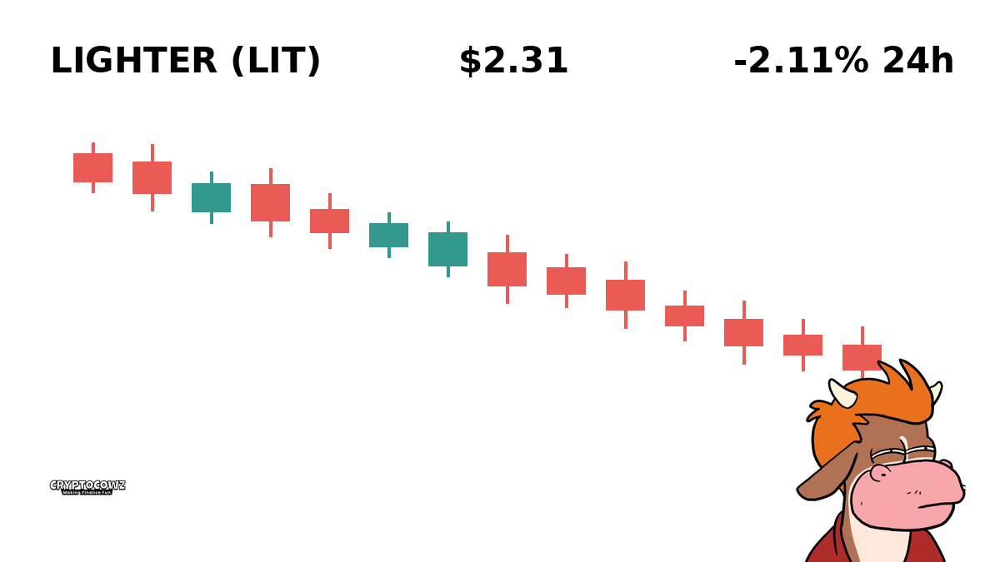
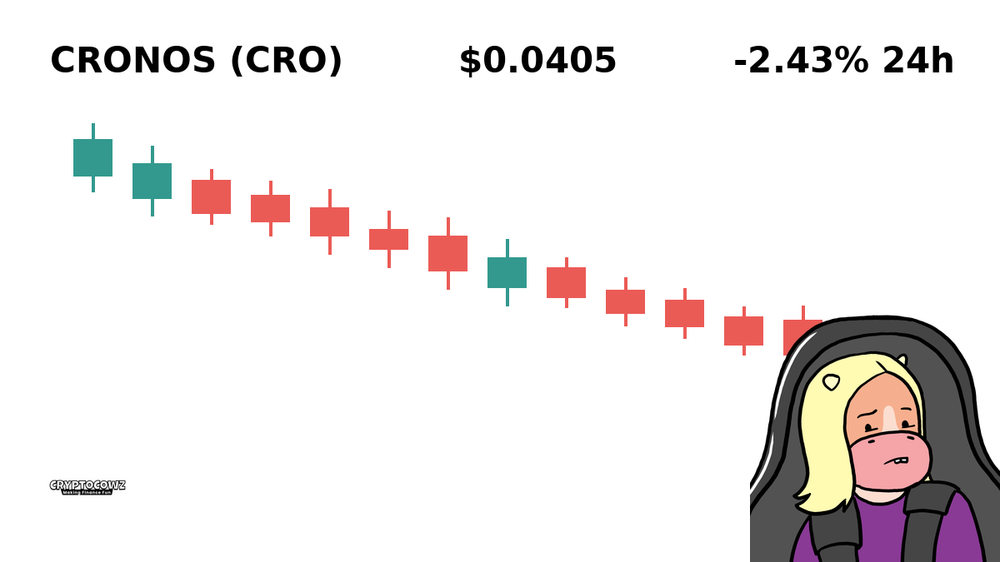
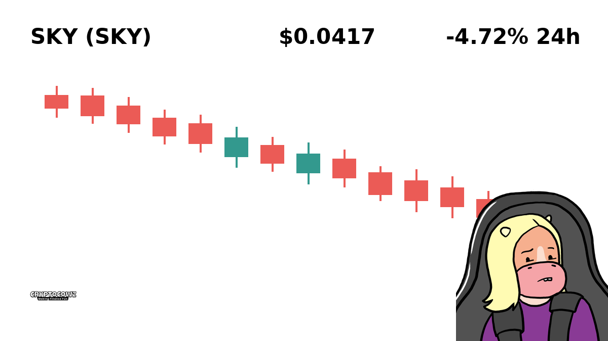
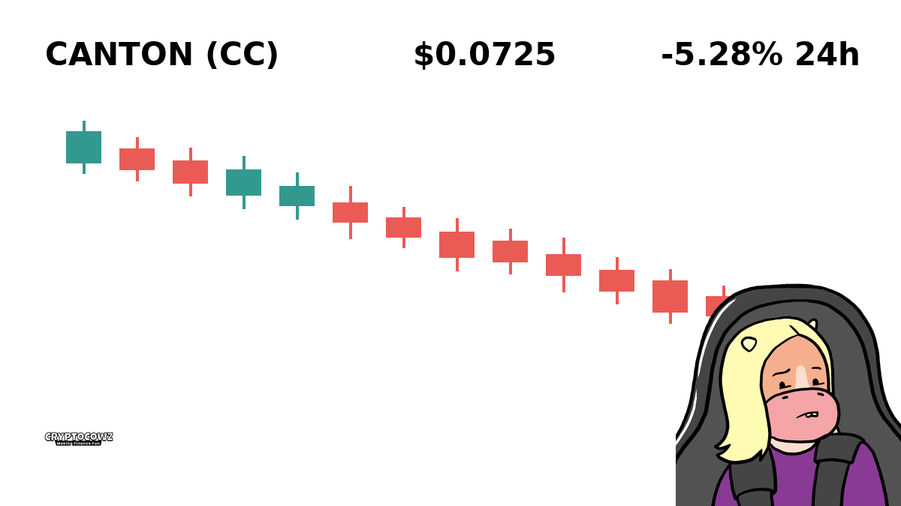

# Daily Top Movers: CMC Community Visuals & Posts

## 1. Pieverse ($PIEVERSE) — +9.39% (PUMP)
**Cast Member:** Skip Zinfandel
**CMC Comment:** PIEVERSE is up over 9% today and I have already leveraged my house to buy virtual bakeries. Green candles mean the pie is infinite, baby!

---

## 2. Venice Token ($VVV) — +8.05% (PUMP)
**Cast Member:** Frank Rizzo
**CMC Comment:** Up 8%? Forget the gondolas, I am buying a solid gold speed boat and racing it straight to the moon!

---

## 3. Midnight ($NIGHT) — +7.48% (PUMP)
**Cast Member:** Sunshine Innocent Nimbus
**CMC Comment:** NIGHT is shining so bright at +7.48%! Staying up past bedtime buying dips unlocked cosmic prosperity for all of us!

---

## 4. Ether.fi ($ETHFI) — +6.87% (PUMP)
**Cast Member:** Professor Hartmut
**CMC Comment:** A 6.87% upward tick indicates temporary market optimism; do enjoy the liquidity before mathematical gravity reasserts itself.

---

## 5. Pump.fun ($PUMP) — +6.25% (PUMP)
**Cast Member:** Skip Zinfandel
**CMC Comment:** It is literally named PUMP! Up 6.25% today, time to screenshot my paper gains and offer financial masterclasses.

---

## 6. Lighter ($LIT) — -2.11% (DUMP)
**Cast Member:** Frank Rizzo
**CMC Comment:** LIT drops 2% and my bags are officially taking on water. Who drained the lighter fluid out of this trade?!

---

## 7. Cronos ($CRO) — -2.43% (DUMP)
**Cast Member:** Professor Hartmut
**CMC Comment:** A 2.43% decline in CRO merely demonstrates that stadium naming rights do not alter structural volatility.

---

## 8. Sky ($SKY) — -4.72% (DUMP)
**Cast Member:** Sunshine Innocent Nimbus
**CMC Comment:** SKY fell 4.72% today, but every downward chart is just the universe clearing away bad vibes for the next rally!

---

## 9. Canton ($CC) — -5.28% (DUMP)
**Cast Member:** Frank Rizzo
**CMC Comment:** Down over 5%? I am holding bags heavier than a concrete block at the bottom of the Hudson River.

---

## 10. Rain ($RAIN) — -9.41% (DUMP)
**Cast Member:** Skip Zinfandel
**CMC Comment:** Down 9.41% isn't a dump, it is a high-speed wealth redistribution discount for visionaries who hate cash!

---
