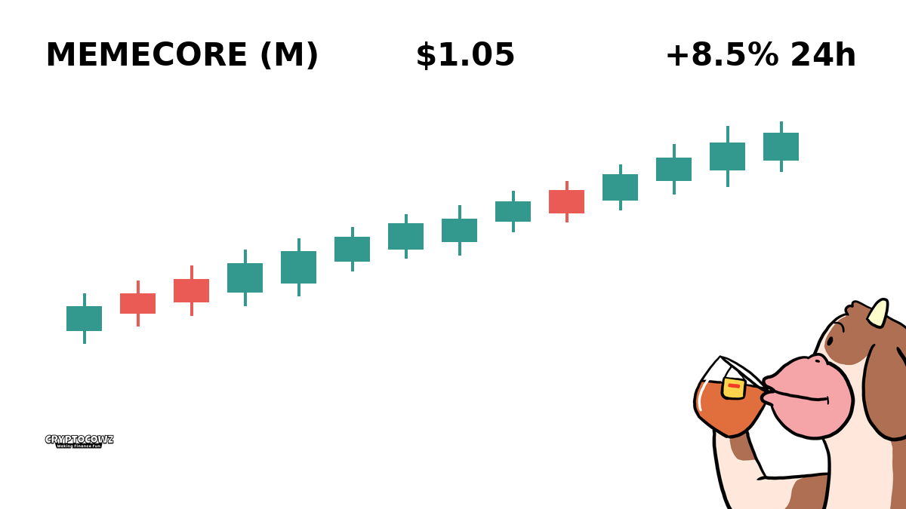
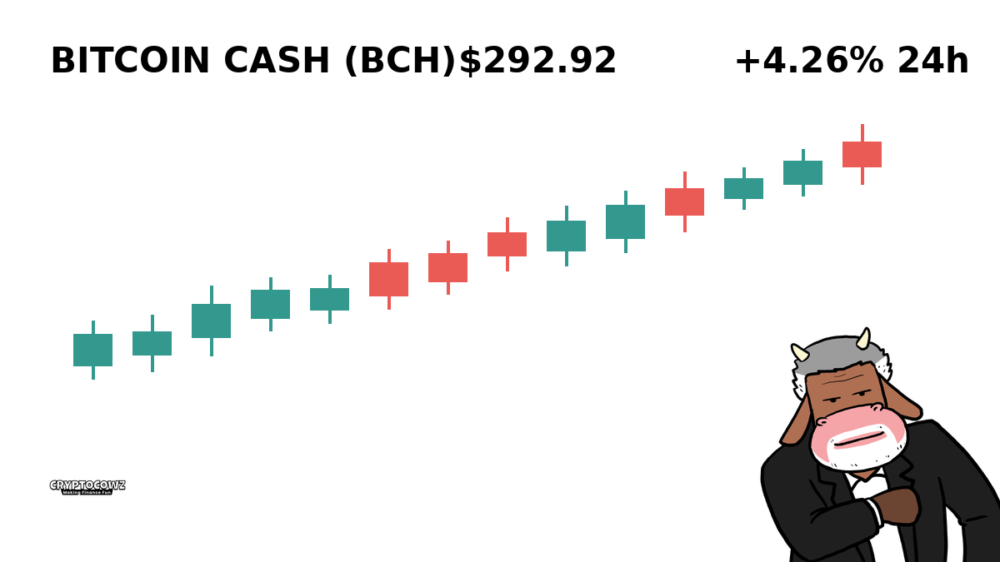
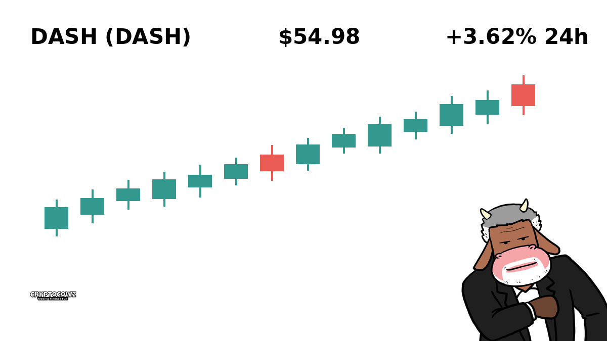
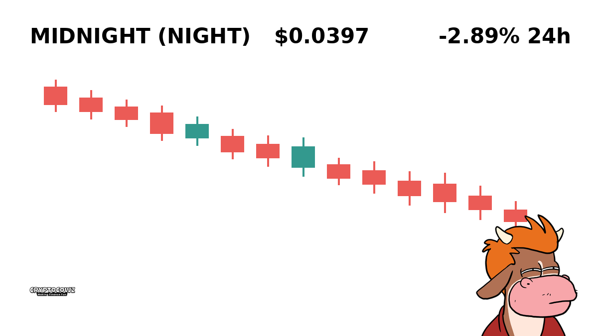
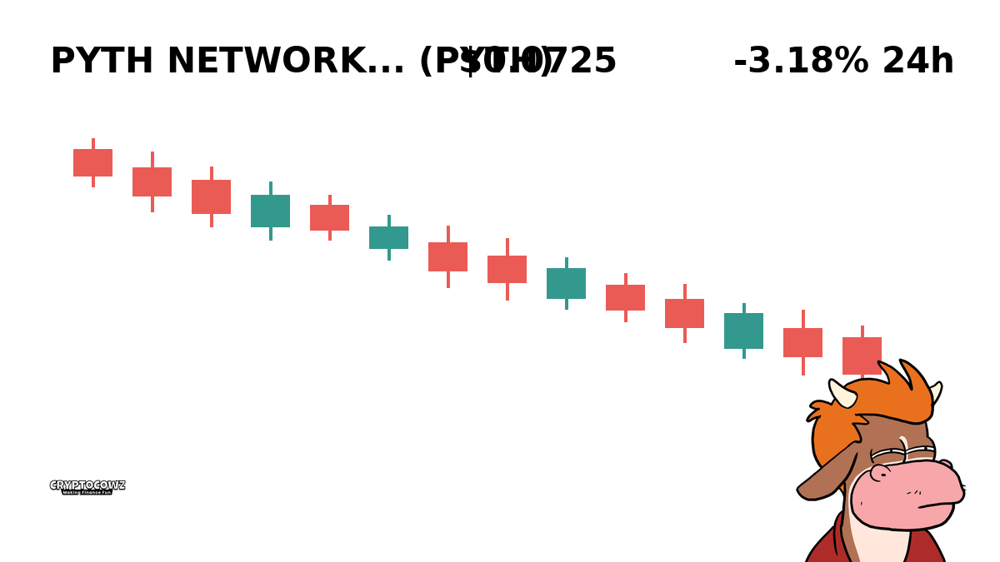
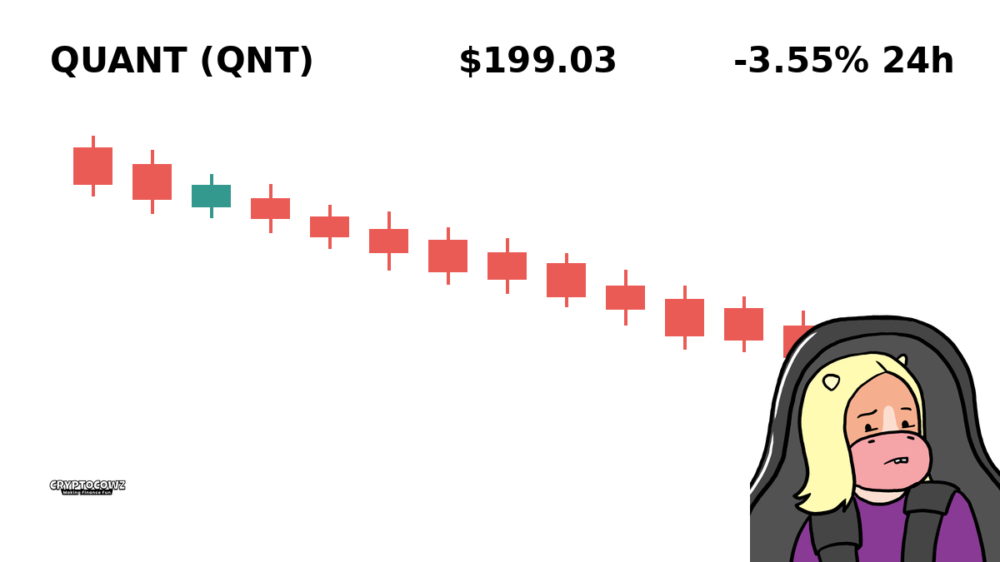
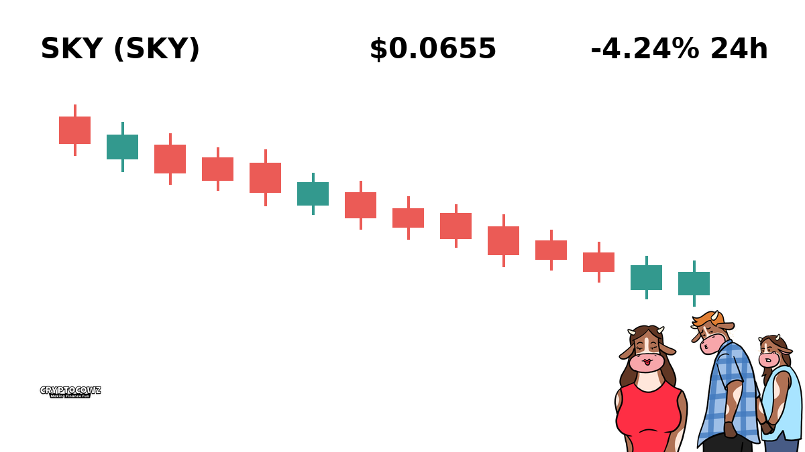
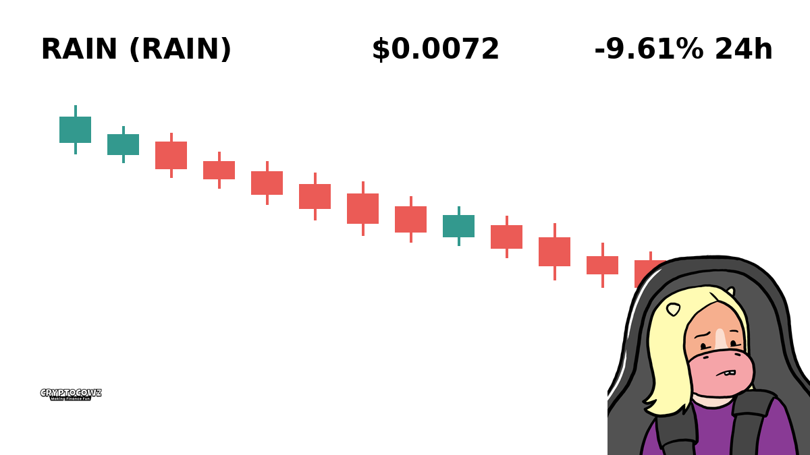

# Daily Top Movers: CMC Community Visuals & Posts

## 1. Bitway ($BTW) — +16.02% (PUMP)
**Cast Member:** Skip Zinfandel
**CMC Comment:** Up 16% today, which means I am officially taking out a third mortgage to double down on Bitway. We are taking this rocket ship straight to financial freedom or total ruin, baby!

---

## 2. MemeCore ($M) — +8.5% (PUMP)
**Cast Member:** Sunshine Innocent Nimbus
**CMC Comment:** The universe is aligning through MemeCore today! When the green candles glow this brightly, my chakras practically vibrate with sheer unadulterated prosperity.

---

## 3. Zcash ($ZEC) — +5.11% (PUMP)
**Cast Member:** Frank Rizzo
**CMC Comment:** Look at Zcash moving up over five percent! If anyone asks, I was never here, you never saw me, and this profit is untraceable.

---

## 4. Bitcoin Cash ($BCH) — +4.26% (PUMP)
**Cast Member:** Professor Hartmut
**CMC Comment:** A 4.26% expansion in Bitcoin Cash demonstrates classical momentum elasticity. Statistically speaking, retail investors will FOMO at the absolute peak in approximately three hours.

---

## 5. Dash ($DASH) — +3.62% (PUMP)
**Cast Member:** Skip Zinfandel
**CMC Comment:** Dash is pumping again and my wife's boyfriend just asked me for trading advice. We are so back, fellas!

---

## 6. Midnight ($NIGHT) — -2.89% (DUMP)
**Cast Member:** Frank Rizzo
**CMC Comment:** Midnight is down almost three percent and my wallet looks pitch black. Time to call my guys down at the docks to clean up this disaster.

---

## 7. Pyth Network ($PYTH) — -3.18% (DUMP)
**Cast Member:** Professor Hartmut
**CMC Comment:** Pyth Network's oracle feed failed to predict its own price collapse today. A fascinating empirical study in cognitive dissonance and bags of holding.

---

## 8. Quant ($QNT) — -3.55% (DUMP)
**Cast Member:** Sunshine Innocent Nimbus
**CMC Comment:** Quant is experiencing a temporary realignment of energy, standard market recalibration! Please send positive vibrations to my portfolio so it stops bleeding red.

---

## 9. Sky ($SKY) — -4.24% (DUMP)
**Cast Member:** Skip Zinfandel
**CMC Comment:** Sky is falling faster than my self-esteem on a Sunday night. Good thing I only invested my kid's college fund and my life savings!

---

## 10. Rain ($RAIN) — -9.61% (DUMP)
**Cast Member:** Frank Rizzo
**CMC Comment:** Rain is washing away nearly ten percent of my net worth today. Someone get me a shovel and a bag of concrete, because this token is officially dead to me.

---
