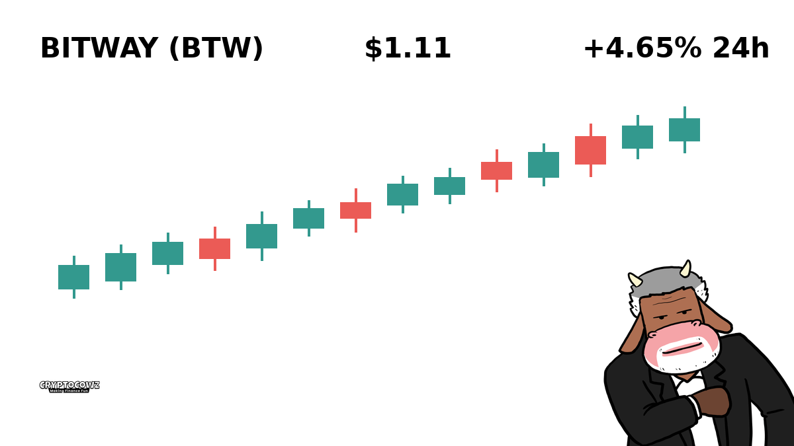
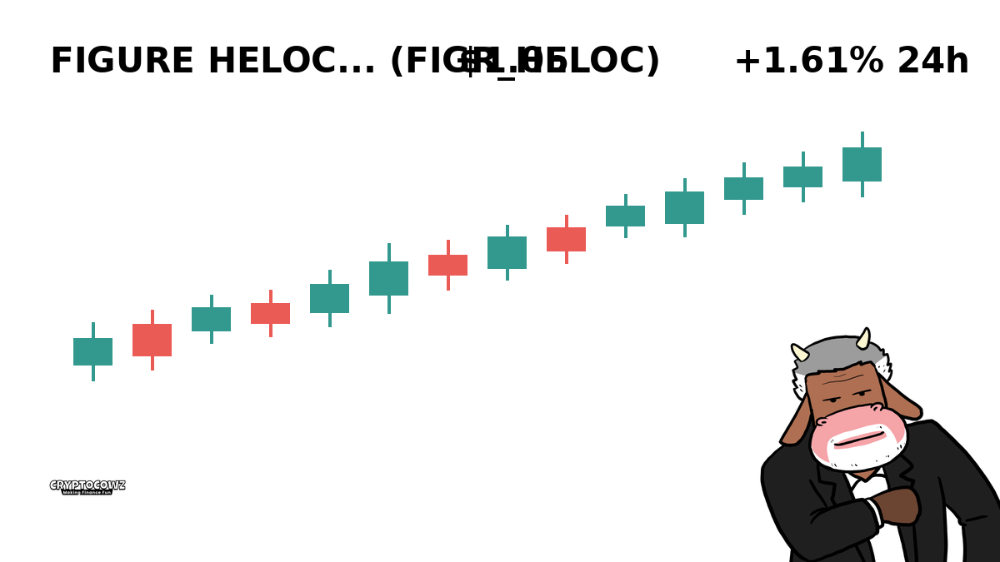
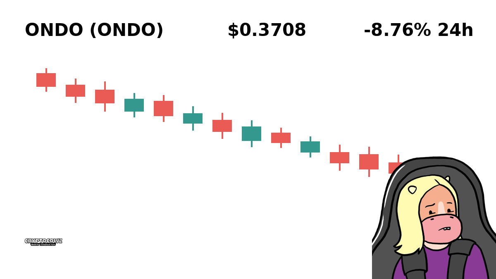
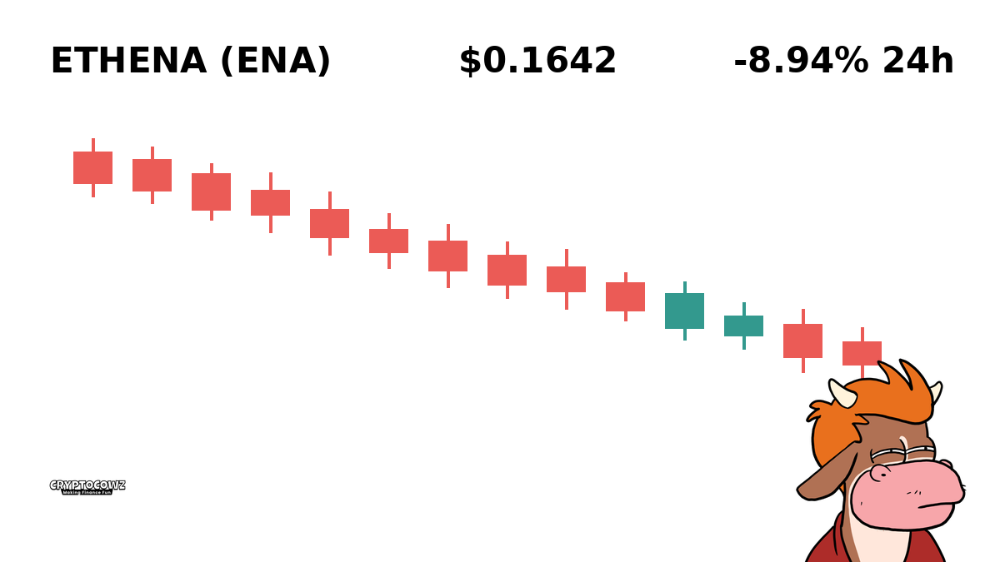
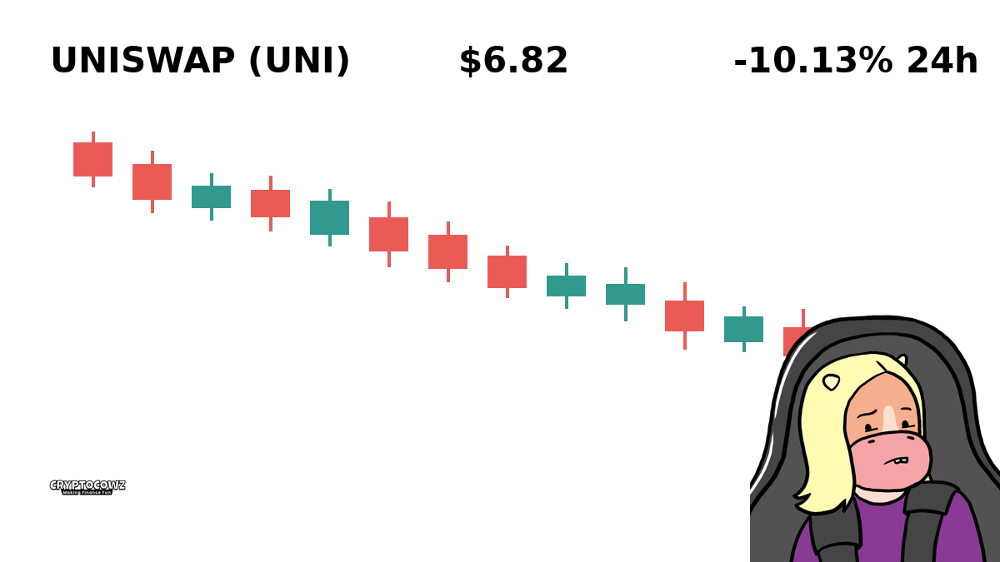

# Daily Top Movers: CMC Community Visuals & Posts

## 1. Pearl ($PEARL) — +4.83% (PUMP)
**Cast Member:** Skip Zinfandel
**CMC Comment:** Clam digging paid off, boys! Up four percent means I can afford real caviar on my jet ski this weekend.

---

## 2. Bitway ($BTW) — +4.65% (PUMP)
**Cast Member:** Frank Rizzo
**CMC Comment:** Look at this beauty moving up! Keep buying or I send my cousin Tony to audit your portfolio.

---

## 3. Injective ($INJ) — +3.39% (PUMP)
**Cast Member:** Professor Hartmut
**CMC Comment:** A modest upward variance in Injective; clearly the market is finally appreciating my theoretical whitepaper on decentralization.

---

## 4. Figure Heloc ($FIGR_HELOC) — +1.61% (PUMP)
**Cast Member:** Sunshine Innocent Nimbus
**CMC Comment:** Borrowing against my home to buy home-equity tokens feels like a beautiful cosmic feedback loop of pure abundance!

---

## 5. Tether Gold ($XAUT) — +1.06% (PUMP)
**Cast Member:** Skip Zinfandel
**CMC Comment:** One percent green on digital shiny metal! Time to order the gold-leaf steak and leverage my entire retirement account.

---

## 6. Ondo ($ONDO) — -8.76% (DUMP)
**Cast Member:** Frank Rizzo
**CMC Comment:** Down almost nine percent? I've seen kneecaps break with less painful drops than this junk.

---

## 7. NEAR Protocol ($NEAR) — -8.82% (DUMP)
**Cast Member:** Professor Hartmut
**CMC Comment:** The term NEAR is fitting, as retail investors are now dangerously near total economic ruin.

---

## 8. Ethena ($ENA) — -8.94% (DUMP)
**Cast Member:** Sunshine Innocent Nimbus
**CMC Comment:** The charts are just shedding negative energy right now, so please send your love and remaining liquidity to the universe.

---

## 9. Ether.fi ($ETHFI) — -9.8% (DUMP)
**Cast Member:** Skip Zinfandel
**CMC Comment:** Down nearly ten percent and my margin call is ringing louder than my ex-wife's lawyer!

---

## 10. Uniswap ($UNI) — -10.13% (DUMP)
**Cast Member:** Frank Rizzo
**CMC Comment:** Unicorn? More like a donkey taking a massive dump right on my life savings!

---
