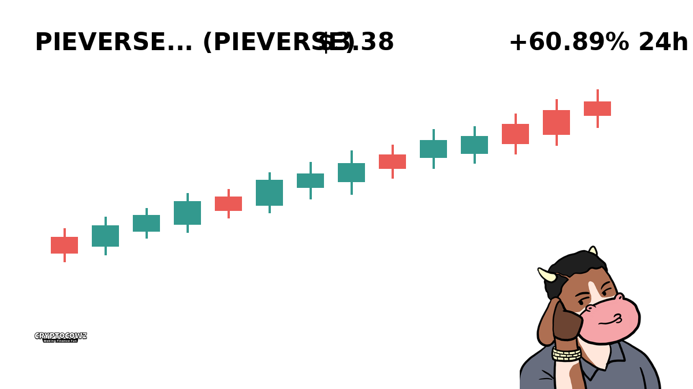
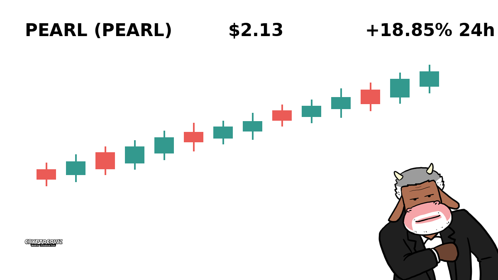
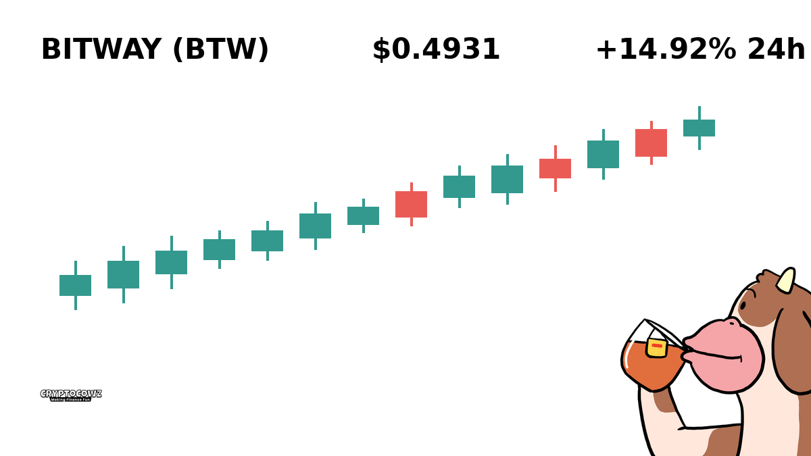
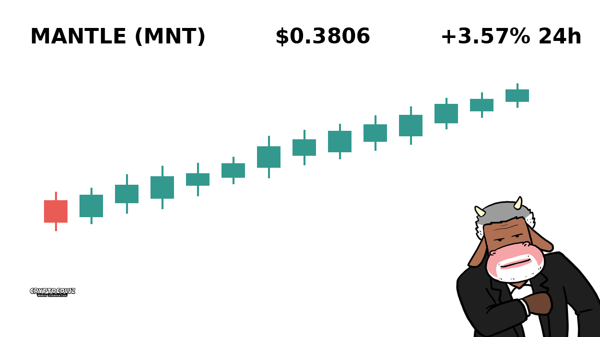
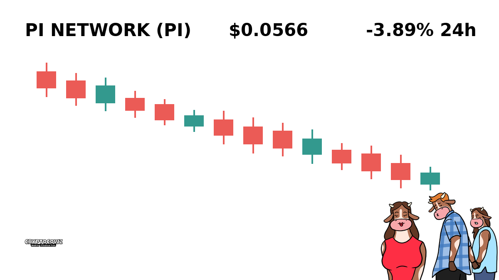
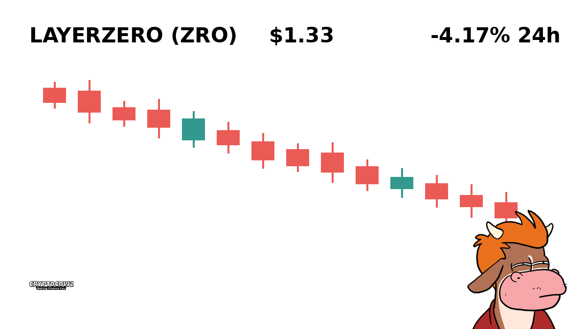
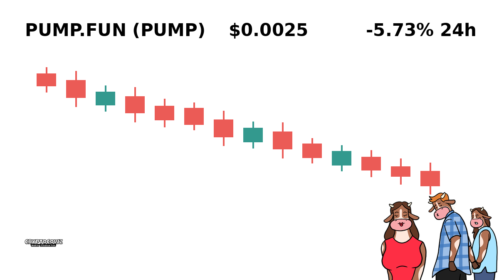

# Daily Top Movers: CMC Community Visuals & Posts

## 1. Pieverse ($PIEVERSE) — +60.89% (PUMP)
**Cast Member:** Skip Zinfandel
**CMC Comment:** I just mortgaged my second yacht to buy more Pieverse because math is for poor people and gains like this build empires!

---

## 2. Pearl ($PEARL) — +18.85% (PUMP)
**Cast Member:** Sunshine Innocent Nimbus
**CMC Comment:** The universe is sending us shiny pearls of light today, so let us all hold hands and watch our cosmic balances float to heaven!

---

## 3. Bitway ($BTW) — +14.92% (PUMP)
**Cast Member:** Frank Rizzo
**CMC Comment:** Listen to me ya bums, Bitway is moving up and if you sell now you deserve to eat cold soup out of a trash can!

---

## 4. Mantle ($MNT) — +3.57% (PUMP)
**Cast Member:** Professor Hartmut
**CMC Comment:** A modest vector shift in Mantle proves that the underlying macroeconomic flywheel is stabilizing near optimal structural equilibrium.

---

## 5. Venice Token ($VVV) — +2.61% (PUMP)
**Cast Member:** Skip Zinfandel
**CMC Comment:** Venice is just warming up its engines for a total face-melting run, so buy the dip right now or get left behind!

---

## 6. Pi Network ($PI) — -3.89% (DUMP)
**Cast Member:** Frank Rizzo
**CMC Comment:** Pi Network dropping again? I spent three long years tapping a button on my phone every day for this garbage?

---

## 7. Sky ($SKY) — -3.98% (DUMP)
**Cast Member:** Sunshine Innocent Nimbus
**CMC Comment:** The Sky isn't falling, friends, it's just coming down closer to Earth so we can give it a gentle, loving hug.

---

## 8. LayerZero ($ZRO) — -4.17% (DUMP)
**Cast Member:** Professor Hartmut
**CMC Comment:** LayerZero seems to be empirical proof of absolute market entropy, mathematically collapsing towards its namesake of literal zero.

---

## 9. Aster ($ASTER) — -4.53% (DUMP)
**Cast Member:** Frank Rizzo
**CMC Comment:** Who advised me to buy Aster? I want names, addresses, and full refunds before I completely lose my mind!

---

## 10. Pump.fun ($PUMP) — -5.73% (DUMP)
**Cast Member:** Skip Zinfandel
**CMC Comment:** Irony is dead! How does a token literally named PUMP dump five percent in one afternoon? My broker lied to me!

---
