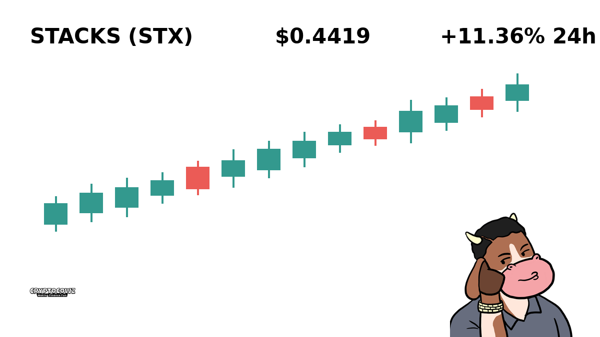
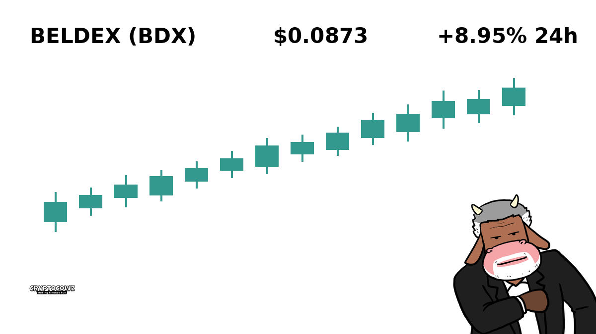
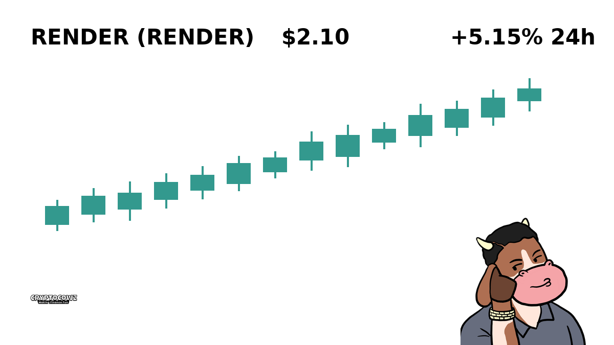
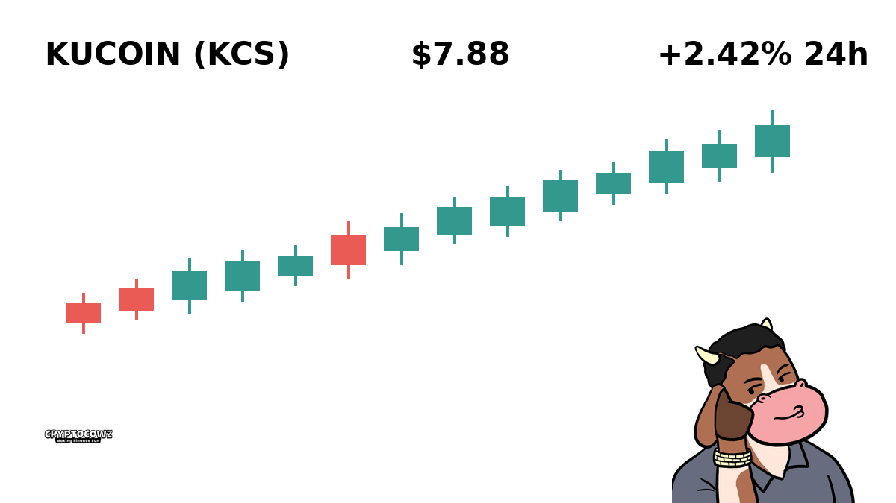
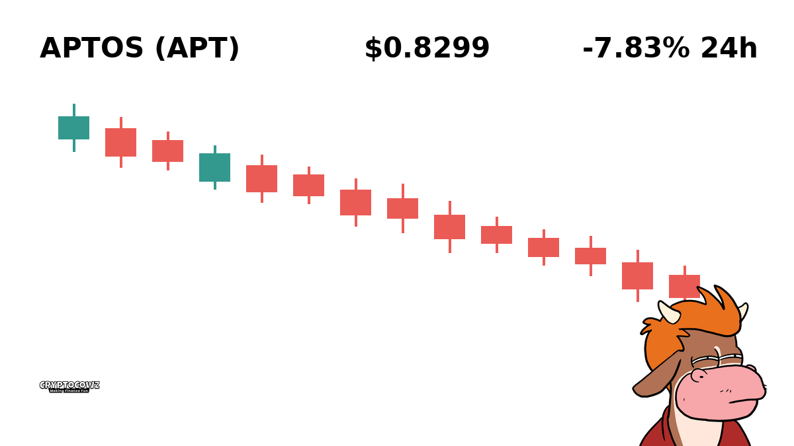
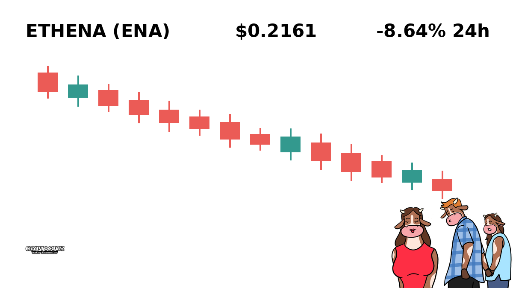
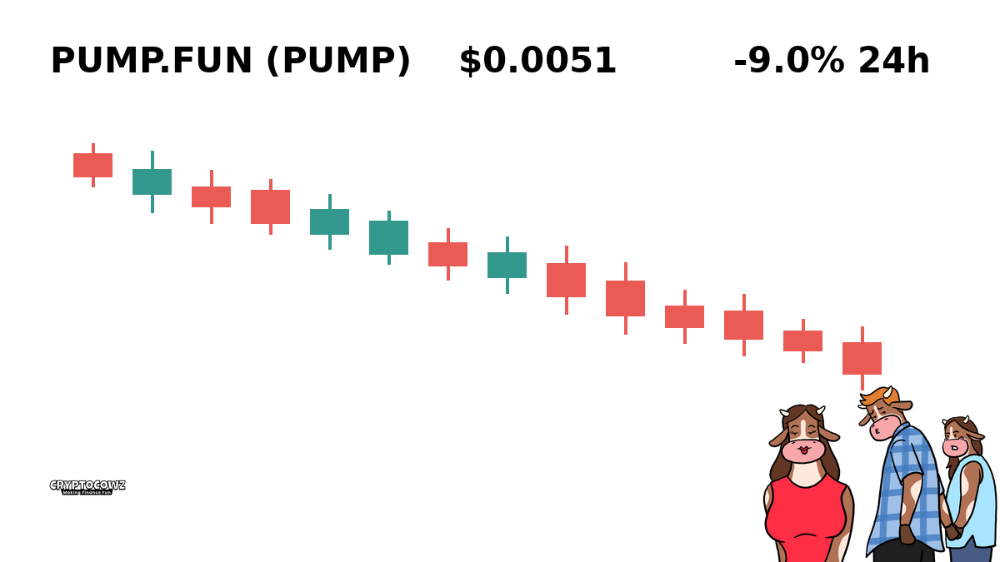
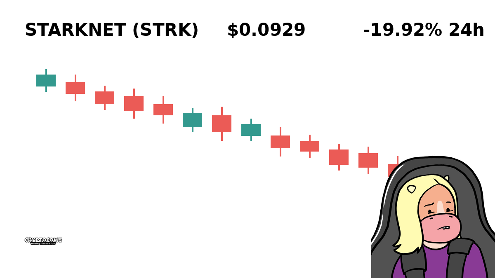

# Daily Top Movers: CMC Community Visuals & Posts

## 1. Stacks ($STX) — +11.36% (PUMP)
**Cast Member:** Skip Zinfandel
**CMC Comment:** Bitcoin smart contracts are pumping, which means I can finally lose my generational wealth at layer two speeds.

---

## 2. Beldex ($BDX) — +8.95% (PUMP)
**Cast Member:** Sunshine Innocent Nimbus
**CMC Comment:** Privacy coins are up, so now you can hide your glorious gains from both the taxman and your disappointed parents.

---

## 3. Bitway ($BTW) — +8.77% (PUMP)
**Cast Member:** Frank Rizzo
**CMC Comment:** Up almost nine percent! I do not know what Bitway actually does, but my cousin Vinny says it is guaranteed money.

---

## 4. Render ($RENDER) — +5.15% (PUMP)
**Cast Member:** Professor Hartmut
**CMC Comment:** The algorithmic rendering of parabolic charts proves that retail euphoria remains fully optimized.

---

## 5. KuCoin ($KCS) — +2.42% (PUMP)
**Cast Member:** Skip Zinfandel
**CMC Comment:** A modest pump for exchange tokens, giving us just enough hope to defer our liquidations until tomorrow.

---

## 6. Aptos ($APT) — -7.83% (DUMP)
**Cast Member:** Frank Rizzo
**CMC Comment:** Down almost eight percent? Somebody tell these Aptos devs that my mortgage payment is not a layer-one experiment!

---

## 7. Ethena ($ENA) — -8.64% (DUMP)
**Cast Member:** Professor Hartmut
**CMC Comment:** Synthetic dollars appear to be undergoing a highly organic implosion of speculative capital.

---

## 8. Filecoin ($FIL) — -8.72% (DUMP)
**Cast Member:** Sunshine Innocent Nimbus
**CMC Comment:** Decentralized storage is down, but at least your emotional baggage is saved safely in the cloud forever.

---

## 9. Pump.fun ($PUMP) — -9.0% (DUMP)
**Cast Member:** Skip Zinfandel
**CMC Comment:** Irony reaches peak saturation as the coin literally named Pump drops straight into the abyss.

---

## 10. Starknet ($STRK) — -19.92% (DUMP)
**Cast Member:** Frank Rizzo
**CMC Comment:** Minus twenty percent?! I have seen mob shakedowns with better recovery rates than Starknet today!

---
