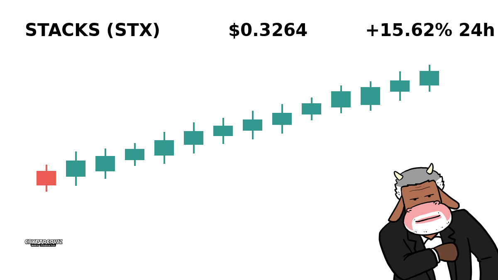
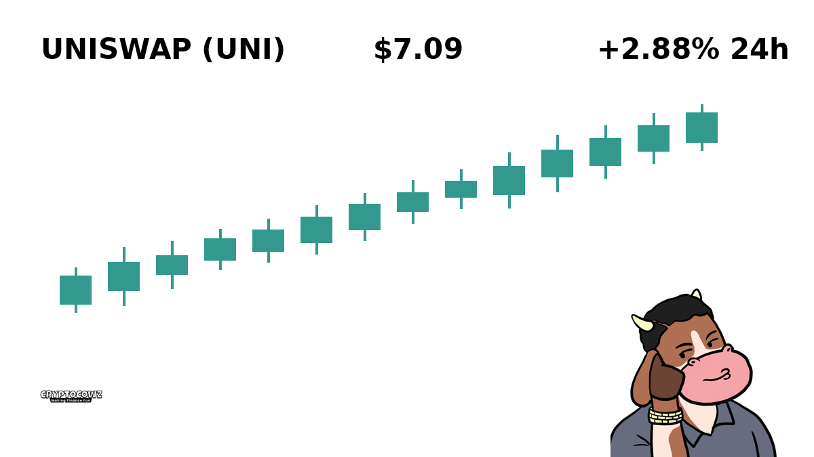
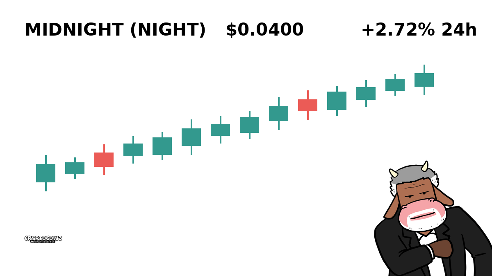
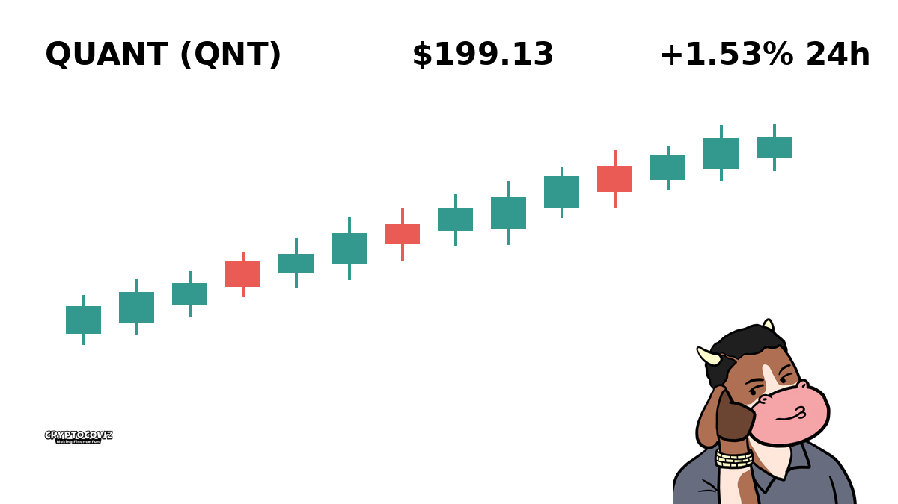
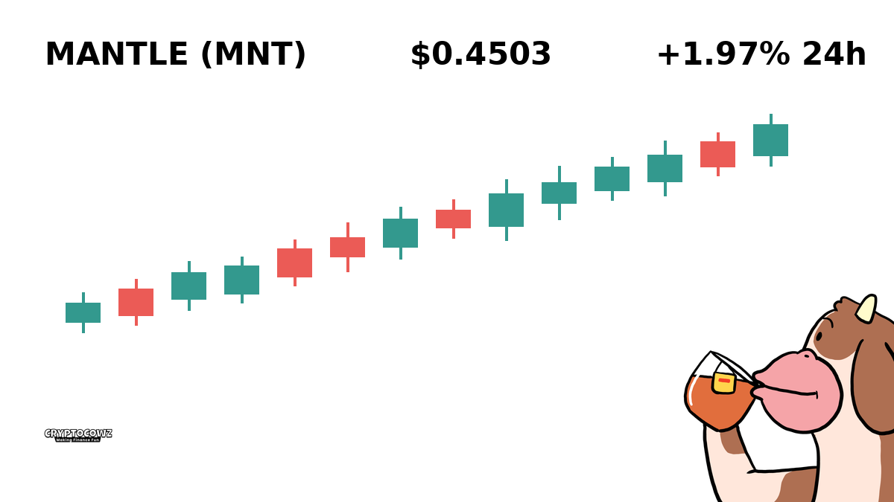
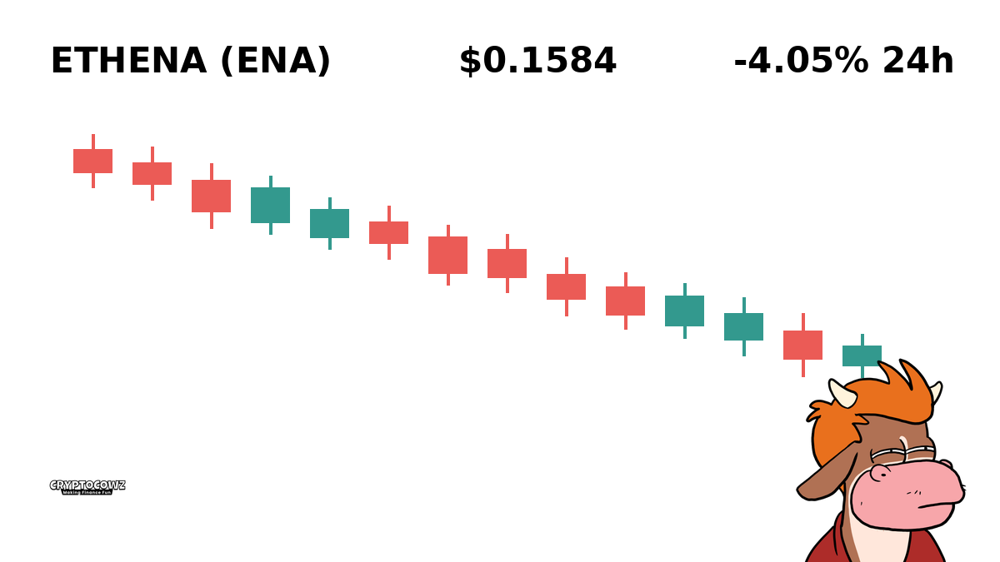
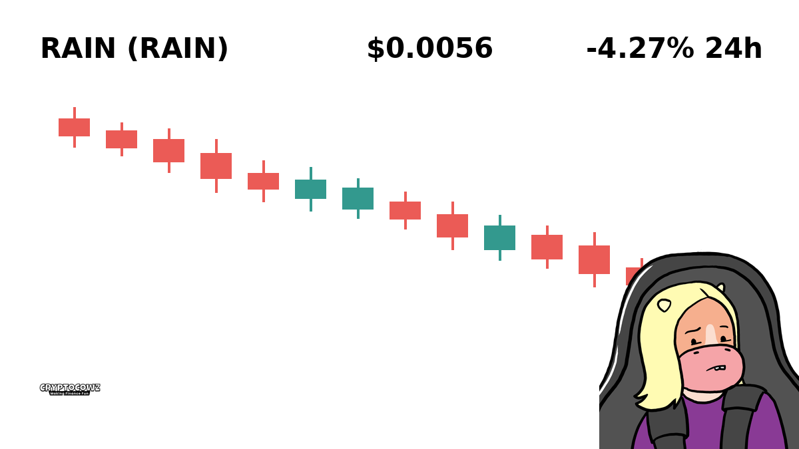
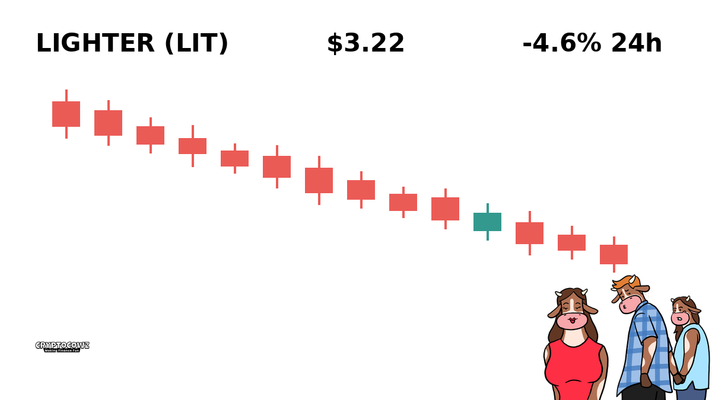
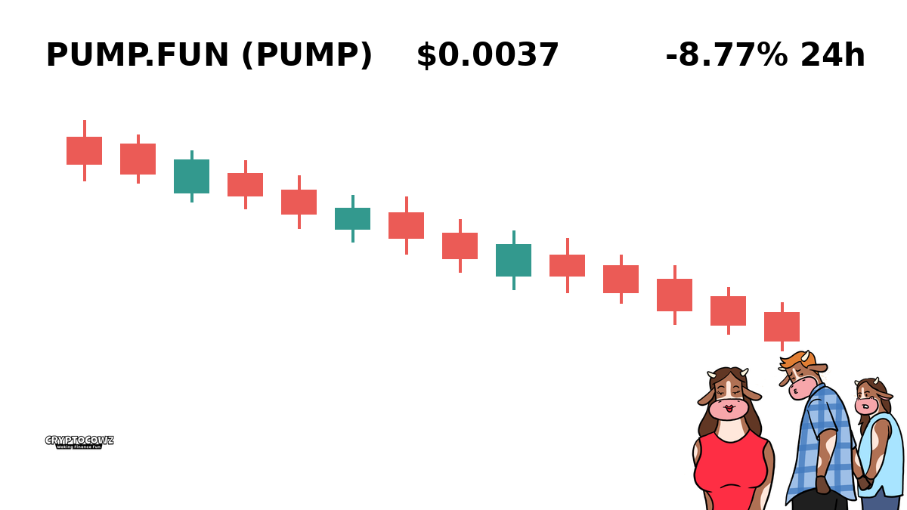

# Daily Top Movers: CMC Community Visuals & Posts

## 1. Stacks ($STX) — +3.69% (PUMP)
**Cast Member:** Skip Zinfandel
**CMC Comment:** Up 3.69% today! I just put my entire retirement fund into Stacks because Bitcoin smart contracts sound like something a billionaire would invent while sipping expensive cabernet.

---

## 2. Uniswap ($UNI) — +2.88% (PUMP)
**Cast Member:** Sunshine Innocent Nimbus
**CMC Comment:** A whole 2.88% up! The governance liquidity pools are blooming so beautifully, I might buy a silk ribbon for my prize heifer.

---

## 3. Midnight ($NIGHT) — +2.72% (PUMP)
**Cast Member:** Frank Rizzo
**CMC Comment:** Midnight up 2.7%? Listen pal, I don't care if it operates in the dark, green is green and my wallet is getting thick.

---

## 4. Quant ($QNT) — +2.64% (PUMP)
**Cast Member:** Professor Hartmut
**CMC Comment:** Quant rising 2.64% aligns perfectly with my theoretical model of enterprise interoperability, though my students still prefer buying worthless dog tokens.

---

## 5. Mantle ($MNT) — +1.97% (PUMP)
**Cast Member:** Skip Zinfandel
**CMC Comment:** Mantle gaining 1.97% is all the confirmation I need to lease a second yacht before lunch.

---

## 6. Ethena ($ENA) — -4.05% (DUMP)
**Cast Member:** Frank Rizzo
**CMC Comment:** Down 4.05%? Ethena bagholders are sweating through their cheap suits right now while I short their tears.

---

## 7. Rain ($RAIN) — -4.27% (DUMP)
**Cast Member:** Sunshine Innocent Nimbus
**CMC Comment:** Oh dear, down 4.27%! Rain is falling on our portfolio today, but every puddle is just a chance to wash our poor dusty hooves.

---

## 8. Lighter ($LIT) — -4.6% (DUMP)
**Cast Member:** Professor Hartmut
**CMC Comment:** Lighter shedding 4.6% confirms my hypothesis that friction-free trading protocols eventually burn out the retail investor's capital base.

---

## 9. Zcash ($ZEC) — -6.19% (DUMP)
**Cast Member:** Skip Zinfandel
**CMC Comment:** Down 6.19%! Zcash privacy features are great because now nobody can see me quietly sobbing into my artisanal gin.

---

## 10. Pump.fun ($PUMP) — -8.77% (DUMP)
**Cast Member:** Frank Rizzo
**CMC Comment:** Pump.fun down 8.77%? Irony is dead, the market is a crime scene, and you suckers are holding the murder weapon.

---
