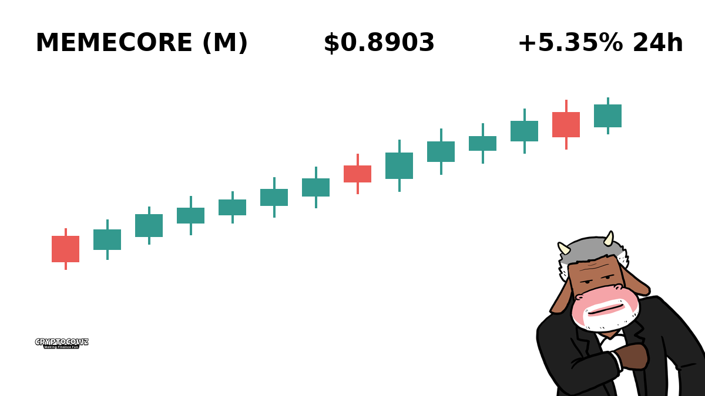
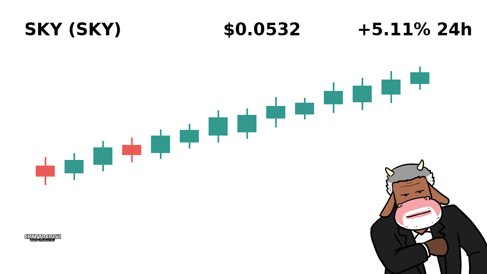
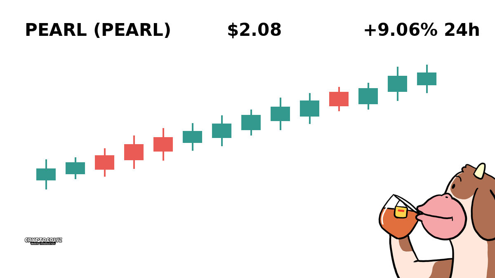
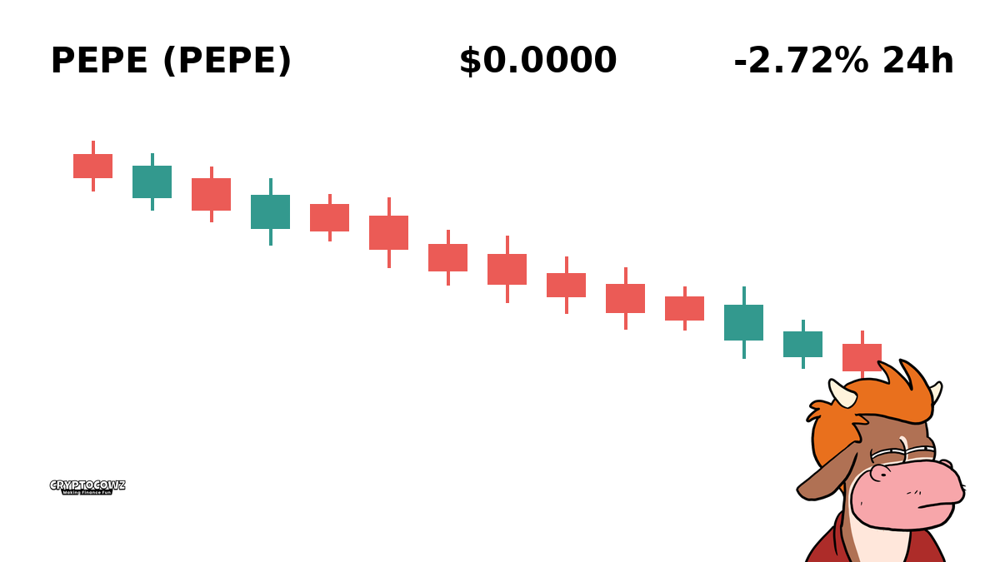
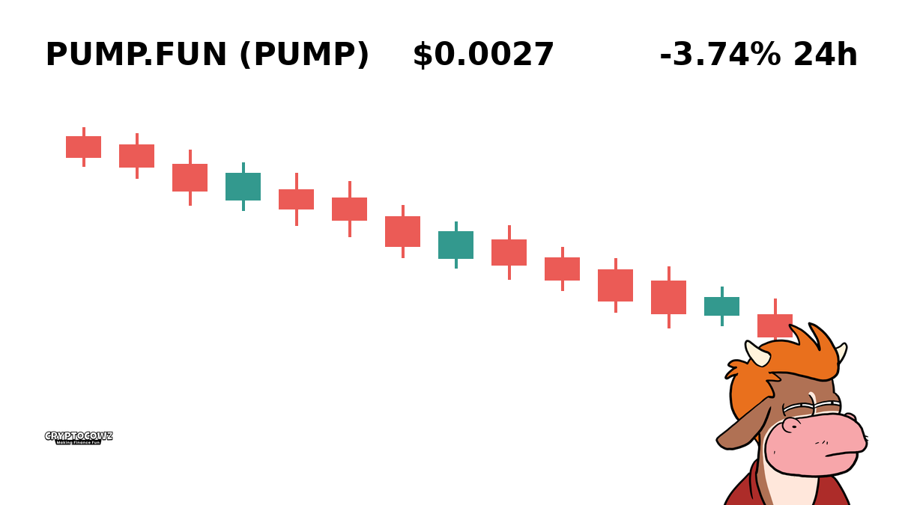
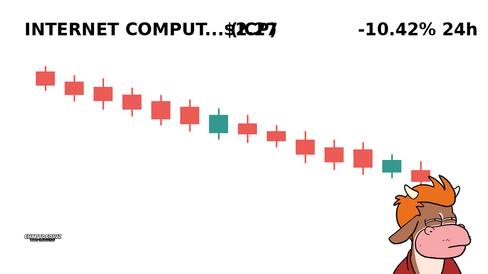
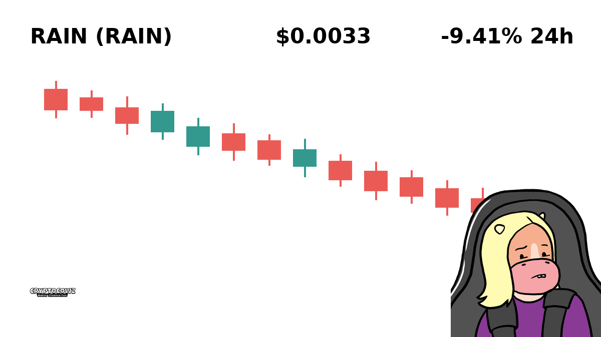

# Daily Top Movers: CMC Community Visuals & Posts

## 1. Bitway ($BTW) — +12.38% (PUMP)
**Cast Member:** Skip Zinfandel
**CMC Comment:** Just refinanced my second barn to double down on Bitway, because who needs risk management when green candles are this shiny? We are going to the moon, baby!

---

## 2. MemeCore ($M) — +5.35% (PUMP)
**Cast Member:** Frank Rizzo
**CMC Comment:** Look at this beauty greening up! I do not know what MemeCore actually does, but my gut tells me it pays for my next yacht.

---

## 3. Sky ($SKY) — +5.11% (PUMP)
**Cast Member:** Sunshine Innocent Nimbus
**CMC Comment:** The universe is sending us pure ascension energy through Sky today! I can literally feel my third eye opening with every decimal point gained.

---

## 4. Pearl ($PEARL) — +4.74% (PUMP)
**Cast Member:** Professor Hartmut
**CMC Comment:** Mathematically speaking, a 4.74% increase in Pearl token standard velocity signals a localized outbreak of irrational euphoria among retail bovines.

---

## 5. Lighter ($LIT) — +4.25% (PUMP)
**Cast Member:** Skip Zinfandel
**CMC Comment:** Lighter is setting my portfolio on fire in the best way possible! I have already quit my day job twice this morning.

---

## 6. Pepe ($PEPE) — -2.72% (DUMP)
**Cast Member:** Frank Rizzo
**CMC Comment:** Another day, another frog drowning in red ink. Hold my bucket while I dump these heavy bags onto the next sap.

---

## 7. Pump.fun ($PUMP) — -3.74% (DUMP)
**Cast Member:** Professor Hartmut
**CMC Comment:** The irony of an asset named Pump experiencing negative velocity is a textbook demonstration of market entropy at work.

---

## 8. Figure Heloc ($FIGR_HELOC) — -4.03% (DUMP)
**Cast Member:** Sunshine Innocent Nimbus
**CMC Comment:** Oh dear, Figure Heloc is cleansing our attachments to material wealth today! Let us breathe through the red charts and accept this financial lesson.

---

## 9. Internet Computer ($ICP) — -10.42% (DUMP)
**Cast Member:** Frank Rizzo
**CMC Comment:** Ten percent down in a day? This computer is not computing anything except my impending bankruptcy.

---

## 10. Rain ($RAIN) — -29.02% (DUMP)
**Cast Member:** Skip Zinfandel
**CMC Comment:** They called it Rain, but this looks more like a Category 5 hurricane flattening my entire retirement fund.

---
