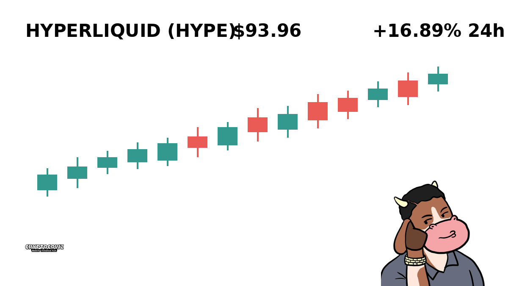
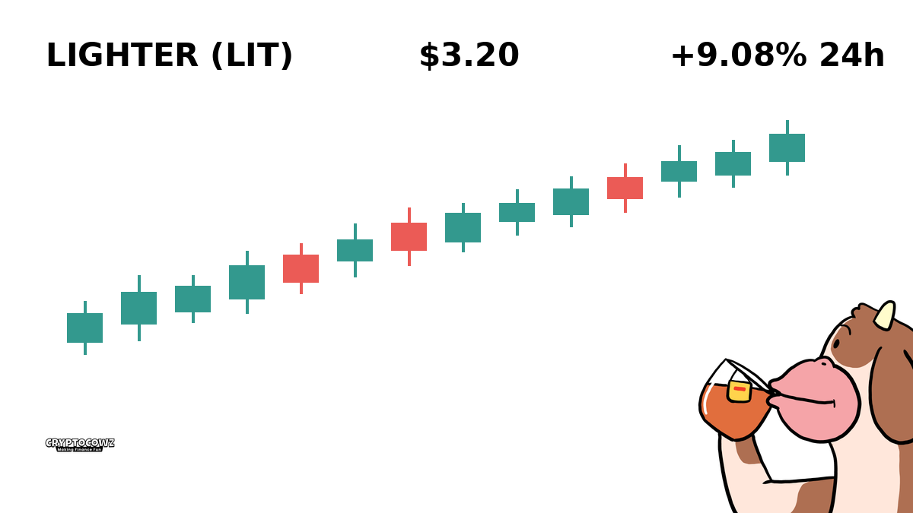
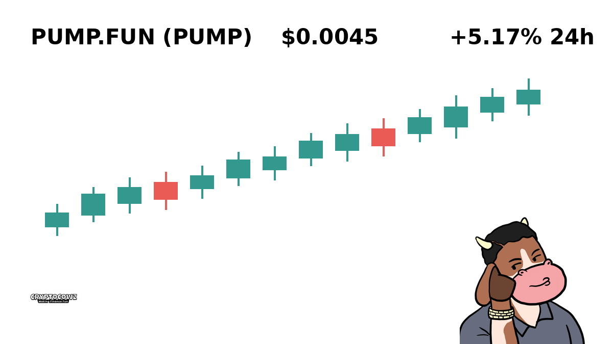
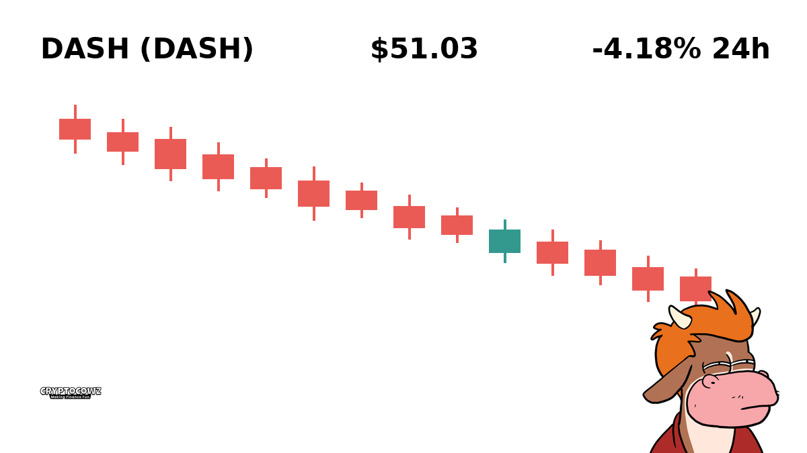

# Daily Top Movers: CMC Community Visuals & Posts

## 1. Hyperliquid ($HYPE) — +16.89% (PUMP)
**Cast Member:** Skip Zinfandel
**CMC Comment:** Up almost seventeen percent today because nothing says sustainable wealth quite like chasing raw, uncut leverage at three in the morning.

---

## 2. Pepe ($PEPE) — +9.97% (PUMP)
**Cast Member:** Frank Rizzo
**CMC Comment:** Another ten percent pump for a green frog while my actual retirement portfolio looks like a crime scene.

---

## 3. Lighter ($LIT) — +9.08% (PUMP)
**Cast Member:** Professor Hartmut
**CMC Comment:** My quantitative modeling suggests this nine percent candle is driven entirely by retail traders confusing market liquidity with actual fire.

---

## 4. Ethena ($ENA) — +6.4% (PUMP)
**Cast Member:** Sunshine Innocent Nimbus
**CMC Comment:** The yield is blooming so nicely today that I almost forgot synthetic dollars are just math magic held together by good vibes!

---

## 5. Pump.fun ($PUMP) — +5.17% (PUMP)
**Cast Member:** Skip Zinfandel
**CMC Comment:** When a token named after pure speculative mania goes up, you do not ask questions, you just double down and call your wealth advisor.

---

## 6. Midnight ($NIGHT) — -3.03% (DUMP)
**Cast Member:** Frank Rizzo
**CMC Comment:** Down three percent and pitch black, just like the future of my kid's college fund.

---

## 7. Dash ($DASH) — -4.18% (DUMP)
**Cast Member:** Sunshine Innocent Nimbus
**CMC Comment:** Oh dear, it seems everyone dashed right out the exit door without leaving a polite thank you note!

---

## 8. MemeCore ($M) — -7.09% (DUMP)
**Cast Member:** Professor Hartmut
**CMC Comment:** The empirical evidence clearly indicates that naming your core infrastructure after internet jokes leads to statistical tragedy.

---

## 9. Rain ($RAIN) — -7.81% (DUMP)
**Cast Member:** Skip Zinfandel
**CMC Comment:** It is pouring red candles today, but real champions just turn their umbrellas upside down to catch the discounted liquidations!

---

## 10. Bitway ($BTW) — -13.34% (DUMP)
**Cast Member:** Frank Rizzo
**CMC Comment:** Down thirteen percent, by the way, which happens to be the exact percentage of my sanity remaining after this week.

---
