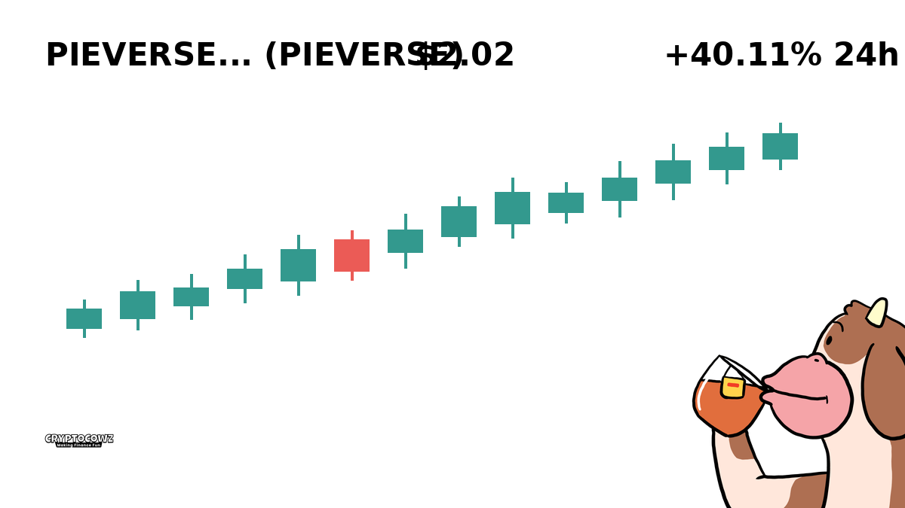
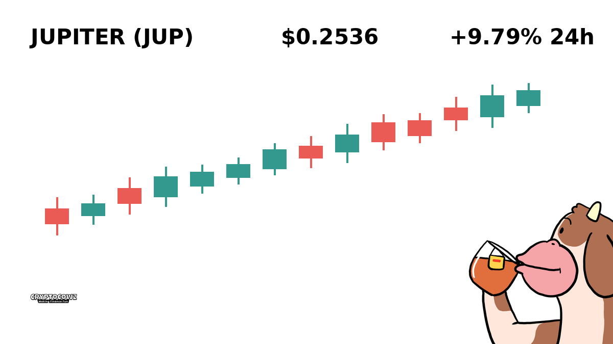
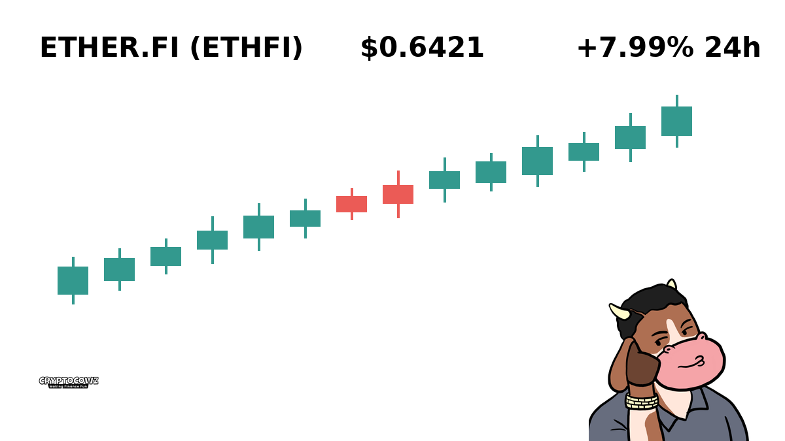
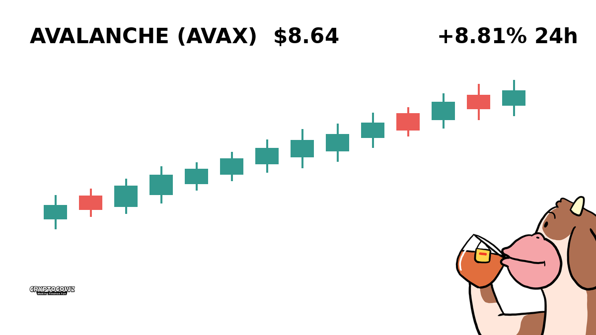
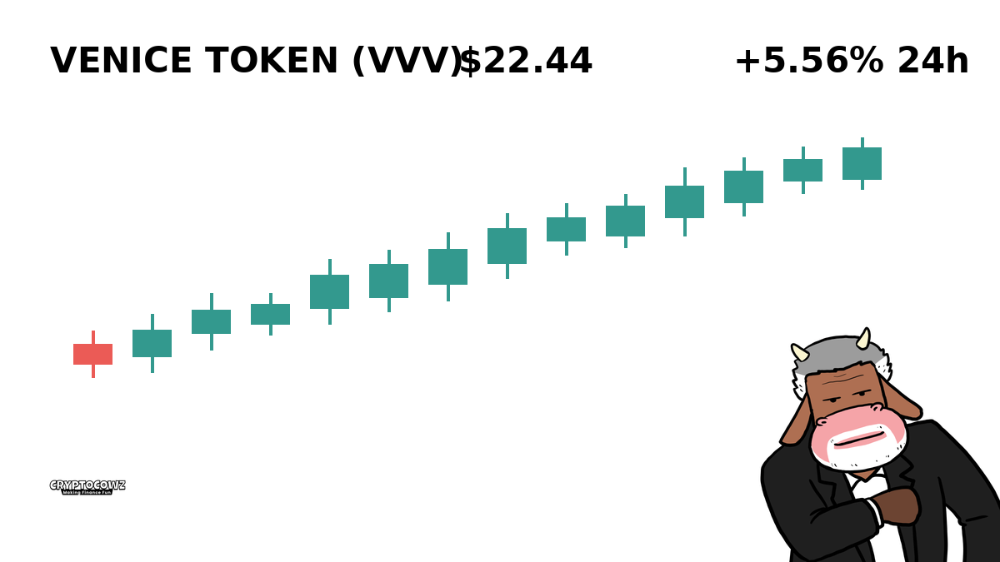
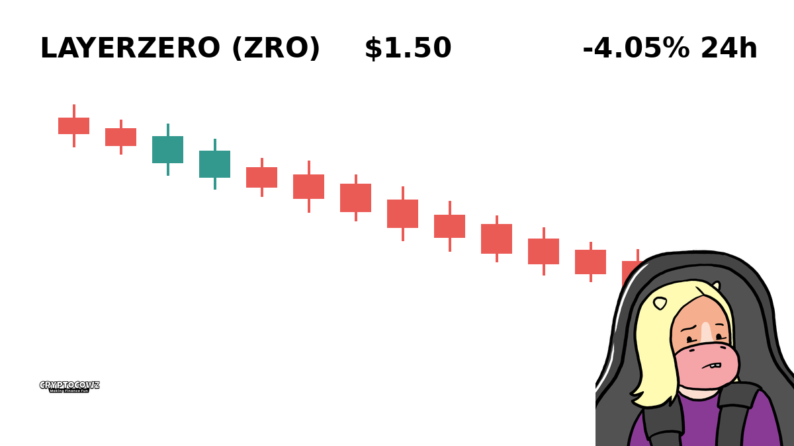
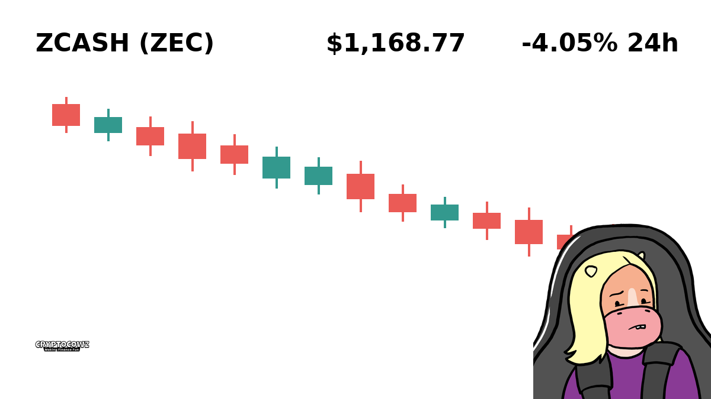
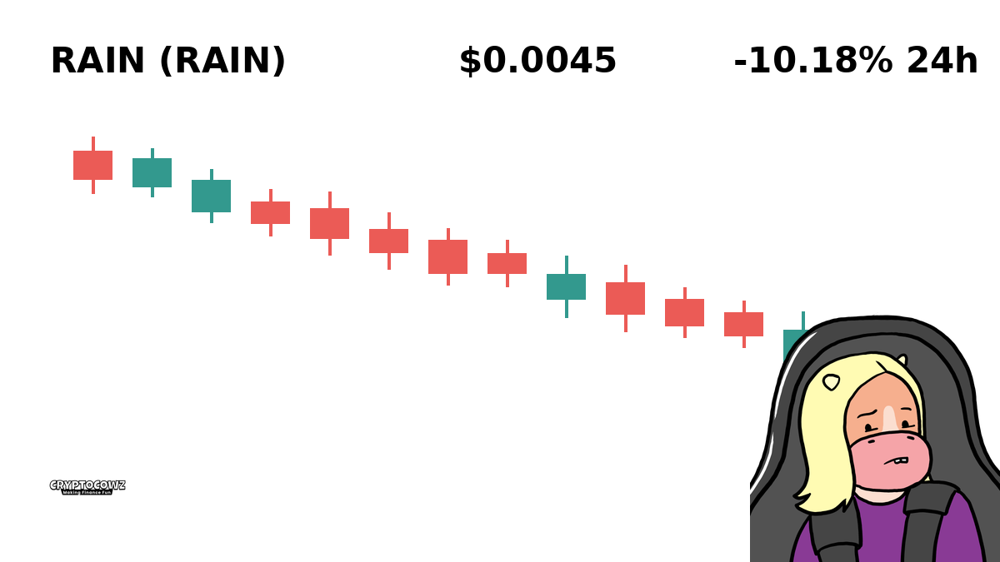
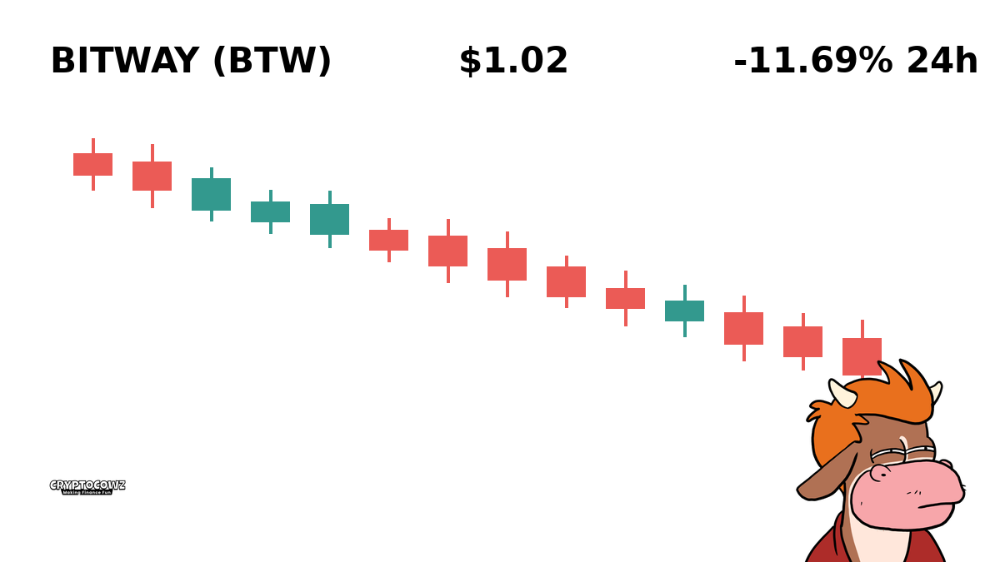

# Daily Top Movers: CMC Community Visuals & Posts

## 1. Pieverse ($PIEVERSE) — +40.11% (PUMP)
**Cast Member:** Skip Zinfandel
**CMC Comment:** Up 40% in a day because nothing screams sound monetary policy like literal digital baked goods. I am taking out a second mortgage to buy the crust.

---

## 2. Jupiter ($JUP) — +9.79% (PUMP)
**Cast Member:** Sunshine Innocent Nimbus
**CMC Comment:** We are shooting past the moon straight to Jupiter! My spiritual advisor said alignment with gas giants brings cosmic wealth, so I sold my car.

---

## 3. Ether.fi ($ETHFI) — +9.14% (PUMP)
**Cast Member:** Frank Rizzo
**CMC Comment:** Look at this green candle, you degenerates! Restaking liquid Ethereum until the yields burn a hole right through your leather wallets!

---

## 4. Avalanche ($AVAX) — +8.81% (PUMP)
**Cast Member:** Professor Hartmut
**CMC Comment:** Mathematically speaking, an avalanche usually moves downhill, yet here we observe a statistical anomaly driven by collective delusion. Fascinating.

---

## 5. Venice Token ($VVV) — +8.32% (PUMP)
**Cast Member:** Skip Zinfandel
**CMC Comment:** Gondolas do not go this high, folks! Venice Token is pumping so hard I have already ordered three fake Rolexes to celebrate.

---

## 6. LayerZero ($ZRO) — -4.05% (DUMP)
**Cast Member:** Frank Rizzo
**CMC Comment:** LayerZero? More like Layer Hero-to-Zero! My portfolio just bridged itself directly into the dumpster.

---

## 7. Zcash ($ZEC) — -4.05% (DUMP)
**Cast Member:** Professor Hartmut
**CMC Comment:** Privacy features ensure nobody can see you crying while holding this bag. The utility of anonymity in tragic financial ruin is truly remarkable.

---

## 8. Pearl ($PEARL) — -6.58% (DUMP)
**Cast Member:** Sunshine Innocent Nimbus
**CMC Comment:** Clams close up when they are scared, and right now my financial future is tightly shut at the bottom of the sea. Sending peaceful vibrations to my liquidity pool!

---

## 9. Rain ($RAIN) — -10.18% (DUMP)
**Cast Member:** Skip Zinfandel
**CMC Comment:** It is raining down 10%, but real alpha males just stand in the storm without an umbrella. Wash away my life savings, baby!

---

## 10. Bitway ($BTW) — -11.69% (DUMP)
**Cast Member:** Frank Rizzo
**CMC Comment:** Bitway is giving us the highway! Down 11% today and my wife is already looking for a divorce lawyer.

---
