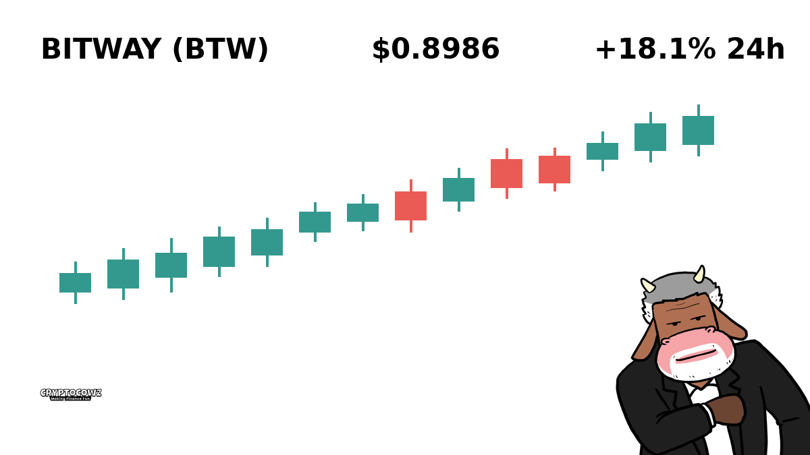
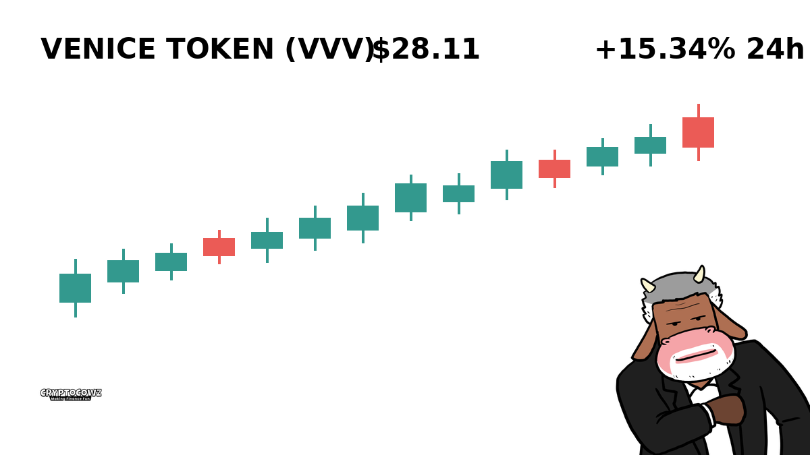
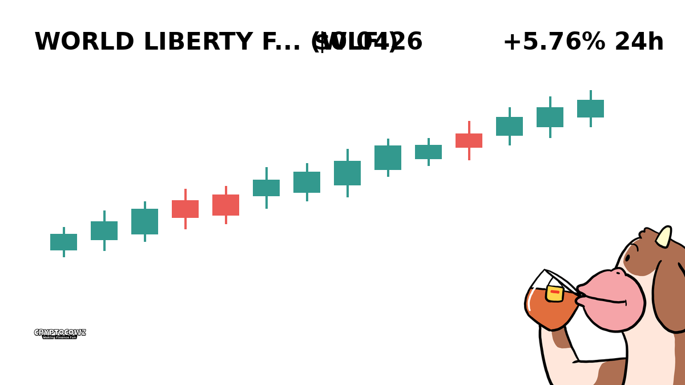
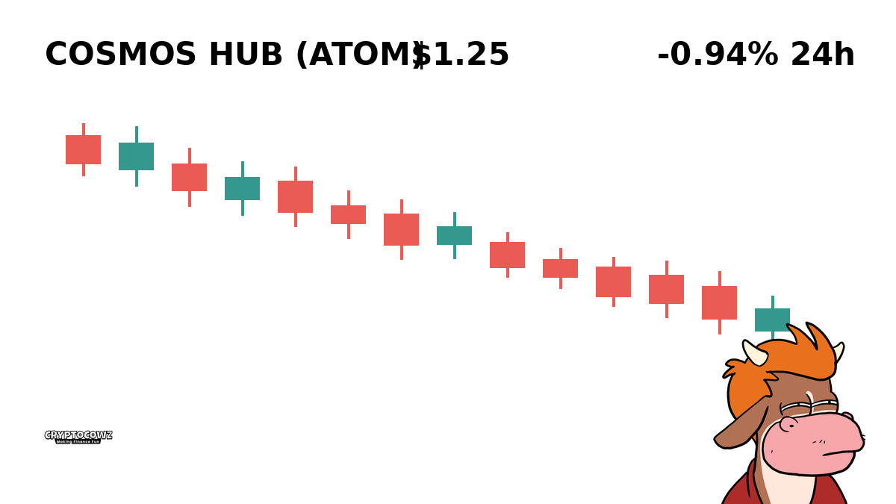
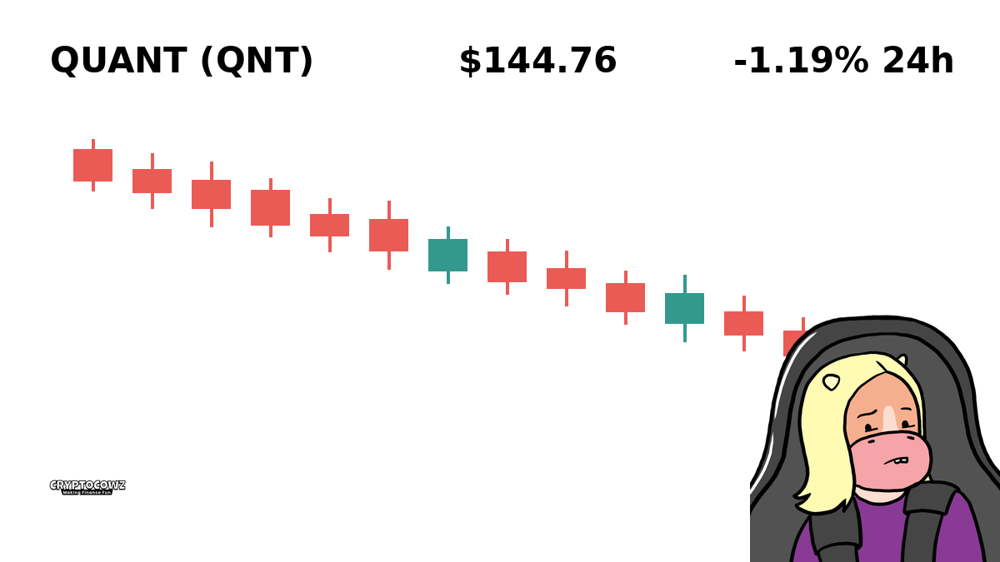
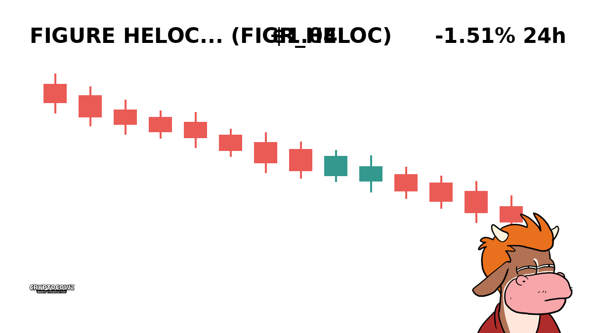
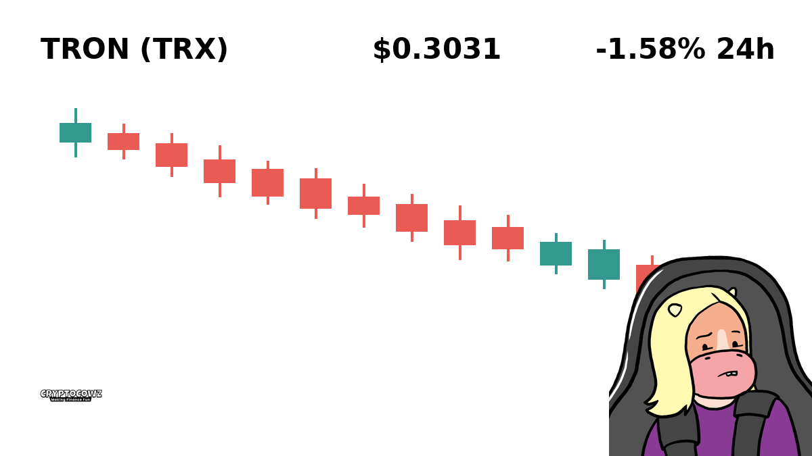

# Daily Top Movers: CMC Community Visuals & Posts

## 1. Pieverse ($PIEVERSE) — +22.09% (PUMP)
**Cast Member:** Skip Zinfandel
**CMC Comment:** Just refinanced my tractor to ape into Pieverse at the top. If baking digital pies doesn't bring financial freedom, nothing will.

---

## 2. Bitway ($BTW) — +18.1% (PUMP)
**Cast Member:** Frank Rizzo
**CMC Comment:** Bitway is pumping so fast my cousin already tried to sell me a fake ledger. Lock in those gains before the devs go to Cabo!

---

## 3. Venice Token ($VVV) — +15.34% (PUMP)
**Cast Member:** Sunshine Innocent Nimbus
**CMC Comment:** Gondolas only go up in the digital lagoon of destiny! I can already feel the cosmic wealth vibrating through my portfolio.

---

## 4. Pearl ($PEARL) — +9.06% (PUMP)
**Cast Member:** Professor Hartmut
**CMC Comment:** Statistically speaking, finding a green candle of this magnitude in an ocean of mediocrity is rare. I shall hold until the liquidity vanishes completely.

---

## 5. World Liberty Financial ($WLFI) — +5.76% (PUMP)
**Cast Member:** Skip Zinfandel
**CMC Comment:** Nothing says financial liberty quite like buying a token up 5 percent while praying for a 100x pump by midnight. Truly patriotic trading!

---

## 6. Cosmos Hub ($ATOM) — -0.94% (DUMP)
**Cast Member:** Frank Rizzo
**CMC Comment:** Down less than one percent and the chat is already crying like a leaky pipe. Wake me up when the whole hub collapses into a black hole!

---

## 7. Quant ($QNT) — -1.19% (DUMP)
**Cast Member:** Professor Hartmut
**CMC Comment:** My quantitative models suggested enterprise adoption, yet here we are observing negative micro-fluctuations. A mild setback for true intellectuals.

---

## 8. Figure Heloc ($FIGR_HELOC) — -1.51% (DUMP)
**Cast Member:** Sunshine Innocent Nimbus
**CMC Comment:** Taking out equity on a digital home line of credit seemed so peaceful until the chart dipped. Sending positive light to my collateral!

---

## 9. TRON ($TRX) — -1.58% (DUMP)
**Cast Member:** Skip Zinfandel
**CMC Comment:** Justin Sun probably sneezed and dropped the market a point. Time to double down and pretend this was the master plan all along!

---

## 10. Rain ($RAIN) — -3.77% (DUMP)
**Cast Member:** Frank Rizzo
**CMC Comment:** Rain is falling and so is my net worth. Somebody fetch me an umbrella before this bag pulls me all the way into the sewer!

---
