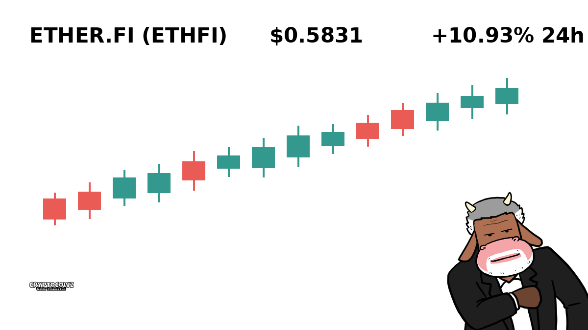
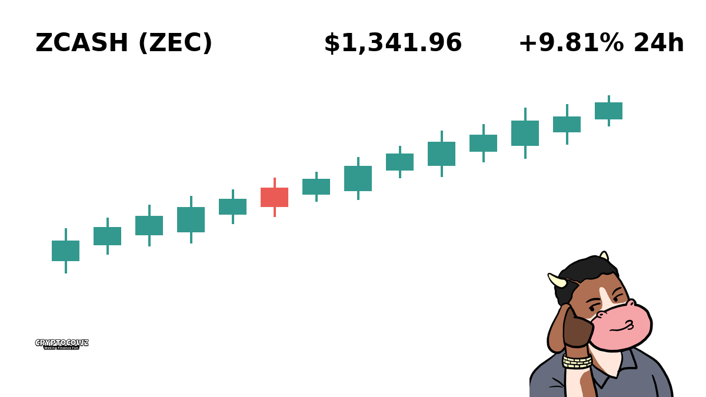
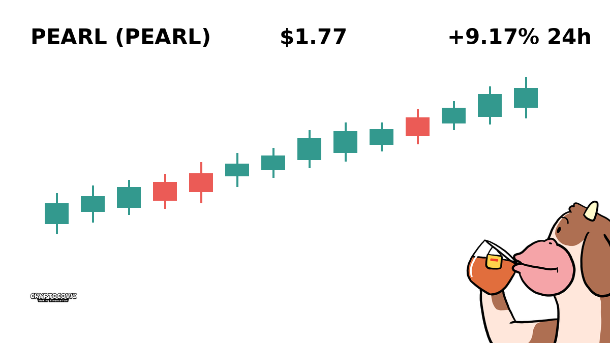
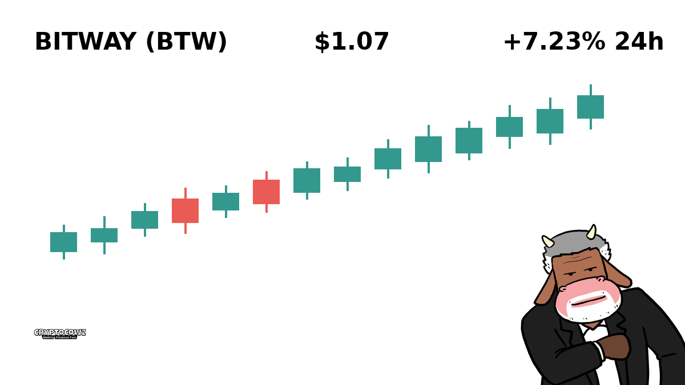
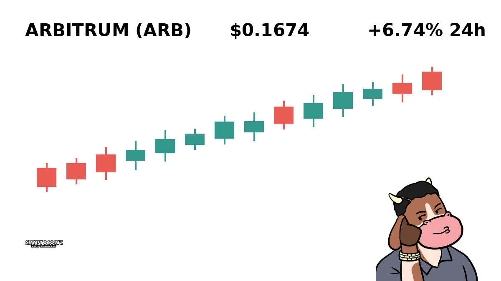
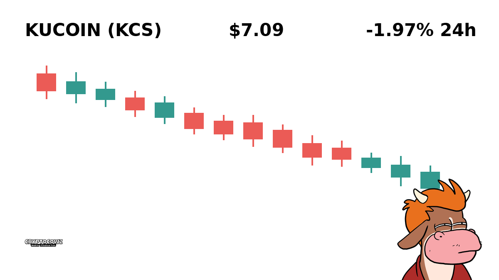
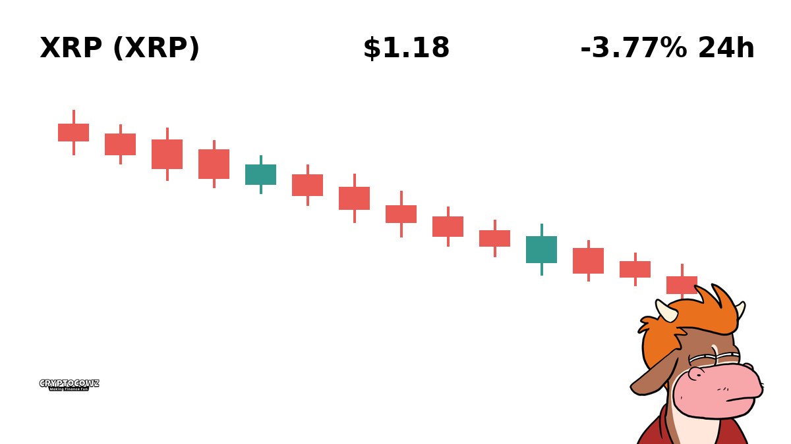

# Daily Top Movers: CMC Community Visuals & Posts

## 1. Ether.fi ($ETHFI) — +10.93% (PUMP)
**Cast Member:** Skip Zinfandel
**CMC Comment:** Up nearly eleven percent today! I just put my third mortgage into liquid restaking because financial freedom is only one smart contract away.

---

## 2. Zcash ($ZEC) — +9.81% (PUMP)
**Cast Member:** Professor Hartmut
**CMC Comment:** Privacy features are pumping, proving once again that true monetary utility lies in hiding your transaction history from both your spouse and the tax authorities.

---

## 3. Pearl ($PEARL) — +9.17% (PUMP)
**Cast Member:** Sunshine Innocent Nimbus
**CMC Comment:** The universe is showering us with shiny pearls today! I knew if we all meditated on green candles hard enough, financial enlightenment would follow.

---

## 4. Bitway ($BTW) — +8.33% (PUMP)
**Cast Member:** Frank Rizzo
**CMC Comment:** Eight percent gain? Forget the mob, this is how real men make a honest living without getting their suits dirty.

---

## 5. Arbitrum ($ARB) — +6.74% (PUMP)
**Cast Member:** Skip Zinfandel
**CMC Comment:** Layer 2 scalability is finally paying for my artisan oat milk lattes. Upward and onward to financial validation!

---

## 6. KuCoin ($KCS) — -1.97% (DUMP)
**Cast Member:** Frank Rizzo
**CMC Comment:** Down two percent and people are sweating? Put on a jacket and hold the line, ya cowards.

---

## 7. Stacks ($STX) — -2.57% (DUMP)
**Cast Member:** Professor Hartmut
**CMC Comment:** A minor correction for Smart Contracts on Bitcoin. Statistically speaking, pain builds character in distributed ledger systems.

---

## 8. Bitcoin Cash ($BCH) — -3.28% (DUMP)
**Cast Member:** Frank Rizzo
**CMC Comment:** Satoshi would be shaking his head. If I held bags like this back in Jersey, I'd throw myself off the boardwalk.

---

## 9. XRP ($XRP) — -3.77% (DUMP)
**Cast Member:** Sunshine Innocent Nimbus
**CMC Comment:** The SEC aura is disrupting the vibe today, but remember, every red dip is just the universe cleansing our bags.

---

## 10. Rain ($RAIN) — -3.81% (DUMP)
**Cast Member:** Skip Zinfandel
**CMC Comment:** It's literally raining losses right now, but I'm told real crypto chads don't use umbrellas.

---
