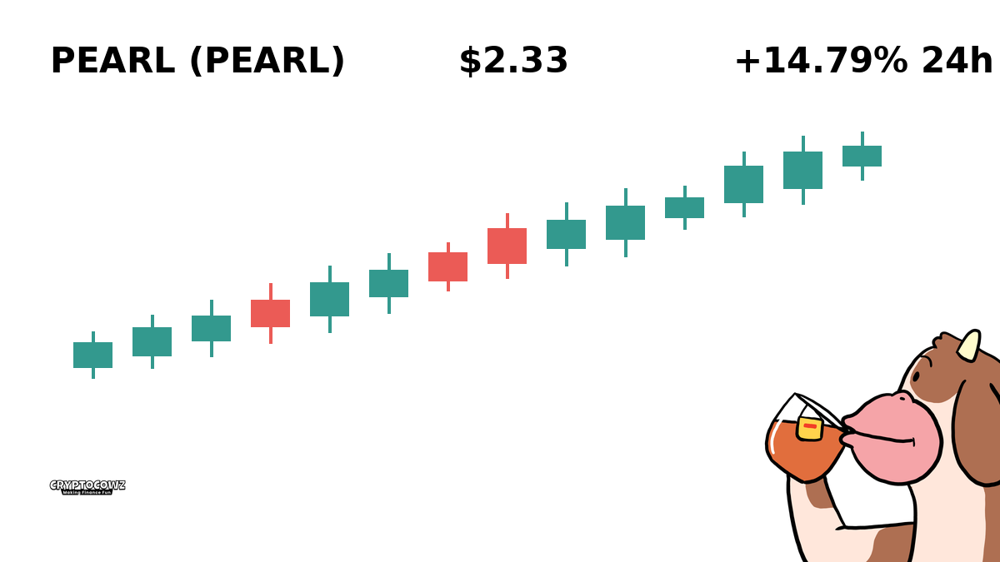
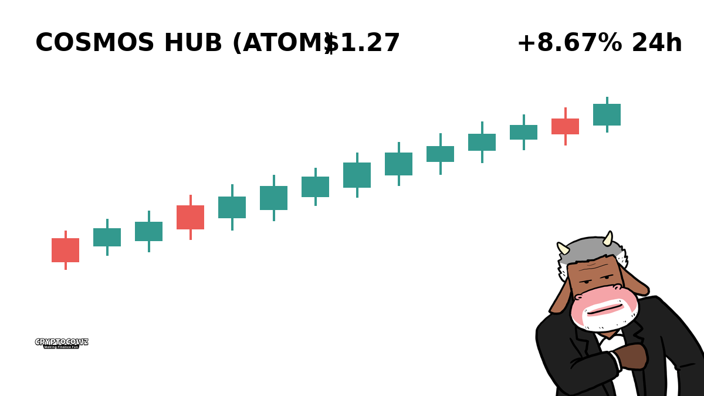
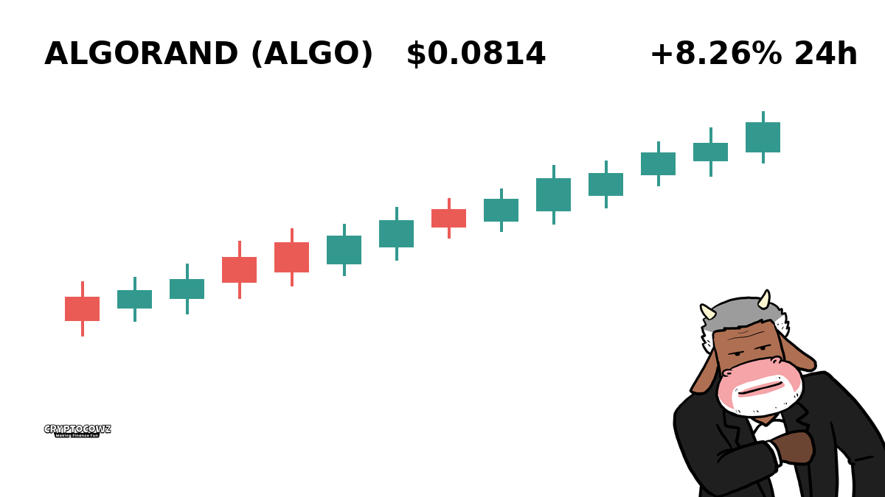
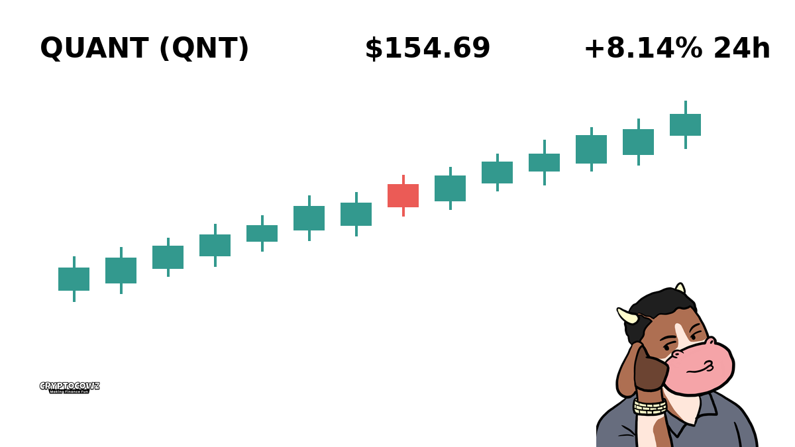
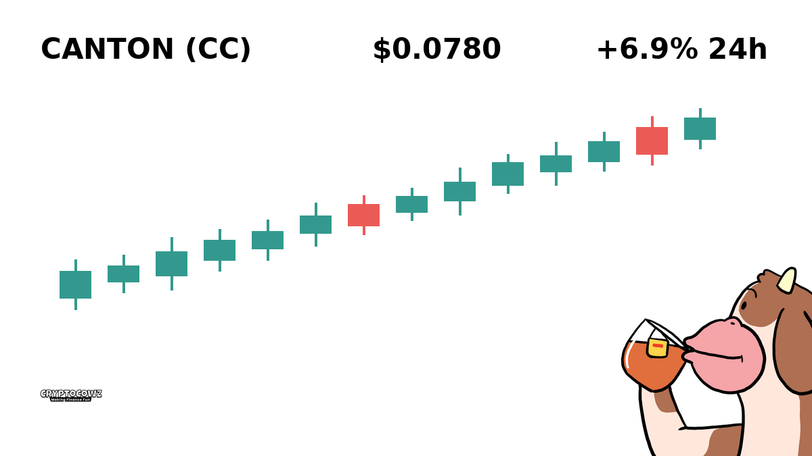
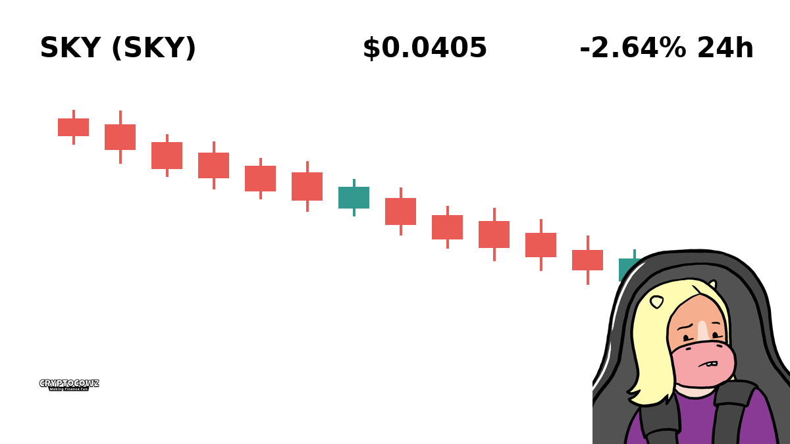
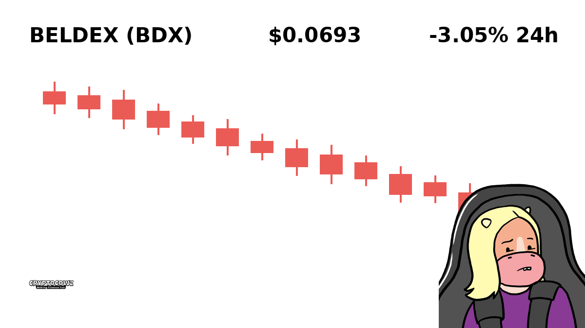
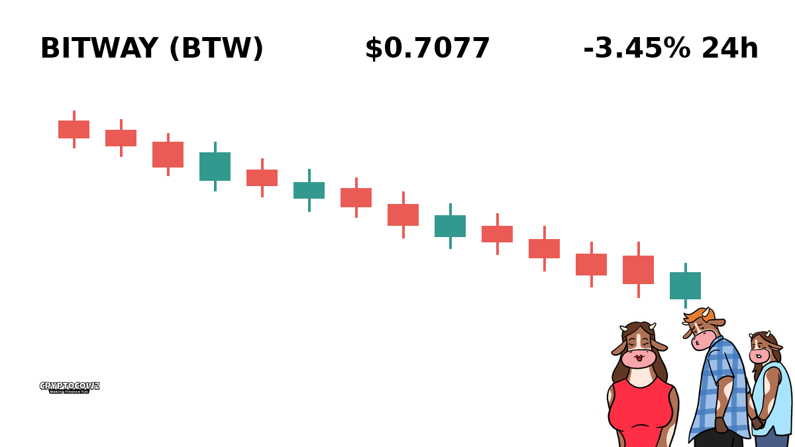
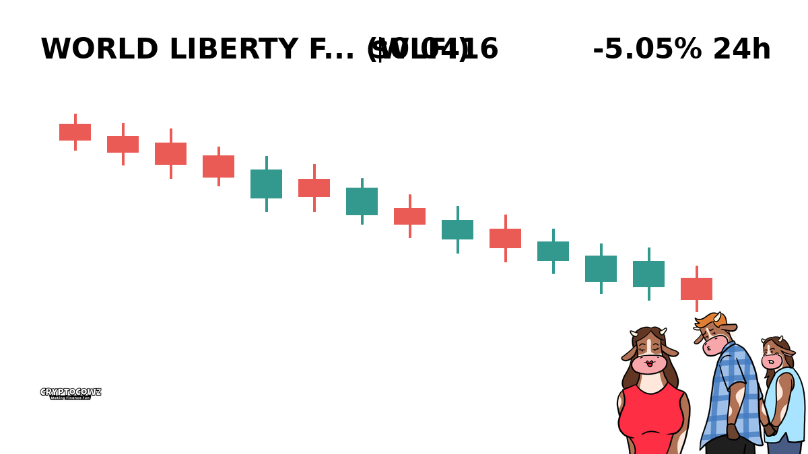
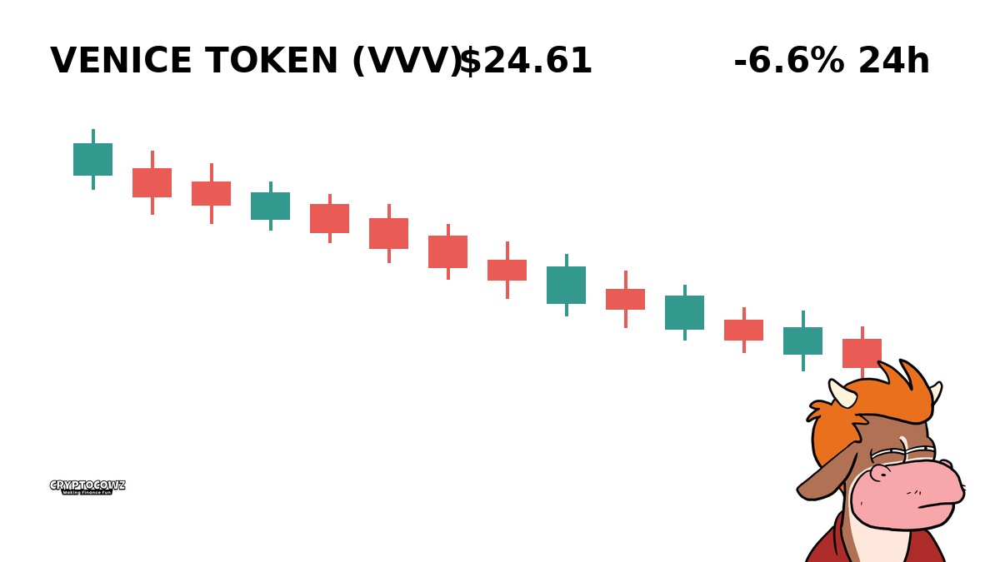

# Daily Top Movers: CMC Community Visuals & Posts

## 1. Pearl ($PEARL) — +14.79% (PUMP)
**Cast Member:** Skip Zinfandel
**CMC Comment:** Clutching this Pearl like my third ex-wife's alimony settlement. We are flying straight to the moon, baby!

---

## 2. Cosmos Hub ($ATOM) — +8.67% (PUMP)
**Cast Member:** Professor Hartmut
**CMC Comment:** Mathematically speaking, the interchain alignment has achieved maximum FOMO velocity. Do not ask about fundamentals, just enjoy the green candle.

---

## 3. Algorand ($ALGO) — +8.26% (PUMP)
**Cast Member:** Sunshine Innocent Nimbus
**CMC Comment:** The universe is healing and Algorand is shining bright! I just traded my sacred chakra crystals for more bags!

---

## 4. Quant ($QNT) — +8.14% (PUMP)
**Cast Member:** Frank Rizzo
**CMC Comment:** Enterprise interoperability? I don't care what it means, the line goes up so I bought another gold chain.

---

## 5. Canton ($CC) — +6.9% (PUMP)
**Cast Member:** Skip Zinfandel
**CMC Comment:** Up almost seven percent and my heart rate is up two hundred. I'm leveraging my second house for Canton right now!

---

## 6. Sky ($SKY) — -2.64% (DUMP)
**Cast Member:** Frank Rizzo
**CMC Comment:** The sky is falling and so is my net worth. Somebody turn off the gravity before I lose my boots.

---

## 7. Beldex ($BDX) — -3.05% (DUMP)
**Cast Member:** Professor Hartmut
**CMC Comment:** Privacy features cannot conceal the absolute tragedy occurring on this order book. A statistical disaster.

---

## 8. Bitway ($BTW) — -3.45% (DUMP)
**Cast Member:** Sunshine Innocent Nimbus
**CMC Comment:** By the way, my portfolio is sending negative vibrations today. I am holding hands with my losses and breathing deeply.

---

## 9. World Liberty Financial ($WLFI) — -5.05% (DUMP)
**Cast Member:** Skip Zinfandel
**CMC Comment:** World Liberty Financial? More like World Financial Disaster! Time to blame the Fed and sell the speedboat.

---

## 10. Venice Token ($VVV) — -6.6% (DUMP)
**Cast Member:** Frank Rizzo
**CMC Comment:** Veni, vidi, lost all my money. Venice is sinking and taking my kids' college fund down with it.

---
