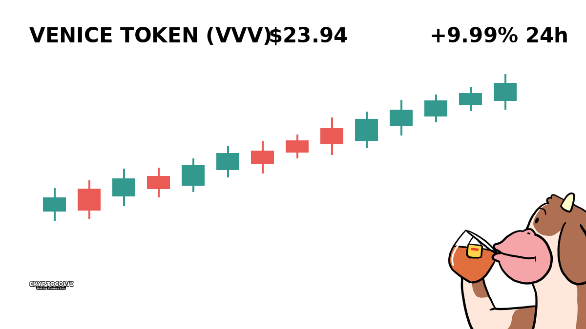
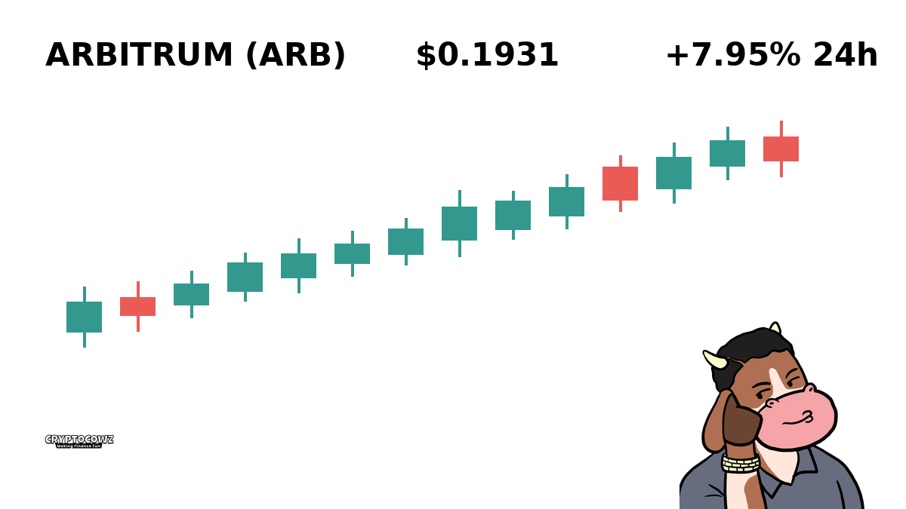
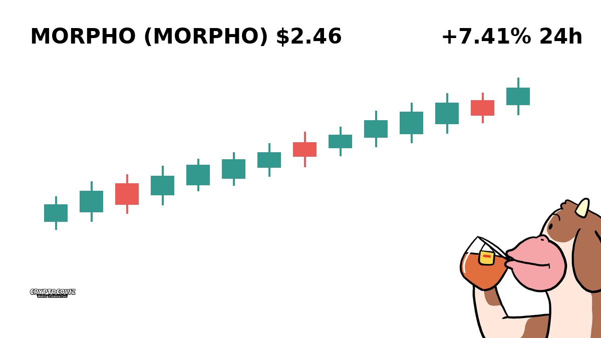
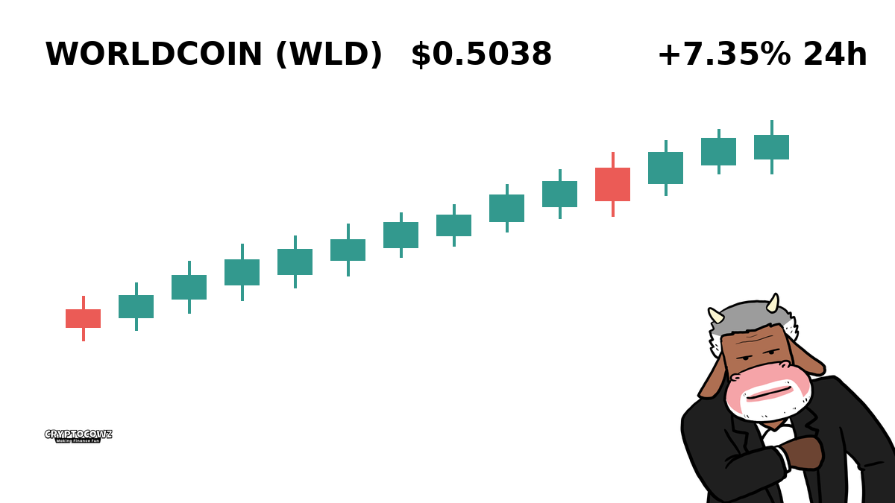
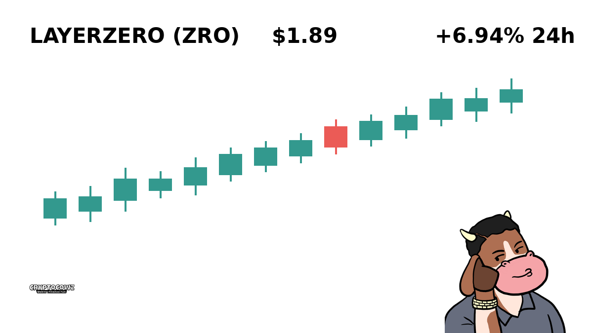
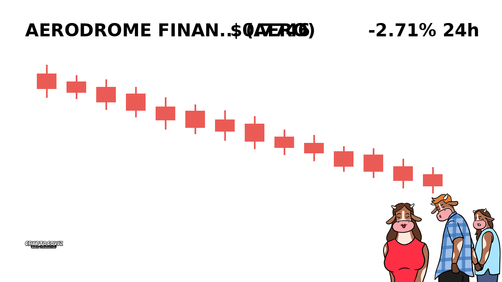
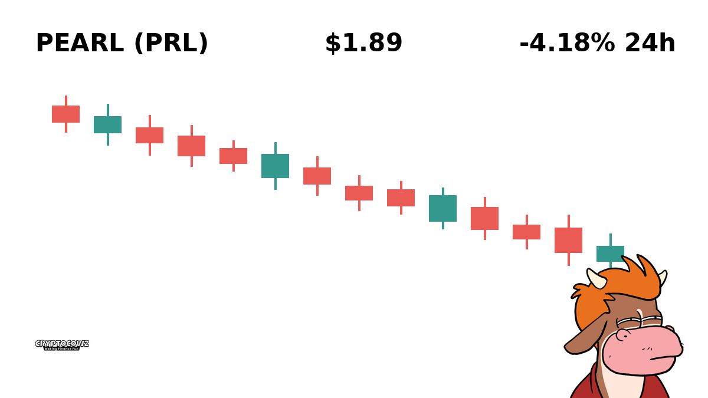
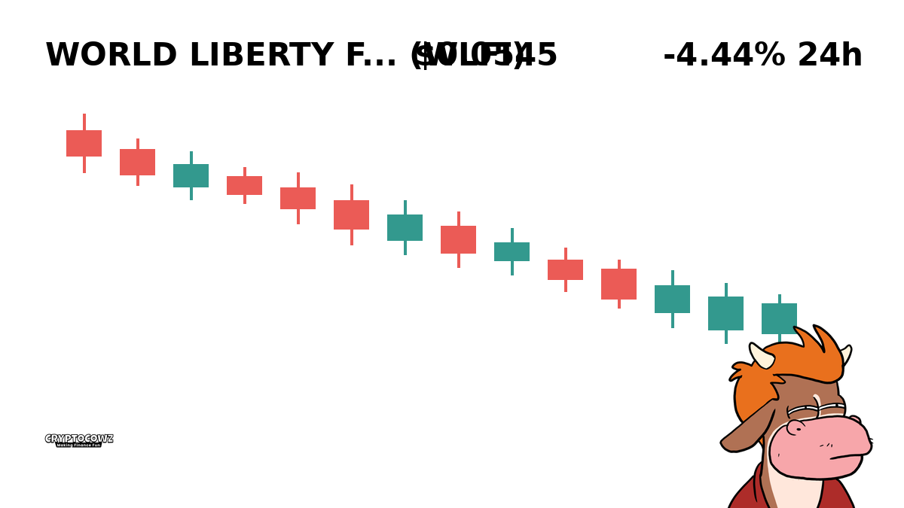

# Daily Top Movers: CMC Community Visuals & Posts

## 1. Venice Token ($VVV) — +9.99% (PUMP)
**Cast Member:** Skip Zinfandel
**CMC Comment:** Venice Token is floating higher than my third alimony payment! Time to trade the gondola for a golden yacht, boys!

---

## 2. Arbitrum ($ARB) — +7.95% (PUMP)
**Cast Member:** Professor Hartmut
**CMC Comment:** Mathematically speaking, this sudden upward vector suggests retail traders have once again mistaken temporary liquidity for infinite prosperity.

---

## 3. Morpho ($MORPHO) — +7.41% (PUMP)
**Cast Member:** Sunshine Innocent Nimbus
**CMC Comment:** Morpho is changing shapes and soaring into the clouds! I knew if we all held hands and believed hard enough, green candle magic would happen!

---

## 4. Worldcoin ($WLD) — +7.35% (PUMP)
**Cast Member:** Frank Rizzo
**CMC Comment:** Scanned my eyeballs into the chrome orb and now I am up seven percent! Who needs privacy when you got green candles, pal?

---

## 5. LayerZero ($ZRO) — +6.94% (PUMP)
**Cast Member:** Skip Zinfandel
**CMC Comment:** LayerZero going hero! Bridging my funds straight into a brand new sports car before the market realizes what happened.

---

## 6. Aerodrome Finance ($AERO) — -2.71% (DUMP)
**Cast Member:** Frank Rizzo
**CMC Comment:** Aerodrome just dumped out of the sky like a wet sack of concrete. Guess who is holding the propeller? Yours truly.

---

## 7. Pearl ($PRL) — -4.18% (DUMP)
**Cast Member:** Sunshine Innocent Nimbus
**CMC Comment:** Oh no, Pearl is falling down the well! Don't worry little coin, I will keep holding you at the bottom forever and ever!

---

## 8. World Liberty Financial ($WLFI) — -4.44% (DUMP)
**Cast Member:** Skip Zinfandel
**CMC Comment:** World Liberty Financial taking a freedom dive straight into my emergency fund. Down four percent, but my patriotism remains unhedged!

---

## 9. MemeCore ($M) — -4.64% (DUMP)
**Cast Member:** Professor Hartmut
**CMC Comment:** Empirical evidence confirms that calling your token MemeCore yields an outcome as structurally sound as a house of cards in a hurricane.

---

## 10. Bitway ($BTW) — -18.56% (DUMP)
**Cast Member:** Frank Rizzo
**CMC Comment:** Down eighteen percent on Bitway? By the way, my landlord is currently banging on the door and I am hiding under the kitchen sink.

---
