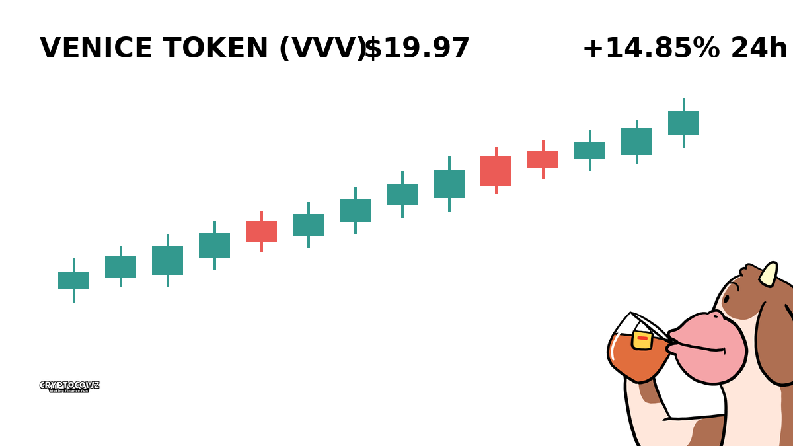
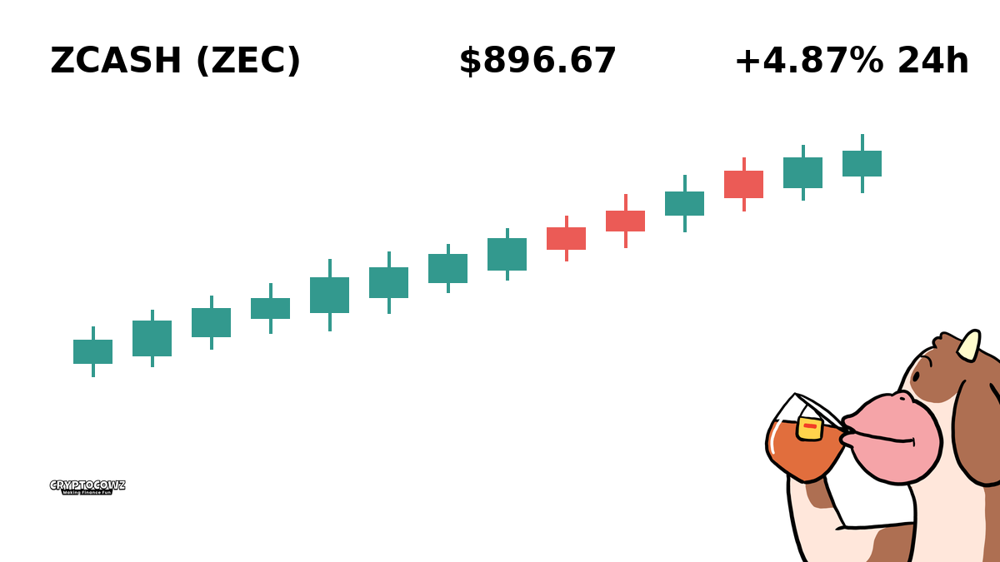
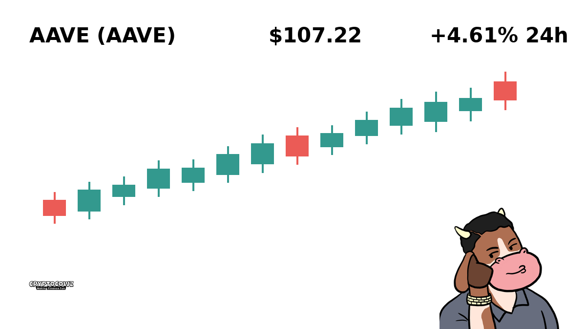
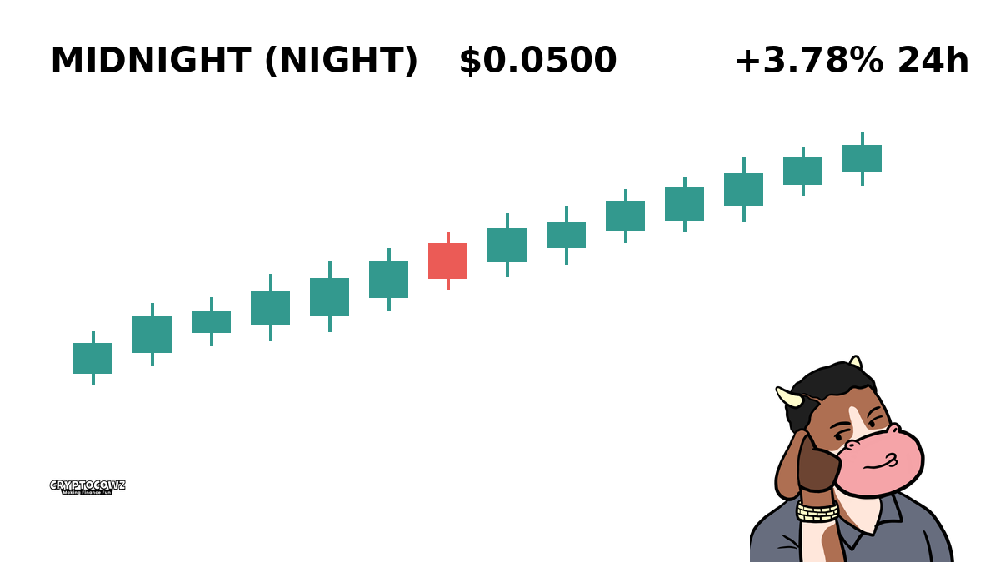
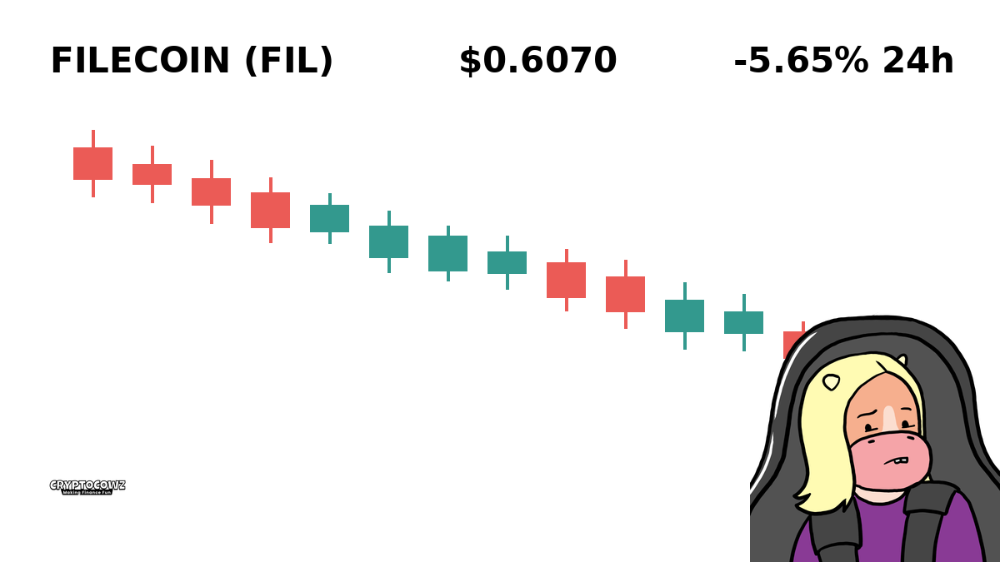
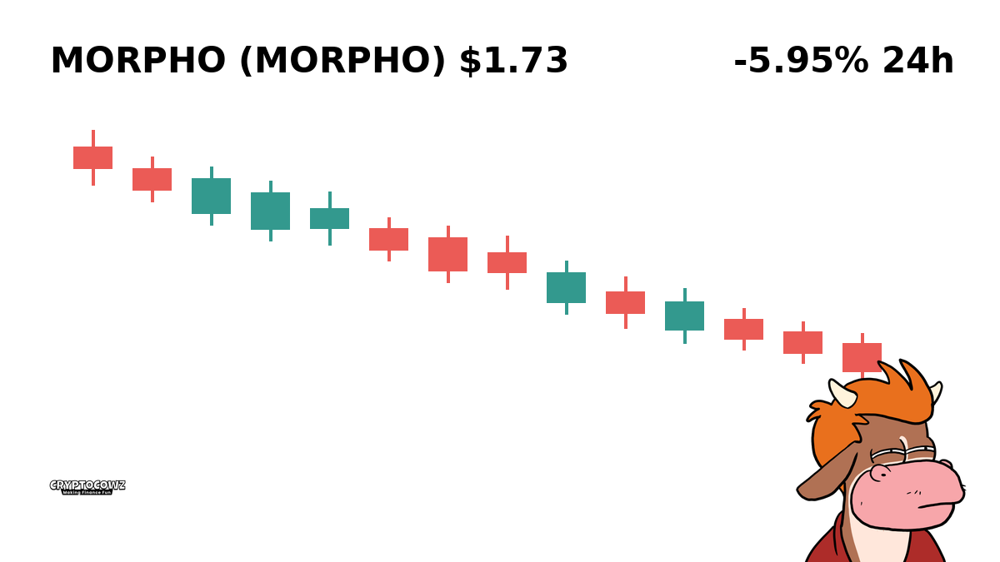
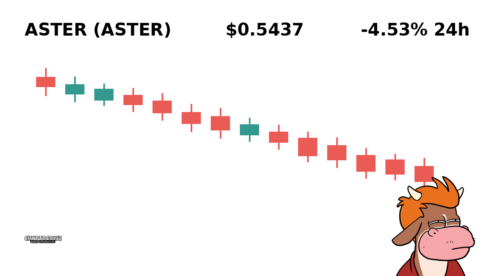
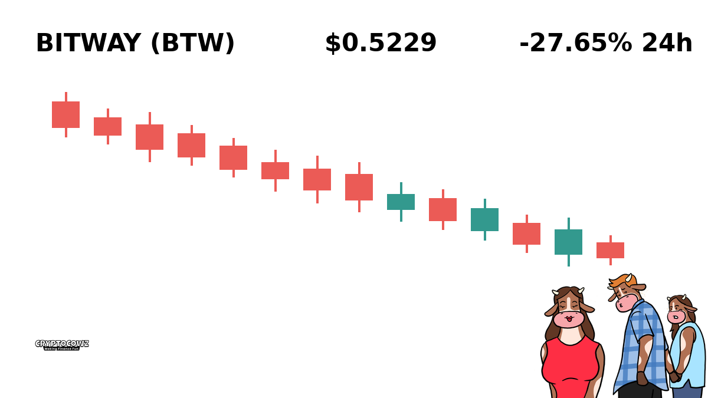

# Daily Top Movers: CMC Community Visuals & Posts

## 1. Venice Token ($VVV) — +14.85% (PUMP)
**Cast Member:** Skip Zinfandel
**CMC Comment:** Pack your bags, folks, Venice isn't sinking today, it's flying directly to Mars! Just put my entire life savings into gondola futures.

---

## 2. Pearl ($PEARL) — +5.48% (PUMP)
**Cast Member:** Sunshine Innocent Nimbus
**CMC Comment:** Pearls are formed from stress inside an oyster, which explains why my portfolio is finally glowing! We are all going to be deep sea millionaires!

---

## 3. Zcash ($ZEC) — +4.87% (PUMP)
**Cast Member:** Frank Rizzo
**CMC Comment:** Privacy coins are pumping, which means somebody's accountant is sweating bullets right now. Keep your mouth shut and collect the gains, capisce?

---

## 4. Aave ($AAVE) — +4.61% (PUMP)
**Cast Member:** Professor Hartmut
**CMC Comment:** Mathematically speaking, borrowing against your own hype yields a temporary spike in dopamine. Enjoy the liquidity while the protocol stays solvent.

---

## 5. Midnight ($NIGHT) — +3.78% (PUMP)
**Cast Member:** Skip Zinfandel
**CMC Comment:** They say nothing good happens after Midnight, but my trading account begs to differ! Up past bedtime and getting filthy rich!

---

## 6. Filecoin ($FIL) — -5.65% (DUMP)
**Cast Member:** Frank Rizzo
**CMC Comment:** Decentralized storage, huh? The only thing being stored here is a massive pile of regret in my wallet.

---

## 7. Morpho ($MORPHO) — -5.95% (DUMP)
**Cast Member:** Professor Hartmut
**CMC Comment:** A nearly six percent contraction is merely the market correcting for unsustainable optimism. Unfortunately for bagholders, gravity remains undefeated.

---

## 8. LayerZero ($ZRO) — -8.15% (DUMP)
**Cast Member:** Sunshine Innocent Nimbus
**CMC Comment:** LayerZero? More like Layer Hero once it rebounds! I'm buying every single dip with my emotional support credit card!

---

## 9. Aster ($ASTER) — -12.79% (DUMP)
**Cast Member:** Skip Zinfandel
**CMC Comment:** Down double digits? That's just a classic launchpad maneuver before we hit hyperspace, trust the process!

---

## 10. Bitway ($BTW) — -27.65% (DUMP)
**Cast Member:** Frank Rizzo
**CMC Comment:** Bitway is giving us the highway straight to bankruptcy. Who authorized this absolute robbery?

---
