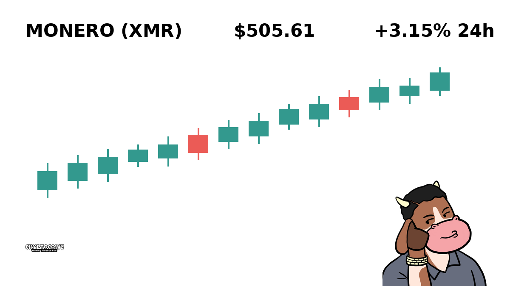
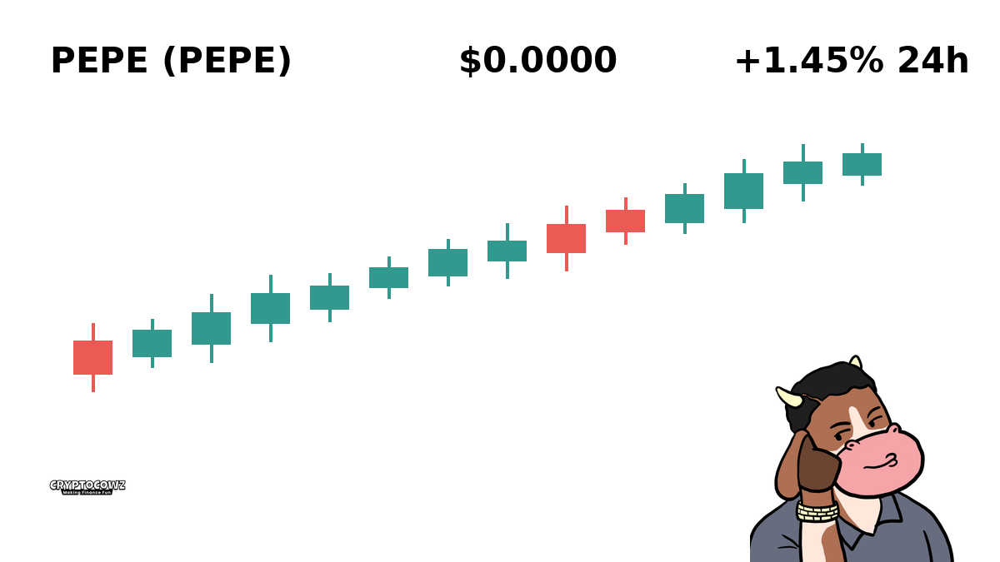
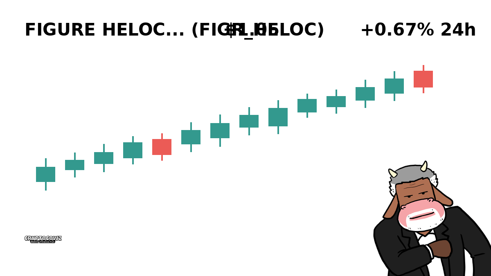
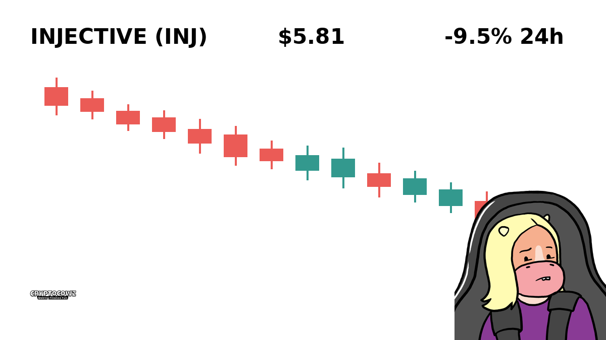
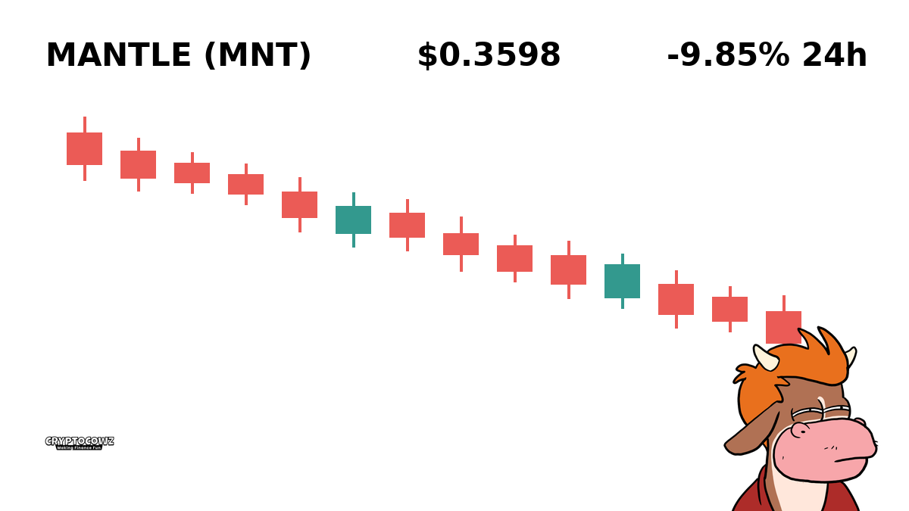
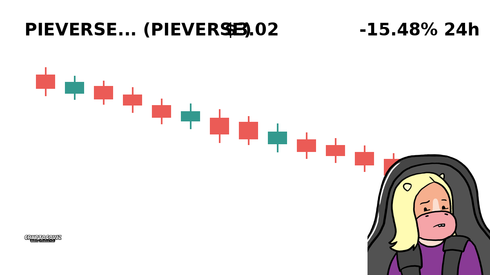

# Daily Top Movers: CMC Community Visuals & Posts

## 1. Bitway ($BTW) — +7.54% (PUMP)
**Cast Member:** Skip Zinfandel
**CMC Comment:** Bitway is up over 7% today! I just remortgaged the barn because green candles like this simply do not lie.

---

## 2. Monero ($XMR) — +3.15% (PUMP)
**Cast Member:** Frank Rizzo
**CMC Comment:** Monero up 3% means someone somewhere just bought a jet ski completely off the grid. You love to see it.

---

## 3. Sky ($SKY) — +2.04% (PUMP)
**Cast Member:** Sunshine Innocent Nimbus
**CMC Comment:** Sky is climbing higher! The cosmic winds are lifting our financial spirits right up into the clouds today!

---

## 4. Pepe ($PEPE) — +1.45% (PUMP)
**Cast Member:** Skip Zinfandel
**CMC Comment:** A 1.4% frog pump? Time to post 'we are so back' and pretend my student loans don't exist anymore!

---

## 5. Figure Heloc ($FIGR_HELOC) — +0.67% (PUMP)
**Cast Member:** Professor Hartmut
**CMC Comment:** A 0.67% upward variance in Figure Heloc represents statistically negligible velocity, yet retail will undoubtedly celebrate it as a triumph.

---

## 6. Injective ($INJ) — -9.5% (DUMP)
**Cast Member:** Frank Rizzo
**CMC Comment:** Injective down nearly 10%. Injecting your life savings directly into a shredder would have saved you the gas fees.

---

## 7. Mantle ($MNT) — -9.85% (DUMP)
**Cast Member:** Professor Hartmut
**CMC Comment:** Mantle's 9.85% decline serves as an empirical demonstration that financial gravity remains entirely undefeated.

---

## 8. Rain ($RAIN) — -10.97% (DUMP)
**Cast Member:** Sunshine Innocent Nimbus
**CMC Comment:** Rain is dumping 11%, but remember that every heavy downpour just helps clean the mud off our bagholding feet!

---

## 9. Pieverse ($PIEVERSE) — -15.48% (DUMP)
**Cast Member:** Frank Rizzo
**CMC Comment:** Pieverse down 15%? Somebody just smashed that pie right into your face and kept the dish, pal.

---

## 10. Pearl ($PEARL) — -22.63% (DUMP)
**Cast Member:** Skip Zinfandel
**CMC Comment:** Pearl dropped 22% today, but I'm told holding heavy bags at the bottom of the ocean is great for upper body strength!

---
