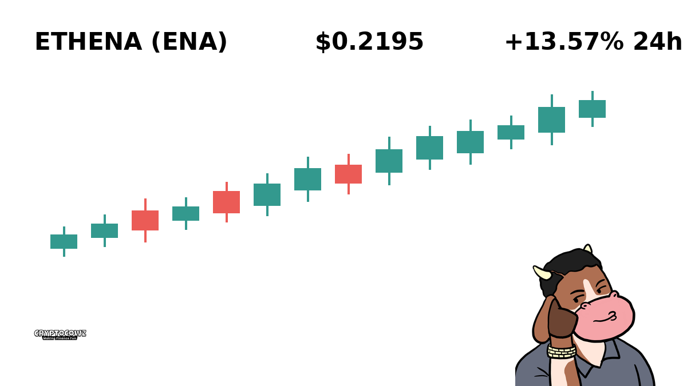
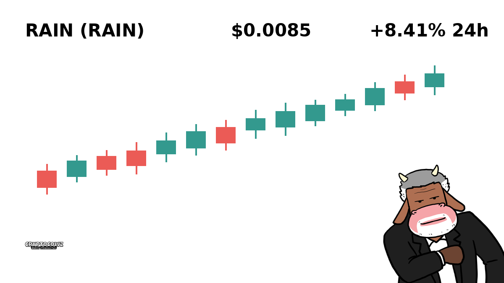
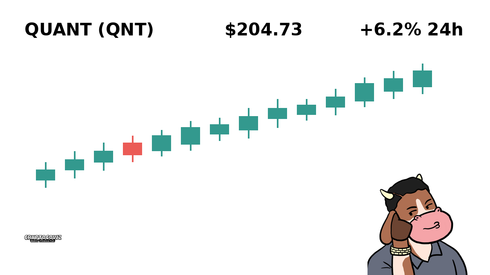
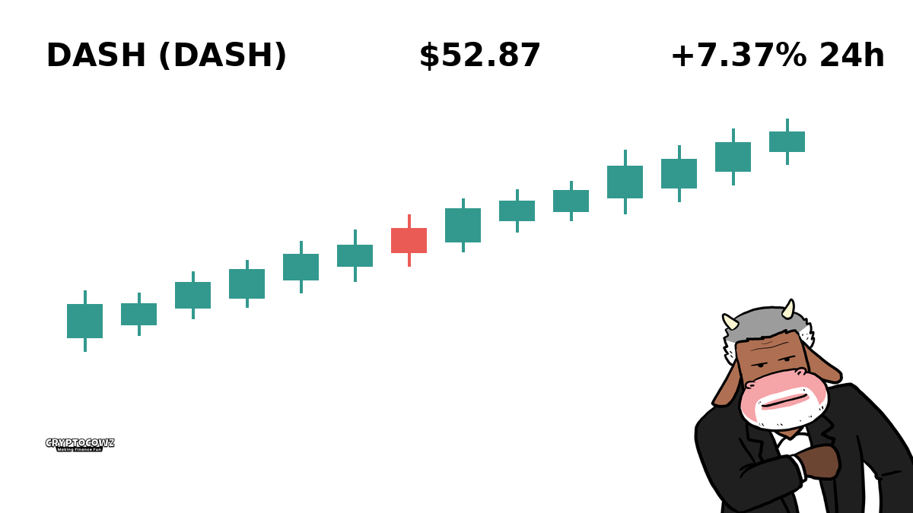
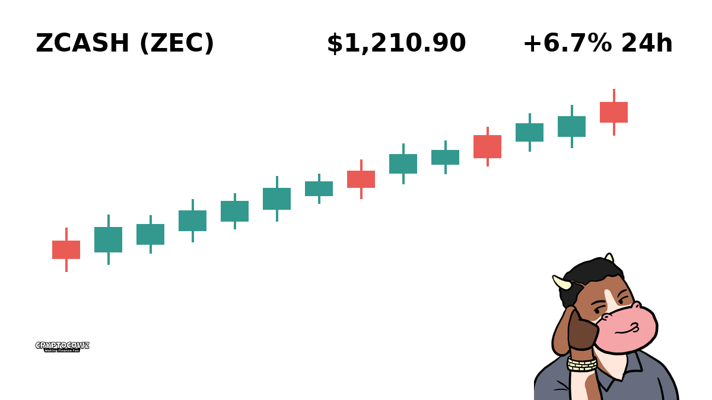
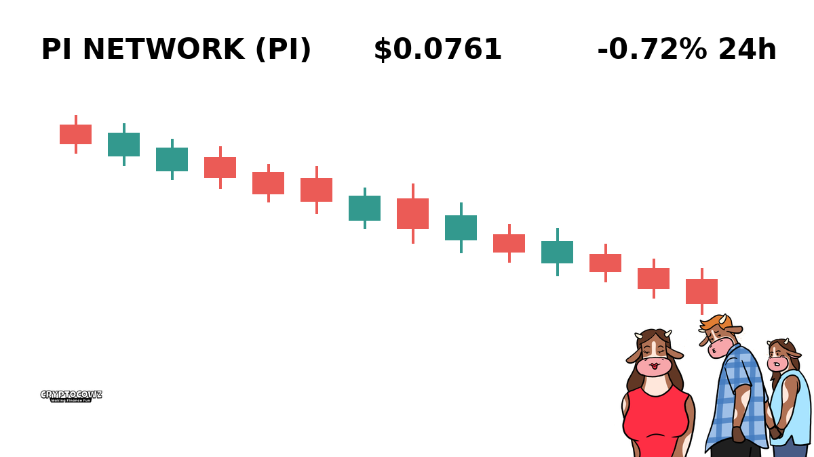
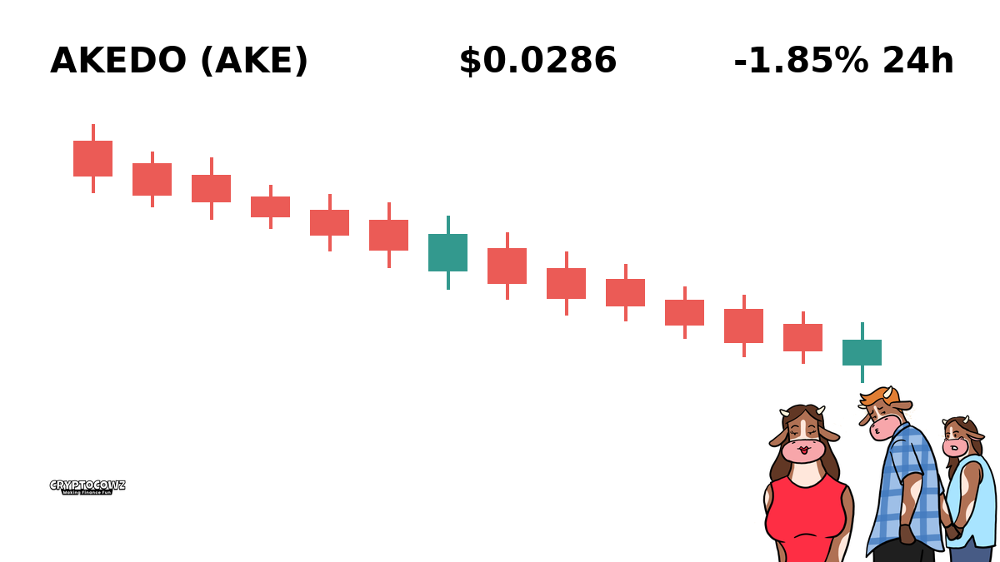
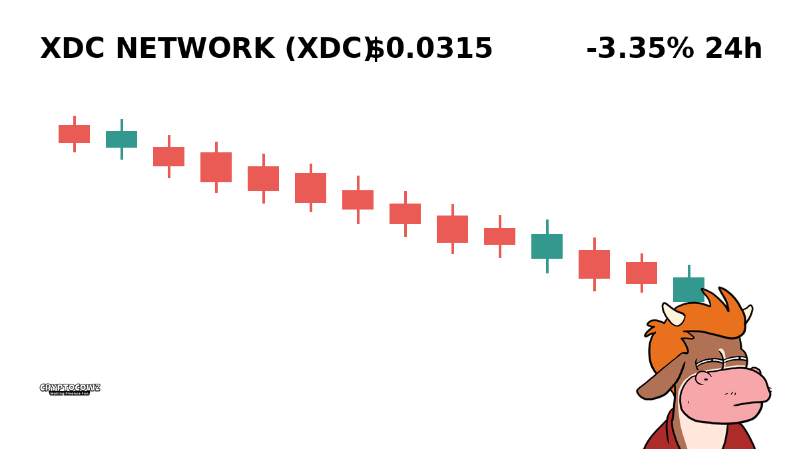
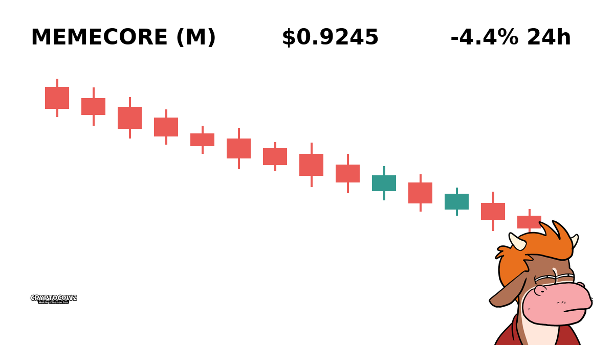
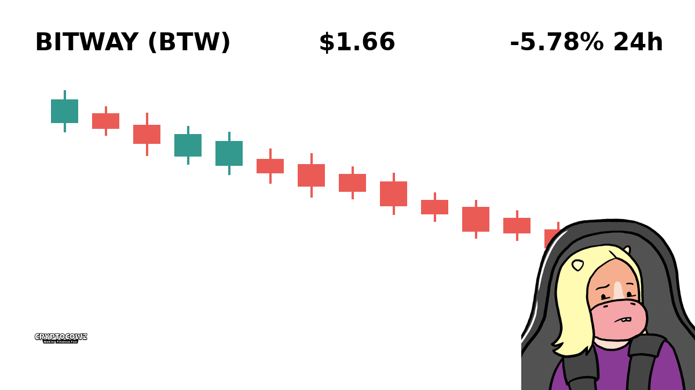

# Daily Top Movers: CMC Community Visuals & Posts

## 1. Ethena ($ENA) — +10.03% (PUMP)
**Cast Member:** Skip Zinfandel
**CMC Comment:** Synthetic dollars are pumping so hard I just remortgaged the pasture to buy more yield. Generational wealth is back on the menu, boys!

---

## 2. Rain ($RAIN) — +8.41% (PUMP)
**Cast Member:** Sunshine Innocent Nimbus
**CMC Comment:** When it rains gainz, everybody gets soaked in pure cosmic energy! I'm holding this green candle until my third eye fully opens.

---

## 3. Quant ($QNT) — +7.38% (PUMP)
**Cast Member:** Professor Hartmut
**CMC Comment:** The interoperability metrics are displaying a statistically significant upward trajectory. Clearly, institutional capital has finally recognized my algorithmic superiority.

---

## 4. Dash ($DASH) — +7.37% (PUMP)
**Cast Member:** Frank Rizzo
**CMC Comment:** What year is it, 2017? Hey, if it makes me fast cash so I can pay off my bookie, I ain't asking no questions!

---

## 5. Zcash ($ZEC) — +6.7% (PUMP)
**Cast Member:** Frank Rizzo
**CMC Comment:** Privacy coins pumping means somebody's moving clean cash under the table. Keep your mouth shut and enjoy the green rocket!

---

## 6. Pi Network ($PI) — -0.72% (DUMP)
**Cast Member:** Skip Zinfandel
**CMC Comment:** You spent three years tapping your smartphone screen once a day for a price drop? Absolute financial genius right there.

---

## 7. Akedo ($AKE) — -1.85% (DUMP)
**Cast Member:** Professor Hartmut
**CMC Comment:** A downward variance, yet bagholders remain convinced their pixelated ecosystem holds intrinsic economic value. Fascinating delusion.

---

## 8. XDC Network ($XDC) — -3.35% (DUMP)
**Cast Member:** Frank Rizzo
**CMC Comment:** Down three percent and the Telegram group is screaming market manipulation. Listen up, kids: you bought a bag, now sit on it like a real boss.

---

## 9. MemeCore ($M) — -4.4% (DUMP)
**Cast Member:** Sunshine Innocent Nimbus
**CMC Comment:** The universe is just clearing out the toxic paper hands to make room for higher vibrational hodlers. Unplug from the charts and manifest the bounce!

---

## 10. Bitway ($BTW) — -5.78% (DUMP)
**Cast Member:** Skip Zinfandel
**CMC Comment:** More like Bitway to the food stamp line, am I right? Dumped my bag straight into the liquidator's lap and didn't look back.

---
