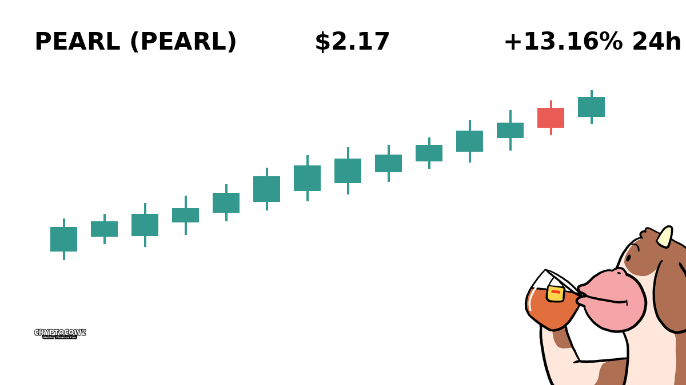
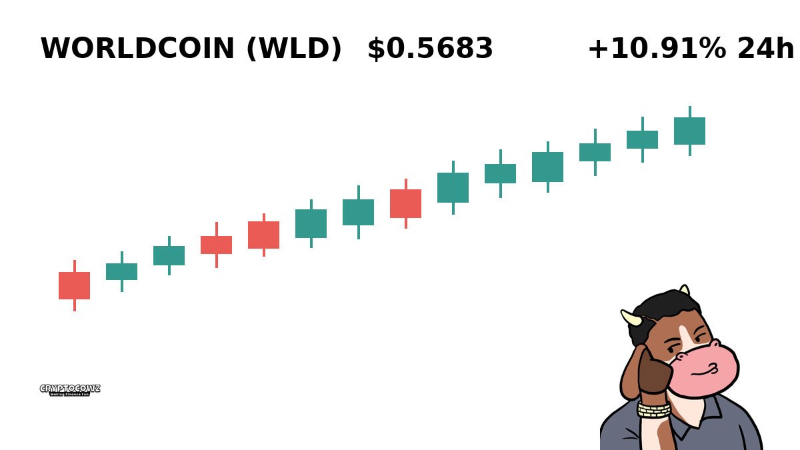
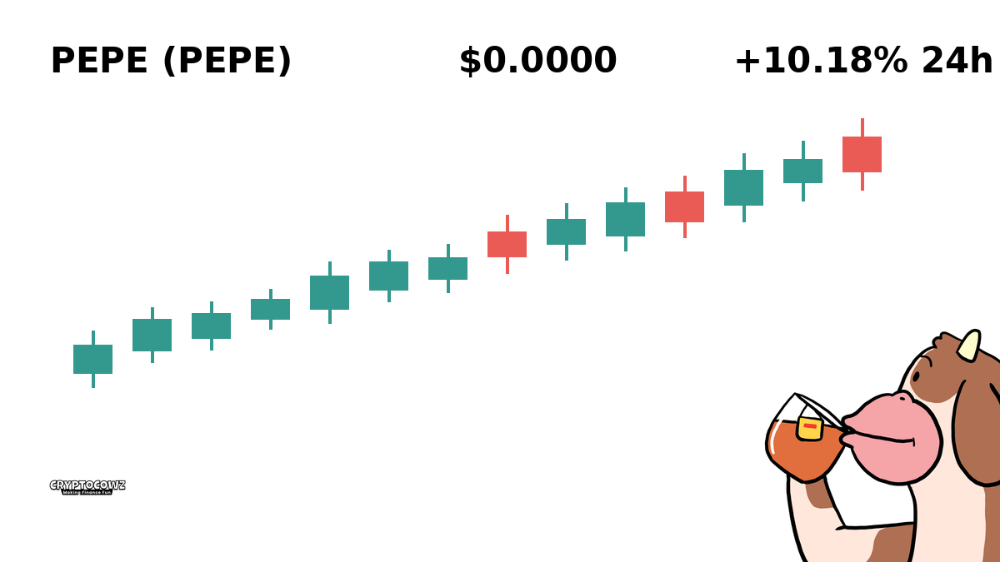
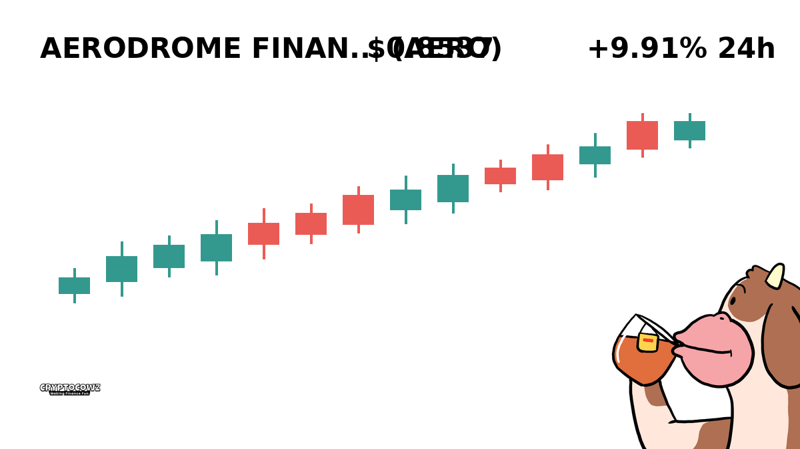
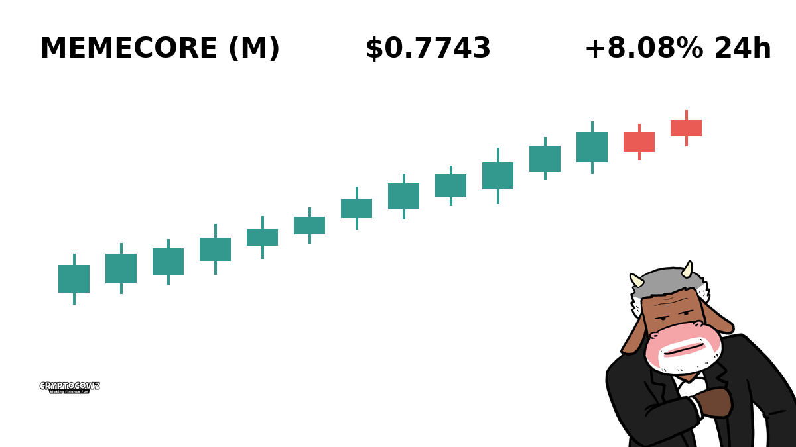
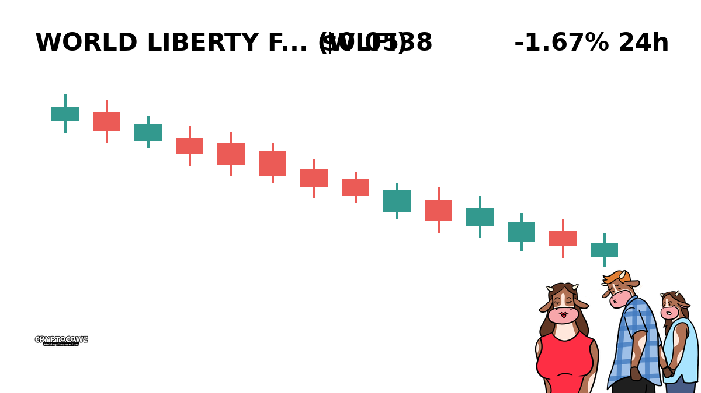
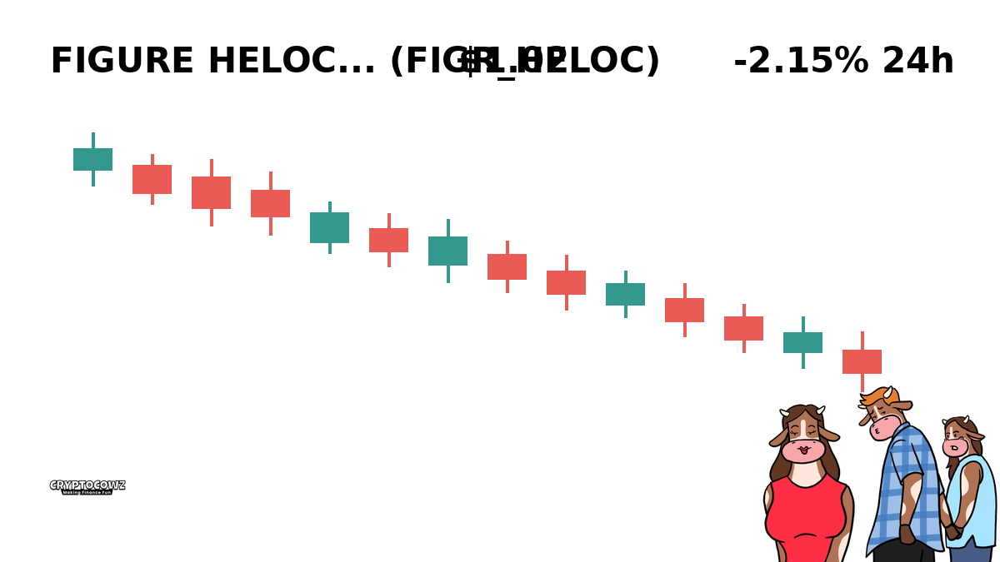
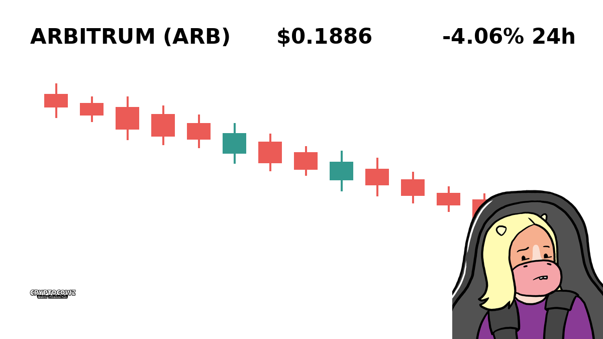
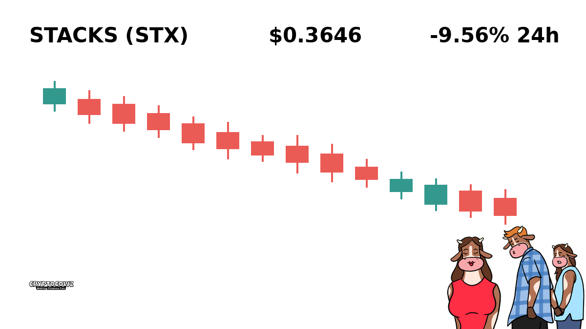
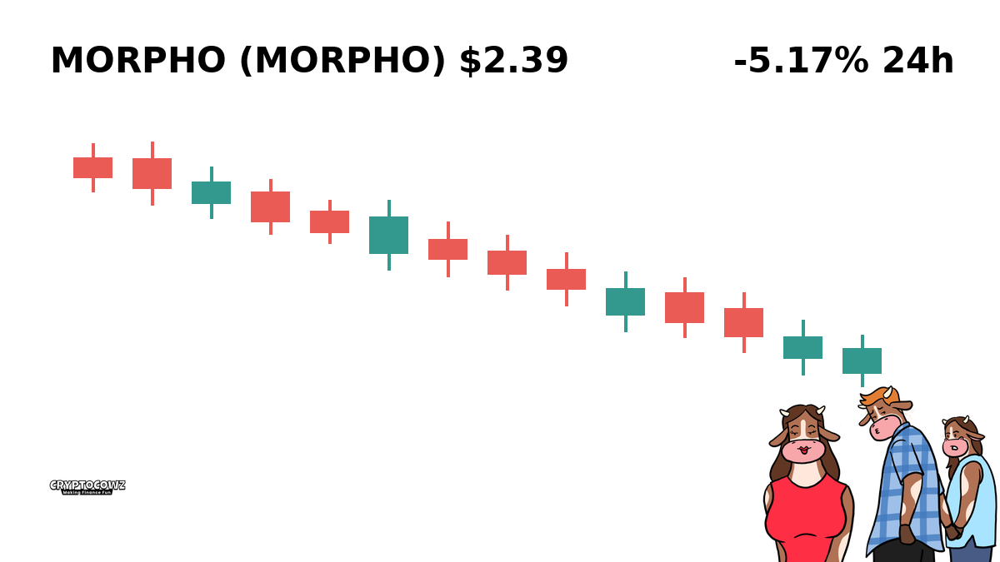

# Daily Top Movers: CMC Community Visuals & Posts

## 1. Pearl ($PEARL) — +13.16% (PUMP)
**Cast Member:** Skip Zinfandel
**CMC Comment:** We are diving straight into liquid luxury with this green candle! I am trading my finest barn for a yacht with pearl-encrusted steering wheels.

---

## 2. Worldcoin ($WLD) — +10.91% (PUMP)
**Cast Member:** Professor Hartmut
**CMC Comment:** Scanning your eyeballs for double-digit gains is a perfectly rational exchange of biological data. The empirical data proves that dystopia pays remarkably well.

---

## 3. Pepe ($PEPE) — +10.18% (PUMP)
**Cast Member:** Sunshine Innocent Nimbus
**CMC Comment:** The happy green froggy is leaping up to the clouds! I drew a picture of him riding a rocket made of pure joy and green candles.

---

## 4. Aerodrome Finance ($AERO) — +9.91% (PUMP)
**Cast Member:** Frank Rizzo
**CMC Comment:** We are taking off, baby! Strap me to this aerodynamic rocket and fly it straight to my offshore account before altitude sickness kicks in.

---

## 5. MemeCore ($M) — +8.08% (PUMP)
**Cast Member:** Skip Zinfandel
**CMC Comment:** MemeCore is pumping so fast I just renamed my prize heifer 'Meme'! True utility is whatever makes the green line shoot straight into the stratosphere.

---

## 6. World Liberty Financial ($WLFI) — -1.67% (DUMP)
**Cast Member:** Frank Rizzo
**CMC Comment:** World Liberty? More like World Liability. I have seen fake gold chains on canal street with better structural integrity than this chart.

---

## 7. Figure Heloc ($FIGR_HELOC) — -2.15% (DUMP)
**Cast Member:** Skip Zinfandel
**CMC Comment:** Taking a home equity loan to buy a coin named HELOC was supposed to be financial synergy! Now the bank owns my tractor and my private key.

---

## 8. Arbitrum ($ARB) — -4.06% (DUMP)
**Cast Member:** Professor Hartmut
**CMC Comment:** My theoretical models predicted efficient Layer 2 scaling, yet failed to account for mass psychological capitulation. A truly fascinating study in unmitigated panic.

---

## 9. Stacks ($STX) — -5.02% (DUMP)
**Cast Member:** Sunshine Innocent Nimbus
**CMC Comment:** Oh no, the stacks are tumbling down like a game of Jenga! Don't worry little bagholders, I am sending warm hugs to your sad crypto wallets.

---

## 10. Morpho ($MORPHO) — -5.17% (DUMP)
**Cast Member:** Frank Rizzo
**CMC Comment:** Morpho is morphing straight into a puddle of my financial ruin. Get me out of this trade before my loan shark finds out!

---
