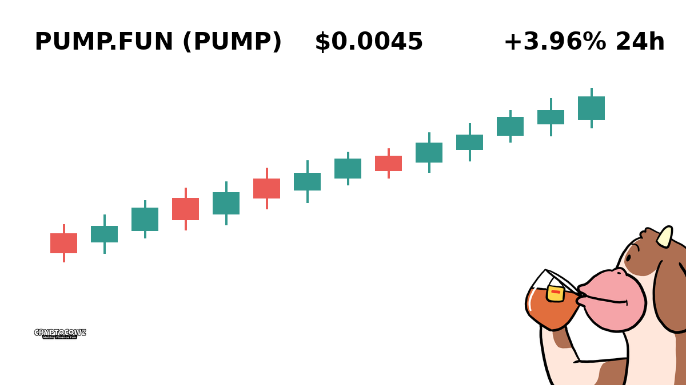
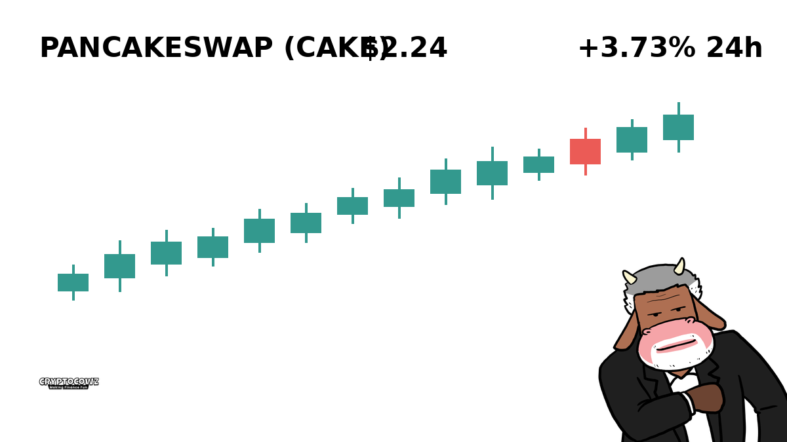
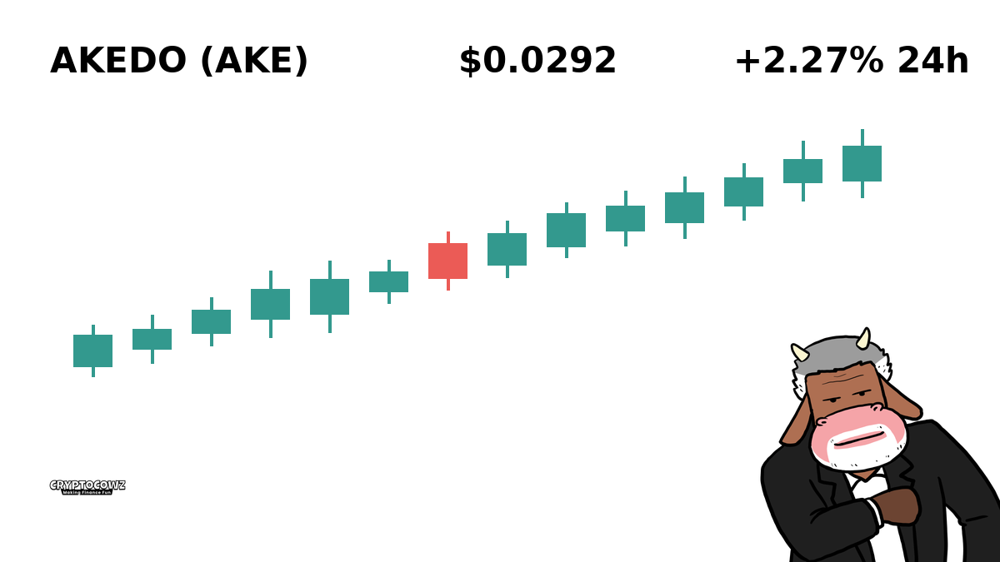
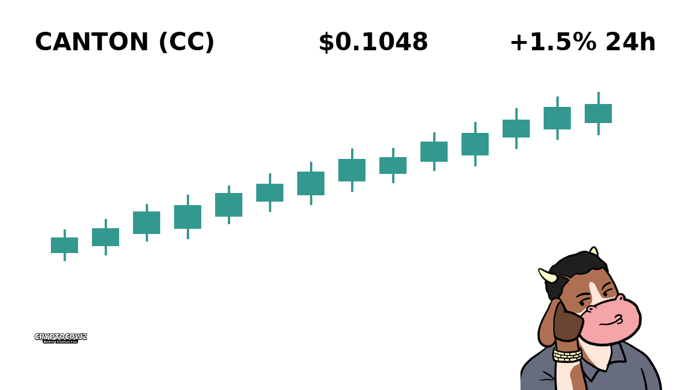
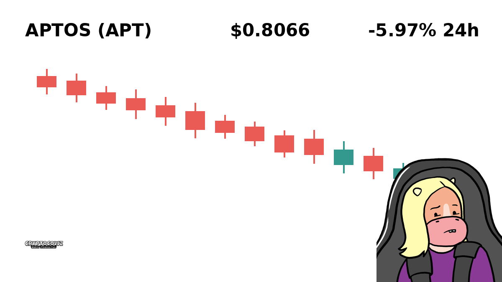

# Daily Top Movers: CMC Community Visuals & Posts

## 1. Bitway ($BTW) — +14.15% (PUMP)
**Cast Member:** Skip Zinfandel
**CMC Comment:** Bitway is ripping up 14% so I just leveraged my ex-wife's condo to buy more. Green candles baby, we are flying straight to Saturn!

---

## 2. Pump.fun ($PUMP) — +3.96% (PUMP)
**Cast Member:** Frank Rizzo
**CMC Comment:** It has PUMP right in the name, so you better buy it before I gotta come over there and press the button for ya.

---

## 3. PancakeSwap ($CAKE) — +3.73% (PUMP)
**Cast Member:** Sunshine Innocent Nimbus
**CMC Comment:** The sweet aroma of sugary green charts is hugging my aura today! Every little bounce brings us closer to global cosmic harmony.

---

## 4. Akedo ($AKE) — +2.27% (PUMP)
**Cast Member:** Professor Hartmut
**CMC Comment:** A 2.27% upward trajectory suggests a temporary micro-bubble of retail irrationality, which my algorithmic model will gladly harvest.

---

## 5. Canton ($CC) — +1.5% (PUMP)
**Cast Member:** Skip Zinfandel
**CMC Comment:** One point five percent in the green is all the validation I need to order bottle service on credit!

---

## 6. ​​Stable ($STABLE) — -5.23% (DUMP)
**Cast Member:** Frank Rizzo
**CMC Comment:** They named the coin STABLE and then it drops 5 percent in a day? Sounds like a scam my cousin Vinny ran back in '98.

---

## 7. Filecoin ($FIL) — -5.9% (DUMP)
**Cast Member:** Professor Hartmut
**CMC Comment:** Decentralized storage seems to be offloading its emotional baggage directly into the order book. A fascinating study in financial agony.

---

## 8. Aptos ($APT) — -5.97% (DUMP)
**Cast Member:** Sunshine Innocent Nimbus
**CMC Comment:** Aptos is just taking a gentle little nap in the red grass to cleanse its chakra, so keep holding hands while it bleeds!

---

## 9. Stacks ($STX) — -9.56% (DUMP)
**Cast Member:** Frank Rizzo
**CMC Comment:** Down almost ten percent? I have seen mob hits that left fewer bodies on the floor than this order book.

---

## 10. LayerZero ($ZRO) — -10.98% (DUMP)
**Cast Member:** Skip Zinfandel
**CMC Comment:** LayerZero is heading straight to absolute zero! Time to dump the bags, rebrand as a life coach, and catch the next wave!

---
