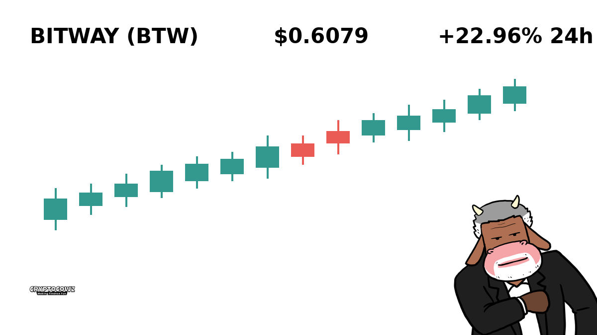
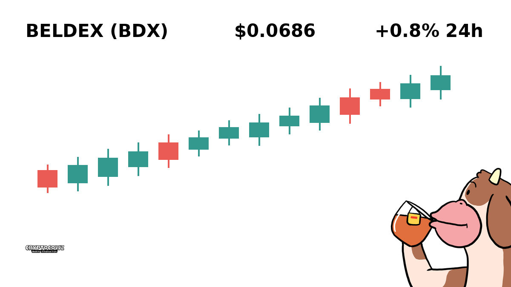
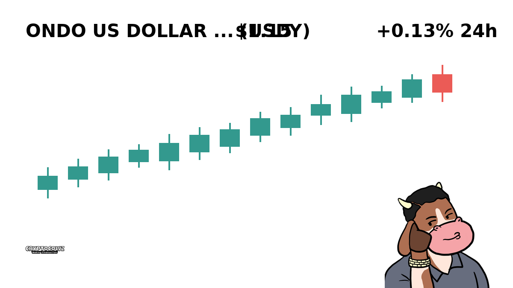
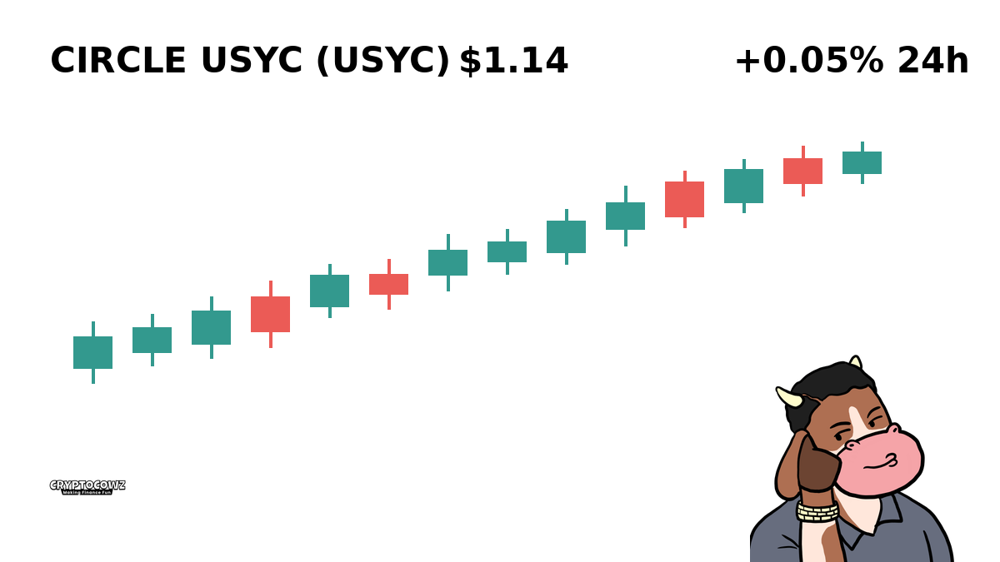
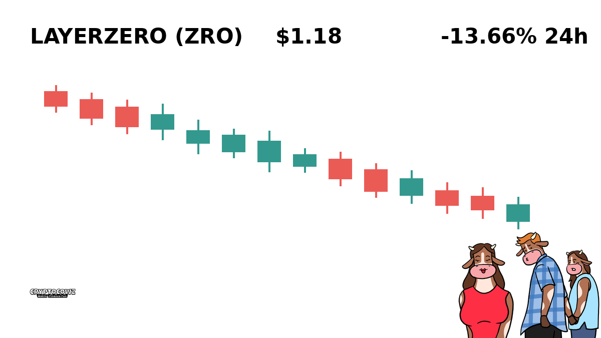
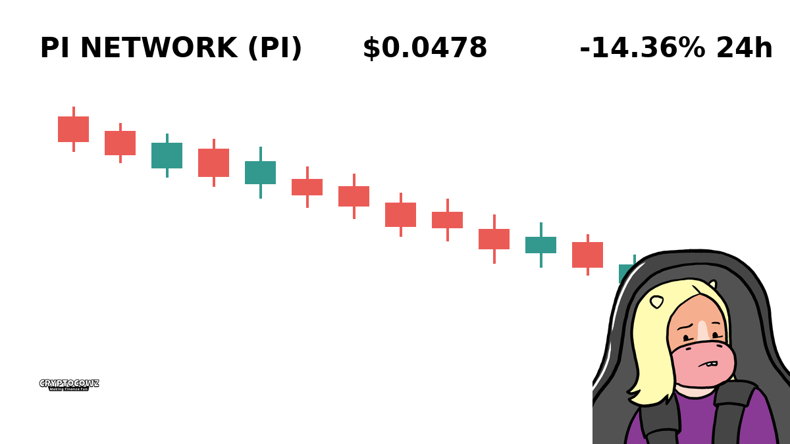
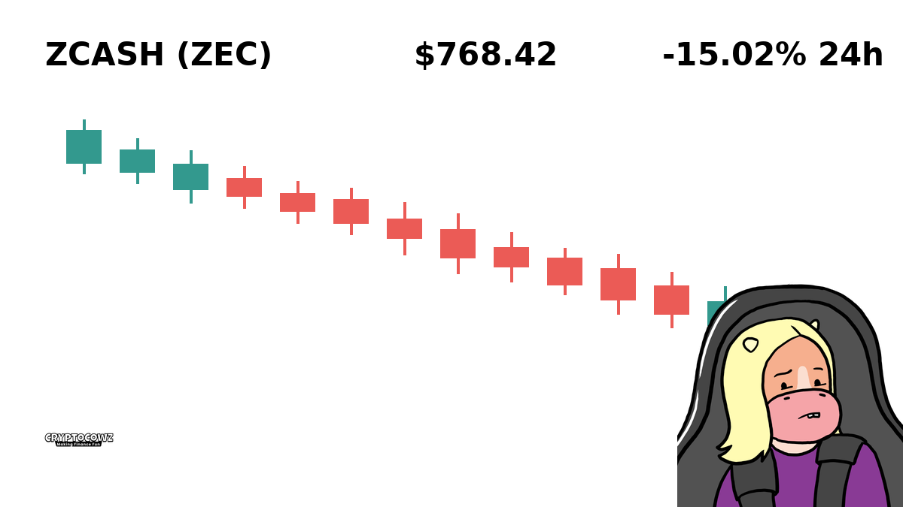
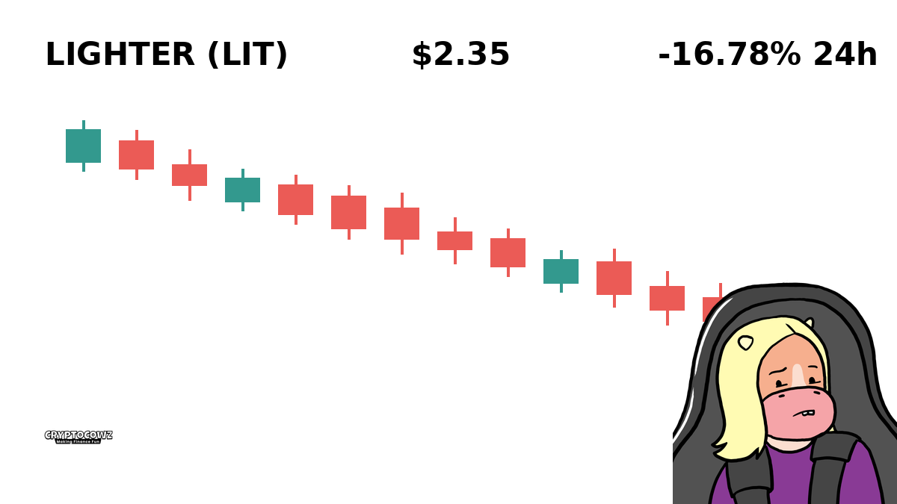

# Daily Top Movers: CMC Community Visuals & Posts

## 1. Bitway ($BTW) — +11.35% (PUMP)
**Cast Member:** Skip Zinfandel
**CMC Comment:** Up 11 percent today! I already put a deposit down on a secondhand jet ski and told my wife we are eating at the fancy steakhouse tonight.

---

## 2. MemeCore ($M) — +3.67% (PUMP)
**Cast Member:** Sunshine Innocent Nimbus
**CMC Comment:** The glorious vibrations of pure utility-free culture are lifting us higher! Who needs fundamentals when you have collective cosmic belief?

---

## 3. Beldex ($BDX) — +0.8% (PUMP)
**Cast Member:** Frank Rizzo
**CMC Comment:** Up almost a whole percent! Don't spend it all in one place, boys, we are practically Wall Street moguls now.

---

## 4. Ondo US Dollar Yield ($USDY) — +0.13% (PUMP)
**Cast Member:** Professor Hartmut
**CMC Comment:** A mathematical marvel of yield generation, soaring by a staggering zero-point-one-three percent! Economists worldwide are weeping at such raw velocity.

---

## 5. Circle USYC ($USYC) — +0.05% (PUMP)
**Cast Member:** Skip Zinfandel
**CMC Comment:** Green is green, baby! Five basis points means my early retirement just moved five minutes closer!

---

## 6. LayerZero ($ZRO) — -13.66% (DUMP)
**Cast Member:** Frank Rizzo
**CMC Comment:** LayerZero? More like Layer Hero-to-Zero! My net worth just took a dirt nap faster than a mob informant.

---

## 7. Pi Network ($PI) — -14.36% (DUMP)
**Cast Member:** Sunshine Innocent Nimbus
**CMC Comment:** The universe is merely asking us to shed our worldly attachment to zero point zero four dollars! Stay serene, fellow phone miners!

---

## 8. Zcash ($ZEC) — -15.02% (DUMP)
**Cast Member:** Professor Hartmut
**CMC Comment:** Fascinating! The privacy protocol has effectively hidden fifteen percent of its market capitalization from existing in this physical reality.

---

## 9. Lighter ($LIT) — -16.78% (DUMP)
**Cast Member:** Skip Zinfandel
**CMC Comment:** LIT is currently setting my life savings on fire! Time to turn off the monitor and pretend I never opened a trading account.

---

## 10. Rain ($RAIN) — -22.04% (DUMP)
**Cast Member:** Frank Rizzo
**CMC Comment:** It is raining pure blood on the charts and I left my umbrella in the trunk, capiche?

---
