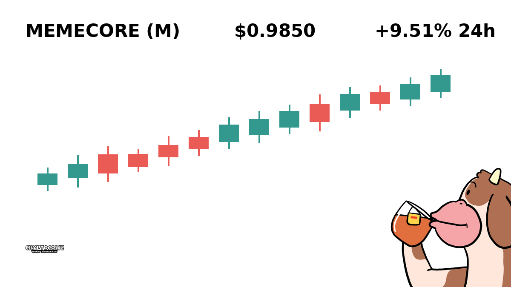
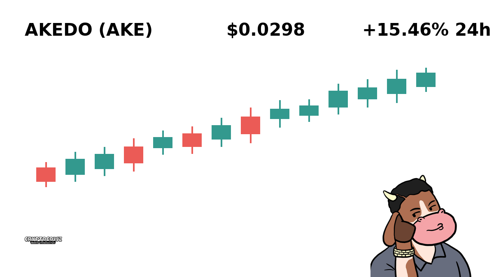
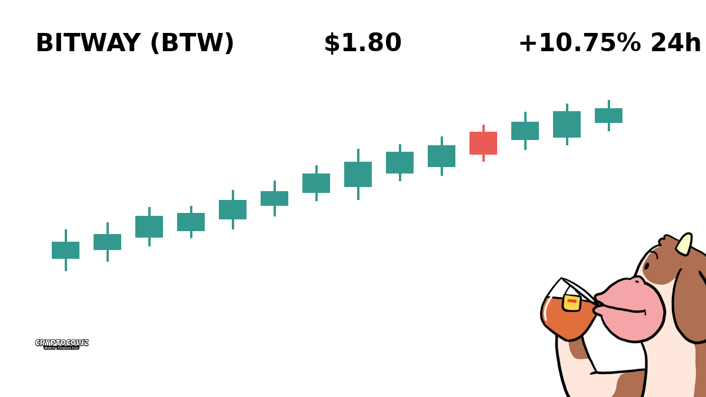
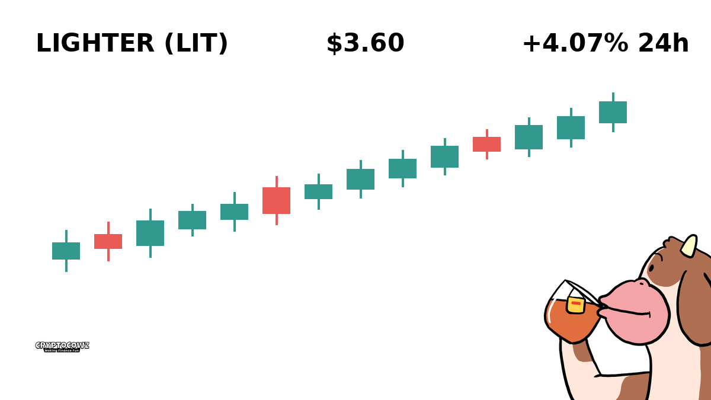
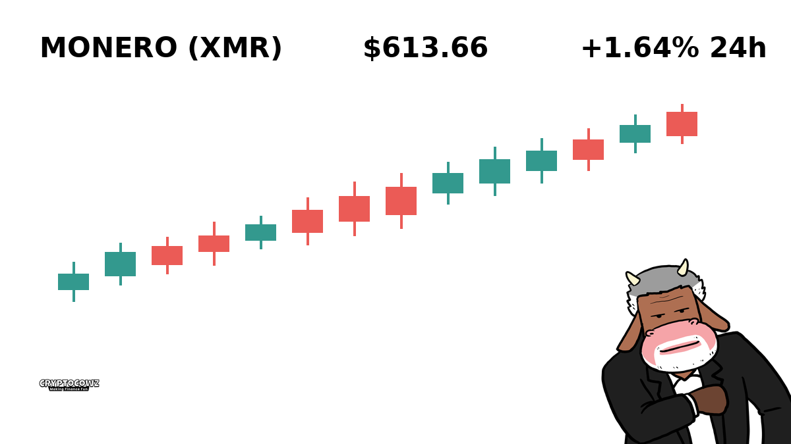
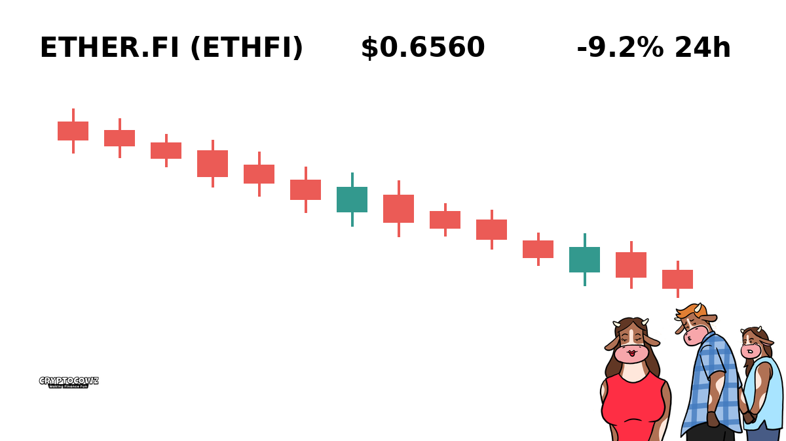
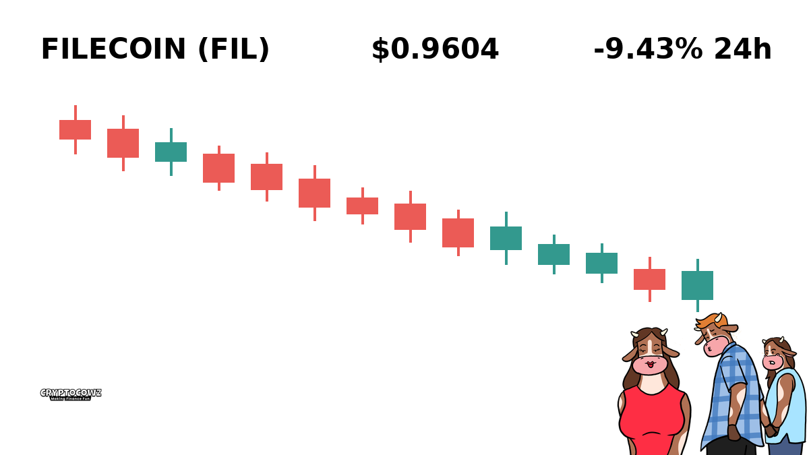
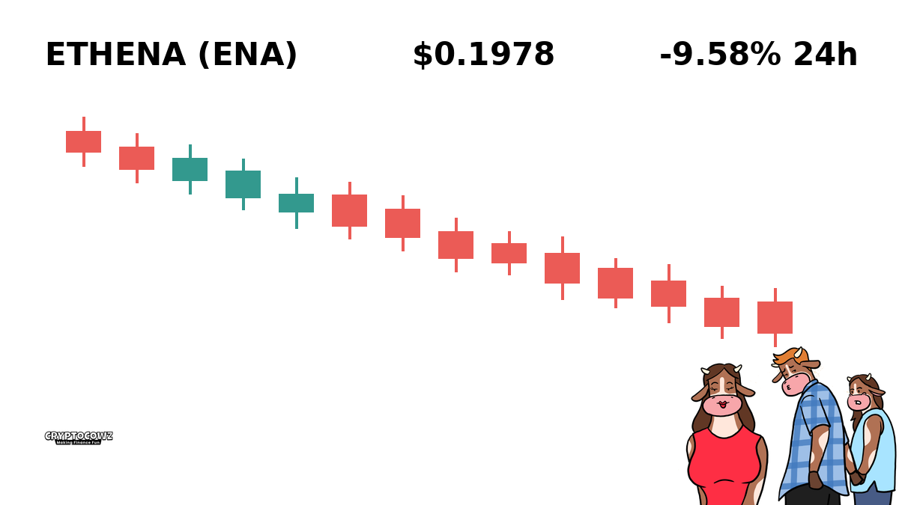
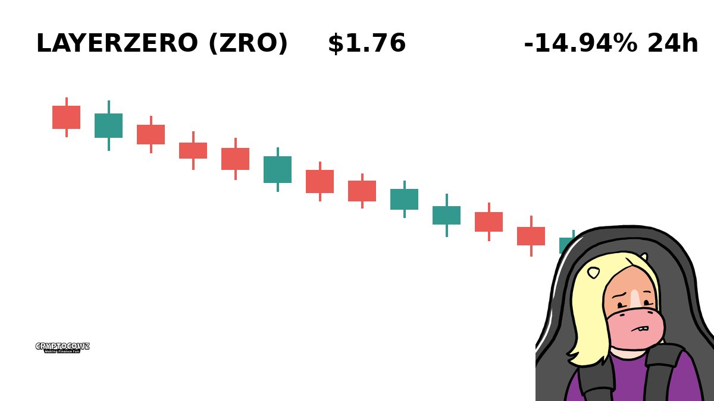

# Daily Top Movers: CMC Community Visuals & Posts

## 1. MemeCore ($M) — +24.95% (PUMP)
**Cast Member:** Skip Zinfandel
**CMC Comment:** I just leveraged my second pasture to long MemeCore, and honestly, retirement in Saint-Tropez is looking udderly guaranteed!

---

## 2. Akedo ($AKE) — +15.46% (PUMP)
**Cast Member:** Sunshine Innocent Nimbus
**CMC Comment:** The cosmic energy around Akedo is beaming green light straight into our third eye chakra today!

---

## 3. Bitway ($BTW) — +10.75% (PUMP)
**Cast Member:** Frank Rizzo
**CMC Comment:** Bitway is pumping so hard my wife stopped asking where the kids' college fund went.

---

## 4. Lighter ($LIT) — +4.07% (PUMP)
**Cast Member:** Skip Zinfandel
**CMC Comment:** Up four percent and I am already browsing luxury pontoon boats online!

---

## 5. Monero ($XMR) — +1.64% (PUMP)
**Cast Member:** Professor Hartmut
**CMC Comment:** A mathematically modest green tick, yet delightfully untraceable by tax authorities and barn accountants alike.

---

## 6. Ether.fi ($ETHFI) — -9.2% (DUMP)
**Cast Member:** Frank Rizzo
**CMC Comment:** Down nine percent? Great, now I gotta explain to my mother-in-law why restaking ruined our weekend.

---

## 7. Filecoin ($FIL) — -9.43% (DUMP)
**Cast Member:** Professor Hartmut
**CMC Comment:** Decentralized storage seems to be storing nothing but acute psychological pain for current bagholders.

---

## 8. Ethena ($ENA) — -9.58% (DUMP)
**Cast Member:** Sunshine Innocent Nimbus
**CMC Comment:** Do not panic over the red candles, the universe is simply cleansing our portfolios of material attachment!

---

## 9. Stacks ($STX) — -9.77% (DUMP)
**Cast Member:** Frank Rizzo
**CMC Comment:** Stacks is stacking nothing but pure disappointment today. My portfolio is bleeding like a stuck pig.

---

## 10. LayerZero ($ZRO) — -14.94% (DUMP)
**Cast Member:** Skip Zinfandel
**CMC Comment:** LayerZero? More like Layer Hero-to-Zero, I am currently drafting a letter to my landlord asking for a grace decade.

---
