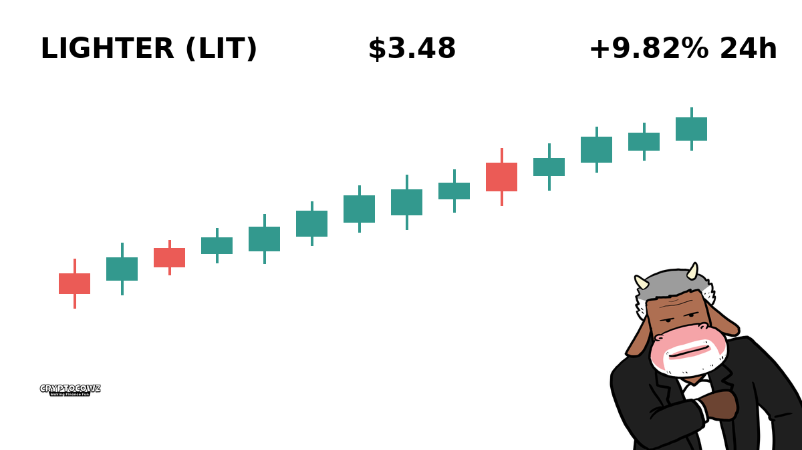
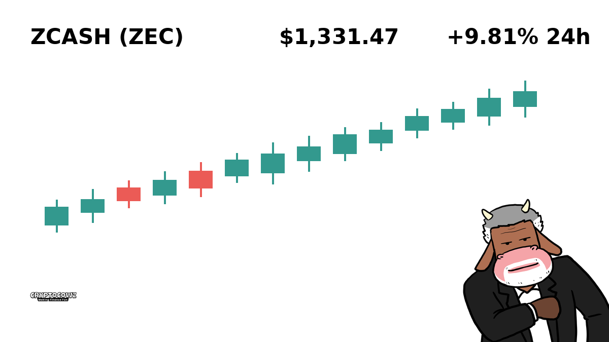
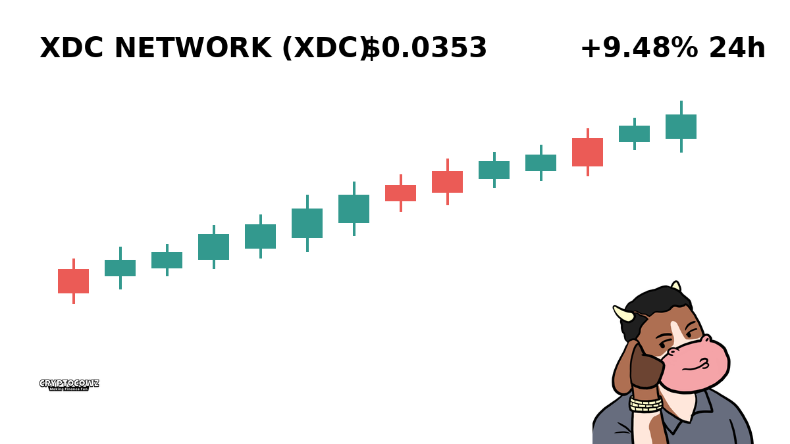
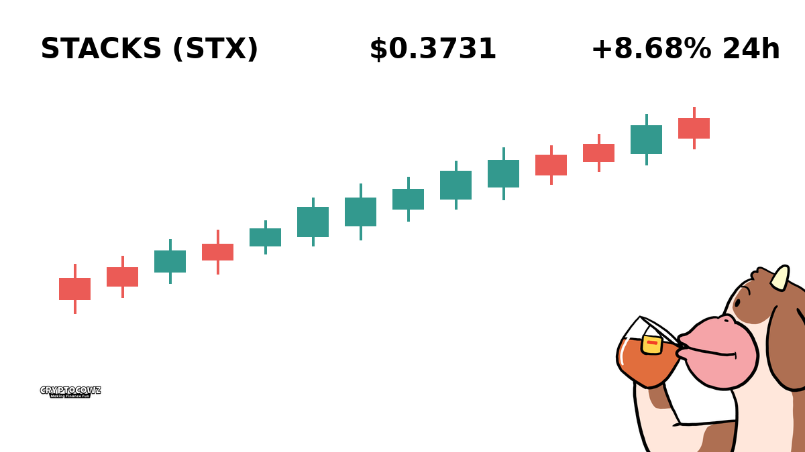
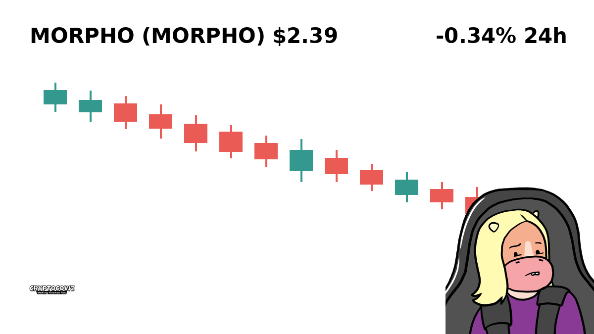
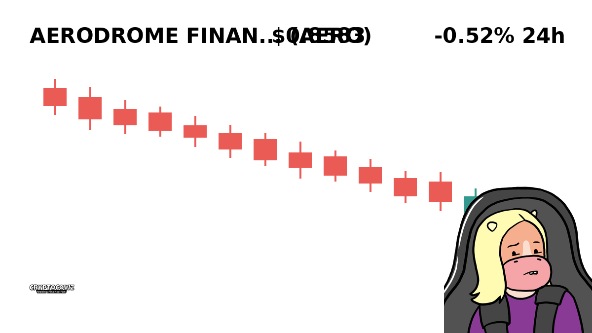
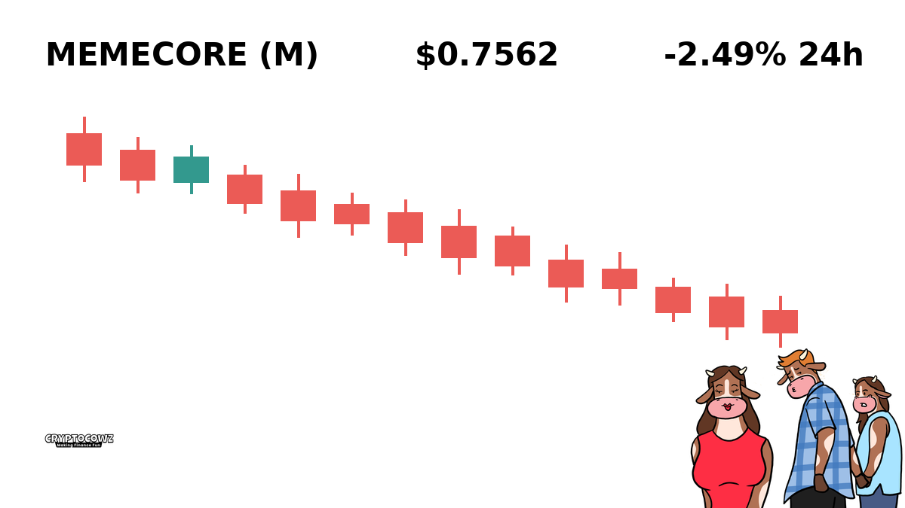
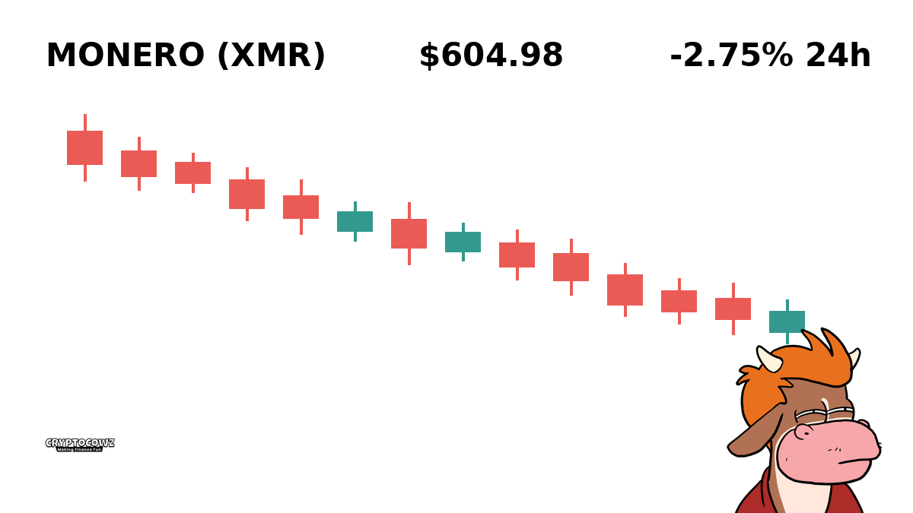

# Daily Top Movers: CMC Community Visuals & Posts

## 1. Ethena ($ENA) — +13.57% (PUMP)
**Cast Member:** Skip Zinfandel
**CMC Comment:** Just refinanced my barn to ape into Ethena because yield is a lifestyle, not a metric. Green candles do not lie, but my accountant definitely will.

---

## 2. Lighter ($LIT) — +9.82% (PUMP)
**Cast Member:** Frank Rizzo
**CMC Comment:** Lighter is sparking up again and I am already measuring my second yacht. Buy now or cry later when I buy your neighborhood!

---

## 3. Zcash ($ZEC) — +9.81% (PUMP)
**Cast Member:** Professor Hartmut
**CMC Comment:** My algorithmic models predicted Zcash privacy gains, though my colleagues insist it is purely statistical noise. Either way, green charts correlate strongly with my immediate happiness.

---

## 4. XDC Network ($XDC) — +9.48% (PUMP)
**Cast Member:** Sunshine Innocent Nimbus
**CMC Comment:** XDC is flying to the moon on good vibes and pure stardust today! I am sending cosmic hugs to everyone who held through the dark times.

---

## 5. Stacks ($STX) — +8.68% (PUMP)
**Cast Member:** Skip Zinfandel
**CMC Comment:** Stacks is stacking gains so fast I had to order a second silk robe just to feel eligible to hold it. Bitcoin layer twos are making me dangerously wealthy!

---

## 6. Morpho ($MORPHO) — -0.34% (DUMP)
**Cast Member:** Frank Rizzo
**CMC Comment:** Down a fraction of a percent and people are already weeping in the chat. Liquidate your weak hands so real men can buy the microscopic dip!

---

## 7. Aerodrome Finance ($AERO) — -0.52% (DUMP)
**Cast Member:** Professor Hartmut
**CMC Comment:** Aerodrome experienced a minor trajectory decay of 0.52 percent. Mathematically insignificant, yet sufficient to induce existential dread in novice retail investors.

---

## 8. MemeCore ($M) — -2.49% (DUMP)
**Cast Member:** Skip Zinfandel
**CMC Comment:** MemeCore slipping a bit, but real degens know a red day is just a discount on future delusion. Holding until I own a helicopter or a cardboard box.

---

## 9. Monero ($XMR) — -2.75% (DUMP)
**Cast Member:** Frank Rizzo
**CMC Comment:** Monero is down slightly, probably because the tax man could not find the buy button. Keep dumping, losers, more ghost money for me.

---

## 10. Bitway ($BTW) — -13.05% (DUMP)
**Cast Member:** Sunshine Innocent Nimbus
**CMC Comment:** Oh dear, Bitway took a nasty little tumble today! Remember sweet spirits, money is temporary but cosmic karma is forever, so hold those heavy bags with love!

---
