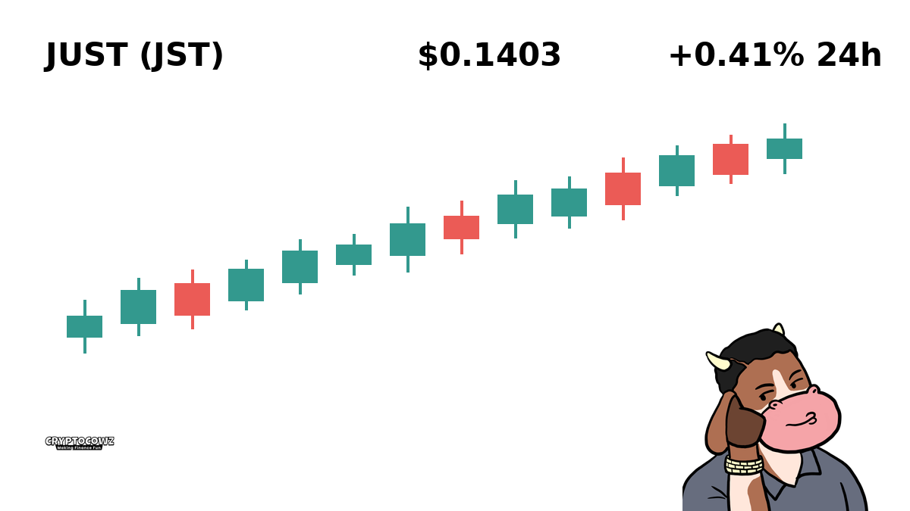
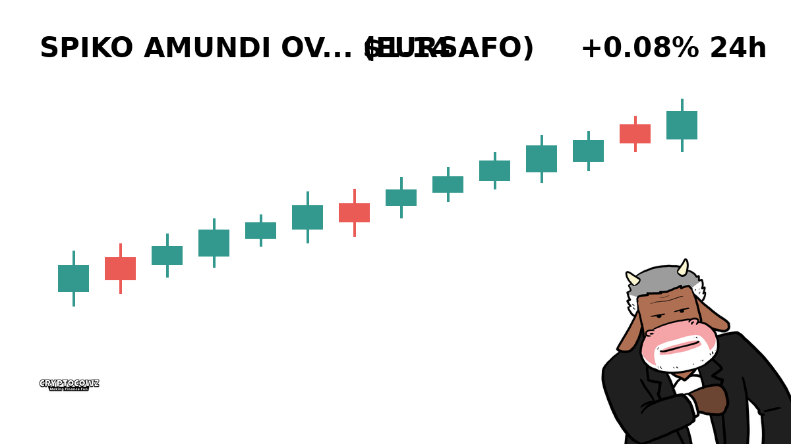
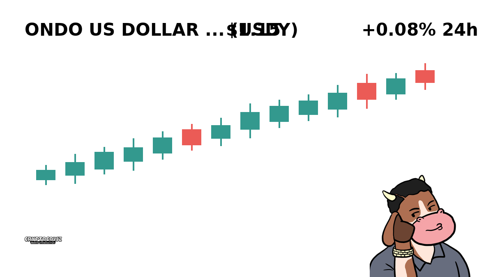
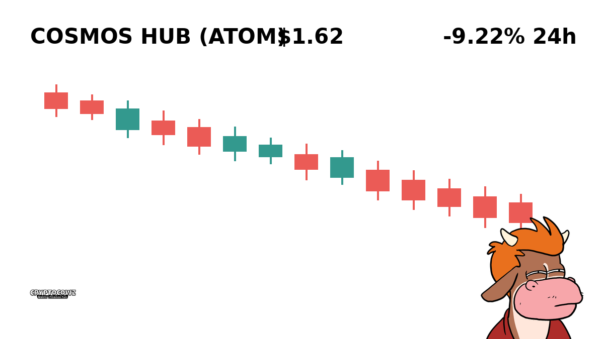
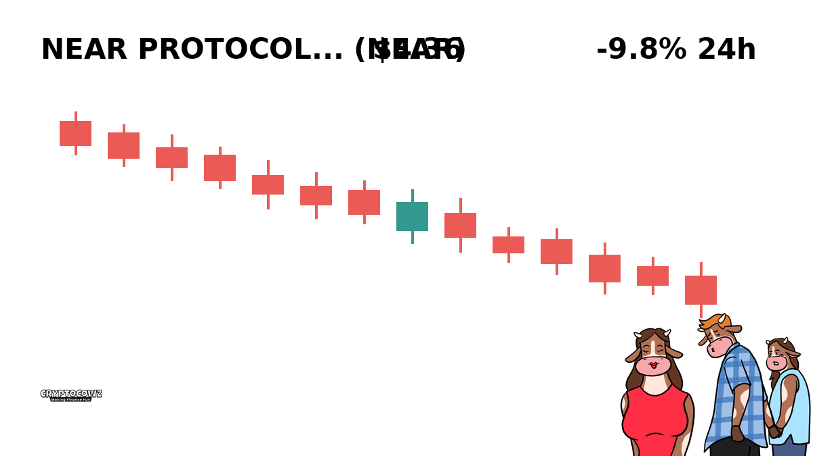
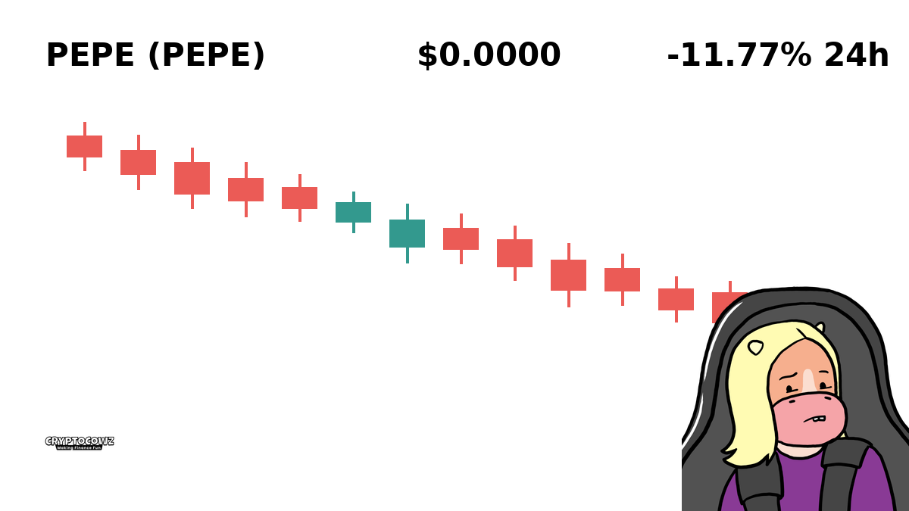
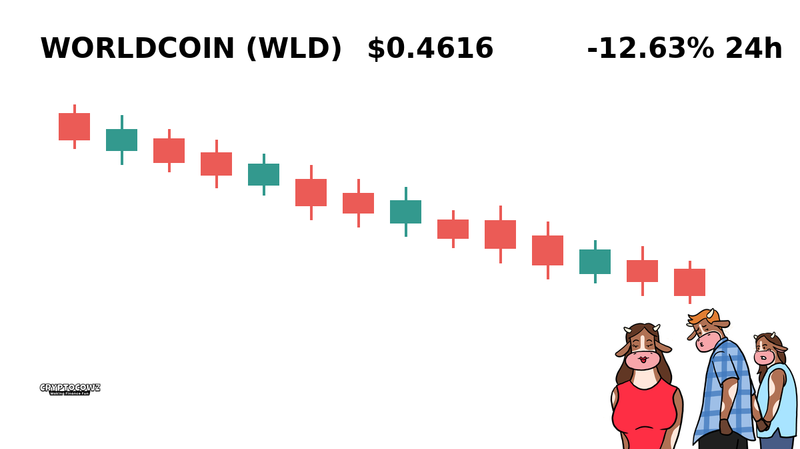
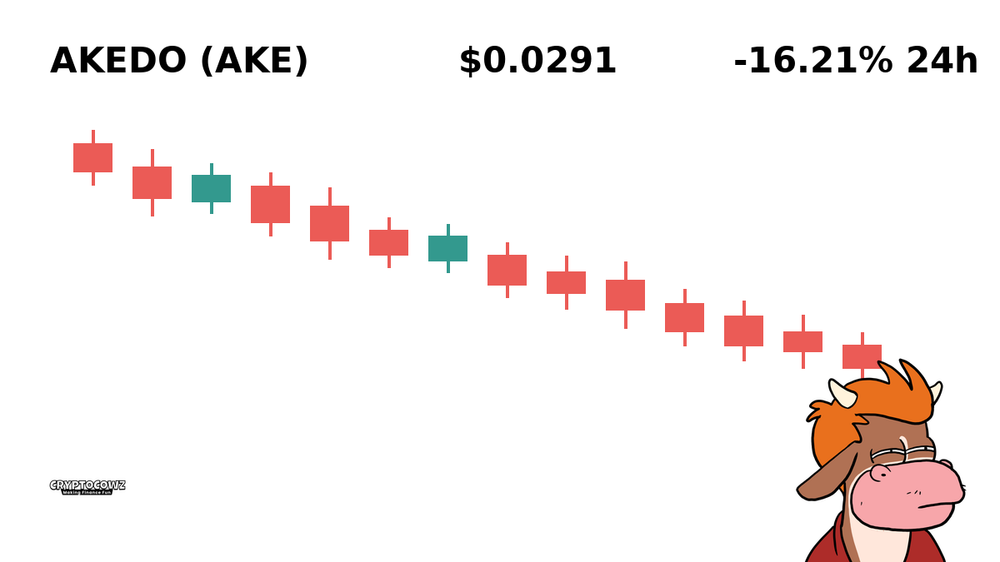

# Daily Top Movers: CMC Community Visuals & Posts

## 1. MemeCore ($M) — +9.51% (PUMP)
**Cast Member:** Skip Zinfandel
**CMC Comment:** Up almost ten percent on pure, unadulterated vibes! I have already quit my day job and leased a second jet ski.

---

## 2. Bitway ($BTW) — +2.38% (PUMP)
**Cast Member:** Frank Rizzo
**CMC Comment:** A green day is a green day, pal, even if it barely covers my morning coffee. Upward chart means we eat steak tonight!

---

## 3. JUST ($JST) — +0.41% (PUMP)
**Cast Member:** Sunshine Innocent Nimbus
**CMC Comment:** A zero point four percent pump is nature's gentle whisper that financial freedom is blossoming! Every tiny step brings us closer to the moon pasture.

---

## 4. Spiko Amundi Overnight Swap Fund (EUR) ($EURSAFO) — +0.08% (PUMP)
**Cast Member:** Professor Hartmut
**CMC Comment:** Fascinating, a 0.08% surge in institutional yield derivatives. The sheer velocity of this gain is practically quantum in nature.

---

## 5. Ondo US Dollar Yield ($USDY) — +0.08% (PUMP)
**Cast Member:** Skip Zinfandel
**CMC Comment:** Look at that massive decimal move! Time to pop the cheap champagne and pretend we understand global yields.

---

## 6. Cosmos Hub ($ATOM) — -9.22% (DUMP)
**Cast Member:** Frank Rizzo
**CMC Comment:** The cosmos is expanding, but my portfolio is shrinking into a black hole. Time to sell the kid's college fund to average down!

---

## 7. NEAR Protocol ($NEAR) — -9.8% (DUMP)
**Cast Member:** Sunshine Innocent Nimbus
**CMC Comment:** The universe is just resetting NEAR's energy so it can grow stronger later. Please ignore the crying sounds coming from my wallet.

---

## 8. Pepe ($PEPE) — -11.77% (DUMP)
**Cast Member:** Professor Hartmut
**CMC Comment:** Empirically speaking, amphibian-based assets exhibit extreme volatility during liquidity drains. The statistical probability of bagholding is now nearing 100%.

---

## 9. Worldcoin ($WLD) — -12.63% (DUMP)
**Cast Member:** Skip Zinfandel
**CMC Comment:** I scanned my eyeballs for this coin and all I got was a twelve percent loss and a blurry retina.

---

## 10. Akedo ($AKE) — -16.21% (DUMP)
**Cast Member:** Frank Rizzo
**CMC Comment:** Down sixteen percent faster than a greasy anvil dropped off a roof. Downside momentum is the only thing working around here!

---
