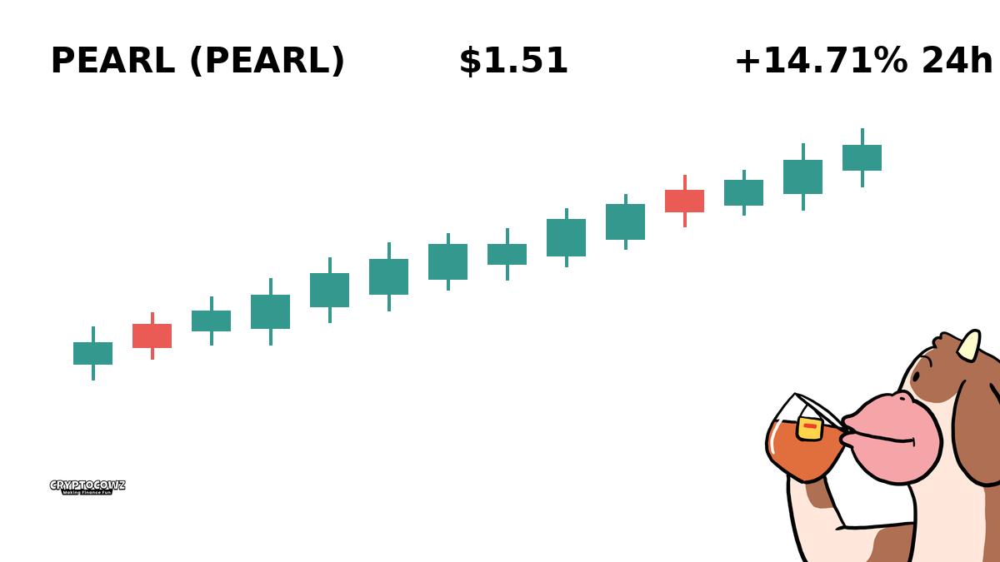
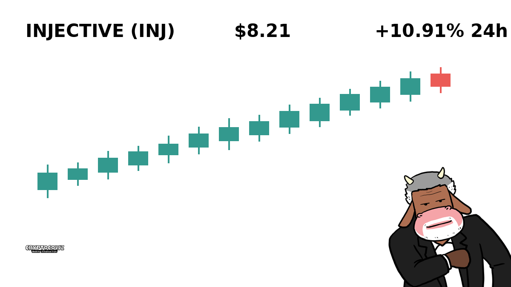
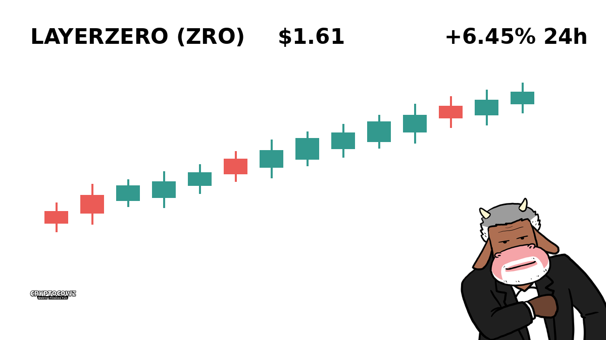
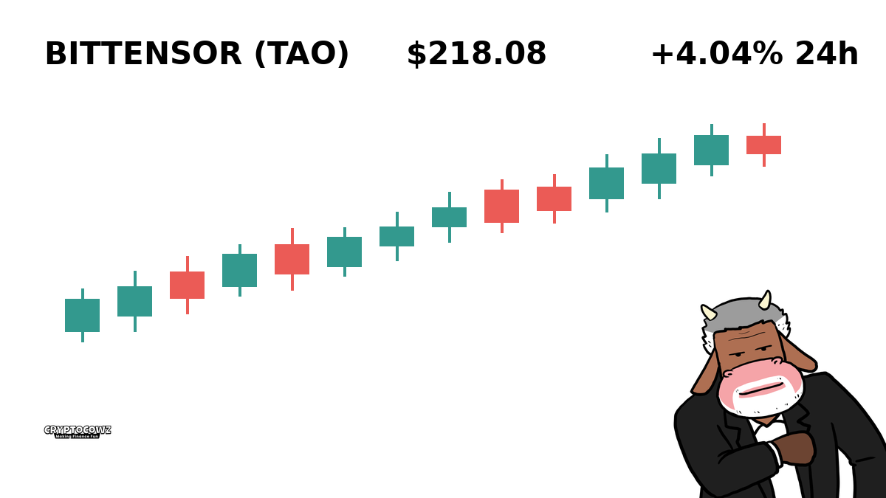
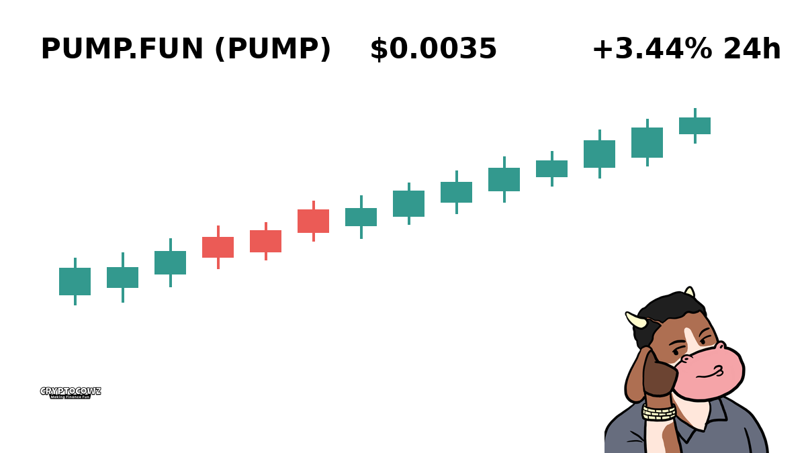
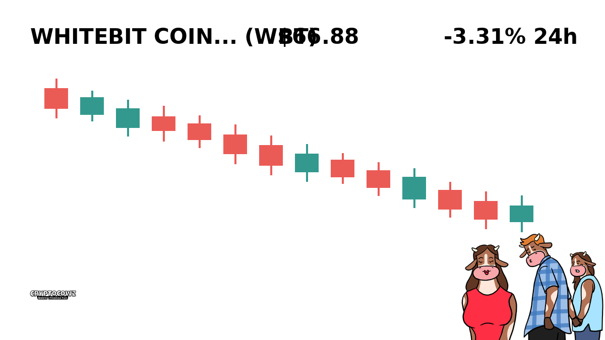
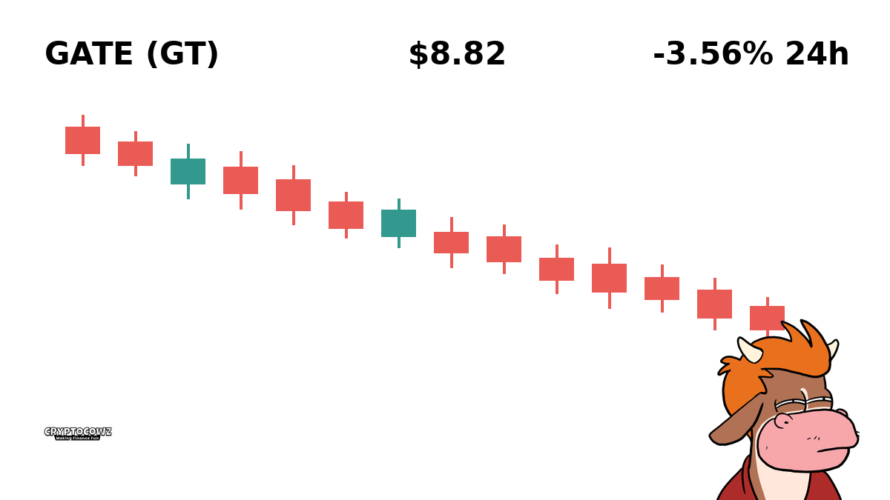
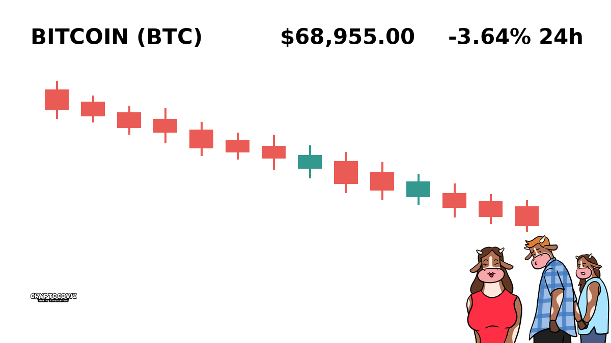
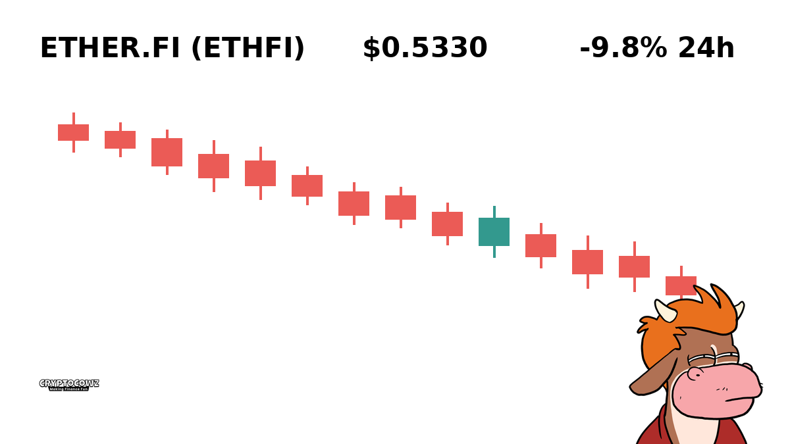

# Daily Top Movers: CMC Community Visuals & Posts

## 1. Pearl ($PEARL) — +14.71% (PUMP)
**Cast Member:** Frank Rizzo
**CMC Comment:** Clamming up was for broke losers anyway! PEARL is pumping, so I am ordering raw oyster platters for the entire pasture.

---

## 2. Injective ($INJ) — +10.91% (PUMP)
**Cast Member:** Sunshine Innocent Nimbus
**CMC Comment:** Injective is injecting pure cosmic sunshine into my wallet today! I can feel the financial chakras aligning perfectly.

---

## 3. LayerZero ($ZRO) — +6.45% (PUMP)
**Cast Member:** Professor Hartmut
**CMC Comment:** LayerZero's cross-chain protocol is demonstrating statistically anomalous upward velocity. Mathematically speaking, we are moonbound.

---

## 4. Bittensor ($TAO) — +4.04% (PUMP)
**Cast Member:** Skip Zinfandel
**CMC Comment:** Decentralized AI? Bro, I do not even know what that means, but my chart says TAO is printing green candle magic.

---

## 5. Pump.fun ($PUMP) — +3.44% (PUMP)
**Cast Member:** Frank Rizzo
**CMC Comment:** It is literally called PUMP, what else did you expect? I just mortgaged the barn to double down.

---

## 6. WhiteBIT Coin ($WBT) — -3.31% (DUMP)
**Cast Member:** Professor Hartmut
**CMC Comment:** A minor mathematical regression in WhiteBIT's valuation. Please remind me to calculate the precise threshold of cope required to hold this bag.

---

## 7. Gate ($GT) — -3.56% (DUMP)
**Cast Member:** Skip Zinfandel
**CMC Comment:** Gate is taking a little dive, but a real bull just buys the dip and pretends he did not check his portfolio today.

---

## 8. Bitcoin ($BTC) — -3.64% (DUMP)
**Cast Member:** Frank Rizzo
**CMC Comment:** Bitcoin dips three percent and suddenly everyone is crying into their cereal. Soft! Real bulls chew straight through the pain.

---

## 9. Ether.fi ($ETHFI) — -7.04% (DUMP)
**Cast Member:** Sunshine Innocent Nimbus
**CMC Comment:** The universe is testing our spiritual resolve with this ETHFI dip. I will manifest a green candle through deep meditation.

---

## 10. Bitway ($BTW) — -20.67% (DUMP)
**Cast Member:** Professor Hartmut
**CMC Comment:** A twenty percent downward trajectory indicates severe liquidity evaporation. If you hold Bitway, your portfolio has entered a financial black hole.

---
