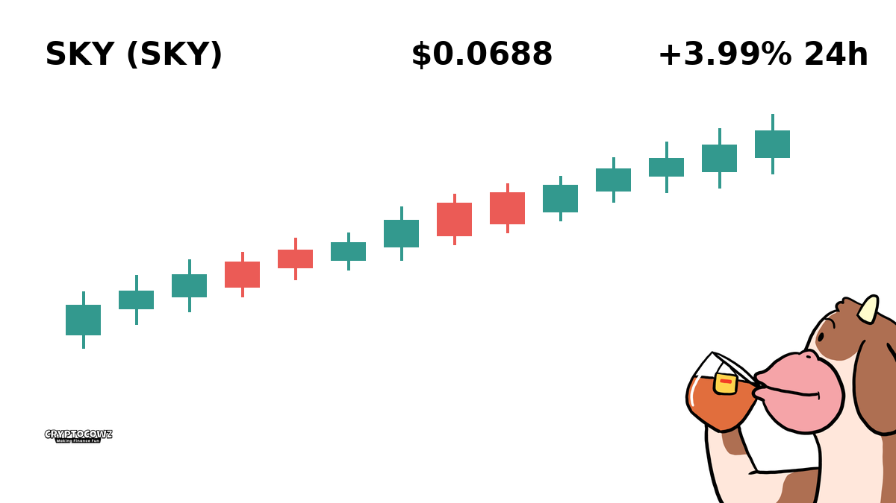
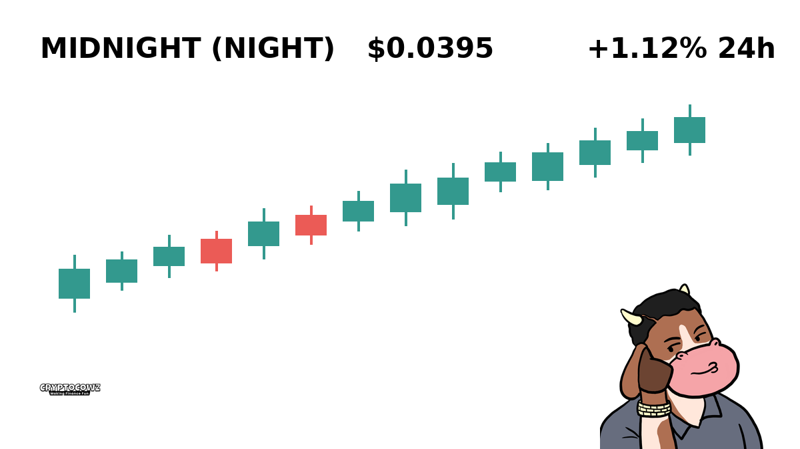
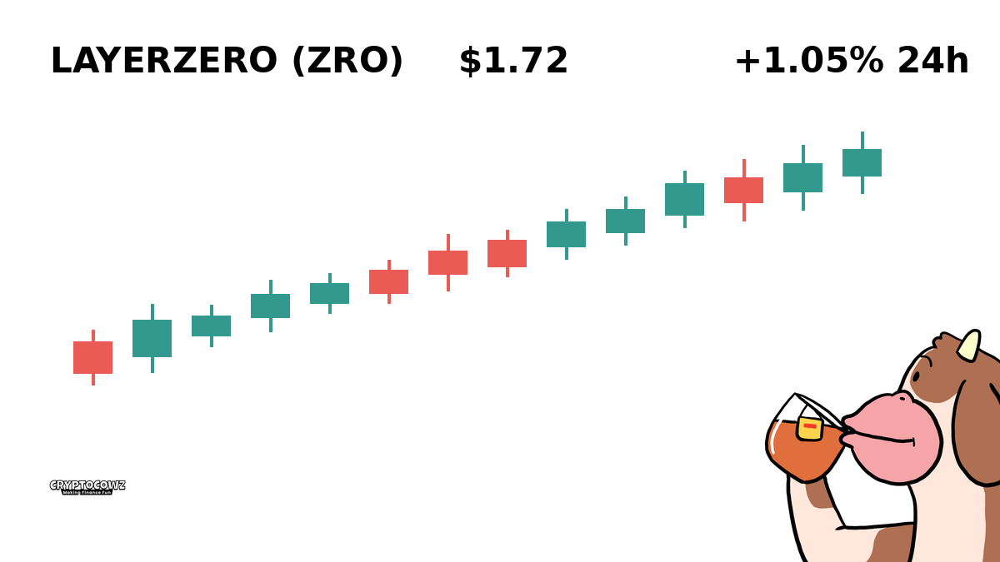
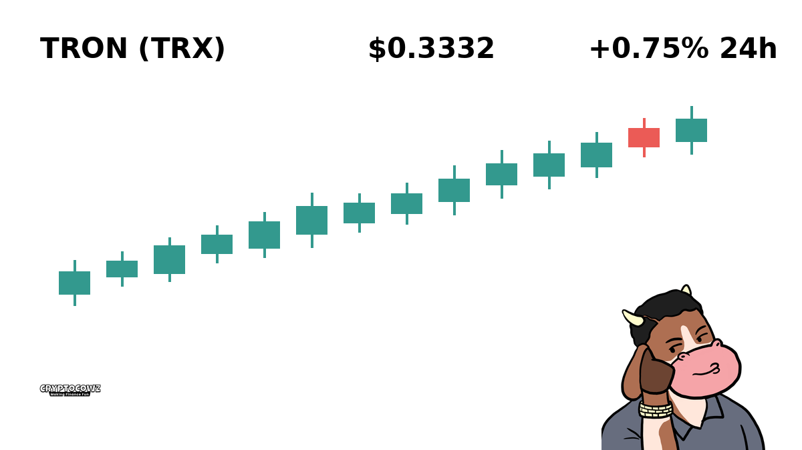
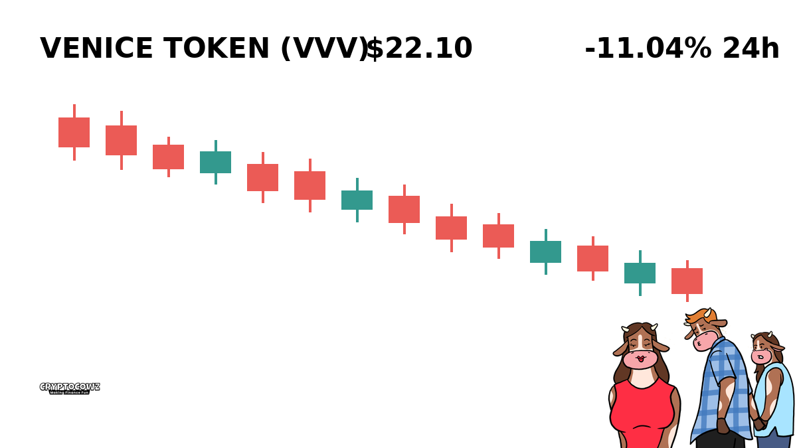
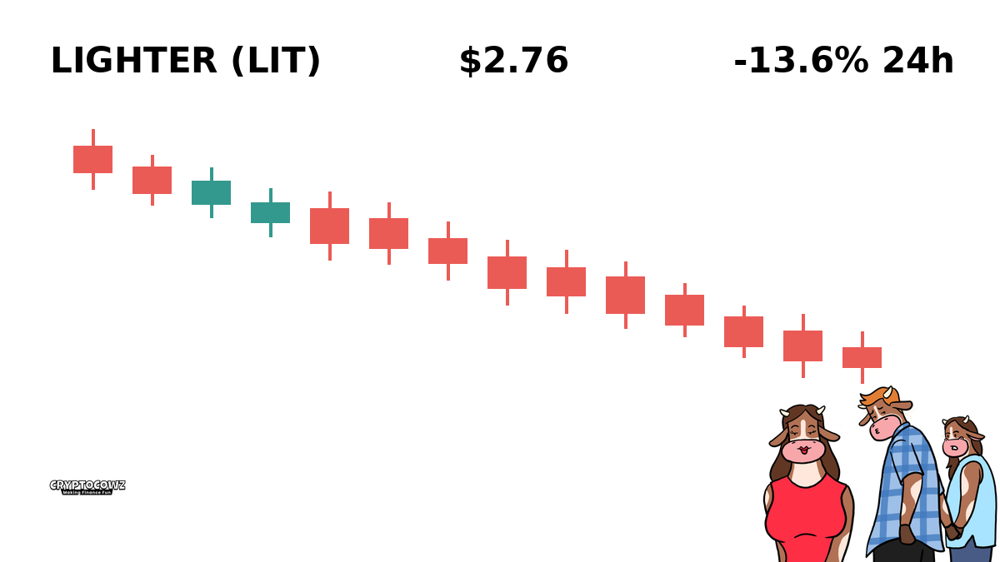

# Daily Top Movers: CMC Community Visuals & Posts

## 1. Sky ($SKY) — +3.99% (PUMP)
**Cast Member:** Skip Zinfandel
**CMC Comment:** Up nearly 4% and I'm already ordering a custom leather jacket to match the trajectory. The sky is literally the limit, or at least my credit line is!

---

## 2. Midnight ($NIGHT) — +1.12% (PUMP)
**Cast Member:** Sunshine Innocent Nimbus
**CMC Comment:** Up 1.12% into the magical night! The stars are aligning for pure organic cosmic gains and the baseline energy feels super dreamy!

---

## 3. LayerZero ($ZRO) — +1.05% (PUMP)
**Cast Member:** Frank Rizzo
**CMC Comment:** LayerZero up one percent? Hey, a win's a win pal, I'm buying the whole diner coffee for everyone on my tab!

---

## 4. TRON ($TRX) — +0.75% (PUMP)
**Cast Member:** Professor Hartmut
**CMC Comment:** Statistically speaking, a 0.75% increase in TRON merely demonstrates micro-velocity stability, but the retail herd insists on calling it a parabolic moonshot.

---

## 5. Bitcoin Cash ($BCH) — +0.32% (PUMP)
**Cast Member:** Skip Zinfandel
**CMC Comment:** A solid 0.32% pump! Put on your shades folks, generational wealth isn't coming, it is already knocking gently at the door!

---

## 6. Ethena ($ENA) — -10.88% (DUMP)
**Cast Member:** Frank Rizzo
**CMC Comment:** Down almost eleven percent? Forget about it, my nephew told me this was a sure thing and now I am sleeping in my Chrysler!

---

## 7. Venice Token ($VVV) — -11.04% (DUMP)
**Cast Member:** Professor Hartmut
**CMC Comment:** The mathematical regression of Venice Token suggests the gondola is taking on heavy ballast, yet bagholders remain utterly fascinated by the descent.

---

## 8. Injective ($INJ) — -11.21% (DUMP)
**Cast Member:** Frank Rizzo
**CMC Comment:** Injective injected a giant hole straight into my kids' college fund! Who do I gotta talk to around here to reverse a blockchain transaction?!

---

## 9. Lighter ($LIT) — -13.6% (DUMP)
**Cast Member:** Sunshine Innocent Nimbus
**CMC Comment:** Oh dear, Lighter got extinguished super fast! Sending gentle soothing vibrations to everyone currently holding these heavy charred bags!

---

## 10. Bitway ($BTW) — -23.61% (DUMP)
**Cast Member:** Skip Zinfandel
**CMC Comment:** Down 23%? By the way, that's just a tactical flash sale before we hit intergalactic valuation! Buy the dip, baby!

---
