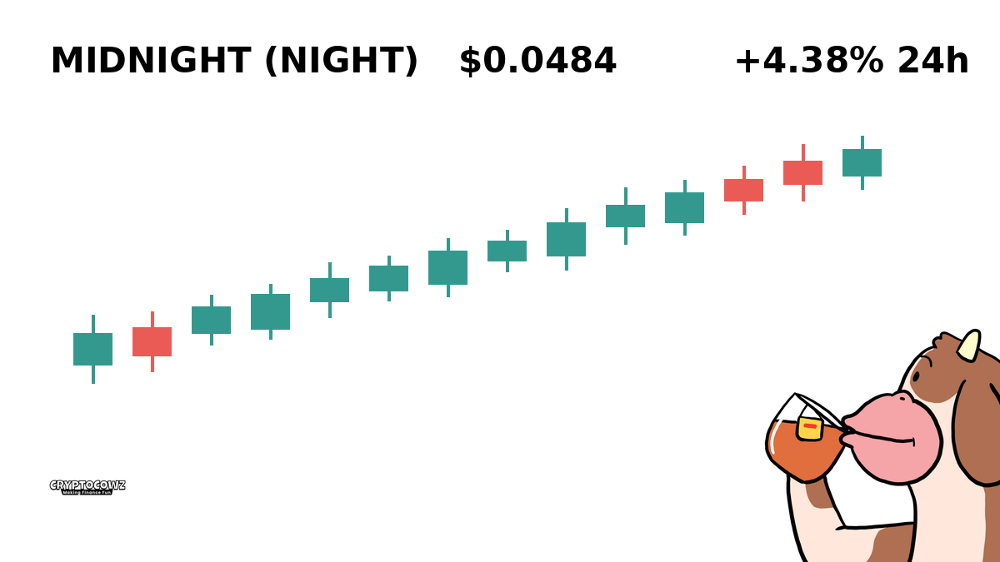
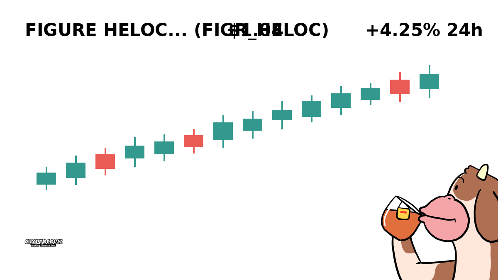
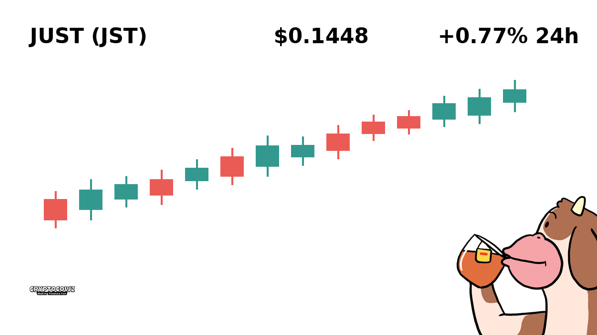
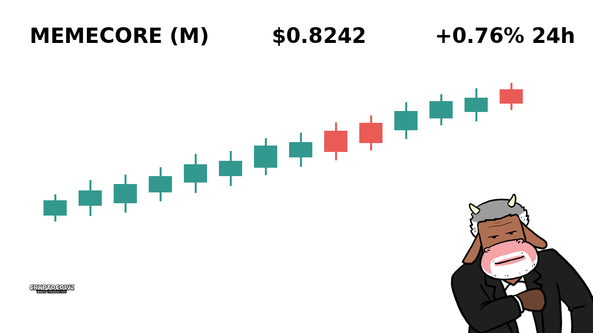
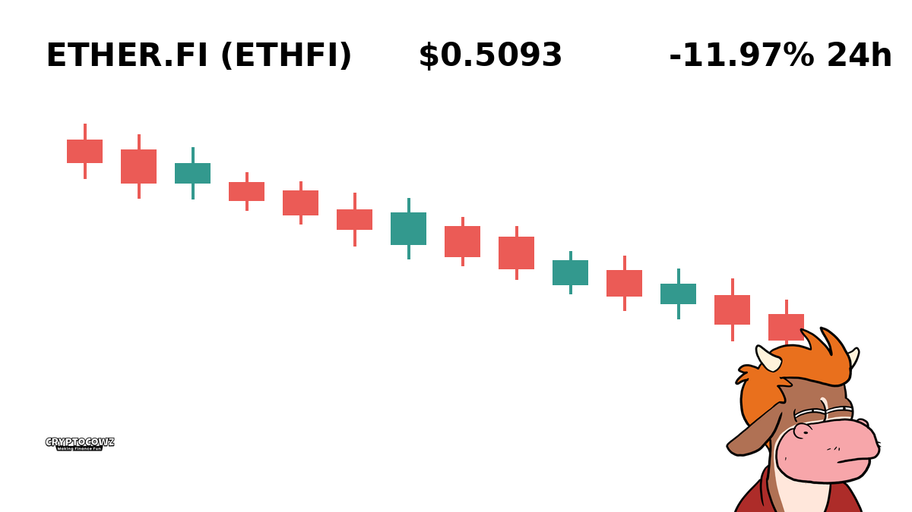
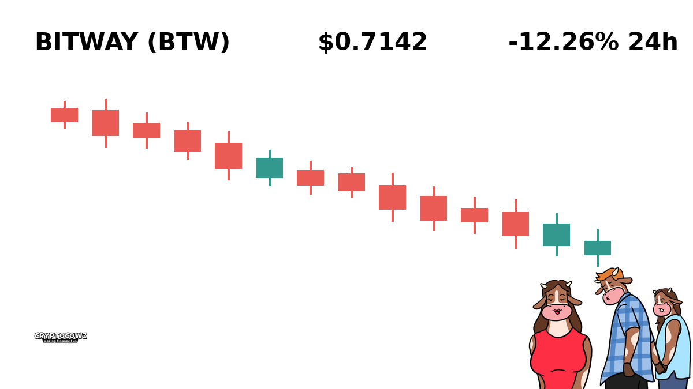

# Daily Top Movers: CMC Community Visuals & Posts

## 1. Pieverse ($PIEVERSE) — +9.88% (PUMP)
**Cast Member:** Skip Zinfandel
**CMC Comment:** Up almost 10 percent because baking fake digital pastries is clearly the backbone of the new global economy. I'm taking a slice straight to the bank before the crust burns!

---

## 2. Midnight ($NIGHT) — +4.38% (PUMP)
**Cast Member:** Sunshine Innocent Nimbus
**CMC Comment:** Midnight is creeping up over 4 percent! The cosmic stars are aligned, sweet beans, and the universe is giving us a tiny cozy bedtime treat.

---

## 3. Figure Heloc ($FIGR_HELOC) — +4.25% (PUMP)
**Cast Member:** Frank Rizzo
**CMC Comment:** Taking out home equity on a blockchain to pump 4 percent? That's the kind of high-stakes degenerateness I can respect, pal.

---

## 4. JUST ($JST) — +0.77% (PUMP)
**Cast Member:** Professor Hartmut
**CMC Comment:** A modest 0.77 percent gain... mathematically speaking, this is less of a bull rally and more of a financial dead-cat twitch.

---

## 5. MemeCore ($M) — +0.76% (PUMP)
**Cast Member:** Skip Zinfandel
**CMC Comment:** Up 0.76 percent! MemeCore is proving that literal garbage can hold value for at least three consecutive minutes. We are so back!

---

## 6. Ethena ($ENA) — -11.8% (DUMP)
**Cast Member:** Frank Rizzo
**CMC Comment:** Down nearly 12 percent? Looks like Ethena's delta-neutral strategy forgot the part where the line isn't supposed to fall off a cliff.

---

## 7. Ether.fi ($ETHFI) — -11.97% (DUMP)
**Cast Member:** Professor Hartmut
**CMC Comment:** Restaking your collateral into a 12 percent loss demonstrates a complete breakdown in economic survival instinct. Fascinating study of human error.

---

## 8. Bitway ($BTW) — -12.26% (DUMP)
**Cast Member:** Sunshine Innocent Nimbus
**CMC Comment:** Oh no, Bitway lost over 12 percent! But money is just energy returning to the cosmos, so really, everyone is just sharing the love.

---

## 9. Uniswap ($UNI) — -12.74% (DUMP)
**Cast Member:** Skip Zinfandel
**CMC Comment:** Down 12.74 percent! Uniswap liquidity providers are currently adding their tears directly into the ETH-UNI pool.

---

## 10. Pump.fun ($PUMP) — -13.08% (DUMP)
**Cast Member:** Frank Rizzo
**CMC Comment:** A token called Pump dropping 13 percent is pure poetry. You got dumped on, kid, now go wash your heavy bags.

---
